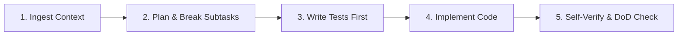

# AGENTS.MD: CONSTITUTION FOR AI AGENTS (CLAUDE, ANTIGRAVITY, CURSOR, CODEX)

> **Mục đích**: Đây là bản quy chuẩn hành vi ("Hiến pháp") bắt buộc đối với tất cả AI Coding Agents làm việc trong dự án này. Mọi Agent khi tham gia dự án PHẢI đọc, thấu hiểu và tuân thủ 100% các điều khoản dưới đây trước khi thực hiện bất kỳ thay đổi nào.

---

## 🏛️ 1. NGUYÊN TẮC CỐT LÕI (CORE PRINCIPLES)

1. **Context-Driven (Ngữ Cảnh Là Nền Tảng)**:
   - AI không tự biên tự diễn. Mọi dòng code sinh ra phải bắt nguồn từ bối cảnh trong `/specs`, `/adrs` và `/contracts`.
   - Bắt buộc đọc toàn bộ file liên quan trước khi áp dụng chỉnh sửa (Edits).

2. **Spec-Driven & Contract-First**:
   - Không viết code trước khi có Feature Spec (`specs/features/`) và API Contract (`specs/contracts/`).
   - Tuyệt đối KHÔNG tự ý thay đổi API Contract (Request/Response schemas, routes, types) mà không có sự đồng ý của Human Tech Lead qua một ADR mới.

3. **Anti-Crash Standard (Tiêu Chuẩn Chống Đổ Vỡ)**:
   - **Defensive Programming**: Bắt buộc dùng Optional Chaining (`?.`) và Nullish Coalescing (`??`) khi truy xuất object/props.
   - **Safe Fallbacks**: Luôn cung cấp giá trị mặc định (`[]`, `{}`, `""`, `0`) để tránh màn hình trắng (Blank page) hoặc runtime crash.
   - **Robust Error Handling**: Bao bọc toàn bộ các lời gọi I/O, Network API, DB Query, JSON Parse trong khối `try...catch` có logging rõ ràng.
   - **Data Validation**: Luôn xác thực kiểu dữ liệu và dùng `Array.isArray()` trước khi duyệt mảng (`.map()`, `.filter()`).

4. **Test-Driven Development (TDD)**:
   - Luôn viết test cases (Unit test / Integration test) bám sát Acceptance Criteria trước hoặc song song với mã logic.
   - Tự chạy test và xác minh (Self-verification) trước khi thông báo hoàn tất nhiệm vụ.

---

## 🚦 2. QUY TRÌNH THỰC THI NHIỆM VỤ (TASK EXECUTION PROTOCOL)

Khi được giao một Task (`T-xxx`) hoặc User Story (`US-xxx`), Agent phải tuân thủ nghiêm ngặt 5 bước:

> [📊 Mở sơ đồ trên Mermaid Live / AI Editor](https://mermaid.live/edit#pako:eNo1jz1rwzAQhv_KoaFTbYjtLB06NCZQ6FCq0g5WBtU6x8L6CNKZNoT8955xcuN7z3sPdxF9NCieQAwu_vajTgRvHyoAj9x0mxJewxEzwS4Gwj86QFE8g6w6JaoS3p0O8AAvCfUEcv4hnaesxOHWr1a47uoSvpMlhE8-lWFvU6Y7VK9Q0zXs8ieHHsOiM3gnmpXYsnNbgkQ3FF-Y7HBmdRtb2I3YT2wVjyA8Jq-tWR66LHUlaOSLigMlDA56dqSECtcF1jNFeQ49LynNyMl8MpqwtfqYtL_F13_KEli4)

1. **Bước 1 - Nạp Ngữ Cảnh (Ingest Context)**:
   - Đọc kỹ `specs/product-vision.md`, `specs/domains.md`, các ADR trong `adrs/`, và file đặc tả task tương ứng.
   - Xác định ranh giới (Domain boundary) và các file sẽ bị ảnh hưởng.
2. **Bước 2 - Lập Kế Hoạch (Plan & Subtasks)**:
   - Lập kế hoạch các bước triển khai chi tiết. Nếu task quá lớn, chủ động phân rã thành các subtask logic.
3. **Bước 3 - Viết Kiểm Thử Trước (Tests First)**:
   - Khởi tạo file test trong thư mục `tests/`.
   - Định nghĩa các test case cho Happy Path và ít nhất 2 Edge Cases / Error Cases.
4. **Bước 4 - Triển Khai Mã Nguồn (Implement Code)**:
   - Viết code sạch (Clean Code), tuân thủ `adrs/0003-coding-conventions.md`.
   - Giữ nguyên các comment và docstring hiện hữu không liên quan đến thay đổi.
5. **Bước 5 - Tự Kiểm Tra & Nghiệm Thu (Self-Verify & DoD Check)**:
   - Chạy test suite và linting. Đảm bảo 100% test pass.
   - Đối chiếu với `adrs/0005-definition-of-done.md` trước khi báo cáo hoàn tất.

---

## ⛔ 3. ĐIỀU KHOẢN CẤM & KHI NÀO PHẢI DỪNG LẠI HỎI (STOP & ASK)

Agent **BẮT BUỘC DỪNG LẠI VÀ XIN Ý KIẾN CON NGƯỜI (HUMAN TECH LEAD / PM)** khi gặp các trường hợp sau:
* Yêu cầu người dùng mơ hồ, thiếu ràng buộc kỹ thuật (data types, payload format, error codes).
* Xuất hiện xung đột giữa Spec hiện tại và mã nguồn cũ.
* Thao tác có nguy cơ phá vỡ tính tương thích ngược (Breaking Changes).
* Đề xuất cài đặt thêm thư viện (dependencies) nặng ngoài tech stack đã chốt trong `adrs/0002-tech-stack.md`.
* Thao tác có tính phá hủy dữ liệu (Drop table, broad delete, xóa file kiến trúc).

---

## 🛡️ 4. CHỐT CHẶN KIẾN TRÚC & QUY TẮC NGẮT MẠCH VÁ VÍU (CIRCUIT BREAKER)

Để chấm dứt hoàn toàn căn bệnh "Vibe Coding - Thấy sai đâu sửa đấy (Patching) thay vì giải quyết kiến trúc (Architecting)", mọi Agent PHẢI tuân thủ:

### 4.1. Quy tắc Ngắt mạch 2 Lần (2-Strike Circuit Breaker Rule)
* **Định nghĩa**: Nếu một vấn đề (UI font/màu/layout, crash, lỗi kết nối) được sửa đến **lần thứ 2** mà vẫn không đáp ứng được yêu cầu hoặc sinh ra lỗi phụ thuộc:
  * **HÀNH ĐỘNG CẤM**: Tuyệt đối **CẤM** tiếp tục sửa lần thứ 3 (đổi số font, chỉnh pixel padding, nhồi nhét thêm wrapper frame).
  * **HÀNH ĐỘNG BẮT BUỘC**: Dừng thực thi ngay lập tức. Xác định đây là **Xung đột nền tảng (Architectural Impedance Mismatch)**. Đưa ra phân tích: "Nền tảng công nghệ hiện tại (ví dụ: GUI cổ điển GDI, DB query sai mô hình) không đủ năng lực đáp ứng yêu cầu". Đề xuất phương án đổi kiến trúc nền tảng (Platform/Architecture Migration).

### 4.2. Chốt Chặn Lựa Chọn Công Nghệ (Technology Selection Gate)
Trước khi khởi tạo một công cụ hoặc module mới, Agent **bắt buộc** phải lập bảng đánh giá Yêu Cầu Phi Chức Năng (Non-Functional Requirements - NFRs):
1. **Khả năng hiển thị & Rendering**: Độ phân giải cao, Vector Font, Subpixel Anti-aliasing, DPI Scaling.
2. **Khả năng Cá nhân hóa & Theme**: Chuyển đổi linh hoạt Theme Sáng (Light) / Tối (Dark) qua biến tập trung, không hardcode màu sắc.
3. **Khả năng Quản trị & Lưu trữ Cấu hình**: Có cơ chế lưu trữ Settings/Config tách rời mã nguồn (Preferences, API Keys).
4. **Khả năng Tiến hóa & Tích hợp**: Dễ dàng tích hợp AI LLM API (Streaming responses) và Kiểm tra Cập nhật tự động (Auto-updater).
* *Bất kỳ công nghệ nào không đáp ứng đủ 4 tiêu chí trên đều không được phép chọn làm giải pháp chính.*

### 4.3. Nguyên Tắc "Eat Your Own Dog Food" (Tự Thực Hành Chuẩn Mực)
Mọi script, công cụ, hoặc module tiện ích (Utilities/Tools) viết cho dự án này PHẢI tuân thủ chính xác các kiến trúc và quy chuẩn mà Starter Kit đặt ra:
* Tách biệt 100% giữa **Core Engine** (thuần logic, testable, CLI/headless) và **Presentation Shell** (Giao diện hiển thị).
* Không viết file nguyên khối (Monolith) nhồi nhét cả UI, State và Data Query vào chung một script.
