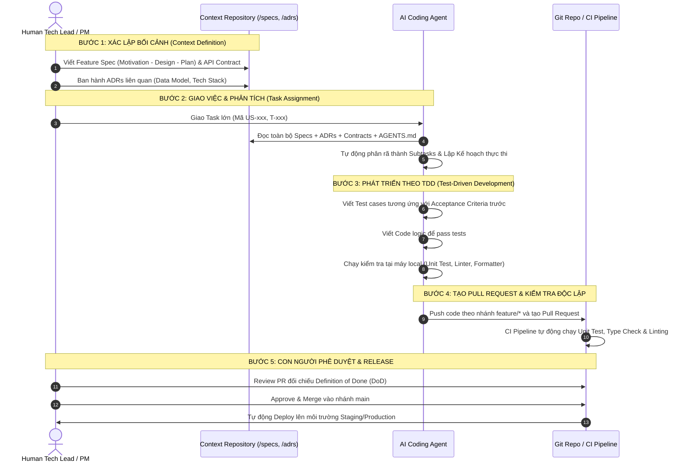

# KẾ HOẠCH TỔNG THỂ: XÂY DỰNG BỘ PROJECT STARTER KIT PHÁT TRIỂN PHẦN MỀM VỚI AI (HUMAN + MULTI-AGENT COLLABORATION)

> **Mục tiêu**: Xây dựng bộ khung chuẩn hóa (Universal Project Starter Kit / Delivery Framework) ứng dụng mô hình cộng tác giữa **Đội ngũ Kỹ sư (Human)** và **Hệ thống Trợ lý Lập trình AI (Multi-Agent: Claude Code, Antigravity, Cursor, Codex...)**. Khung làm việc này mang tính tổng quát, có thể áp dụng cho bất kỳ dự án phần mềm nào (Full-stack Web/Mobile, AI Agentic System, Microservices, SaaS Platform...).

---

## 📑 MỤC LỤC
1. [Bối Cảnh & Triết Lý Phát Triển (Philosophy)](#1-bối-cảnh--triết-lý-phát-triển-philosophy)
2. [Phân Định Trách Nhiệm: Con Người vs. AI Agents (RACI Matrix)](#2-phân-định-trách-nhiệm-con-người-vs-ai-agents-raci-matrix)
3. [Cấu Trúc Không Gian Ngữ Cảnh (Context-Driven Workspace)](#3-cấu-trúc-không-gian-ngữ-cảnh-context-driven-workspace)
4. [Thiết Lập Môi Trường, Công Cụ & Kỹ Năng (Setup & Tooling)](#4-thiết-lập-môi-trường-công-cụ--kỹ-năng-setup--tooling)
5. [Quy Chuẩn Hoạt Động (Rules & Guidelines)](#5-quy-chuẩn-hoạt-động-rules--guidelines)
6. [Quy Trình Triển Khai Thực Thi 5 Bước (End-to-End Workflow)](#6-quy-trình-triển-khai-thực-thi-5-bước-end-to-end-workflow)
7. [Hệ Thống Mẫu Biểu Cốt Lõi Cần Khởi Tạo (Deliverables Checklist)](#7-hệ-thống-mẫu-biểu-cốt-lõi-cần-khởi-tạo-deliverables-checklist)
8. [Tiêu Chuẩn Kiểm Định & Chống Đổ Vỡ (Anti-Crash Standards)](#8-tiêu-chuẩn-kiểm-định--chống-đổ-vỡ-anti-crash-standards)

---

## 1. BỐI CẢNH & TRIẾT LÝ PHÁT TRIỂN (PHILOSOPHY)

Trong kỷ nguyên mới của ngành kỹ thuật phần mềm (**AI-Native Software Engineering**), năng suất cá nhân tăng vọt nhờ sự hỗ trợ của các LLM và Coding Agent. Tuy nhiên:
* **"Xây túp lều $\neq$ Xây tòa nhà"**: Khi làm việc nhóm (Teamwork) và phát triển sản phẩm lớn, nếu không có kiến trúc vững chắc, AI sẽ không giúp xây nhanh hơn mà sẽ **phá vỡ hệ thống nhanh gấp nhiều lần**.
* **Bản chất của AI**: AI không có bức tranh toàn cảnh (Overall Context), AI chỉ tối ưu hóa các tác vụ cục bộ. Do đó, muốn AI sinh mã chính xác, **Con người phải cung cấp một Context hoàn hảo và nhất quán**.
* **Nguyên tắc "Outcome over Output"**: Đích đến của dự án không phải là viết ra thật nhiều dòng code hay sinh ra nhiều tính năng (Output), mà là tác động đo lường được lên bài toán kinh doanh và trải nghiệm người dùng (Outcome).

---

## 2. PHÂN ĐỊNH TRÁCH NHIỆM: CON NGƯỜI VS. AI AGENTS (RACI MATRIX)

> **Nguyên tắc cốt lõi**: *"AI nắm quyền thực thi và đề xuất giải pháp; Con người nắm giữ thẩm quyền, trách nhiệm giải trình và quyền phê duyệt cuối cùng."*

```mermaid
flowchart TD
    subgraph HumanLeadership [ĐỘI NGŨ CON NGƯỜI (Accountability & Authority)]
        PO["Product Owner (PO)<br/>Bảo vệ GIÁ TRỊ & Nghiệp vụ"]
        PM["Project Manager (PM)<br/>Bảo vệ THỜI GIAN & Kỷ luật Sprint"]
        TL["Tech Lead / Software Architect<br/>Bảo vệ KỸ THUẬT & Phê duyệt PR"]
    end

    subgraph MultiAgentSwarm [HỆ THỐNG TRỢ LÝ AI (Execution & Automation)]
        AgentArch["Architect Agent (Antigravity/Claude)<br/>Quét Context, Soạn Thảo Specs & ADRs"]
        AgentCode["Coding Agent (Claude Code/Cursor/Codex)<br/>TDD, Phân rã Subtask, Sinh mã"]
        AgentReview["Reviewer Agent (Automated CI / Quality Gate)<br/>Linting, Security Scan, Kiểm tra DoD"]
    end

    PO -->|Định hình Problem & Outcome| AgentArch
    TL -->|Thiết lập Boundary & Tech Constraints| AgentArch
    AgentArch -->|Tạo Specs & API Contracts| TL
    PM -->|Phân bổ Feature Tasks theo Sprint| AgentCode
    AgentCode -->|Đọc Context Base, Viết Test, Code| AgentReview
    AgentReview -->|Phát hiện vi phạm DoD & Lỗi cú pháp| TL
    TL -->|Code Review & Merge vào Main| PM
```

### Bảng phân định RACI chi tiết

| Hạng Mục Công Việc | Human PO | Human PM | Human Tech Lead | AI Architect Agent | AI Coding Agent | AI Reviewer Agent |
| :--- | :---: | :---: | :---: | :---: | :---: | :---: |
| **Xác định Problem & Outcome** | **A / R** | C | C | C | I | I |
| **Lập Project Charter & Phạm vi (Scope)** | **A** | **R** | C | C | I | I |
| **Soạn thảo Specs & API Contracts** | C | I | **A** | **R** | I | I |
| **Ban hành Quyết định Kiến trúc (ADR)** | I | I | **A** | **R** | I | I |
| **Quản lý Sprint Backlog & Milestones** | C | **A / R** | C | C | I | I |
| **Phân rã Subtasks & TDD Implementation** | I | I | I | C | **A / R** | I |
| **Kiểm tra Kỷ luật DoD & Linting** | I | C | C | I | C | **R** |
| **Code Review & Phê duyệt Pull Request** | I | I | **A / R** | C | I | C |
| **Triển khai Production & Release** | I | **A** | **R** | I | I | C |

*(Ghi chú: **R** - Responsible: Người trực tiếp làm | **A** - Accountable: Người chịu trách nhiệm cao nhất | **C** - Consulted: Tham vấn ý kiến | **I** - Informed: Nhận thông báo)*

---

## 3. CẤU TRÚC KHÔNG GIAN NGỮ CẢNH (CONTEXT-DRIVEN WORKSPACE)

Hệ thống repo chuẩn hoạt động như một **Nguồn Sự Thật Duy Nhất (Single Source of Truth)**. Cả con người và AI đều đọc, hiểu và cập nhật trên cùng một cấu trúc thư mục:

```
├── .antigravity/                   # Cấu hình quy chuẩn cho Antigravity & Subagents
│   ├── rules.json                  # Rules cấp độ IDE/Agent
│   └── skills/                     # Kỹ năng mở rộng (DB, Testing, Deployment)
├── .github/                        # Tự động hóa CI/CD & Mẫu cộng tác
│   ├── workflows/ci.yml            # CI Pipeline: Lint -> Test -> Build -> Quality Scan
│   └── PULL_REQUEST_TEMPLATE.md    # Khung mô tả PR bắt buộc đối chiếu DoD
├── specs/                          # Đặc tả nghiệp vụ (Spec-driven Development)
│   ├── product-vision.md           # Tầm nhìn sản phẩm, Outcome Tree, Khung Who-What-How
│   ├── domains.md                  # Bản đồ Bounded Contexts (Phân rã nghiệp vụ)
│   ├── user-roles.md               # Vai trò, phân quyền, actor matrices
│   ├── contracts/                  # API Contracts (OpenAPI 3.0, JSON Schema, Protobuf)
│   └── features/                   # Chi tiết từng Feature (Motivation - Design - Plan)
├── adrs/                           # Architecture Decision Records (Quyết định kiến trúc)
│   ├── 0001-architecture-style.md # Kiểu kiến trúc (Modular Monolith / Microservices)
│   ├── 0002-tech-stack.md          # Công nghệ: Backend, Frontend, Database, Cache
│   ├── 0003-coding-conventions.md  # Chuẩn đặt tên, xử lý lỗi, defensive programming
│   ├── 0004-test-strategy.md       # Chiến lược TDD, Unit/Integration/E2E test
│   └── 0005-definition-of-done.md  # Tiêu chuẩn hoàn thành nhiệm vụ (DoD)
├── planning/                       # Lộ trình & Quản lý tiến độ
│   ├── roadmap.md                  # Kế hoạch tổng thể và các Checkpoints
│   ├── backlog.md                  # Danh mục User Stories (US-xxx) và Tasks (T-xxx)
│   └── sprints/                    # Kế hoạch chi tiết theo từng Sprint (Sprint-01, 02...)
├── tasks/                          # Hồ sơ giao việc cho AI
│   └── templates/task-spec.md      # Khung mô tả task lớn để AI tự chia nhỏ
├── docs/                           # Tài liệu hướng dẫn kỹ thuật
│   ├── system-architecture.md      # Sơ đồ kiến trúc (C4 Model / Mermaid diagrams)
│   └── deployment-guide.md         # Quy trình triển khai Staging & Production
├── src/                            # Toàn bộ mã nguồn ứng dụng
├── tests/                          # Automated Test Suite (Unit, Integration, Contract)
├── AGENTS.md                       # "Bản hiến pháp" điều phối hành vi cho AI Agents
└── README.md                       # Hướng dẫn tổng quan dự án
```

---

## 4. THIẾT LẬP MÔI TRƯỜNG, CÔNG CỤ & KỸ NĂNG (SETUP & TOOLING)

### 4.1. Công Cụ Hỗ Trợ Đội Ngũ (Tooling Stack)
1. **Quản lý mã nguồn & Tự động hóa**: Git + GitHub (Branch protection rules, GitHub Actions).
2. **AI Coding Assistants**:
   * **Antigravity / Claude Code**: Đóng vai trò Architect & Core Implementer (tận dụng context window lớn và khả năng đọc file toàn diện).
   * **Cursor / VS Code Copilot**: Đóng vai trò Inline Autocomplete & Quick Refactor.
   * **Codex / OpenCode**: Hỗ trợ generate boilerplate, test cases nhanh chóng.
3. **Môi trường & Package**:
   * Container hóa với Docker & Docker Compose để đảm bảo môi trường dev đồng nhất giữa các máy.
   * Environment variables cô lập qua `.env` (bảo đảm không hardcode API key hoặc secrets).

### 4.2. Cấu Hình Rules & Skills Cho Agent
* **Rules File (`AGENTS.md` / `.antigravity/rules.json`)**:
  * Định hình Persona: Kỹ sư phần mềm cao cấp (Senior Staff Engineer / Architect).
  * Quy định đọc context bắt buộc trước khi chỉnh sửa file.
  * Cấm tuyệt đối việc tự ý xóa code hoặc sửa đổi API Contract mà chưa có sự đồng ý của Tech Lead.
* **Skills Cần Trang Bị Cho Agent**:
  * `schema-validator`: Kiểm tra tính toàn vẹn của JSON Schemas, OpenAPI Specs, SQL migrations.
  * `test-runner`: Khả năng chạy test tự động sau khi code để tự kiểm tra lỗi (Self-verification).
  * `git-workflow-helper`: Hỗ trợ chia nhỏ commit có ý nghĩa, tuân thủ Conventional Commits.

---

## 5. QUY CHUẨN HOẠT ĐỘNG (RULES & GUIDELINES)

### 5.1. Kỷ Luật Git & Quản Lý Nhánh (Branching Strategy)
* **Nhánh `main`**: Chỉ chứa code sẵn sàng deploy lên Production. Tuyệt đối **không push trực tiếp** lên nhánh `main`.
* **Quy ước đặt tên nhánh**:
  * Tính năng mới: `feature/{task-id}-{ten-ngan-gon}` (Ví dụ: `feature/T-004-auth-jwt`).
  * Sửa lỗi: `bugfix/{bug-id}-{ten-ngan-gon}` (Ví dụ: `bugfix/BUG-012-cors-origin`).
  * Sửa gấp production: `hotfix/{ten-loi}`.
* **Quy chuẩn Pull Request (PR)**:
  * Mỗi PR không vượt quá 400 dòng code thay đổi (để đảm bảo khả năng review chất lượng).
  * Bắt buộc có ít nhất 1 Human Reviewer (Tech Lead hoặc Peer) approve trước khi merge.
  * Tự động xóa nhánh phụ sau khi đã merge thành công.

### 5.2. Nguyên Tắc Kỹ Thuật "Anti-Crash" (The Anti-Crash Standard)
1. **Defensive Programming**: Sử dụng triệt để Optional Chaining (`?.`) và Nullish Coalescing (`??`). Luôn cung cấp giá trị mặc định an toàn (`[]`, `{}`, `""`, `0`) cho mọi hàm xử lý dữ liệu.
2. **Robust Error Handling**: Bao bọc toàn bộ các thao tác bất đồng bộ (I/O, API calls, DB queries, JSON parse) trong khối `try...catch` có logging tường minh.
3. **Data Integrity**: Xác thực kiểu dữ liệu đầu vào (Input Validation) bằng Schema (Pydantic / Zod) trước khi xử lý business logic.

---

## 6. QUY TRÌNH TRIỂN KHAI THỰC THI 5 BƯỚC (END-TO-END WORKFLOW)



---

## 7. HỆ THỐNG MẪU BIỂU CỐT LÕI CẦN KHỞI TẠO (DELIVERABLES CHECKLIST)

Khi triển khai bộ template này vào thực tế, các tệp mẫu sau sẽ được thiết lập:

- [ ] **`AGENTS.md`**: Bản "Hiến pháp" điều phối hành vi AI (Context reading protocol, plan before code, anti-crash rules).
- [ ] **Bộ 5 Mẫu ADR Chuẩn**:
  - `adrs/0001-architecture-style.md`: Hướng dẫn lựa chọn Monolith vs. Microservice.
  - `adrs/0002-tech-stack.md`: Khung lựa chọn công nghệ, ngôn ngữ, hạ tầng.
  - `adrs/0003-coding-conventions.md`: Quy ước định dạng mã nguồn và xử lý lỗi.
  - `adrs/0004-test-strategy.md`: Chiến lược kiểm thử tự động đa tầng.
  - `adrs/0005-definition-of-done.md`: Bộ tiêu chuẩn nghiệm thu trước khi merge.
- [ ] **Mẫu Feature Spec (`specs/features/template-spec.md`)**:
  - Phần 1: *Motivation* (Động lực, bài toán thực tế, Who & What).
  - Phần 2: *Design* (Sơ đồ kiến trúc, API Contract, DB Schema, Edge cases).
  - Phần 3: *Plan* (Phân rã task, Test plan, Timeline, Deployment).
- [ ] **Mẫu User Story & Backlog (`planning/backlog.md`)**: Khung quản lý công việc liên kết đa chiều `US-xxx` $\leftrightarrow$ `T-xxx`.
- [ ] **Mẫu Pull Request Template (`.github/PULL_REQUEST_TEMPLATE.md`)**: Khung checklist kiểm duyệt chất lượng mã nguồn.
- [ ] **Mẫu Sprint Retrospective (`planning/retrospective-template.md`)**: Biên bản họp cải tiến quy trình theo phương pháp `Sad - Mad - Glad`.

---

## 8. TIÊU CHUẨN KIỂM ĐỊNH & CHỐNG ĐỔ VỠ (ANTI-CRASH STANDARDS)

Mọi đóng góp từ AI Coding Agent đều phải vượt qua 4 chốt chặn kiểm định:

1. **Dependency Integrity**: Không đưa thêm các thư viện lạ hoặc phiên bản xung đột vào dự án. Ưu tiên các thư viện tiêu chuẩn, ổn định.
2. **Zero Breaking Changes**: Không sửa đổi hoặc xóa bỏ các hàm, API Contract đang có nếu chưa có sự phê duyệt qua một ADR mới.
3. **100% Test Passing**: Tất cả các test cases hiện tại và test cases mới viết phải chạy thành công trước khi tạo PR.
4. **Documentation Sync**: Bất kỳ sự thay đổi nào trong code dẫn đến thay đổi logic hoặc cấu hình môi trường đều phải cập nhật đồng thời trong tài liệu (`README.md`, `specs/contracts/`, hoặc `docs/`).

---

*Tài liệu này đóng vai trò là kim chỉ nam kiến trúc và kế hoạch hành động chính thức để xây dựng bộ Project Starter Kit.*
