<div align="center">

  

  <br />
  <br />

  [](https://github.com/Dokhacgiakhoa/Project-Starter-Kit/actions/workflows/ci.yml)
  [](LICENSE)
  [](#-kiến-trúc-hệ-thống)
  [](frontend/README.md)
  [](#-tiêu-chuẩn-anti-crash)
  [](knowledge-base/ui-ux-presets/design-archetypes-catalog.md)
  [](templates/pitch-deck/pitch-deck-template.md)

  <br />

  <h3>Khung Khởi Tạo & Quản Trị Dự Án Phần Mềm Chuẩn Quốc Tế</h3>
  <p><b>Kết hợp hài hòa giữa Thẩm quyền Lãnh đạo của Con người và Năng lực Thực thi của AI Multi-Agent (Claude Code, Antigravity, Cursor, Codex)</b></p>

  <p>
    <a href="#-hướng-dẫn-bắt-đầu-nhanh-quick-start"><b>🚀 Bắt Đầu Nhanh</b></a> •
    <a href="src/README.md"><b>🏛️ Backend Clean Architecture</b></a> •
    <a href="frontend/README.md"><b>⚡ Frontend Bulletproof React</b></a> •
    <a href="knowledge-base/ui-ux-presets/design-archetypes-catalog.md"><b>🎨 14+ UI/UX Archetypes</b></a> •
    <a href="templates/pitch-deck/pitch-deck-template.md"><b>📊 Pitch Deck Kit</b></a> •
    <a href="docs/guides/diataxis-framework-guide.md"><b>📖 Diátaxis Docs</b></a>
  </p>

</div>

---

## 💥 Vấn Đề Lớn Nhất Của Kỷ Nguyên "Vibe Coding"

Trong kỷ nguyên AI, bất kỳ ai cũng có thể gõ vài prompt để sinh ra hàng ngàn dòng code trong vài phút. Nhưng **85% các dự án làm cùng AI đều thất bại hoặc phải đập đi xây lại** vì 3 "căn bệnh tử huyệt":

1. **AI sinh code siêu nhanh nhưng không có ngữ cảnh tổng thể**: Mã nguồn chắp vá, không có ranh giới module (Spaghetti Code), gây nợ kỹ thuật trầm trọng.
2. **Crash & Màn hình trắng liên tục**: Thiếu kỹ thuật lập trình phòng vệ (Defensive Programming), ứng dụng sập ngay khi gặp dữ liệu `null/undefined`.
3. **Thất bại ở khâu Thuyết trình & Vận hành**: Đội ngũ chỉ mải mê code mà thiếu **Pitch Deck chuyên nghiệp** để gọi vốn/bảo vệ dự án, và thiếu **Hệ thống Documentation chuẩn mực** để bàn giao hay xử lý sự cố lúc 2h sáng.

> **Universal Project Starter Kit** sinh ra để giải quyết triệt để bài toán này: Biến Git Repository thành **"Một Nguồn Sự Thật Duy Nhất" (Single Source of Truth)** để con người và AI cùng phối hợp nhịp nhàng, an toàn và tốc độ.

---

## 🍱 Bento Grid: 6 Trụ Cột Sức Mạnh Cốt Lõi

<table width="100%">
  <tr>
    <td width="50%" valign="top">
      <h3>🧠 1. Context-First & Spec-Driven</h3>
      <p>AI chỉ code đúng khi có ngữ cảnh rõ ràng. Mọi tính năng đều bắt đầu từ <b>Feature Specs</b>, <b>ADRs</b> (Architecture Decision Records) và <b>API Contracts</b> đóng băng trước khi gõ dòng code đầu tiên.</p>
      <p>👉 <i>Khám phá: <a href="specs/contracts/api-contract-template.yaml">API Contract Template</a> • <a href="adrs/">Thư viện 11 ADRs</a> • <a href="AGENTS.md">Hiến pháp AGENTS.md</a></i></p>
    </td>
    <td width="50%" valign="top">
      <h3>🏛️ 2. Clean Architecture & DDD Backend</h3>
      <p>Thiết kế 4 phân tầng đồng tâm (Domain ➔ Application ➔ Infrastructure ➔ Presentation) tuân thủ nghiêm ngặt <b>Dependency Inversion Principle</b>. Core nghiệp vụ hoàn toàn độc lập với Database và UI.</p>
      <p>👉 <i>Khám phá: <a href="src/README.md">Backend Blueprint</a> • <a href="adrs/0006-clean-architecture-and-ddd.md">ADR-0006 Clean Architecture</a></i></p>
    </td>
  </tr>
  <tr>
    <td width="50%" valign="top">
      <h3>⚡ 3. Bulletproof React Frontend</h3>
      <p>Kiến trúc <b>Feature-Driven SPA</b> tốc độ cao với Vite, React 18, TypeScript Strict, Tailwind CSS, TanStack React Query, Zustand Store và Axios Interceptor tự động chuẩn hóa lỗi không để crash app.</p>
      <p>👉 <i>Khám phá: <a href="frontend/README.md">Frontend Blueprint</a> • <a href="adrs/0008-frontend-architecture.md">ADR-0008 Frontend Architecture</a></i></p>
    </td>
    <td width="50%" valign="top">
      <h3>🎨 4. 7 Vũ Trụ UI/UX & Theme Studio</h3>
      <p>Trang bị sẵn <b>14+ Style Presets kinh điển</b> (Linear Pro Max, iOS Glass, Windows XP, Cyberpunk HUD, Neubrutalism, Hacker Terminal) kèm theo <b>AI Visual DNA Prompts</b> và <b>Studio chuyển đổi trực quan</b> trong app.</p>
      <p>👉 <i>Khám phá: <a href="knowledge-base/ui-ux-presets/design-archetypes-catalog.md">UI Archetypes Catalog</a> • <a href="specs/design-system/visual-dna-prompts.md">AI Visual Prompts</a></i></p>
    </td>
  </tr>
  <tr>
    <td width="50%" valign="top">
      <h3>🛡️ 5. The Anti-Crash Standard (100% Zero-Crash)</h3>
      <p>Quy chuẩn phòng vệ tuyệt đối: Mọi thuộc tính truy cập đều dùng <code>?.</code> và <code>??</code>, mọi mảng đều kiểm tra <code>Array.isArray()</code> trước khi map, toàn bộ I/O bất đồng bộ đều bọc trong <code>try...catch</code>.</p>
      <p>👉 <i>Khám phá: <a href="adrs/0003-coding-conventions.md">ADR-0003 Coding Conventions</a> • <a href="adrs/0011-desktop-and-tooling-architecture.md">ADR-0011 Desktop Tooling</a> • <a href="knowledge-base/tu-duy/anti-patching-architectural-thinking.md">Tư duy Anti-Patching</a></i></p>
    </td>
    <td width="50%" valign="top">
      <h3>📊 6. The Ultimate Pitch Deck & Diátaxis Docs</h3>
      <p>Bộ <b>Pitch Deck 11 Slide</b> chuẩn Y Combinator & Sequoia (hỗ trợ Marp Slides-as-Code) + Kịch bản 3p/5p + 20 câu hỏi phản biện VCs + Hệ thống tài liệu <b>Diátaxis</b> (User Guide, Onboarding 30p, Runbook 2h sáng).</p>
      <p>👉 <i>Khám phá: <a href="templates/pitch-deck/pitch-deck-template.md">Pitch Deck Kit</a> • <a href="docs/guides/diataxis-framework-guide.md">Diátaxis Guide</a></i></p>
    </td>
  </tr>
</table>

---

## 🥊 So Sánh: Vibe Coding vs. Universal Starter Kit

| Tiêu Chí Đánh Giá | Khởi Tạo Truyền Thống | Vibe Coding Tự Phát (Hộp Đen) | **Universal AI-Native Starter Kit** |
| :--- | :---: | :---: | :---: |
| **Quy Trình Phối Hợp Human & Agent** | ❌ Không có | ⚠️ Chắp vá, phụ thuộc chat history | ✅ **Chuẩn hóa qua Git (RACI Matrix & DoD)** |
| **Bảo Vệ Ngăn Chặn Crash (Anti-Crash)** | ⚠️ Hạn chế | ❌ Rất hay sập runtime / màn hình trắng | ✅ **Phòng thủ 100% (Optional Chaining & Fallbacks)** |
| **Kiến Trúc Backend & Frontend** | ⚠️ Nguyên khối rối rắm | ❌ Code spaghetti không phân tầng | ✅ **Clean Architecture DDD + Bulletproof React** |
| **Bản Sắc Thị Giác (UI/UX Presets)** | ❌ 1 style mặc định | ⚠️ AI sinh giao diện ngẫu nhiên, xấu | ✅ **14+ Archetypes Studio + Prompt Injector** |
| **Hồ Sơ Gọi Vốn (Pitch Deck Kit)** | ❌ Không có | ❌ Không có | ✅ **Chuẩn YC & Sequoia 11 slides + Marp code** |
| **Hệ Thống Docs Vận Hành** | ❌ Sơ sài | ❌ Không có tài liệu | ✅ **Chuẩn Diátaxis + Onboarding 30p + Runbook 2h sáng** |
| **Khóa Nhà Cung Cấp (Vendor Lock-in)**| ❌ Tùy framework | ❌ Bị khóa vào nền tảng cloud của họ | ✅ **Zero Lock-in (Docker Compose, Open Source MIT)** |

---

## 👥 Ma Trận Phân Định Trách Nhiệm (RACI: Human vs. Multi-Agent)

> **Nguyên tắc bất biến**: *AI là đòn bẩy cấp số nhân thực thi; Con người nắm giữ thẩm quyền, trách nhiệm giải trình và cổng phê duyệt chất lượng cuối cùng.*

```mermaid
flowchart TD
    subgraph Human [ĐỘI NGŨ CON NGƯỜI (Accountability & Quality Gate)]
        PO["Product Owner (PO)<br/>Bảo vệ GIÁ TRỊ & Khung Outcome"]
        PM["Project Manager (PM)<br/>Bảo vệ TIẾN ĐỘ & Sprint Milestones"]
        TL["Tech Lead / Architect<br/>Bảo vệ KỸ THUẬT & Phê duyệt Pull Request"]
    end

    subgraph Agents [HỆ THỐNG TRỢ LÝ AI (Execution & Automation)]
        ArchAgent["Architect Agent (Antigravity/Claude)<br/>Quét Context, Soạn ADRs & Specs"]
        CodingAgent["Coding Agent (Claude Code/Cursor/Codex)<br/>TDD, Phân rã Subtasks, Sinh mã"]
        ReviewAgent["Reviewer Agent (CI / Quality Gate)<br/>Linting, Security Scan, Kiểm tra DoD"]
    end

    PO -->|Định nghĩa Problem & Outcome Tree| ArchAgent
    TL -->|Thiết lập Boundary & Constraints| ArchAgent
    ArchAgent -->|Soạn thảo Specs & API Contracts| TL
    PM -->|Giao Task lớn theo Sprint Backlog| CodingAgent
    CodingAgent -->|TDD Implementation & Self-Test| ReviewAgent
    ReviewAgent -->|Báo cáo vi phạm DoD & Lint Errors| TL
    TL -->|Code Review & Merge Main| PM
```

---

## 📂 Bản Đồ Cấu Trúc Repository Chuẩn

```
├── .github/                        # Tự động hóa CI/CD & Mẫu cộng tác
│   ├── workflows/ci.yml            # CI Pipeline: Linting -> Test -> Quality Gate
│   ├── ISSUE_TEMPLATE/             # Form tạo Issue có cấu trúc (Bug, Feature, Task)
│   ├── PULL_REQUEST_TEMPLATE.md    # Khung mở PR đối chiếu checklist DoD
│   ├── CONTRIBUTING.md             # Hướng dẫn đóng góp mã nguồn chuẩn
│   ├── CODE_OF_CONDUCT.md          # Quy chuẩn hành vi Contributor Covenant
│   ├── SECURITY.md                 # Chính sách & báo cáo lỗ hổng bảo mật
│   └── dependabot.yml              # Quét & cập nhật bảo mật dependencies tự động
├── AGENTS.md                       # "Bản hiến pháp" điều phối hành vi cho AI Agents
├── specs/                          # Không gian đặc tả nghiệp vụ (Spec-driven)
│   ├── product-vision.md           # Tầm nhìn sản phẩm, Outcome Tree, Khung Who-What-How
│   ├── domains.md                  # Bản đồ phân rã Bounded Contexts
│   ├── user-roles.md               # Ma trận vai trò và phân quyền người dùng
│   ├── contracts/                  # API Contracts (OpenAPI 3.0 / JSON Schemas)
│   │   └── api-contract-template.yaml
│   ├── design-system/              # AI Visual DNA & Design Prompts
│   │   └── visual-dna-prompts.md   # Prompt Cookbook chuẩn hóa cho AI Coding
│   └── features/                   # Chi tiết từng Feature (Motivation - Design - Plan)
│       └── template-spec.md
├── adrs/                           # Architecture Decision Records (Quyết định kiến trúc)
│   ├── 0001-architecture-style.md # Kiểu kiến trúc (Modular Monolith)
│   ├── 0002-tech-stack.md          # Công nghệ & Chiến lược Cloud Free-Tier
│   ├── 0003-coding-conventions.md  # Chuẩn đặt tên & The Anti-Crash Standard
│   ├── 0004-test-strategy.md       # Chiến lược kiểm thử tự động TDD đa tầng
│   ├── 0005-definition-of-done.md  # Tiêu chuẩn hoàn thành nghiệm thu (DoD)
│   ├── 0006-clean-architecture-and-ddd.md # Phân tầng Clean Architecture & CQRS
│   ├── 0007-agentic-patterns-and-evals.md # Agentic AI Patterns & RAG Evals
│   ├── 0008-frontend-architecture.md     # Feature-Driven Architecture (Bulletproof React)
│   ├── 0009-ui-ux-archetypes-and-design-presets.md # Quy chuẩn 7 Vũ trụ UI/UX & Theme Engine
│   ├── 0010-documentation-and-pitch-standards.md # Chuẩn Diátaxis & The Ultimate Pitch Deck
│   └── 0011-desktop-and-tooling-architecture.md  # Chuẩn hóa kiến trúc Desktop Tooling & Modern WebView2 Shell
├── planning/                       # Kế hoạch & Quản trị tiến độ
│   ├── roadmap.md                  # Lộ trình tổng thể & các Checkpoints
│   ├── backlog.md                  # Danh mục User Stories (US-xxx) và Tasks (T-xxx)
│   ├── sprints/                    # Kế hoạch theo từng Sprint
│   └── retrospective-template.md   # Mẫu họp cải tiến quy trình (Sad - Mad - Glad)
├── tasks/                          # Hồ sơ nhiệm vụ thực thi cho AI
│   └── templates/task-spec.md      # Khung mô tả task lớn để AI tự chia nhỏ
├── templates/                      # Biểu mẫu quản trị dự án & Thuyết trình
│   ├── pitch-deck/                 # THE ULTIMATE PITCH DECK KIT (YC & Sequoia Standard)
│   │   ├── pitch-deck-template.md  # Khung 11 Slide chuẩn kinh điển
│   │   ├── marp-presentation.md   # Slides-as-Code (Render trực tiếp PDF/HTML)
│   │   ├── pitch-scripts-and-qa-guide.md # Kịch bản 3p/5p & 20 câu phản biện VCs
│   │   └── ai-pitch-generator-prompts.md # Prompts cho AI sinh Pitch Deck
│   └── project-management/         # File Excel quản trị tập trung & Project Charter
├── knowledge-base/                 # Thư viện tri thức kỹ thuật & tài liệu hướng dẫn
│   ├── ui-ux-presets/              # 14+ UI/UX Archetypes Catalog & Mã nguồn mở
│   │   └── design-archetypes-catalog.md
│   ├── patterns/                   # Danh mục Design Patterns thực chiến
│   │   └── design-patterns-catalog.md
│   ├── technical-book/             # 15 chương cẩm nang kỹ thuật phần mềm AI
│   ├── quan-tri-du-an/             # Cẩm nang quản trị dự án thực chiến
│   └── tu-duy/                     # Tư duy Product & AI-Native Engineering
│       └── anti-patching-architectural-thinking.md # Tư duy chấm dứt bẫy vá víu & Circuit Breaker
├── docs/                           # Tài liệu thiết kế & triển khai (Diátaxis Framework)
│   ├── guides/                     # HỆ THỐNG TÀI LIỆU HƯỚNG DẪN CHUẨN DIÁTAXIS
│   │   ├── diataxis-framework-guide.md   # Quy chuẩn 4 góc phần tư Diátaxis
│   │   ├── developer-onboarding-guide.md # Onboard kỹ sư mới trong 30 phút
│   │   ├── user-guide-template.md        # Mẫu hướng dẫn người dùng cuối
│   │   └── incident-runbook-template.md  # Sổ tay xử lý sự cố Production lúc 2h sáng
│   ├── system-architecture.md      # Sơ đồ kiến trúc tổng thể (C4 Container Diagram)
│   ├── deployment-guide.md         # Hướng dẫn deploy Local, Staging & Production
│   └── reference-slides/           # Các bài giảng & slide tham khảo
├── frontend/                       # FRONTEND STARTER KIT (Bulletproof React)
│   ├── src/app/                    # Application Providers & Router
│   ├── src/components/             # UI Components dùng chung (Buttons, Cards, Layouts)
│   ├── src/features/               # Modules nghiệp vụ độc lập (Auth, Dashboard, AI Chat)
│   │   ├── dashboard/              # Màn hình điều khiển số liệu
│   │   ├── ai-chat/                # Trợ lý giao tiếp AI Agent
│   │   └── theme-showcase/         # Studio chuyển đổi trực quan 7 UI/UX Archetypes
│   ├── src/lib/api-client.ts       # Axios client có interceptors & error normalization
│   ├── src/stores/                 # Quản lý Global Client State qua Zustand
│   └── README.md                   # Hướng dẫn chi tiết kiến trúc Frontend
├── src/                            # BACKEND & DOMAIN (Clean Architecture Blueprint)
│   ├── Domain/                     # Enterprise Core & Entities (Độc lập 100%)
│   ├── Application/                # Use Cases, CQRS Commands/Queries, DTOs
│   ├── Infrastructure/             # DB Persistence, External Services, Caching
│   ├── Presentation/               # REST API Controllers, Middlewares, DI Wiring
│   └── README.md                   # Hướng dẫn ánh xạ Clean Architecture đa ngôn ngữ
├── docker-compose.yml              # Khởi chạy hạ tầng local (Postgres+pgvector, Redis)
├── Makefile                        # Bộ lệnh dev chuẩn hóa (make up, test, lint, clean)
├── .editorconfig                   # Chuẩn hóa format code đa nền tảng IDE
├── tests/                          # Automated Test Suite (Unit, Integration, E2E)
├── .env.example                    # Mẫu cấu hình biến môi trường bảo mật
├── .gitignore                      # Quy chuẩn loại trừ file rác & secrets
├── Project-Review.exe              # Ứng dụng thanh tra kiến trúc có Icon độc quyền (Standalone)
├── Project-Review.bat              # Script thanh tra kiến trúc (Windows)
├── Project-Review.sh               # Script thanh tra kiến trúc (Linux/macOS)
├── build-exe.bat                   # Tự động đóng gói Project-Review.exe
├── assets/                         # Vector Hero Banner & App Icon (.ico)
├── tools/                          # Bộ công cụ Native Desktop cho lập trình viên
│   └── ProjectReviewer/            # Native Host Shell chuẩn hóa (.NET 10 + WebView2)
├── scripts/                        # Core Engine thanh tra & Decoupled Web Shell
│   ├── project_auditor.py          # Core Engine phân tích kiến trúc (CLI & 100% Offline)
│   ├── reviewer_shell/             # Modern Web Shell & Local Bridge (HTML5/CSS)
│   │   ├── llm_evaluator.py        # Adapter kết nối AI LLM (Gemini, Claude, OpenAI)
│   │   ├── settings_manager.py     # Quản lý cấu hình Settings & API Keys bảo mật
│   │   └── static/                 # Giao diện Antigravity Dark/Light Theme
│   └── reviewer_app.py             # Entrypoint khởi chạy Web Shell
├── PLAN.md                         # Kế hoạch chi tiết của Starter Kit
└── LICENSE                         # Giấy phép mã nguồn mở (MIT)
```

---

## ⚡ Hướng Dẫn Bắt Đầu Nhanh (Quick Start)

### 0. Thanh Tra Kiến Trúc Dự Án (Project Review)
Chạy bộ thanh tra tự động (100% Offline, Zero-Token) để đối chiếu mã nguồn với chuẩn mực Starter Kit:
```bash
# Cách 1 (Khuyến nghị trên Windows): Nhấp đúp trực tiếp vào file:
Project-Review.exe
# (Giao diện Modern Native WebView2 phong cách Antigravity: Chọn thư mục dự án, thanh tiến trình động, 1-click mở báo cáo & copy prompt AI)
# Hoặc chạy qua dòng lệnh: .\Project-Review.bat

# Cách 2 (Qua Makefile hoặc Linux/macOS):
make review
# hoặc: ./Project-Review.sh
```

> Tệp **Project-Review.exe** là ứng dụng **Portable Windows GUI Hiện Đại** xây dựng theo chuẩn **ADR-0011 (Decoupled Engine + Native WebView2 Shell)** có gắn **Custom App Icon độc quyền**, tích hợp sẵn runtime (chạy ngay trên mọi máy tính Windows mà không cần cài Python).
> - **Hiển thị Hiện đại & Sắc nét**: Typography vector chuẩn DirectWrite, không vỡ layout khi thay đổi DPI màn hình, hỗ trợ chuyển đổi linh hoạt **Dark Theme (Slate Dark)** và **Light Theme**.
> - **Tách rời Core Engine & UI**: Khối lõi chẩn đoán chạy 100% Offline (Zero-Token), quét qua 8 giai đoạn kiến trúc chuẩn Starter Kit.
> - **Báo cáo Tự động**: File báo cáo **`PROJECT_REVIEW_REPORT.md`** được xuất ngay tại thư mục dự án được review.
> - **⚙️ Cài đặt & AI Deep Review**: Modal Settings lưu trữ an toàn cấu hình và API Key (Gemini, Claude, OpenAI) cho phép AI đánh giá sâu và gợi ý refactor code.
> - **🔄 Kiểm tra Cập nhật (Auto Check-Update)**: Tích hợp 1-click kiểm tra phiên bản mới từ GitHub Releases.
> - **📋 Sao Chép Prompt Cho AI**: 1-click ném toàn bộ prompt phản biện kèm báo cáo vào chat với **Claude Code, Cursor, hoặc Antigravity** để sửa code tự động!

### 1. Clone Repository & Khởi Tạo Môi Trường
```bash
git clone https://github.com/Dokhacgiakhoa/Project-Starter-Kit.git
cd Project-Starter-Kit

# Khởi tạo file .env từ template:
make setup
```

### 2. Khởi Chạy Hạ Tầng Local (Database & Cache)
```bash
# Khởi chạy PostgreSQL (có pgvector) và Redis bằng Docker Compose:
make up
```

### 3. Khởi Chạy Giao Diện Frontend (Vite Dev Server)
```bash
# Cài đặt dependencies và chạy dev server trên cổng 3000:
cd frontend
npm install
npm run dev
```

Mở trình duyệt truy cập: **`http://localhost:3000`** để trải nghiệm Dashboard, AI Chat và Studio đổi giao diện 14+ Archetypes.

---

## 🛠️ Bộ Lệnh Makefile Chuẩn Hóa

| Lệnh | Ý Nghĩa Chức Năng |
| :--- | :--- |
| `make setup` | Tự động tạo file `.env` từ `.env.example` và kiểm tra môi trường. |
| `make review` | Thanh tra toàn diện kiến trúc dự án (Xuất PROJECT_REVIEW_REPORT.md). |
| `make build-exe` | Đóng gói Project-Review.exe độc lập có gắn icon ứng dụng. |
| `make up` | Khởi chạy toàn bộ hạ tầng CSDL cục bộ qua Docker Compose (PostgreSQL, Redis). |
| `make down` | Dừng an toàn toàn bộ containers hạ tầng. |
| `make dev-frontend` | Khởi chạy frontend React trên Vite dev server (`http://localhost:3000`). |
| `make build-frontend` | Biên dịch bản production bundle cho frontend với kiểm tra TypeScript nghiêm ngặt. |
| `make test` | Thực thi toàn bộ bộ kiểm thử tự động (Unit Tests & Integration Tests). |
| `make lint` | Kiểm tra định dạng code và các quy chuẩn linter. |
| `make clean` | Dọn dẹp cache tạm thời, tệp rác và build artifacts. |

---

## 🛡️ Tiêu Chuẩn Hoàn Thành (Definition of Done - DoD)

Một tính năng chỉ được xem là hoàn tất và được phép merge vào `main` khi:
- [x] **Spec-Driven**: Bám sát đặc tả trong `specs/features/` và không vi phạm API Contract.
- [x] **Anti-Crash Standard**: 100% thuộc tính dùng Optional Chaining `?.`, có fallback an toàn, không có lỗi màn hình trắng.
- [x] **Strict Typing**: Không sử dụng kiểu dữ liệu `any` trong TypeScript.
- [x] **Test Coverage**: Bổ sung Unit Tests (Happy Path + 2 Edge Cases) và 100% tests pass.
- [x] **CI Quality Gate**: Toàn bộ kiểm tra trên GitHub Actions chạy màu xanh (PASS).
- [x] **Human Review**: Được ít nhất 1 Human Tech Lead phê duyệt Pull Request.

---

## 🤝 Đóng Góp & Cộng Đồng (Contributing)

Dự án này là mã nguồn mở cộng đồng. Mọi ý tưởng đóng góp về Design Patterns, Thư viện UI/UX Archetypes, hoặc Quy chuẩn điều phối Agent mới đều được hoan nghênh nồng nhiệt!

1. Đọc hướng dẫn đóng góp: [CONTRIBUTING.md](.github/CONTRIBUTING.md).
2. Tuân thủ chuẩn hành vi: [CODE_OF_CONDUCT.md](.github/CODE_OF_CONDUCT.md).
3. Báo cáo lỗi bảo mật: [SECURITY.md](.github/SECURITY.md).

---

## 📄 Giấy Phép (License)

Dự án được phân phối dưới giấy phép mã nguồn mở [MIT License](LICENSE). Bạn hoàn toàn có quyền sử dụng, sửa đổi và thương mại hóa trong các dự án của cá nhân hoặc tổ chức mà không có bất kỳ rào cản nào.

<div align="center">
  <br />
  <p>Được xây dựng với niềm đam mê dành cho Cộng đồng Kỹ sư &amp; Nhà sáng lập Khởi nghiệp AI 🚀</p>
  <p>⭐ <b>Hãy bấm Star cho repository nếu dự án hữu ích với bạn!</b> ⭐</p>
</div>
