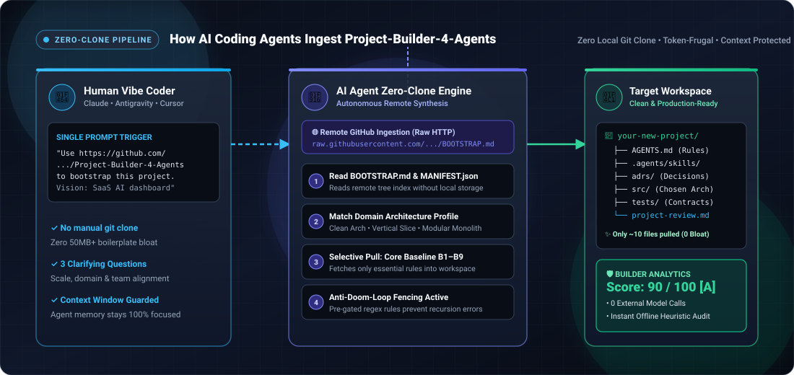
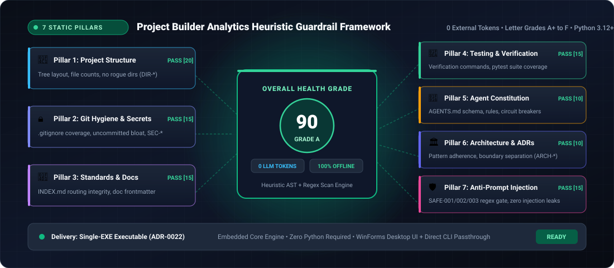
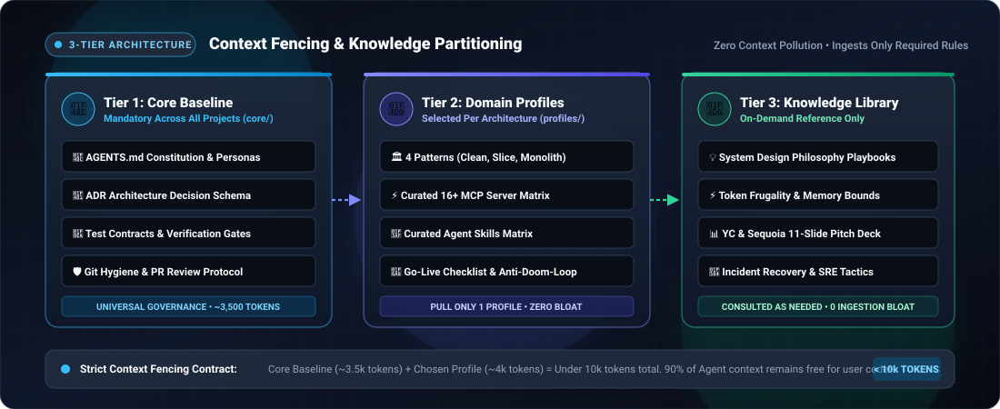

# Project-Builder-4-Agents

<div align="center">

<!-- AUTO-GEN:STATS -->
[](project-review.md)
[](tests/)
[](MANIFEST.json)
[](HOW_IT_WORKS.md)
<!-- /AUTO-GEN:STATS -->
[](https://www.python.org/downloads/)
[](LICENSE)
[](HOW_IT_WORKS.md)

  <br /><br />
  <a href="https://github.com/Dokhacgiakhoa/Project-Builder-4-Agents">
    
  </a>
  <br /><br />

  <h3>The Remote Knowledge Hub &amp; Static Guardrail Engine for AI Coding Agents</h3>
  <p><b>Bootstrap resilient software architectures remotely with Zero-Clone, govern agent workflows, and continuously audit project health without consuming LLM tokens.</b></p>

  <p>
    Built for <b>Claude Code</b> &nbsp;•&nbsp; <b>Google Antigravity</b> &nbsp;•&nbsp; <b>Cursor</b> &nbsp;•&nbsp; <b>Windsurf</b> &nbsp;•&nbsp; <b>GitHub Copilot Workspace</b>
  </p>

  <p>
    <a href="#-quick-start-for-human-vibe-coders"><b>🚀 Quick Start</b></a> &nbsp;•&nbsp;
    <a href="#-for-ai-coding-agents-zero-clone-protocol"><b>🤖 Agent Protocol</b></a> &nbsp;•&nbsp;
    <a href="#️-project-builder-analytics"><b>🛡️ Analytics</b></a> &nbsp;•&nbsp;
    <a href="#-whats-inside"><b>📦 Knowledge Architecture</b></a> &nbsp;•&nbsp;
    <a href="#-validation-status--empirical-benchmarks"><b>📊 Validation &amp; Benchmarks</b></a> &nbsp;•&nbsp;
    <a href="#-for-kit-contributors"><b>🛠️ Contributors</b></a>
  </p>

</div>

---

## 💡 Why Project-Builder-4-Agents?

Most templates dump hundreds of boilerplate files, framework configurations, and monolithic instructions into your workspace. This quickly **saturates LLM context windows**, triggers **hallucinatory drift**, and traps agents in **doom-loops**.

**Project-Builder-4-Agents** takes an agent-first approach:

| Traditional Boilerplates | Project-Builder-4-Agents |
| :--- | :--- |
| ❌ Clone 50 MB+ of multi-stack files upfront | ⚡ **Zero-Clone**: Ingest remotely from GitHub raw URLs without local cloning |
| ❌ Bloats agent context with irrelevant stacks | 🎯 **Selective Ingestion**: Interview first, then pull only the selected architecture pattern |
| ❌ No automated health verification | 🛡️ **Project Builder Analytics**: 0-token static auditor (`.exe` / Python) with letter grades (A+ to F) |
| ❌ Silent prompt injection vulnerabilities | 🔒 **Pre-Gated Security**: Heuristic detection for hidden directives (`SAFE-*`) & supply-chain traps |
| ❌ Speculation and drift between docs & code | 🔄 **Living Documentation**: Strict CI checks (`check_links.py`, `sync_docs.py`) prevent drift |

---

## 🚀 Quick Start (For Human Vibe Coders)

You do **not** need to clone this repository. Open your favorite AI Coding Agent in an empty folder (or an existing project) and paste this single prompt:

```text
Use https://github.com/Dokhacgiakhoa/Project-Builder-4-Agents to bootstrap this project.
I want to build a [describe your product vision in 1–2 sentences].
```

### What happens next?

<p align="center">
  
</p>

1. **Remote Ingestion**: Your agent inspects [BOOTSTRAP.md](https://raw.githubusercontent.com/Dokhacgiakhoa/Project-Builder-4-Agents/main/BOOTSTRAP.md) directly via raw HTTP.
2. **Discovery Interview**: Your agent asks at most 3 clarifying questions about your domain, scale, and requirements.
3. **Profile Matching**: Recommends the optimal pattern (*Clean Architecture, Layered, Vertical Slice, or Modular Monolith*).
4. **Selective Pull**: Drops the core governance baseline (`AGENTS.md`, ADR system, coding standards) into your target directory.
5. **Continuous Guardrails**: Runs the companion **Project Builder Analytics** to guarantee project health over time.

---

## 🤖 For AI Coding Agents (Zero-Clone Protocol)

> [!IMPORTANT]
> **ZERO-CLONE CONTRACT**: If a user prompts you with this repository URL:
> 1. **DO NOT ask the user to clone the whole repository**: Read remotely via [BOOTSTRAP.md](https://raw.githubusercontent.com/Dokhacgiakhoa/Project-Builder-4-Agents/main/BOOTSTRAP.md) or inspect the tree at [MANIFEST.json](https://raw.githubusercontent.com/Dokhacgiakhoa/Project-Builder-4-Agents/main/MANIFEST.json) / [llms.txt](https://raw.githubusercontent.com/Dokhacgiakhoa/Project-Builder-4-Agents/main/llms.txt).
> 2. **Never download until Stack is finalized**: Ingest `core/discovery.md` to interview the user, then consult `profiles/README.md` to match an architecture pattern.
> 3. **Selective pull**: Fetch only the Core Baseline (B1–B9) and the chosen Architecture Profile into the target workspace (via direct raw HTTP fetch or shallow temp clone).
> 4. **Continuous Companion & Go-Live**: Consult [INDEX.md](https://raw.githubusercontent.com/Dokhacgiakhoa/Project-Builder-4-Agents/main/INDEX.md) during sprints; run [Project Builder Analytics](scripts/README.md) to track the project's static-audit score.
> Full operational specifications: [HOW_IT_WORKS.md](HOW_IT_WORKS.md).

---

## 🛡️ Project Builder Analytics

The companion static analysis and guardrail engine. Runs 100% offline with zero external model calls (consuming **0 LLM tokens**), generating a clean, actionable **`project-review.md`** report for both humans and agents.

<p align="center">
  
</p>

```bash
$ Project-Builder-Analytics.exe audit .

  Project Builder Analytics v1.0.0 — Static Guardrail Engine
  ─────────────────────────────────────────────────────────────
  ✔ Pillar 1: Project Structure & File Layout ......... [PASSED]
  ✔ Pillar 2: Git Hygiene & Secret Exposure ........... [PASSED]
  ✔ Pillar 3: Standards & Documentation (INDEX) ....... [PASSED]
  ✔ Pillar 4: Testing & Verification Contracts ........ [PASSED]
  ✔ Pillar 5: Agent Constitution (AGENTS.md) .......... [PASSED]
  ✔ Pillar 6: Architectural Integrity (ADR) ........... [PASSED]
  ✔ Pillar 7: Anti-Prompt-Injection Shield (SAFE-*) ... [PASSED]
  ─────────────────────────────────────────────────────────────
  ▶ Final Score: 90 / 100 [Grade A] — 0 LLM Tokens Consumed
  ▶ Remediation Report generated: ./project-review.md
```

### Capabilities
- **Letter Grading (A+ to F)**: Objective 0–100 health scoring based on 7 core pillars (Structure, Git hygiene, Standards, Testing, Agent constitution, Architecture, Safety).
- **Prompt-Injection Defense (`SAFE-*`)**: Heuristic scanner detecting prompt injection directives, hidden unicode/ANSI containers, and override tags.
- **Context-Aware Remediation**: Every issue links directly to a self-contained playbook or ADR in the kit.
- **Single-EXE Delivery (ADR-0022)**: Standalone engine embedded inside a single Windows desktop executable. No Python or external dependencies required.

### Quick Execution

| Platform / Mode | Command | Details |
| :--- | :--- | :--- |
| **Windows GUI & CLI** | `Project-Builder-Analytics.exe` (download from [GitHub Releases](https://github.com/Dokhacgiakhoa/Project-Builder-4-Agents/releases); not stored in git) | WinForms UI (WebView2), or direct CLI: `Project-Builder-Analytics.exe audit .` |
| **Python CLI (Cross-platform)** | `python scripts/project_auditor.py <target_dir>` | Python 3.12+ standard library only (zero third-party dependencies) |
| **Linux / macOS Shell** | `./Project-Builder-Analytics.sh <target_dir>` | Native bash wrapper for automated CI environments |
| **Web Server Mode** | `python scripts/project_auditor.py serve .` | Local browser dashboard on `http://127.0.0.1:8765` (180s watchdog auto-exit) |

Full engine documentation: [scripts/README.md](scripts/README.md).

---

## 📦 What's Inside

All documents are strictly partitioned into three tiers to eliminate context pollution:

<p align="center">
  
</p>

| Tier | Directory | Description & Key Files |
| :--- | :--- | :--- |
| **Core Baseline**<br/>*(Mandatory)* | [`core/`](core/README.md) | Universal agent foundation: [`AGENTS.md`](core/templates/AGENTS.md), discovery interview, ADR schema, testing contracts, verification commands, and PR templates. |
| **Domain Profiles**<br/>*(Selected)* | [`profiles/`](profiles/README.md) | Architectural frameworks (Layered, Clean Arch, Vertical Slice, Modular Monolith), curated MCP tool matrix, and the Anti-Doom-Loop playbook. |
| **Knowledge Library**<br/>*(On-Demand)* | `knowledge-base/`<br/>`templates/` | Deep technical reference, system design philosophy, scaling playbooks, token optimization tactics, and pitch deck templates. |

> [!TIP]
> **Decisions & constraints only**: Documents contain actionable rules and architecture boundaries—never redundant syntax tutorials—ensuring minimal token usage and high reasoning fidelity.

---

## 📊 Validation Status & Empirical Benchmarks

In accordance with [ADR-0012](adrs/0012-agent-first-builder-and-health-check.md) and our **Adversarial Self-Review Protocol** (Kit Rule 13), this kit claims no unsubstantiated novelty. All empirical measurements are transparently disclosed:

| Metric / Claim | Status | Empirical Findings (Measured 2026-11-07) |
| :--- | :---: | :--- |
| **Audit Engine Speed** | 🔬 Measured | Rerun 2026-11-08 with the same A/B scripts (Core i7-12700F, 31.8 GB RAM, 5 runs per side): P-062 15.1s → 4.3s (**3.51x**); LiteLLM 58.2s → 18.6s (3.14x); kit repo ~0.6s (`evals/results/raw/016-ab-speed.json`, `016-ab-benchmark-pillars.json`). An earlier run (report 010) measured 28.9s → 5.9s (4.88x) on P-062; the two runs differ and were not reconciled. Absolute times depend on the machine. |
| **Cold vs. Warm Latency** | 🔬 Measured | 4,000 files HDD cold read 30.3s vs warm cache 0.28s (109x difference). First-run on mechanical HDDs exhibits cache warming delay (`011-cold-warm.json`). |
| **Prompt-Injection Detection (`SAFE-*`)** | 🔬 Measured | 49/49 synthetic attacks detected (100%), 23 benign look-alikes 0 false positives. Public repo audit raised benign quotation flags, hardened with context-aware gating (ADR-0021). |
| **Watchdog & Reload Survivability** | ✅ Verified | Shell UI reloads preserve engine PID; orphaned engine processes terminate automatically after 180s without heartbeat (ADR-0019). |
| **Zero-Clone HTTP Resolution** | ✅ Verified | 100% of raw GitHub URLs in `MANIFEST.json` resolve with HTTP 200 (tested across 333+ pushed assets). |
| **Single-EXE Windows Delivery** | ✅ Verified | `Project-Builder-Analytics.exe` v0.2.0 (SHA-256 `ed6d0d7325cd20cfc16f9a779ec2847a98b80ca795828de314956f70ef2e0168`): UI tested manually by the maintainer; 175 tests; exe vs source identical on 23 targets; engine output identical to the previous engine on the same 23 targets apart from language (`evals/results/2026-11-08-english-engine-verification-017.md`). Not re-run for this build: clean-machine test (no Python/.NET), watchdog and reload behaviour. |
| **English Token Efficiency** | 🔬 Measured | Claude tokenizer comparison across 9 parallel technical documents showed English consumes **~10% fewer tokens** (2–21% variance per file) compared to Vietnamese. |
| **End-to-End Agent Bootstrap** | ⏳ Planned | Eval protocol specified in `evals/c1-bootstrap-protocol.md`, awaiting automated multi-agent run. |

Detailed evaluation history and raw benchmark data: [`evals/`](evals/) • Task roadmap: [`TASKS.md`](TASKS.md).

---

## ⚙️ Configuration & Environment

Project-Builder-4-Agents and the Project Builder Analytics engine operate **completely offline**, require no API keys, and make no external network calls.

To customize default audit ports or timeout settings, copy `.env.example`:

```bash
cp .env.example .env
```

---

## 🛠️ For Kit Contributors

We welcome contributions to the knowledge base, health check heuristics, and architecture profiles!

```bash
# Run complete test suite (pytest)
make test

# Verify INDEX.md routing, frontmatter, and link integrity
make check-links

# Audit this repository using Project Builder Analytics
make review
```

### Key Guidelines
- **Strict English for Docs**: All kit knowledge documents are written in technical English ([ADR-0014](adrs/0014-english-as-primary-language-for-token-efficiency.md)).
- **Standard Library Only**: Core analytics engine in `scripts/auditor_engine/` must have zero third-party dependencies.
- **Living Sync**: Always run `python scripts/sync_docs.py` before opening a pull request to keep `MANIFEST.json` and badges synchronized.
- **Contribution Standards**: See [AGENTS.md](AGENTS.md) and Architecture Decision Records in [`adrs/`](adrs/).

---

## 📄 License

Copyright (c) 2026 **Đỗ Khắc Gia Khoa** (Dokhacgiakhoa). All Rights Reserved.

This repository is source-available for educational inspection, personal reference, and remote Zero-Clone ingestion by AI coding agents. **Copying, reproduction, mirroring, or redistribution in any form is strictly prohibited** without prior written authorization from the author. For complete terms, see [LICENSE](LICENSE).

---

<div align="center">
  <p>Star ⭐ this repository if Project-Builder-4-Agents helps you build cleaner, safer AI-native projects!</p>
  <p><a href="https://github.com/Dokhacgiakhoa/Project-Builder-4-Agents/issues/new">Report an Issue</a> &nbsp;•&nbsp; <a href="HOW_IT_WORKS.md">Architecture Specification</a> &nbsp;•&nbsp; <a href="BOOTSTRAP.md">Bootstrap Guide</a></p>
</div>
