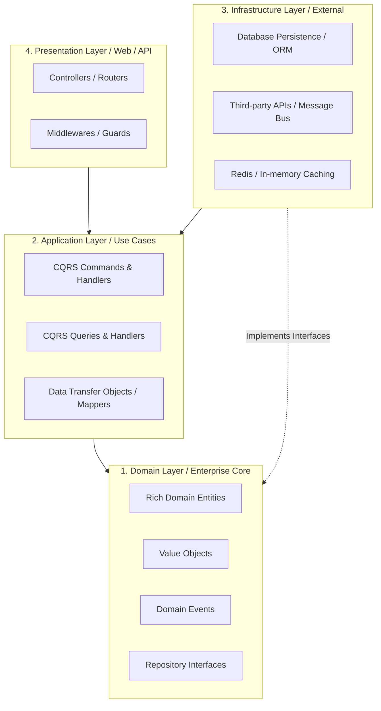

# ADR 0006: CLEAN ARCHITECTURE & DOMAIN-DRIVEN DESIGN (DDD) PRINCIPLES

* **Trạng thái**: Đã phê duyệt (Accepted)
* **Ngày quyết định**: 2026-11-04
* **Người quyết định**: Human Tech Lead & Software Architect

---

## 1. BỐI CẢNH (CONTEXT)
Khi hệ thống phát triển, sự phụ thuộc chặt chẽ giữa logic nghiệp vụ (Business Logic) và các framework, cơ sở dữ liệu hay thư viện bên thứ ba thường gây ra nợ kỹ thuật (Technical Debt), khó khăn khi viết test và dễ phát sinh lỗi lan truyền khi AI chỉnh sửa code. Chúng ta cần một ranh giới kiến trúc bất biến để bảo vệ lõi nghiệp vụ.

---

## 2. QUYẾT ĐỊNH (DECISION)
Chúng ta áp dụng mô hình **Clean Architecture (Onion / Hexagonal Architecture)** kết hợp các nguyên lý cốt lõi của **Domain-Driven Design (DDD)**:

### Các quy tắc bất di bất dịch:
1. **Quy tắc phụ thuộc (Dependency Rule)**: Mũi tên phụ thuộc luôn hướng vào trong. Tầng `Domain` là trung tâm, độc lập 100% với mọi framework, DB hoặc UI.
2. **Dependency Inversion Principle (DIP)**: Tầng `Domain` định nghĩa giao diện (Interfaces) lưu trữ (`IUserRepository`). Tầng `Infrastructure` chịu trách nhiệm cài đặt chi tiết (SQL / ORM).
3. **CQRS (Command Query Responsibility Segregation)**:
   - **Command**: Thay đổi trạng thái, thực thi nghiệp vụ, trả về kết quả thành công/thất bại hoặc ID tạo mới.
   - **Query**: Chỉ đọc dữ liệu, tối ưu hóa tốc độ truy vấn, không bao giờ thay đổi trạng thái hệ thống.
4. **Rich Domain Model vs. Anemic Model**: Đặt logic kiểm tra tính hợp lệ và biến đổi trạng thái trực tiếp bên trong Entities, không đẩy toàn bộ thành hàm thủ tục ở tầng Service.

---

## 3. HỆ QUẢ (CONSEQUENCES)
* **Ưu điểm [Pros]**:
  - Dễ kiểm thử độc lập (Testability): `Domain` và `Application` có thể được kiểm thử 100% mà không cần kết nối DB thật.
  - Độc lập Framework: Dễ dàng nâng cấp hoặc thay thế thư viện mà không ảnh hưởng nghiệp vụ.
  - AI-Friendly: AI Coding Agent có phạm vi rõ ràng cho từng task (chỉ sửa Handler, hoặc chỉ sửa Repository).
* **Nhược điểm [Cons]**:
  - Cần tạo thêm các lớp DTO, Mapper và Interface (overhead ban đầu).
