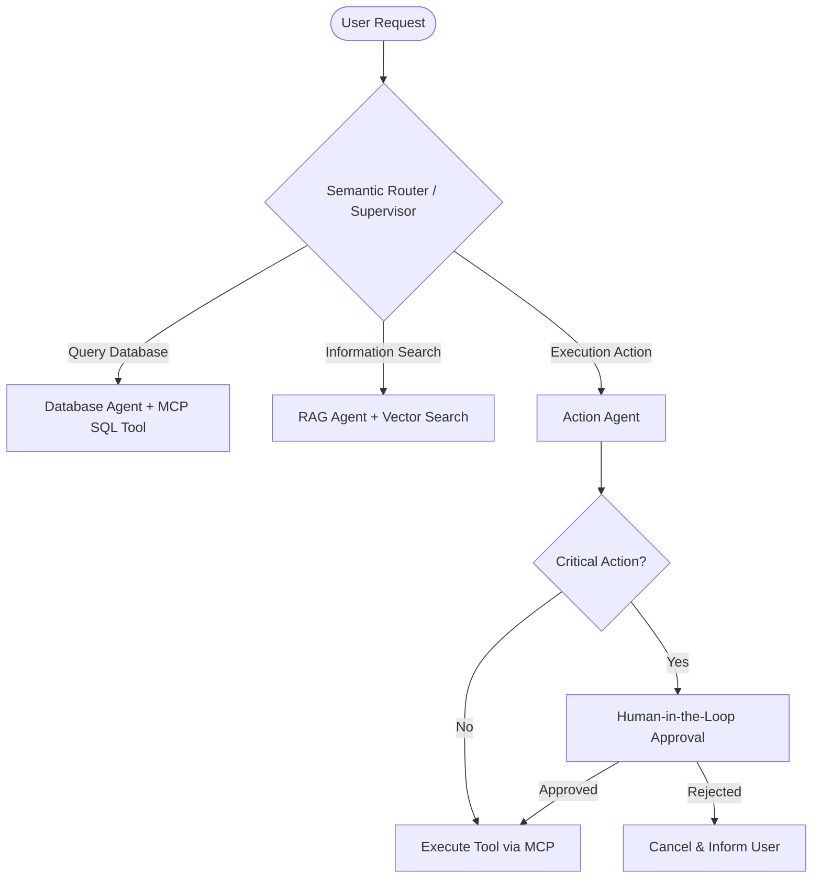

# ADR 0007: AI AGENTIC ARCHITECTURAL PATTERNS & EVALUATION PIPELINES

* **Trạng thái**: Đã phê duyệt (Accepted)
* **Ngày quyết định**: 2026-11-04
* **Người quyết định**: AI Architect & Tech Lead

---

## 1. BỐI CẢNH (CONTEXT)
Các ứng dụng hiện đại tích hợp LLM không chỉ dừng lại ở các prompt đơn giản mà đã chuyển dịch sang hệ thống tác tử tự chủ (**Agentic Systems**): tự suy luận, gọi công cụ (Tool Calling), quản lý bộ nhớ (Memory), và phối hợp đa tác tử (Multi-Agent Swarm). Chúng ta cần chuẩn hóa kiến trúc và phương pháp đánh giá định lượng (Evaluation) cho các module AI.

---

## 2. QUYẾT ĐỊNH (DECISION)

### 2.1. Các Mẫu Kiến Trúc Tác Tử Chuẩn (Agentic Patterns)
1. **ReAct Pattern (Reasoning + Acting)**:
   - Vòng lặp: $	ext{Thought} 
ightarrow 	ext{Action (Tool Call)} 
ightarrow 	ext{Observation} 
ightarrow 	ext{Final Answer}$.
2. **Supervisor & Subagent Hierarchy**:
   - Sử dụng một Supervisor Agent để phân loại intent và điều phối tác vụ tới các Subagents chuyên biệt (DB Agent, Search Agent, Coding Agent).
3. **Model Context Protocol (MCP)**:
   - Chuẩn hóa việc tích hợp công cụ (Tools) và nguồn tài nguyên (Resources) thông qua giao thức MCP, giúp tách rời logic Agent khỏi logic thực thi của Tool.
4. **Human-in-the-Loop (HITL) Guardrails**:
   - Mọi hành động có tính rủi ro cao (thanh toán, xóa dữ liệu, gửi email hàng loạt) phải qua bước chờ phê duyệt từ con người trước khi thực thi.

### 2.2. Pipeline Đánh Giá Định Lượng (AI Evaluation Pipeline)
Đo lường chất lượng hệ thống RAG và Agent thông qua **RAG Triad Metrics**:
* **Faithfulness (Độ trung thực)**: Phản hồi của AI có hoàn toàn dựa trên ngữ cảnh được truy xuất (Context) không? (Chống ảo giác).
* **Answer Relevance (Độ liên quan câu trả lời)**: Câu trả lời có giải quyết đúng trọng tâm câu hỏi của người dùng không?
* **Context Precision (Độ chính xác ngữ cảnh)**: Các tài liệu được vector store trả về có chứa đúng thông tin cần thiết không?

Toàn bộ vết thực thi (Execution Traces) được ghi nhận tự động vào công cụ Observability (**Langfuse**).

---

## 3. HỆ QUẢ (CONSEQUENCES)
* Hệ thống AI có thể kiểm soát được (Deterministic & Observable), giảm thiểu tối đa ảo giác (Hallucination) và rủi ro bảo mật (Prompt Injection).
