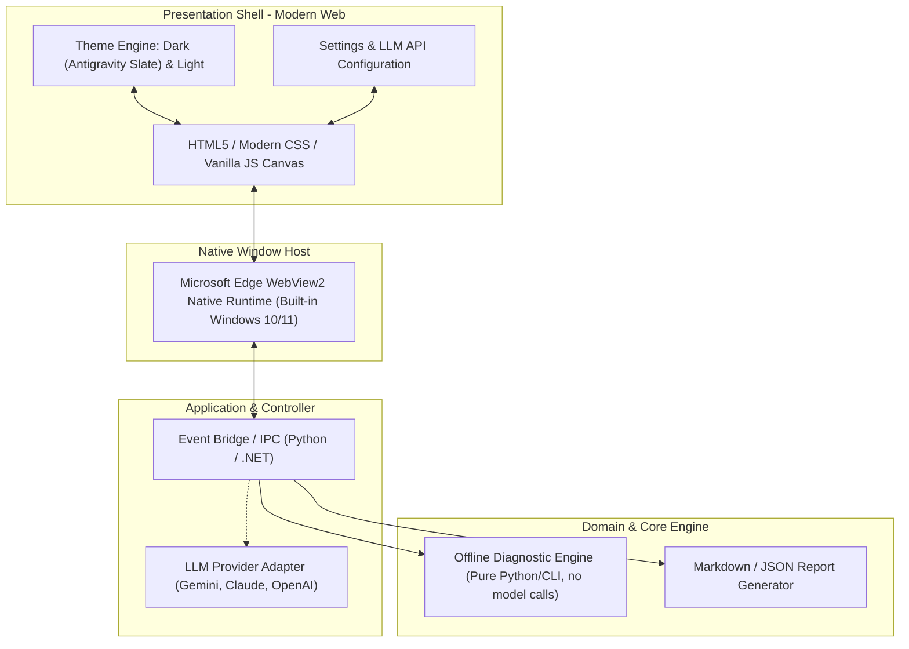

# ADR 0011: DESKTOP & DEVELOPER TOOLING ARCHITECTURE STANDARD

* **Status**: Approved (Accepted)
* **Decision date**: 2026-11-05
* **Decided by**: AI Architect & Tech Lead

---

## 1. CONTEXT
When building developer support tools (Developer Utilities / CLI / Desktop Diagnostics), the choice of GUI technology often falls into the trap of "whatever is at hand": classic GUI libraries (Tkinter, basic WinForms) are used because they seem lightweight.

These classic GUI systems have severe limits:
1. **Rendering & DPI mismatch**: No subpixel font anti-aliasing, and layouts break when the DPI changes on Windows 11.
2. **Cannot scale to a modern interface standard**: Extremely difficult or impossible to reproduce a flat, borderless style with proper typography like Antigravity 2.0 / VS Code / Cursor.
3. **Very high maintenance cost**: Patching rounded corners, shadows and colors by hand on a canvas wastes time and is error-prone.
4. **No Theme and Settings support**: Hard to integrate a Light / Dark theme, store LLM API keys, or build a modern configuration experience.

---

## 2. DECISION

We decided to standardize all Desktop / Developer Review Tools in the project ecosystem on the model: **Decoupled Core Engine + Modern Web View Shell (WebView2)**.

> [📊 Open the diagram on Mermaid Live / an AI editor](https://mermaid.live/edit#pako:eNp9U01r4zAQ_SuDDyWBpGkKeynLQuqENiVf1CE9xHtQ7bEtqoyMLCeU0v--o1jJxqXUJ8-bN6OZ96SPINEpBncQZEofkkIYC-txTMBfVb_mRpQFrAxWSFZYqQm2rSgqUCnow5y7GIIXfP3bFLuPo1DQXlTbOHhcz2e_YHAihlHEwUaQVErAUwQNMQ4uytcF7nAuSORouMMxhAnlkvAOxsK8QWdEVvKMe2nfIVLCYheuYCbzwrY6RWitpLziw4XiVqfYkWdzGK2mEGrKZF6b41rnYqQ0pi9qPOrKwnbBxD3Ci6RUH47Y5eKbWz5lLhOjK51ZmKQ5OjU2Eg-34Eufax6eN-rc11LZviTfrILhzWA47P44xKgslUy8I3FwGV65XazRSqFpqXBvJM_B7Mme_fMhuzBdhdBZvduCiwdwvZisu606lmiUitIeXXB6rYzeS7YRPAydB9xJkj0IlahT7MGyRBpNf14h1Abd7GO9E7IZ25z8bZ3fQMxcZpniPxhLkRMrLhOf4_Frrm12GISzaQ9u-la_IbU3ecZSG_uA5NzhC8Rqu5WfouXC54CTyJdAm-9mP19o-N3v_3E2N_jlTfWpE7MhtC7gtwzu1eCNLQ3oLXKw1-UrfN6onbnm1H_bgh4EOzQsc-pe-ofjxoF1Q8cMxEGKmagVv5mYPh1Z1FZH75Rw0pqa_QzqMuXX5YQ3Yufhz3_1hFkq)

### 2.1. Separating the Core Engine from the Presentation Shell
* **Core Engine**: Must be pure logic, runnable on its own as a CLI or emitting JSON. No dependency on any UI library. Must have independent unit tests.
* **Presentation Shell**: Uses HTML5/Tailwind/CSS Variables and the native Windows WebView2.
  - Aim for sharp typography (vector fonts, ClearType/DirectWrite).
  - Fully flat, removing rigid framing borders.
  - Built-in CSS Variables for the Light / Dark theme.

### 2.2. Tooling Standard and Ability to Evolve
Every desktop tool must have:
1. **A Settings tab/modal**: Stores configuration in `~/.starter-kit/settings.json` (Theme, rule overrides, LLM API keys).
2. **AI Deep Review integration**: An option to call an LLM (Gemini / Claude / OpenAI) for deep analysis of complex code when the user enters an API key.
3. **An update-check mechanism (Check Update)**: A button that checks for a new version from GitHub Releases.

---

## 3. CONSEQUENCES
* **Positive**:
  - A polished, professional interface consistent with Antigravity 2.0.
  - Zero-crash display: web CSS handles every screen resolution and DPI smoothly.
  - New features (Settings, AI Chat, Themes) are easy to add without tearing down and rebuilding the GUI.
* **Negative**:
  - Requires the WebView2 Runtime on the machine (present on Windows 11 and modern Windows 10; not yet tested on a clean machine, see TASKS.md A2).
