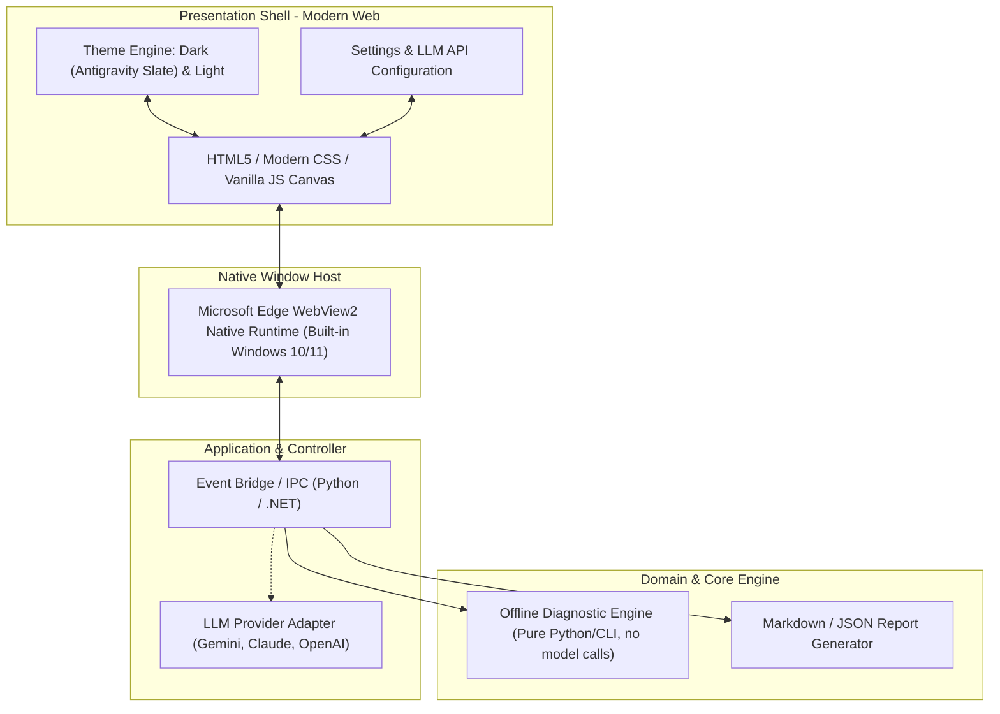

# ADR 0011: DESKTOP & DEVELOPER TOOLING ARCHITECTURE STANDARD

* **Trạng thái**: Đã phê duyệt (Accepted)
* **Ngày quyết định**: 2026-11-05
* **Người quyết định**: AI Architect & Tech Lead

---

## 1. BỐI CẢNH (CONTEXT)
Trong quá trình phát triển các công cụ hỗ trợ nhà phát triển (Developer Utilities / CLI / Desktop Diagnostics), việc lựa chọn công nghệ GUI thường rơi vào bẫy "tiện đâu làm đấy": dùng các thư viện GUI cổ điển (Tkinter, WinForms cơ bản) vì nghĩ rằng chúng nhẹ. 

Tuy nhiên, các hệ thống GUI cổ điển này gặp phải các giới hạn chết người:
1. **Rendering & DPI mismatch**: Thiếu Subpixel Font Anti-Aliasing, vỡ layout khi DPI thay đổi trên Windows 11.
2. **Không thể mở rộng giao diện chuẩn hiện đại**: Cực kỳ khó khăn hoặc bất khả thi để tái hiện phong cách thiết kế phẳng, không viền, typography chuẩn như Antigravity 2.0 / VS Code / Cursor.
3. **Chi phí bảo trì cực cao**: Cố gắng vá víu bo góc, đổ bóng, màu sắc bằng canvas thủ công gây lãng phí thời gian và dễ lỗi.
4. **Không có khả năng chuyển đổi Theme và Settings**: Khó tích hợp Theme Sáng / Tối, lưu trữ API Key LLM, hoặc xây dựng trải nghiệm cấu hình hiện đại.

---

## 2. QUYẾT ĐỊNH (DECISION)

Chúng tôi quyết định chuẩn hóa toàn bộ các công cụ Desktop / Developer Review Tools trong hệ sinh thái dự án theo mô hình: **Decoupled Core Engine + Modern Web View Shell (WebView2)**.

> [📊 Mở sơ đồ trên Mermaid Live / AI Editor](https://mermaid.live/edit#pako:eNp9U01r4zAQ_SuDDyWBpGkKeynLQuqENiVf1CE9xHtQ7bEtqoyMLCeU0v--o1jJxqXUJ8-bN6OZ96SPINEpBncQZEofkkIYC-txTMBfVb_mRpQFrAxWSFZYqQm2rSgqUCnow5y7GIIXfP3bFLuPo1DQXlTbOHhcz2e_YHAihlHEwUaQVErAUwQNMQ4uytcF7nAuSORouMMxhAnlkvAOxsK8QWdEVvKMe2nfIVLCYheuYCbzwrY6RWitpLziw4XiVqfYkWdzGK2mEGrKZF6b41rnYqQ0pi9qPOrKwnbBxD3Ci6RUH47Y5eKbWz5lLhOjK51ZmKQ5OjU2Eg-34Eufax6eN-rc11LZviTfrILhzWA47P44xKgslUy8I3FwGV65XazRSqFpqXBvJM_B7Mme_fMhuzBdhdBZvduCiwdwvZisu606lmiUitIeXXB6rYzeS7YRPAydB9xJkj0IlahT7MGyRBpNf14h1Abd7GO9E7IZ25z8bZ3fQMxcZpniPxhLkRMrLhOf4_Frrm12GISzaQ9u-la_IbU3ecZSG_uA5NzhC8Rqu5WfouXC54CTyJdAm-9mP19o-N3v_3E2N_jlTfWpE7MhtC7gtwzu1eCNLQ3oLXKw1-UrfN6onbnm1H_bgh4EOzQsc-pe-ofjxoF1Q8cMxEGKmagVv5mYPh1Z1FZH75Rw0pqa_QzqMuXX5YQ3Yufhz3_1hFkq)

### 2.1. Tách Rời Core Engine & Presentation Shell
* **Core Engine**: Bắt buộc là Pure Logic, chạy độc lập dưới dạng CLI hoặc xuất JSON. Không phụ thuộc vào bất kỳ thư viện UI nào. Phải có unit tests độc lập.
* **Presentation Shell**: Sử dụng HTML5/Tailwind/CSS Variables và WebView2 native của Windows. 
  - Hướng tới độ sắc nét typography (Vector Font, ClearType/DirectWrite).
  - Phẳng hoàn toàn, loại bỏ các đường viền đóng khung xơ cứng.
  - Tích hợp sẵn CSS Variables cho Theme Sáng / Tối.

### 2.2. Tiêu Chuẩn Bộ Công Cụ & Khả Năng Tiến Hóa
Mọi công cụ desktop phải có:
1. **Tab/Modal Cài Đặt (Settings)**: Lưu trữ cấu hình trong `~/.starter-kit/settings.json` (Theme, Rule overrides, LLM API keys).
2. **AI Deep Review Integration**: Tùy chọn gọi LLM (Gemini / Claude / OpenAI) để phân tích chuyên sâu các đoạn code phức tạp khi người dùng nhập API key.
3. **Cơ chế Tự Kiểm Tra Cập Nhật (Check Update)**: Tích hợp nút kiểm tra phiên bản mới từ GitHub Releases.

---

## 3. HỆ QUẢ (CONSEQUENCES)
* **Tích cực**:
  - Giao diện đẹp, chuyên nghiệp, đồng nhất với Antigravity 2.0.
  - Zero-Crash về mặt hiển thị: Web CSS xử lý mượt mà mọi độ phân giải màn hình và DPI.
  - Dễ dàng nâng cấp tính năng mới (Settings, AI Chat, Themes) mà không phải đập đi xây lại GUI.
* **Tiêu cực**:
  - Cần máy tính có cài sẵn WebView2 Runtime (có sẵn trên Windows 11 và các bản Windows 10 hiện đại; chưa kiểm thử trên máy sạch, xem TASKS.md A2).
