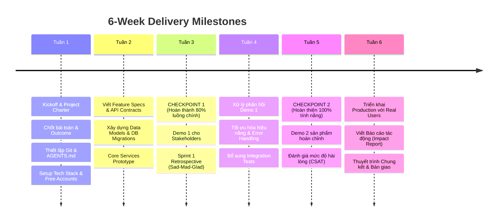

# LỘ TRÌNH DỰ ÁN TỔNG THỂ (6-WEEK ROADMAP)

> **Mô hình**: Khung 6 tuần chia thành 4 Sprint phát triển lặp nhanh (Agile).

---

## 🗺️ CÁC MỐC QUAN TRỌNG & CHECKPOINT SINH TỬ

> [📊 Mở sơ đồ trên Mermaid Live / AI Editor](https://mermaid.live/edit#pako:eNplVNtO4zAQ_ZVRpEUgLaukXWDLG7RcKgRUm-7lIS-uPa29TezIGSNViH_fsdOAgEqVjOfM-FymPGfSKczOISPTYG0sVhb4Q4ZqhNPjP4hbmHHhCf0O7k2NHTmLXY9ahioUKM4sFHAOd0Zu3XoNB7Dw7h9KgqkWntBzbaojUhUEqyrkOeYGyKVTYbnhMZB0DTJwqU1ErtYEdRquWrgxxJiLm6uHZfmtUYwqkUILS5QaShJyy-VrjwgXUrpg6RO9Eff8fh18jYKCRyhblF2cvJjD1FnyQlLHyL-J2GgHKnasC7uBmSAB92xVHRtml2zFxgsyzsaGqYvT0D8ZiV1UT452LX5kMY7Q26vp3eJx_rBkzw5vew9yC6T3Jw0_8i9QpyY15qdlX1FWH3H_DBvHnVK7qHyL2tUKfSRRtt5Y4tpPJO861kacGhyWQh3f8_emFuroI6XvvdwCUUW_83ytoE1ZibGFPrSxGV7lePoYDTC2WOUBErn1WECfmzwLYGMtj9QP4Mp75-FWWMW7teEBl2nACXSB_5xbwr2NHGb3ObeT946N3ju2f5G3L2fLaLDpjcCrYSPoBk17dZMG9Osome7khHvPk7Ii3--mho3pj9AkmyayBxRJxwT0sM69eyNWdTgtL5afnD6N7vmeMtPYamHipqggk_ynNG9lOD1Rw6-uz_RtZy97Fg7kcOj1Fu_5xOfnTcuLzINa5-ko_abCbphDPrVJVjbVMYPtUDnYv8F-bIxw2VfIGvSNMCr-e3iOeqqMNDZY8UWVKVyLUFOVVfYlgkUgV-6s5CL5gHwTWiUIZ0Zwxs3--uU_IX1opg==)
