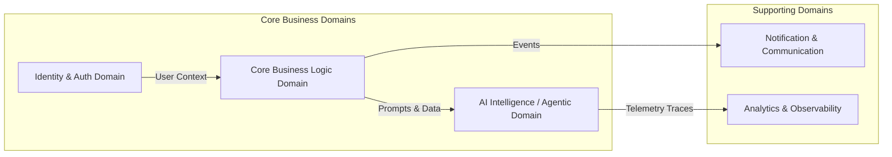

# DOMAIN BOUNDARIES & CONTEXT MAP (BOUNDED CONTEXTS)

> **Objective**: Partition the system into decoupled bounded contexts so developers and AI agents can execute in parallel without code collisions.

---

## 🗺️ 1. Domain Context Map

---

## 📦 2. Boundary Conventions & Cross-Domain Communication

1. **Contract-Only Communication**:
   - Domain A MUST NOT directly access database tables or private internals of Domain B.
   - All inter-domain communication must traverse public API contracts (REST, RPC) or event buses.
2. **Context Isolation for AI Coding Agents**:
   - When assigning tasks in Domain A, feed only Domain A's context and related contracts into the agent to prevent token bloat and hallucination.
