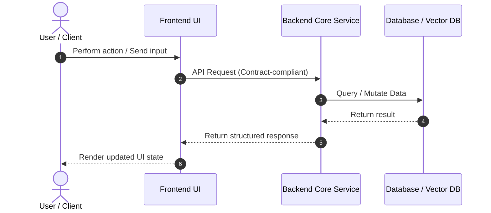

# FEATURE SPECIFICATION: [FEATURE NAME]

* **Associated User Story**: `US-xxx`
* **Implementation Task**: `T-xxx`
* **Author**: [PM / Tech Lead]
* **Status**: [Draft | In Review | Approved]
* **Approval Date**: [YYYY-MM-DD]

---

## 1. Motivation & Context
* **Problem Statement**: [Why is this feature needed? What friction does the user experience?]
* **Target User**: [Who is the direct consumer / operator?]
* **Target Metric**: [Specific measurable goal, e.g., reduce workflow completion time by 40%]
* **Alternatives Considered**: [Why choose this technical approach over other alternatives?]

---

## 2. Mandatory NFR Checklist
* [ ] **DPI & Rendering**: Sharp rendering across display densities (Subpixel Anti-Aliasing, Responsive Canvas).
* [ ] **Theming & Design Presets**: Support minimum 2 themes: Dark / Slate and Light / Studio. Never hardcode colors.
* [ ] **Config & Settings Persistence**: User preferences, API keys, and tokens persist cleanly in config files or local storage.
* [ ] **Extensibility & Integration**: Architecture prepared for streaming AI LLM APIs and automated update checks.

---

## 3. Technical Design
* **Data Flow Architecture**:

* **API Endpoints**: [Link to `specs/contracts/` or specify new endpoint definitions]
* **Data Model / Schema**: [New entities, schema migrations, foreign keys]
* **Edge Cases & Error Handling**:
  - Empty state: Render defensive fallback view.
  - Network timeout / disconnect: Retry up to 3 times with exponential backoff.
  - Validation failure: Return HTTP 400 Bad Request with actionable machine-readable error payload.
* **Security & Authorization**: [Required RBAC roles, input sanitization, rate limits]

---

## 4. Implementation Plan & Subtasks
* [ ] **Subtask 1 (Tests First)**: Author unit tests for core logic and schema validation.
* [ ] **Subtask 2 (Backend)**: Implement API endpoints, domain logic, and database migrations.
* [ ] **Subtask 3 (Frontend)**: Integrate API contracts and implement defensive UI rendering.
* [ ] **Subtask 4 (Verification)**: Execute full test suite and verify Definition of Done checklist.
