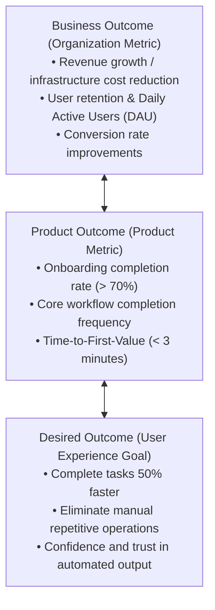

# PRODUCT VISION & STRATEGY

---

## 🎯 1. Who - What - How Framework

* **1. WHO (Target Audience)**:
  * Primary Target Segment: [Detailed description of core user persona]
  * Usage Context: [Environment, platforms, and frequency of use]

* **2. WHAT (Core Problem & Pain Point)**:
  * Critical Pain Point: [The primary unresolved problem users currently face]
  * Willingness to Pay: [What are users willing to invest (money, time, effort) to solve this?]

* **3. HOW (Strategic Solution)**:
  * Solution: [How does this product / AI agent decisively solve the pain point?]
  * Unique Selling Proposition (USP): [Why will users choose this over existing alternatives?]

---

## 📈 2. Three-Tier Outcome Alignment Tree (Outcome Over Output)

---

## 🚫 3. Scope Boundaries (In-Scope vs. Out-of-Scope)

* **In-Scope (Mandatory for Current Milestone)**:
  1. [Core capability / workflow 1]
  2. [Core capability / workflow 2]
  3. [Core capability / workflow 3]

* **Out-of-Scope (Explicitly Deferred)**:
  1. [Secondary nice-to-have features]
  2. [Premature micro-optimizations]
  3. [Ancillary platform adaptations without validated demand]
