# 🚀 DEVELOPER ONBOARDING GUIDE (ZERO TO FIRST COMMIT TRONG 30 PHÚT)

> **Mục tiêu**: Hướng dẫn một Kỹ sư phần mềm mới (hoặc AI Coding Agent) thiết lập môi trường hoàn chỉnh trên máy cục bộ và tạo Pull Request (PR) đầu tiên trong vòng **dưới 30 phút**.

---

## ⏱️ TIMELINE 30 PHÚT

```mermaid
gantt
    title Lộ trình Onboarding 30 Phút
    dateFormat  mm
    axisFormat  %M'

    section Thiết Lập
    Cài đặt công cụ nền tảng & Clone Repo :00, 05m
    Khởi tạo cấu hình biến môi trường     :05, 05m
    Khởi chạy hạ tầng Docker & Services    :10, 05m
    section Trải Nghiệm
    Khởi chạy Frontend & Backend           :15, 05m
    Tạo nhánh & Viết First Feature (TDD)   :20, 07m
    section Nghiệm Thu
    Kiểm tra Anti-Crash & Mở PR            :27, 03m
```



---

## 🛠️ 1. YÊU CẦU NỀN TẢNG (PREREQUISITES)

Trước khi bắt đầu, hãy đảm bảo máy tính của bạn đã cài đặt các công cụ sau:
- **Git** (v2.30 trở lên): `git --version`
- **Node.js** (v18 trở lên hoặc v20+ LTS): `node -v`
- **Docker & Docker Compose**: `docker compose version`
- **Trình soạn thảo mã nguồn**: VS Code, Cursor hoặc Antigravity IDE.

---

## ⚡ 2. CÁC BƯỚC THIẾT LẬP TỪNG BƯỚC (STEP-BY-STEP SETUP)

### Bước 1: Clone Repository & Kiểm tra Nhánh (2 phút)
```bash
git clone https://github.com/Dokhacgiakhoa/Project-Starter-Kit.git
cd Project-Starter-Kit
git checkout main
git pull origin main
```

### Bước 2: Thiết lập Biến Môi Trường (3 phút)
Khởi tạo file cấu hình môi trường từ mẫu an toàn:
```bash
# Trên Linux/macOS hoặc Git Bash:
make setup

# Hoặc thủ công trên Windows PowerShell:
cp .env.example .env
```
> [!IMPORTANT]
> Mở file `.env` và kiểm tra các cấu hình mặc định. Tuyệt đối không commit các API Keys thực tế lên Git repo.

### Bước 3: Khởi chạy Hạ tầng CSDL Cục bộ (5 phút)
Khởi chạy PostgreSQL (có pgvector) và Redis bằng Docker Compose:
```bash
make up
```
*Kiểm tra trạng thái containers:*
```bash
docker compose ps
```
Cả hai dịch vụ `db` (cổng 5432) và `redis` (cổng 6379) phải ở trạng thái `running (healthy)`.

### Bước 4: Khởi chạy Giao diện Frontend (5 phút)
Mở một cửa sổ terminal mới:
```bash
cd frontend
npm install
npm run dev
```
Mở trình duyệt truy cập: **`http://localhost:3000`**.  
Bạn sẽ thấy màn hình Dashboard với thanh chuyển đổi giữa: **Dashboard | AI Assistant Chat | UI/UX Presets Studio**.

---

## 💻 3. TẠO FEATURE & PULL REQUEST ĐẦU TIÊN (FIRST COMMIT WORKFLOW)

### Quy tắc Đặt Tên Nhánh (Branch Naming Convention):
* `feat/US-xxx-ten-tinh-nang` (Tính năng mới)
* `fix/BUG-xxx-mo-ta-loi` (Sửa lỗi)
* `docs/ten-tai-lieu` (Cập nhật tài liệu)

Ví dụ tạo nhánh mới:
```bash
git checkout -b feat/T-001-user-avatar-badge
```

### Quy Trình Viết Mã Nguồn Tuân Thủ "Anti-Crash Standard":
Trước khi viết code, bạn PHẢI tuân thủ 4 nguyên tắc kỹ thuật phòng vệ:
1. **Defensive Access**: Luôn dùng Optional Chaining (`user?.profile?.avatarUrl`) và Nullish Coalescing (`?? 'default.png'`).
2. **Safe Array Handling**: Luôn bọc `Array.isArray(items) ? items.map(...) : []`.
3. **Safe Async/JSON**: Mọi thao tác `JSON.parse` hoặc gọi API bắt buộc nằm trong khối `try...catch`.
4. **Strict Typing**: Tuyệt đối không dùng kiểu `any` trong TypeScript.

### Tự Kiểm Tra Trước Khi Commit (Pre-flight Verification):
```bash
# Kiểm tra định dạng và type checking của Frontend:
cd frontend
npm run build

# Chạy linter toàn hệ thống:
make lint
```

### Tạo Commit Chuẩn Hóa (Conventional Commits):
```bash
git add .
git commit -m "feat(user): add status badge to user avatar in main layout"
git push origin feat/T-001-user-avatar-badge
```

### Mở Pull Request:
1. Vào GitHub repo và nhấn **Compare & pull request**.
2. Tiêu đề PR bám sát mã Task: `feat: [T-001] User avatar status badge`.
3. Tích chọn đầy đủ các mục trong checklist của `.github/PULL_REQUEST_TEMPLATE.md`:
   - [x] Code bám sát Feature Spec và API Contract.
   - [x] Đã kiểm tra Anti-Crash (không có null/undefined crash).
   - [x] Đã chạy build và tests thành công ở local.
4. Gán ít nhất 1 Reviewer (Tech Lead hoặc Peer Reviewer) để được phê duyệt.

---

## ❓ 4. CÁC LỖI THƯỜNG GẶP & CÁCH XỬ LÝ NHANH (FAQ & GOTCHAS)

| Hiện Tượng Lỗi | Nguyên Nhân Gốc Rễ | Lệnh Khắc Phục Nhanh |
| :--- | :--- | :--- |
| `Error: connect ECONNREFUSED 127.0.0.1:5432` | Container Database chưa khởi động kịp | Chạy `make restart` và chờ 10 giây để PostgreSQL hoàn tất healthcheck. |
| `Cannot find module '@/...'` | Lỗi cấu hình path alias trong TypeScript | Kiểm tra file `tsconfig.json` và đảm bảo đã chạy `npm install` đầy đủ. |
| Port 3000 hoặc 5432 bị chiếm dụng | Ứng dụng khác đang dùng chung cổng | Đổi cổng cục bộ trong `.env` hoặc tắt tiến trình chiếm cổng (`lsof -i :3000` hoặc Task Manager trên Windows). |
