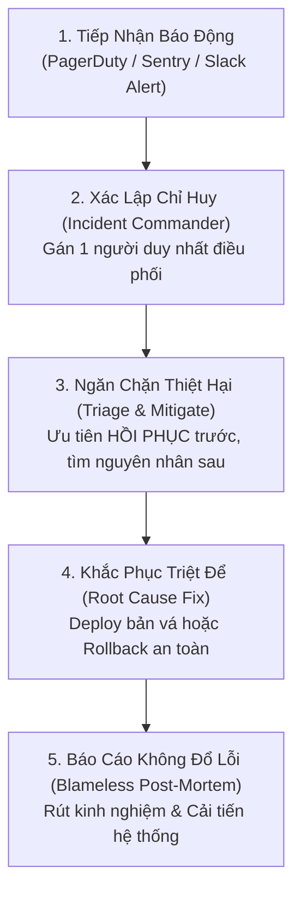

# 🚨 PRODUCTION INCIDENT RESPONSE RUNBOOK (SỔ TAY XỬ LÝ SỰ CỐ PRODUCTION)

> **Mục đích**: Hướng dẫn khẩn cấp dành cho Kỹ sư trực ca (On-Call Engineer) và Tech Lead khi hệ thống gặp sự cố nghiêm trọng trên môi trường Production (Đặc biệt vào các khung giờ nhạy cảm như 2h sáng).

---

## 🚦 1. MA TRẬN MỨC ĐỘ SỰ CỐ & THỜI GIAN PHẢN HỒI (SEVERITY MATRIX & SLA)

| Mức Độ | Định Nghĩa Sự Cố | SLA Phản Hồi | SLA Khắc Phục Tạm Thời | Kênh Điều Phối |
| :---: | :--- | :---: | :---: | :--- |
| **P1 - Critical** | Toàn bộ hệ thống sập, mất mát dữ liệu, người dùng không thể thanh toán/đăng nhập. | **< 15 phút** | **< 1 giờ** | Tạo War Room khẩn cấp (Slack / Google Meet) + Báo cáo CTO/CEO ngay lập tức. |
| **P2 - Major** | Một tính năng cốt lõi bị lỗi (ví dụ: AI Agent không phản hồi), nhưng hệ thống chính vẫn hoạt động. | **< 30 phút** | **< 4 giờ** | Kênh Slack `#incident-response` + Cập nhật trang Status Page. |
| **P3 - Minor** | Lỗi hiển thị giao diện, suy giảm nhẹ hiệu năng, có giải pháp thay thế tạm thời. | **< 2 giờ** | **< 24 giờ** | Tạo Issue ưu tiên cao trên GitHub / Jira. |
| **P4 - Low** | Lỗi chính tả, lỗi giao diện nhỏ không ảnh hưởng trải nghiệm chính. | **< 24 giờ** | Sprint tiếp theo | Xử lý theo quy trình phát triển thông thường. |

---

## 🧭 2. QUY TRÌNH PHẢN ỨNG 5 BƯỚC KHI CÓ BÁO ĐỘNG P1/P2


> [📊 Mở sơ đồ trên Mermaid Live / AI Editor](https://mermaid.live/edit#pako:eNpNkl9P2zAUxb_KkR-mIkFp-kcV04REk20gBqpKHyYtfXBsp7FI7Mq1t1WI786N3QJ5ydW1z_Xv3HtfmLBSsa9gdWv_iYY7j3VRGtB386dk2RBrXYZMVfUOj00fcWmwKMNopDIL-mfZqE_LK7P9VrnL68GSb5Urgj_gEk_KeBeDlotn3LTK-bOSbXBxcY0FPTAe4ncqJvArld8hjw-JK9yGAwZ3RmhJdZDbruNGKncWH_qZdAYZzLYHqRKI1JCkM4l25hNkFm2ILGAXDyQl2CY5XUScnHAmQzzGWqOJOWJUc4N1k9Rzj9tYNdMYrJ0mp_iCB-31lnuVsHo1rwO8jnzcJIkc32EZIzXN4d0n4Eqcw8fLoiMr4XAS9hYoGhvseXinzSNtQbTTIe6Ty1pgGSM1EyCwE-3HfMQEg5W11EUe9go_9P-EW6hdaw-oYhky_Td1FY1N5gVWtm2rfnpE5G08Hpl3miLSfCea2fBjL_JTcB8t1FOz_bwrszRrOac2LlreqVbt91javb94sM6rLrGtopZ7PGvTUGdOU-io6XkC1rHP_X4apK2Zwx8HTFvBNuwcrFOu41r2a_7SU5fMN6pTJSVKJlXNQ-tLVprX_jIP3j4djKBD74KiTNhJmm5B03a8O6Zf3wDFrwMS)

---

## 🛠️ 3. CHECKLIST HỒI PHỤC KHẨN CẤP (EMERGENCY MITIGATION CHECKLIST)

### Lựa chọn 1: Rollback phiên bản phát hành gần nhất (Khuyến nghị số 1)
Nếu sự cố xảy ra ngay sau một đợt Deploy, **ĐỪNG CỐ SỬA TRÊN PRODUCTION**, hãy rollback ngay:
```bash
# Xem lịch sử 3 commit gần nhất trên main:
git log -n 3 --oneline

# Revert commit gây lỗi và push khẩn cấp:
git revert <COMMIT_HASH_LỖI> -m 1
git push origin main
```

### Lựa chọn 2: Khởi động lại dịch vụ bị treo (Graceful Restart)
```bash
# Khởi động lại containers an toàn:
docker compose restart <service-name>

# Xem logs thời gian thực để kiểm tra lỗi:
docker compose logs -f --tail=100 <service-name>
```

### Lựa chọn 3: Bật Chế Độ Bảo Trì (Maintenance Mode)
Nếu xảy ra rò rỉ dữ liệu hoặc lỗi CSDL chưa xác định, hãy bật ngay trang bảo trì để bảo vệ dữ liệu người dùng:
- Chuyển hướng traffic tại Cloudflare / Nginx sang trang `maintenance.html`.
- Thông báo cho khách hàng qua Twitter/Email trạng thái hệ thống: *"Hệ thống đang được nâng cấp kỹ thuật khẩn cấp, dự kiến hoàn tất trong 30 phút."*

---

## 🔍 4. SỔ TAY CHẨN ĐOÁN CÁC BỆNH THƯỜNG GẶP (DIAGNOSTICS CHEATSHEET)

### Tình huống 1: Tràn Connection Pool CSDL (Postgres Error: "Too many connections")
* **Dấu hiệu**: Ứng dụng trả về lỗi HTTP 500 đồng loạt, CPU máy chủ CSDL tăng vọt 100%.
* **Xử lý nhanh**:
  1. Kiểm tra số lượng connection đang mở:
     ```sql
     SELECT count(*) FROM pg_stat_activity;
     ```
  2. Hủy các query bị treo chạy quá 60 giây:
     ```sql
     SELECT pg_terminate_backend(pid) 
     FROM pg_stat_activity 
     WHERE state = 'active' AND now() - query_start > interval '60 seconds';
     ```
  3. Khởi động lại connection pooler (PgBouncer).

### Tình huống 2: Tràn bộ nhớ RAM Redis (OOM - Out of Memory)
* **Dấu hiệu**: Cache không lưu được, hàng đợi Task Queue ngừng xử lý.
* **Xử lý nhanh**:
  1. Kiểm tra mức sử dụng RAM:
     ```bash
     redis-cli info memory
     ```
  2. Xóa các key tạm thời hoặc chuyển chính sách eviction sang `allkeys-lru`:
     ```bash
     redis-cli config set maxmemory-policy allkeys-lru
     ```

### Tình huống 3: AI Provider API quá tải hoặc Rate Limit (HTTP 429 Too Many Requests)
* **Dấu hiệu**: Toàn bộ tính năng AI Agent bị đơ hoặc báo timeout.
* **Xử lý nhanh**:
  1. Kích hoạt cờ chuyển mạch dự phòng (Fallback Provider Flag) trong cấu hình để chuyển từ OpenAI sang Anthropic Claude hoặc Gemini.
  2. Bật cơ chế Exponential Backoff có jitter để giảm áp lực gọi lại liên tục.

---

## 📝 5. MẪU BÁO CÁO HẬU SỰ CỐ KHÔNG ĐỔ LỖI (BLAMELESS POST-MORTEM TEMPLATE)

> **Triết lý**: Chúng ta không tìm người để phạt; chúng ta tìm kiếm lỗ hổng trong quy trình và kiến trúc để hệ thống không bao giờ lặp lại lỗi tương tự.

```markdown
# [POST-MORTEM]: Sự cố [Mã Sự Cố - Tên Ngắn Gọn]
* **Ngày xảy ra**: YYYY-MM-DD
* **Mức độ**: P1 / P2
* **Thời gian gián đoạn (Downtime)**: XX phút
* **Chỉ huy sự cố (Incident Commander)**: [Họ Tên]
* **Ảnh hưởng người dùng**: Khoảng XX% người dùng gặp lỗi trong thời gian từ [HH:MM] đến [HH:MM].

## 1. Dòng thời gian chi tiết (Timeline - Giờ UTC+7)
- 02:15: Hệ thống giám sát Sentry bắn alert lỗi HTTP 500 tăng đột biến.
- 02:20: Kỹ sư trực ca nhận thông báo và xác nhận sự cố P1.
- 02:35: Xác định nguyên nhân do commit #abc làm tràn bộ nhớ Redis.
- 02:45: Tiến hành rollback về bản phát hành an toàn trước đó.
- 02:50: Hệ thống phục hồi hoàn toàn, tỷ lệ lỗi trở về 0%.

## 2. Phân tích Nguyên nhân Gốc rễ (The 5 Whys)
1. Tại sao hệ thống sập? ➔ Do Redis bị tràn bộ nhớ (OOM).
2. Tại sao Redis bị tràn bộ nhớ? ➔ Do một background worker lưu trữ toàn bộ payload ảnh lớn vào cache.
3. Tại sao worker lại lưu ảnh lớn vào cache? ➔ Do tính năng mới không có giới hạn kích thước file tải lên.
4. Tại sao không có giới hạn kích thước file? ➔ Do Spec nghiệp vụ thiếu định nghĩa ràng buộc validation.
5. Tại sao thiếu ràng buộc mà vẫn merge vào main? ➔ Do quy trình review PR thiếu bước kiểm tra checklist Anti-Crash.

## 3. Hành động Cải tiến Ngăn ngừa Tương lai (Action Items)
| STT | Hành Động Cụ Thể | Người Phụ Trách | Hạn Chót (DoD) |
| :---: | :--- | :--- | :--- |
| 1 | Thêm middleware giới hạn kích thước upload tối đa 5MB | [Kỹ sư A] | Trước ngày 10/11 |
| 2 | Cấu hình cảnh báo Prometheus khi RAM Redis vượt ngưỡng 80% | [Kỹ sư B] | Trước ngày 12/11 |
| 3 | Bổ sung bài test tự động cho trường hợp file quá tải | [Kỹ sư C] | Trước ngày 15/11 |
```
