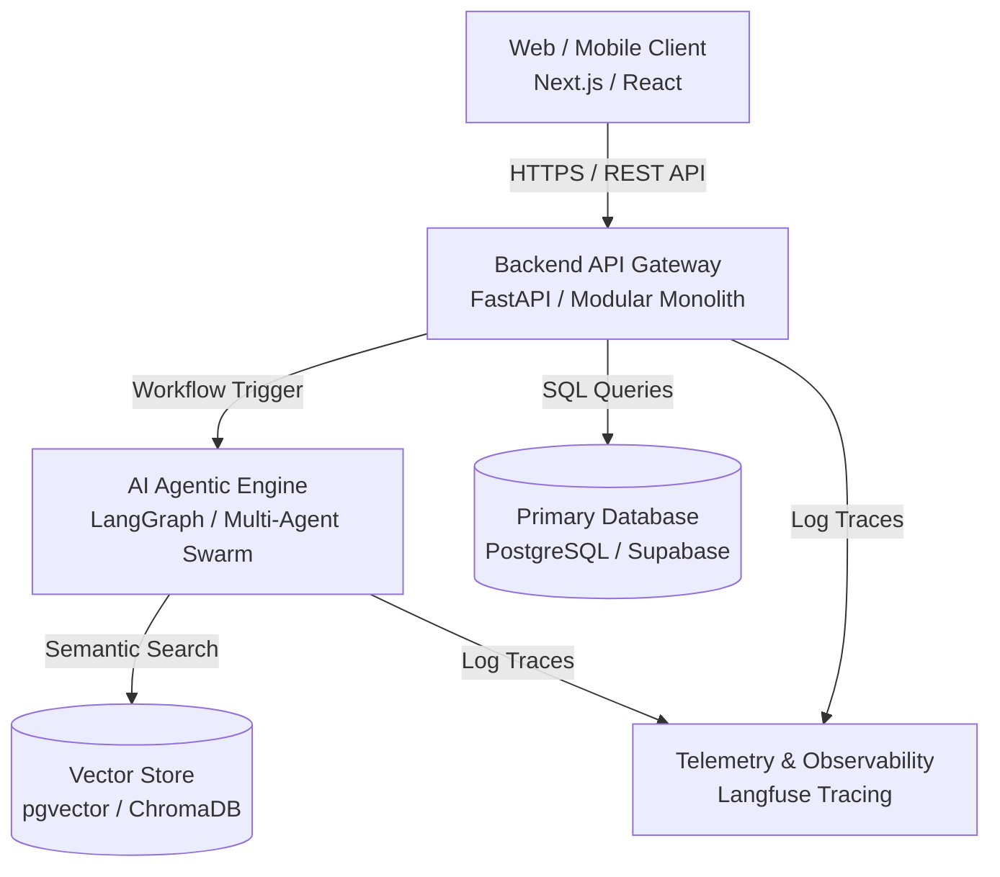

# KIẾN TRÚC TỔNG THỂ HỆ THỐNG (SYSTEM ARCHITECTURE)

---

## 🏛️ 1. SƠ ĐỒ KIẾN TRÚC TỔNG QUAN (C4 CONTAINER DIAGRAM)

---

## 🔄 2. LUỒNG DỮ LIỆU CHÍNH (KEY DATA FLOW)
1. Người dùng gửi yêu cầu từ giao diện Client.
2. Backend API xác thực quyền (`ROLE_USER`), kiểm tra Input Schema.
3. Kích hoạt AI Agent để thực hiện suy luận hoặc tìm kiếm ngữ nghĩa trên Vector DB.
4. Trả về kết quả phòng vệ (Defensive Payload) cho Client hiển thị.
