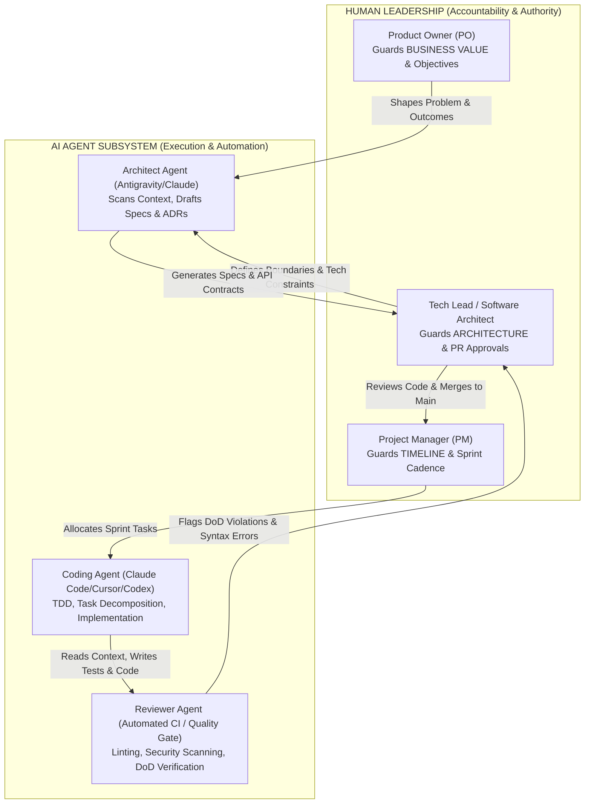
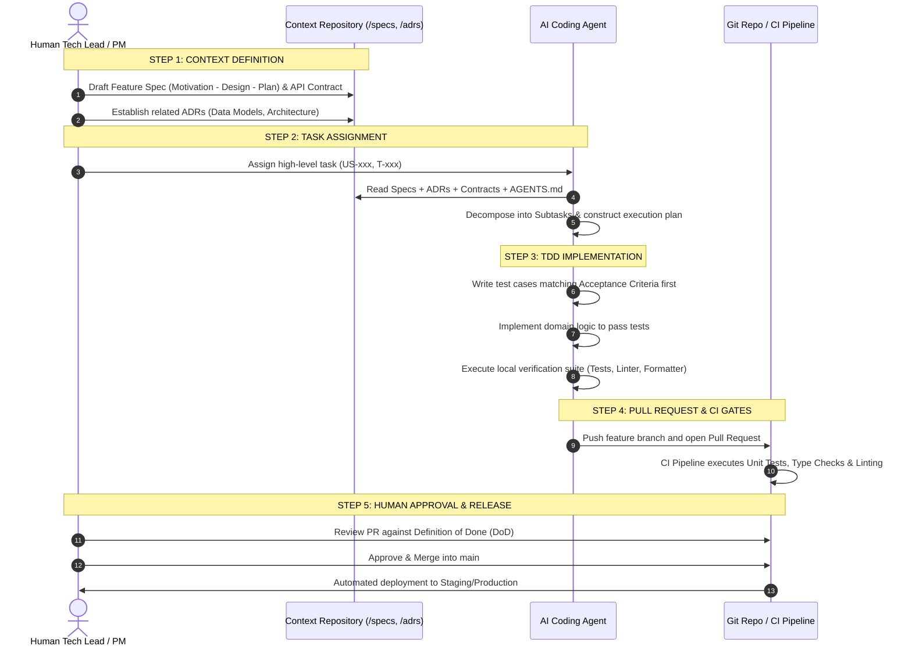

# MASTER PLAN: BUILDING A PROJECT STARTER KIT FOR AI-ASSISTED SOFTWARE DEVELOPMENT (HUMAN + MULTI-AGENT COLLABORATION)

> **Objective**: Establish a standardized delivery framework applying collaborative workflows between **Engineering Teams (Humans)** and **AI Coding Assistants (Multi-Agent: Claude Code, Antigravity, Cursor, Codex...)**. This framework is universal, applicable across any software paradigm (Full-stack Web/Mobile, AI Agentic Systems, Microservices, SaaS Platforms).

---

## 📑 TABLE OF CONTENTS
1. [Context & Engineering Philosophy](#1-context--engineering-philosophy)
2. [Division of Responsibilities: Humans vs. AI Agents (RACI Matrix)](#2-division-of-responsibilities-humans-vs-ai-agents-raci-matrix)
3. [Context-Driven Workspace Structure](#3-context-driven-workspace-structure)
4. [Environment, Tooling & Agent Skills Setup](#4-environment-tooling--agent-skills-setup)
5. [Operational Rules & Guidelines](#5-operational-rules--guidelines)
6. [5-Step End-to-End Implementation Workflow](#6-5-step-end-to-end-implementation-workflow)
7. [Deliverables Checklist](#7-deliverables-checklist)
8. [Anti-Crash Quality Standards](#8-anti-crash-quality-standards)

---

## 1. CONTEXT & ENGINEERING PHILOSOPHY

In the era of **AI-Native Software Engineering**, individual developer throughput increases dramatically through LLMs and Coding Agents. However:
* **"Building a cabin $\neq$ Building a skyscraper"**: In team settings and large-scale product engineering, without solid architecture, AI does not build faster—it **breaks systems exponentially faster**.
* **Nature of AI Agents**: Agents lack overall context and optimize only for local task boundaries. To produce correct code, **humans must provide an unambiguous, consistent context envelope**.
* **Outcome over Output**: The goal is never raw lines of code or arbitrary feature bloat (Output), but measurable impact on business problems and user experiences (Outcome).

---

## 2. DIVISION OF RESPONSIBILITIES: HUMANS VS. AI AGENTS (RACI MATRIX)

> **Core Principle**: *"AI holds execution velocity and solution proposals; Humans retain authority, ultimate accountability, and final approval."*



### Detailed RACI Matrix

| Work Item | Human PO | Human PM | Human Tech Lead | AI Architect Agent | AI Coding Agent | AI Reviewer Agent |
| :--- | :---: | :---: | :---: | :---: | :---: | :---: |
| **Problem Definition & Outcomes** | **A / R** | C | C | C | I | I |
| **Project Charter & Scope** | **A** | **R** | C | C | I | I |
| **Specs & API Contracts Drafting** | C | I | **A** | **R** | I | I |
| **Architecture Decision Records (ADRs)** | I | I | **A** | **R** | I | I |
| **Sprint Backlog & Milestones** | C | **A / R** | C | C | I | I |
| **Subtask Breakdown & TDD Coding** | I | I | I | C | **A / R** | I |
| **DoD Compliance & Lint Checks** | I | C | C | I | C | **R** |
| **Code Review & PR Approval** | I | I | **A / R** | C | I | C |
| **Production Release & Deployment** | I | **A** | **R** | I | I | C |

*(Notes: **R** - Responsible | **A** - Accountable | **C** - Consulted | **I** - Informed)*

---

## 3. CONTEXT-DRIVEN WORKSPACE STRUCTURE

The canonical repository functions as the **Single Source of Truth**. Both humans and AI agents interact with a shared directory hierarchy:

```
├── .antigravity/                   # IDE/Agent rules & custom subagent configs
│   ├── rules.json                  # IDE/Agent level rule definitions
│   └── skills/                     # Domain skills (DB, Testing, Deployment)
├── .github/                        # CI/CD workflows & collaboration templates
│   ├── workflows/ci.yml            # CI: Lint -> Test -> Build -> Quality Gate
│   └── PULL_REQUEST_TEMPLATE.md    # PR template enforcing DoD alignment
├── specs/                          # Specification-driven development artifacts
│   ├── product-vision.md           # Product vision, Outcome trees, Who-What-How
│   ├── domains.md                  # Bounded Contexts map
│   ├── user-roles.md               # User roles, permissions, actor matrices
│   ├── contracts/                  # API Contracts (OpenAPI 3.0, JSON Schema)
│   └── features/                   # Feature specs (Motivation - Design - Plan)
├── adrs/                           # Architecture Decision Records
│   ├── 0001-architecture-style.md # Architecture pattern (Monolith / Microservices)
│   ├── 0002-tech-stack.md          # Stack: Backend, Frontend, Database, Cache
│   ├── 0003-coding-conventions.md  # Naming, error handling, defensive rules
│   ├── 0004-test-strategy.md       # Multi-tiered testing strategy (Unit/Int/E2E)
│   └── 0005-definition-of-done.md  # Definition of Done (DoD)
├── planning/                       # Roadmap & progress tracking
│   ├── roadmap.md                  # Master roadmap and milestones
│   ├── backlog.md                  # User Stories (US-xxx) and Tasks (T-xxx)
│   └── sprints/                    # Sprint execution plans (Sprint-01, 02...)
├── tasks/                          # Task assignment prompts for AI
│   └── templates/task-spec.md      # Template for large task decomposition
├── docs/                           # Architecture and operations documentation
│   ├── system-architecture.md      # System diagrams (C4 Model / Mermaid)
│   └── deployment-guide.md         # Staging & production deployment guide
├── src/                            # Application source code
├── tests/                          # Automated test suites
├── AGENTS.md                       # Canonical behavioral governance rules for AI
└── README.md                       # Repository overview and onboarding runbook
```

---

## 4. ENVIRONMENT, TOOLING & AGENT SKILLS SETUP

### 4.1. Tooling Stack
1. **Source Control & Automation**: Git + GitHub (Branch protection rules, GitHub Actions).
2. **AI Coding Assistants**:
   * **Antigravity / Claude Code**: Architect & Core Implementer (leveraging large context windows and holistic workspace awareness).
   * **Cursor / VS Code Copilot**: Inline autocomplete & localized refactorings.
   * **Codex / OpenCode**: Rapid boilerplate and test scaffolding.
3. **Environment Isolation**:
   * Containerized setups via Docker & Docker Compose for parity across developer workstations.
   * Environment variables isolated via `.env` (never commit keys or production secrets).

### 4.2. Agent Rules & Skills Configuration
* **Rules Configuration (`AGENTS.md` / `.antigravity/rules.json`)**:
  * Persona: Senior Staff Software Engineer / Solution Architect.
  * Mandatory context inspection prior to modifying files.
  * Strict prohibition on modifying API contracts or deleting code without Tech Lead approval.
* **Essential Agent Skills**:
  * `schema-validator`: Validates JSON Schemas, OpenAPI Specs, SQL migrations.
  * `test-runner`: Executes automated test suites for continuous self-verification.
  * `git-workflow-helper`: Enforces meaningful commit granularity with Conventional Commits.

---

## 5. OPERATIONAL RULES & GUIDELINES

### 5.1. Git Discipline & Branching Strategy
* **`main` Branch**: Contains only deployable production code. **Direct pushes to `main` are strictly forbidden**.
* **Branch Conventions**:
  * New features: `feature/{task-id}-{short-description}` (e.g. `feature/T-004-auth-jwt`).
  * Bug fixes: `bugfix/{bug-id}-{short-description}` (e.g. `bugfix/BUG-012-cors-origin`).
  * Production hotfixes: `hotfix/{short-description}`.
* **Pull Request (PR) Policy**:
  * Diff size bounded to ≤ 400 lines of code for high-quality human review.
  * Requires at least 1 Human Reviewer (Tech Lead or Peer) approval prior to merge.
  * Ephemeral branches deleted automatically upon merge.

### 5.2. The Anti-Crash Standard
1. **Defensive Programming**: Use optional chaining (`?.`) and nullish coalescing (`??`). Provide safe fallback defaults (`[]`, `{}`, `""`, `0`) in all data transformation routines.
2. **Robust Error Handling**: Encapsulate asynchronous boundary calls (I/O, network APIs, DB transactions, JSON parsing) in structured `try...catch` blocks with clear error logging.
3. **Data Integrity**: Validate all incoming payloads with schema-driven validation (Pydantic / Zod) prior to domain execution.

---

## 6. 5-STEP END-TO-END IMPLEMENTATION WORKFLOW



---

## 7. DELIVERABLES CHECKLIST

When initializing a new repository from this starter kit, verify:

- [ ] **`AGENTS.md`**: Behavioral contract for AI Agents (context rules, plan before code, anti-crash guidelines).
- [ ] **Canonical ADR Suite**:
  - `adrs/0001-architecture-style.md`: Monolith vs. Microservice selection guide.
  - `adrs/0002-tech-stack.md`: Language, runtime, and database selection rationale.
  - `adrs/0003-coding-conventions.md`: Code formatting and defensive error patterns.
  - `adrs/0004-test-strategy.md`: Multi-layer automated testing strategy.
  - `adrs/0005-definition-of-done.md`: Acceptance criteria and merge prerequisites.
- [ ] **Feature Spec Template (`specs/features/template-spec.md`)**:
  - Section 1: *Motivation* (Business problem, Who & What).
  - Section 2: *Design* (Architecture diagram, API Contract, DB Schema, Edge cases).
  - Section 3: *Plan* (Subtasks, Test plan, Timeline, Deployment).
- [ ] **User Story & Backlog Template (`planning/backlog.md`)**: Traceability linking `US-xxx` $\leftrightarrow$ `T-xxx`.
- [ ] **Pull Request Template (`.github/PULL_REQUEST_TEMPLATE.md`)**: DoD verification checklist.
- [ ] **Sprint Retrospective Template (`planning/retrospective-template.md`)**: `Sad - Mad - Glad` review format.

---

## 8. ANTI-CRASH QUALITY STANDARDS

Every contribution generated by an AI Coding Agent must satisfy 4 quality gates:

1. **Dependency Integrity**: Do not introduce unvetted libraries or conflicting dependencies. Stick to stable, standard ecosystems.
2. **Zero Breaking Changes**: Never modify existing API contracts without prior Tech Lead approval via an ADR.
3. **100% Test Passing**: All existing tests and newly authored test cases must pass cleanly before opening a PR.
4. **Documentation Sync**: Any code modification affecting behavior, contracts, or environment variables must be mirrored simultaneously in documentation (`README.md`, `specs/contracts/`, `docs/`).

---

*This document serves as the architectural blueprint and operational roadmap for the Project Starter Kit.*
