# 🚀 Software Project Management & Execution Playbook (VinUni AI20K)
### Field-Tested Project Management & Team Conflict Resolution Guide

> **Issuing Body:** VinUni & AI20K Organizing Committee (Mentor Workshop)  
> **Target Audience:** Engineering teams in the AI20K Build Phase  
> **Duration:** 6-week intensive sprint cycle

---

## 🧭 Table of Contents
1. [Execution Philosophy in the Real World (Execution Over Core Tech)](#1-execution-philosophy-in-the-real-world)
2. [Project Charter: Compass for Project Success](#2-project-charter-compass-for-project-success)
3. [The Core Role Triangle (PO - PM - Tech Lead)](#3-the-core-role-triangle)
4. [Single Source of Truth (SSOT) Management Principle](#4-single-source-of-truth-ssot)
5. [Continuous Delivery Strategy (Release Often & Regularly)](#5-continuous-delivery-strategy)
6. [User Story: The Shared Currency of Software Engineering](#6-user-story-the-shared-currency)
7. [Sprint Discipline & 2 Critical Checkpoints (W3 & W5)](#7-sprint-discipline--2-critical-checkpoints)
8. [Technical Specification Protocol (RFC: Motivation - Design - Plan)](#8-technical-specification-protocol)
9. [Meeting Cadence Optimization: Daily Standup vs Technical Meeting](#9-meeting-cadence-optimization)
10. [Four Stages of Team Dynamics (Tuckman Model)](#10-four-stages-of-team-dynamics-tuckman-model)
11. [Conflict Management Matrix: Technical vs Personal](#11-conflict-management-matrix)
12. [Structured Retrospectives: Sad - Mad - Glad](#12-structured-retrospectives-sad---mad---glad)
13. [Cross-Functional Teamwork](#13-cross-functional-teamwork)
14. [Sprint 1 Mission Brief](#14-sprint-1-mission-brief)

---

## 1. Execution Philosophy in the Real World

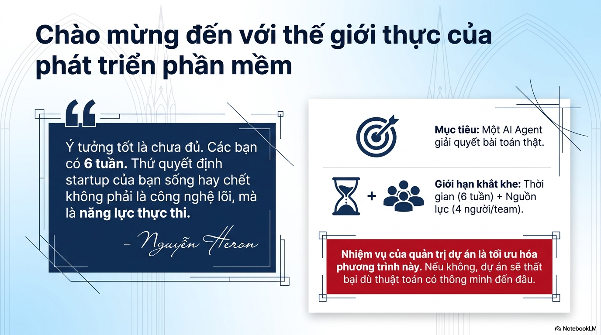

> *"Good ideas are not enough. You have 6 weeks. What determines whether your product survives is not the novelty of the core algorithm, but your **execution capability**."*  
> — **Nguyen Heron**

* **Ultimate Goal:** Deliver a **functional, deployed AI Agent solving a real-world problem**.
* **Strict Constraints:**
  * **Timeline:** Exactly 6 weeks.
  * **Team Size:** 4 members per team.
* **Core Takeaway:** Project management exists to optimize the equation between time and constraints. Without rigorous management, projects fail regardless of AI sophistication.

---

## 2. Project Charter: Compass for Project Success

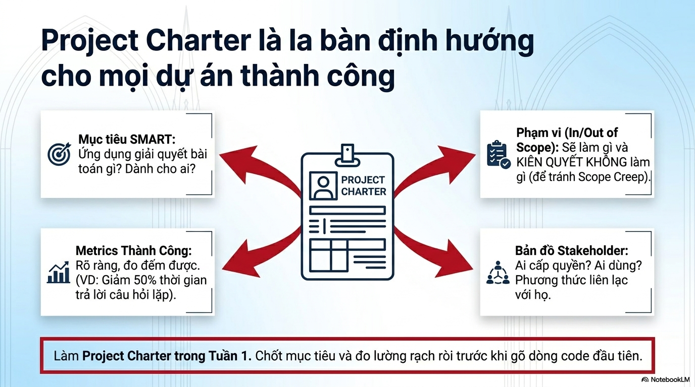

Every team must finalize their **Project Charter** during **Week 1**, locking objectives and success criteria before writing code:

1. **SMART Objectives:** What specific domain problem does the application solve? For which Target Persona?
2. **Boundary Definition (In-Scope / Out-of-Scope):**
   - Explicitly define what will be built in 6 weeks.
   - **RUTHLESSLY CUT WHAT WILL NOT BE BUILT** to prevent scope creep.
3. **Success Metrics:** Concrete quantitative benchmarks (e.g. 50% reduction in processing time, 95% fraud detection rate, 100% PII masking).
4. **Stakeholder Map:** Data providers, target end-users, mentors, communication channels, and core working hours.

---

## 3. The Core Role Triangle

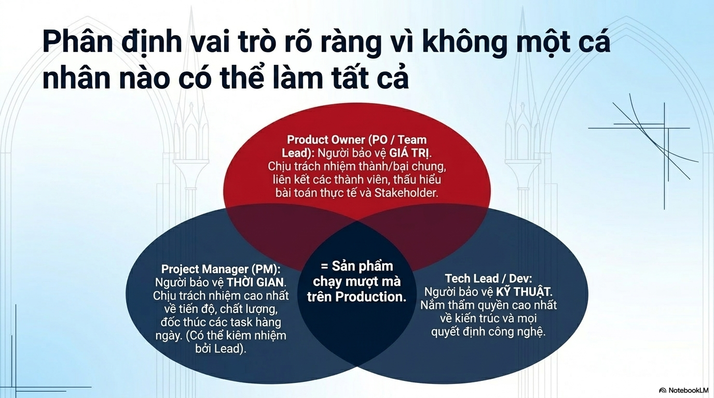

No single engineer carries an entire project alone. Three core responsibilities must be distinct:

* **Product Owner (PO / Team Lead) — Guarding BUSINESS VALUE:**  
  Ultimate ownership of product direction, stakeholder alignment, user empathy, and executive judging expectations.
* **Project Manager (PM) — Guarding TIMELINE & CADENCE:**  
  Drives daily execution, sprint tracking, blocker escalation, and timeline risk management. *(Often co-owned by Team Lead)*.
* **Tech Lead / Developer — Guarding ARCHITECTURE & QUALITY:**  
  Ultimate technical authority on system architecture, framework selection, API contracts, code quality, and PR reviews.

> 🎯 **Convergence Point:** Harmonic synchronization across these 3 roles delivers: **A reliable product running in production.**

---

## 4. Single Source of Truth (SSOT)

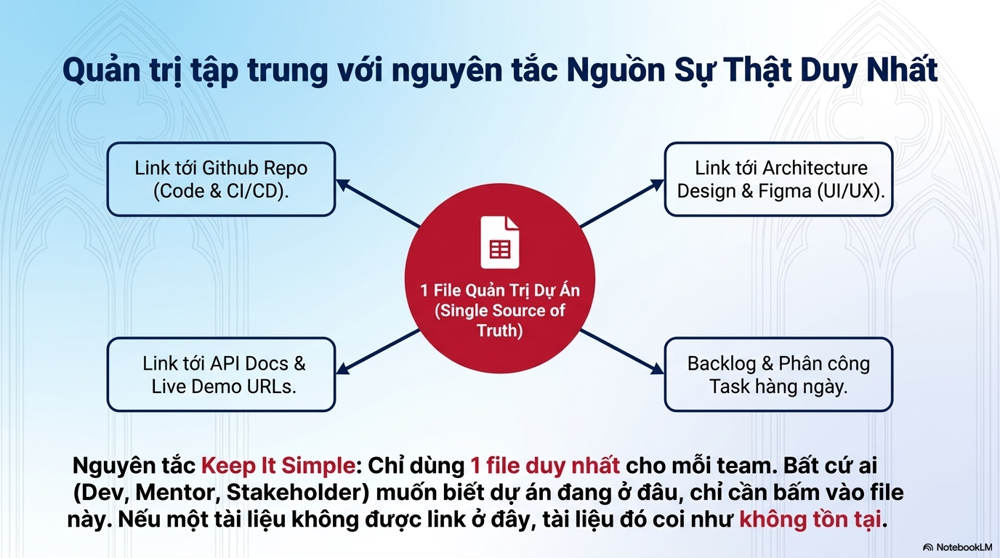

* **"Keep It Simple" Principle:** Maintain **EXACTLY 1 CENTRAL PROJECT MANAGEMENT TRACKER** (Spreadsheet or central document) per team.
* **Four Mandatory Canonical Links:**
  1. Link to GitHub Repository (Source code, Pull Requests, CI/CD Actions).
  2. Link to System Architecture Diagrams & Figma UI/UX designs.
  3. Link to OpenAPI Docs & Deployed Staging/Demo URLs.
  4. Daily task backlog and assignment tracker.
* **The Golden Rule:** *If a document, feature, or task is not linked in the SSOT, it **DOES NOT EXIST**.*

---

## 5. Continuous Delivery Strategy

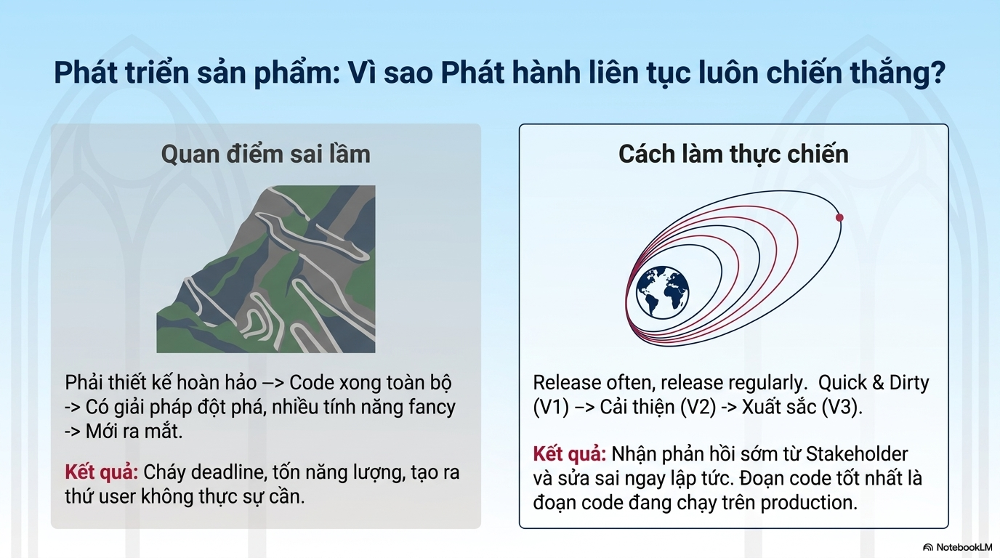

* **The Perfection Trap:** Over-designing upfront -> coding silently in isolation -> packing fancy features -> waiting until the deadline to launch.  
  *Result:* Missed deadlines, burnout, and building capabilities users never requested.
* **Winning Engineering Mindset:** **Release often, release regularly.**  
  * Iteration 1: **Quick & Dirty (V1)** — Working end-to-end happy path, even with rough UI.
  * Iteration 2: **Refinement (V2)** — Performance optimization, comprehensive error handling.
  * Iteration 3: **Polished Production (V3)** — Hardened reliability, seamless UX in production.
* **Motto:** *The best code is working code deployed in production receiving real user feedback.*

---

## 6. User Story: The Shared Currency

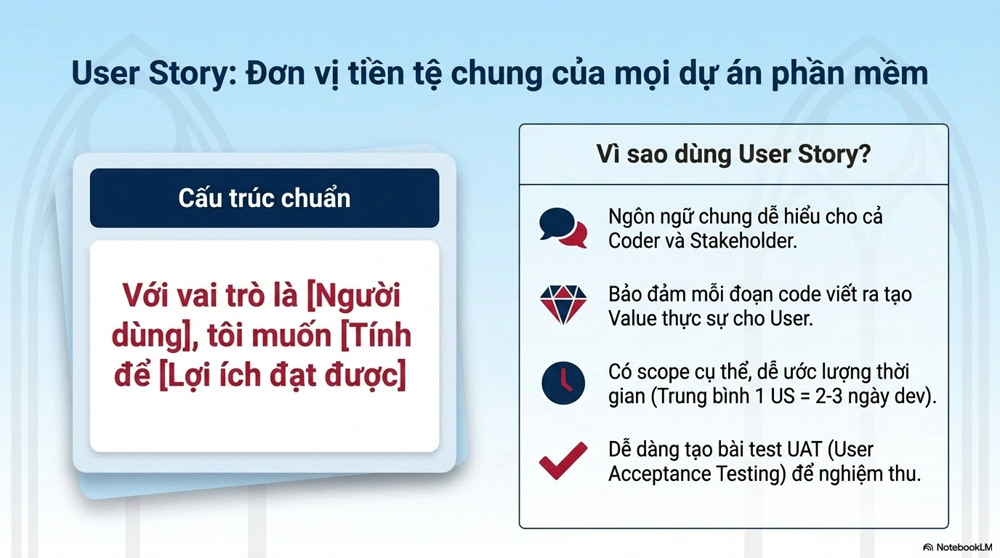

Every Backlog feature must follow standard User Story syntax:

$$\text{"As a [User Persona], I want [Feature / Action] so that [Observable Benefit]"}$$

* **Practical Value:**
  * Common vocabulary aligning Developers, Product Owners, and Mentors.
  * Ensures every line of code serves a measurable user need.
  * Scoped for predictable estimation (target: 1 User Story = 2–3 days).
  * Direct basis for deriving User Acceptance Testing (UAT) scenarios.

---

## 7. Sprint Discipline & 2 Critical Checkpoints

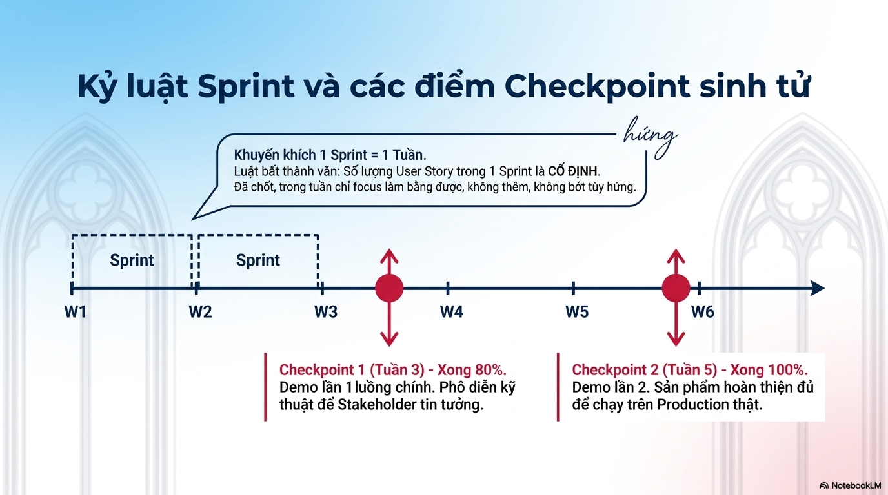

* **Sprint Cadence:** Fixed cadence of **1 Sprint = 1 Week**.
* **Scope Frozen Principle:** The user stories committed at Sprint Planning are **FROZEN**. The team executes focused delivery; avoid ad-hoc additions mid-sprint.
* **Two Critical Milestone Checkpoints:**
  * **Checkpoint 1 (End of Week 3) — 80% Functional Baseline:** First live demo of end-to-end happy path. Proves technical feasibility and architecture to mentors and judges.
  * **Checkpoint 2 (End of Week 5) — 100% Feature Complete:** Final rehearsal demo. Fully integrated, stress-tested, and ready for Demo Day in Week 6.

---

## 8. Technical Specification Protocol (Tech Spec)

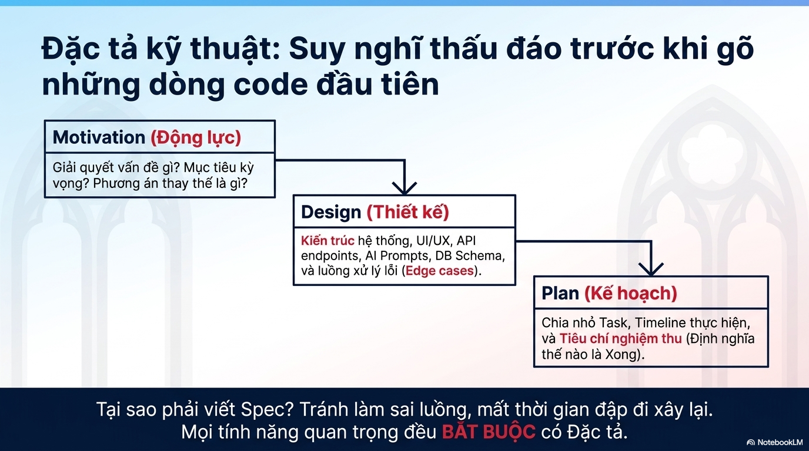

Mandatory 3-step specification workflow before implementing complex modules:

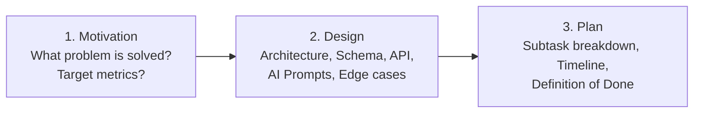

> **Why Write Specs?** To think through edge cases, synchronize contracts between Frontend and Backend, and completely eliminate circular rework.

---

## 9. Meeting Cadence Optimization: Daily Standup vs Technical Meeting

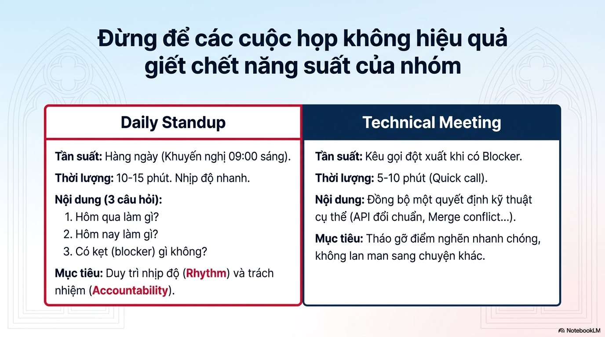

| Criteria | Daily Standup | Technical Deep-Dive Meeting |
|---|---|---|
| **Frequency** | Daily (Recommended: 09:00 AM) | On-demand immediately when blockers arise |
| **Duration** | 10–15 minutes (Fast-paced, stand-up) | 5–15 minutes (Focused quick sync) |
| **Agenda** | **Address 3 questions strictly:** 1. What was completed yesterday? 2. What will be done today? 3. What blockers or dependencies are stalled? | Resolve a single technical impasse (DB schema revision, API contract dispute, merge conflict) |
| **Objective** | Maintain team cadence, accountability, and visibility | Clear immediate bottlenecks with zero conversational drift |

---

## 10. Four Stages of Team Dynamics (Tuckman Model)

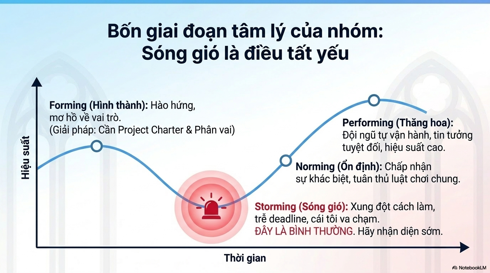

Team psychology progresses across 4 phases during an intensive sprint:
1. **Forming:** High excitement, but vague role boundaries and coordination habits.  
   *(Remedy: Finalize Project Charter & allocate responsibilities immediately).*
2. **Storming (The Friction Trough):** Technical disagreements emerge, delivery slippage occurs, individual egos clash.  
   *(Reality Check: THIS IS COMPLETELY NORMAL. Recognize early and address with professional dialogue).*
3. **Norming:** Acceptance of team differences, mutual respect, shared standards and disciplined rituals.
4. **Performing:** Frictionless execution, deep mutual trust, rapid delivery velocity.

---

## 11. Conflict Management Matrix: Technical vs Personal

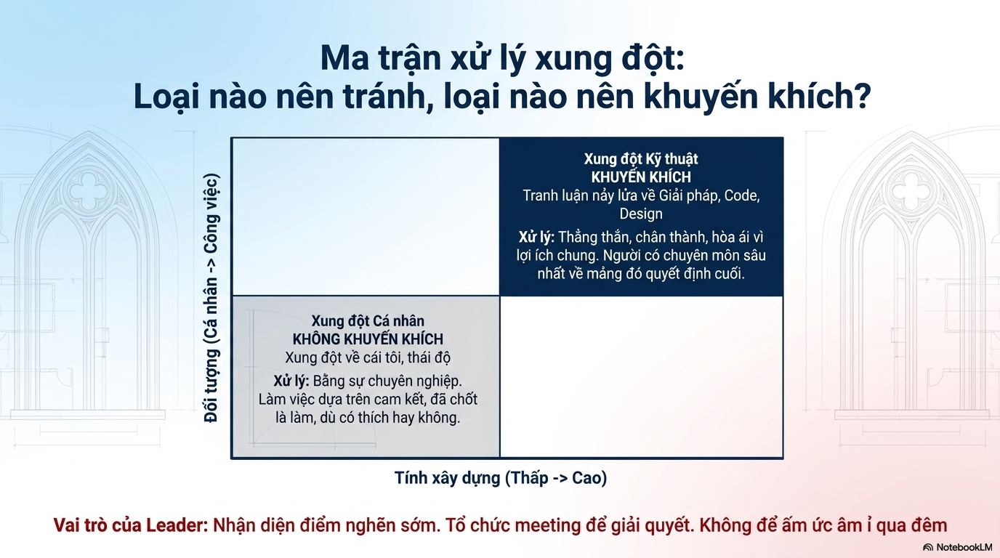

Classify conflicts along two axes: Target (Personal $\leftrightarrow$ Technical) and Constructiveness (Low $\leftrightarrow$ High):

* **Technical Conflict (Work-focused & Highly constructive) $\rightarrow$ ENCOURAGE:**  
  Debates regarding architecture, code patterns, database normalization, or UI design.  
  *Guideline:* Direct, objective, candid communication. The domain owner holds final decision authority.
* **Personal Conflict (Ego, passive aggression, unconstructive) $\rightarrow$ ELIMINATE:**  
  *Guideline:* Disarm emotions with professionalism. Commit to agreed decisions: once the team votes and aligns on a path, everyone commits regardless of personal preference.

> 👑 **Team Lead Responsibility:** Surface team friction early, initiate direct retrospectives, and **never allow passive grievances to linger overnight.**

---

## 12. Structured Retrospectives: Sad - Mad - Glad

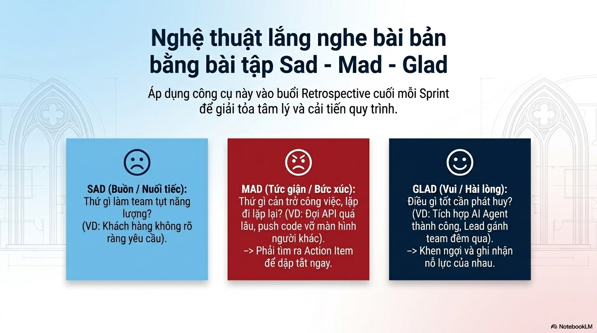

Execute at the end of each Sprint during the **Retrospective** to clear friction and improve workflows:

* 😢 **SAD (Disappointments):** What dampened team morale this week? *(e.g. Unclear requirements, missing test data)*.
* 😡 **MAD (Blockers & Impediments):** What recurring obstacles disrupted progress? *(e.g. Stalled API contracts, untested commits breaking UI)*.  
  $\rightarrow$ **Mandatory: Formulate concrete, actionable items to remediate in the next Sprint.**
* 😊 **GLAD (Wins & Highlights):** What positive breakthroughs occurred? *(e.g. Clean LangGraph pipeline execution, teammates staying late to help each other)*.  
  $\rightarrow$ **Provide candid appreciation and acknowledge individual contributions.**

---

## 13. Cross-Functional Teamwork

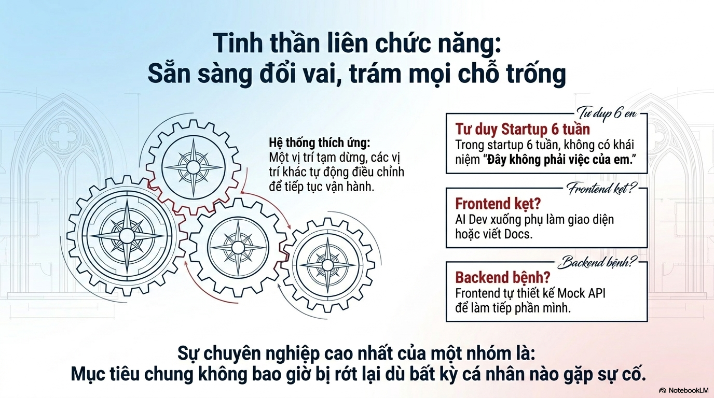

* **Startup Mindset:** In an intensive sprint, **"That is not my job" does not exist.**
* **Gear Mesh System:**
  * When Frontend is blocked on styling $\rightarrow$ Backend/AI developers jump in to support CSS or draft technical documentation.
  * When Backend is debugging an infrastructure crash $\rightarrow$ Frontend developers mock API endpoints to maintain interface progress.
* **Guiding Principle:** *Team outcomes are never allowed to stall due to localized bottlenecks.*

---

## 14. Sprint 1 Mission Brief

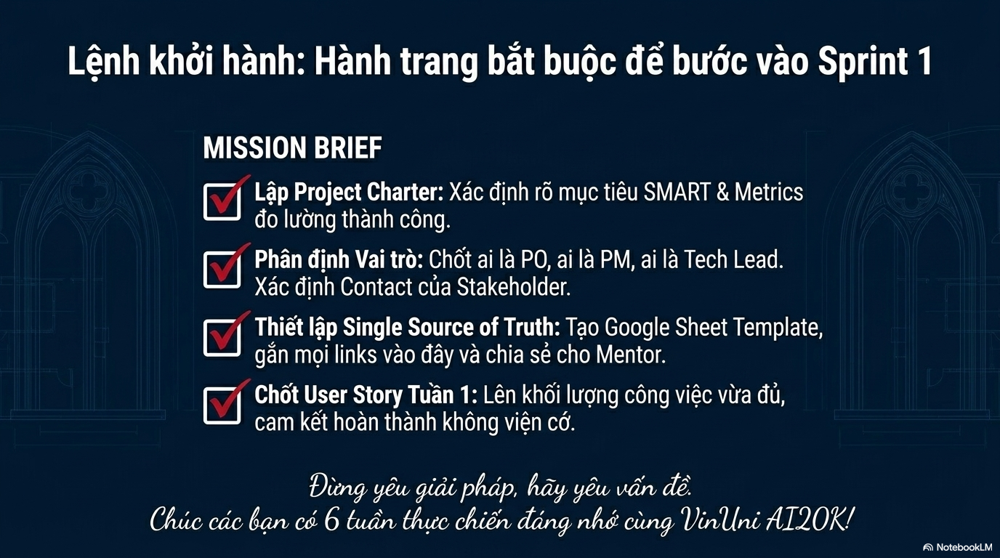

Four mandatory launch items for every team starting Sprint 1:

- [x] **1. Finalize Project Charter:** Scope the problem, SMART goals, and quantitative success metrics.
- [x] **2. Allocate Roles:** Formally assign PO, PM, and Tech Lead responsibilities; establish mentor communication channels.
- [x] **3. Initialize Single Source of Truth (SSOT):** Set up the project spreadsheet/dashboard, connect canonical repo links, and grant mentor access.
- [x] **4. Lock Sprint 1 User Stories:** Commit to a focused, realistic scope for Week 1 with a no-excuses delivery mindset.

> 🌟 *"Fall in love with the user's problem, not just your proposed solution. Have a high-impact, transformative sprint!"*
