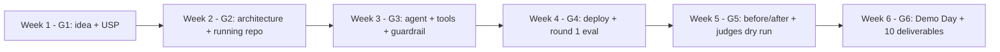

> [📊 Open diagram in Mermaid Live / AI Editor](https://mermaid.live/edit#pako:eNo10D1rwzAQBuC_cmhtTevPwUOHYsjQDqVpyRB5uFjnD5Alo0guJuS_V4oSL4a797kXdGGdFsRqYL3Uf92IxsLnN1fgv0N6_HGoIIUEdmkNkyCEJ_jdf7WQJG9wyOI-C_usBjTdOFnqrDPkc4YWDf7i1t7PZVHlUeVB5V4NpKyPW63l2f8Hh0YYnOSD5ZEVkRWBFTUIWqTefJ5WlLBqNUD6EEUU5ZGzmymDKWs4Ua8NvWBvydwaPRJuIwvvuw_OHryMvIqFVcBVDQ3NGhoMlemrr5fTSgZPks4tewY2k5lxEuElL-EOZ3akmbgfcCaoRyctZ1xdQxid1ftNdX5pjSM_cYtAS82Eg8H5Pr7-A9rneqI=)

## Document Objectives

This book is designed with a single goal: **to help you build high-quality AI Agent projects**, from architectural design to final project submission.

You will learn:

- How to structure projects according to industry standards — folder structure, configuration, environments
- Building AI Agents with LangGraph — state, nodes, edges, tools
- Developing APIs with FastAPI — routes, validation, error handling, streaming
- Setting up DevOps — Docker, CI/CD, cloud deployment
- Writing tests and evaluating Agent quality
- Completing all deliverables on deadline

Each chapter comes with concrete code examples, practical tips, and review questions. After completing this guide, you will be able to confidently build a complete project.

> 🔑 **KEY POINT:** This is not a theory textbook. Every chapter contains code you can copy, run, and modify immediately. Open your terminal and follow along step by step.

## Common Pitfalls to Avoid

Many teams building AI Agents for the first time make similar mistakes — not from a lack of intelligence, but from a lack of software engineering experience. Keep these common gaps in mind to avoid them:

**Not configuring a CI/CD pipeline.** CI/CD (Continuous Integration/Continuous Deployment) is the baseline standard in modern software engineering. When code is pushed to the repository, the system automatically runs tests and checks code quality. No CI/CD = manual testing and manual deployments — with extremely high risk of production failures.

**Skipping evaluation (Agent quality assessment).** Evaluation measures: What percentage of queries does the Agent answer correctly? Does it hallucinate? What is the response latency? Without evaluation, you cannot know whether an Agent is truly effective or just "appears to work" in a demo.

**Sparse or missing README.** The README is the front door of your project. It tells readers what the project does, how to run it, and how the repository is structured.

**Lacking clear environment setup instructions.** Others cannot run your project just by reading documentation. In real-world environments, rapid onboarding capability is essential.

**Lumping all code into a single file.** The project lacks a modular directory structure, making it hard to maintain, test, and review.

**Not writing tests.** No tests = inability to prove that code functions correctly and inability to refactor safely.

> ⚠️ **NOTE:** The issues above reflect the gap between algorithmic theory and practical software engineering. This book is designed to bridge that gap.

## Target Audience and Prerequisites

### Who This Book Is For

- **Primary audience:** Students participating in the AI20K Build Phase program looking to build a production-grade AI Agent from scratch to demo and deployment.
- **Secondary audience:** Mentors and reviewers seeking a standardized reference document. Self-taught developers wanting to apply best practices to AI Agent projects.

### Prerequisites

| Skill | Requirement Level | Explanation |
|---|---|---|
| Python Fundamentals | Intermediate | Function definitions, classes, async/await, type hints |
| APIs & HTTP | Basic | Understanding GET/POST, JSON, REST |
| Git | Basic | Clone, commit, push, branch |
| Terminal/CLI | Basic | Running commands, directory navigation |
| AI/LLMs | Not mandatory | The guide covers concepts from the ground up |

If you need to strengthen your Python basics, complete the "AI Python for Beginners" course on [DeepLearning.AI](https://www.deeplearning.ai/courses) before starting.

## How to Use This Document

### 6-Week Roadmap

| Week | Focus | Chapters | Estimated Time |
|---|---|---|---|
| 1 | Clone template, setup environment, git workflow | 1-2 | 4h |
| 2 | Architecture design, system diagrams | 3 | 6h |
| 3 | Build AI Agent with LangGraph | 4 | 8h |
| 4 | API development + user interface | 5-6 | 8h |
| 5 | DevOps, Docker, CI/CD, deployment | 7 | 6h |
| 6 | Testing, evaluation, final deliverables | 8-9 | 8h |

### Reading Each Chapter

Each chapter follows a consistent structure:

1. **Introduction** — Chapter objectives and key takeaways
2. **Core Content** — In-depth explanations accompanied by code examples
3. **Callout boxes** — Practical tips (💡), Warnings (⚠️), Key takeaways (🔑)
4. **Summary** — Review of essential concepts
5. **Review Questions** — Self-assessment exercises

> 💡 **TIP:** Do not just read — open your terminal and code along. Learning by doing is the most effective approach. Every code block in the guide can be executed directly.

## 10-Chapter Overview

| Chapter | Content | Focus Area |
|---|---|---|
| 1 | Preface (this chapter) | Goals, how to use the guide |
| 2 | Project Initialization | Template, setup, git workflow |
| 3 | Architecture Design | 3-tier architecture, diagrams, ADRs |
| 4 | LangGraph Agent | State, nodes, edges, tools, RAG |
| 5 | FastAPI | Routes, validation, error handling |
| 6 | User Interface | Next.js, responsive design, streaming |
| 7 | DevOps | Docker, CI/CD, deployment, logging |
| 8 | Testing | Unit tests, integration tests, RAGAS |
| 9 | Demo Day Submission | Deliverables, checklist, best practices |
| 10 | Learning Resources | Courses, docs, BMAD method |

## Chapter Summary

- This guide helps you build production-ready AI Agent projects from end to end.
- 10 core chapters across 6 weeks, each with code examples and review exercises.
- Common mistakes to avoid: missing CI/CD, lack of automated tests, weak READMEs, skipping evaluations.
- Learn by doing — open your terminal and implement each step.

## Review Questions

1. List 3 common mistakes when building AI Agents that you must avoid. Why is each mistake critical?
2. Which prerequisite skills do you currently possess? Which areas do you need to improve?
3. Plan your 6-week schedule based on the roadmap, specifying the hours per week and target chapters.
