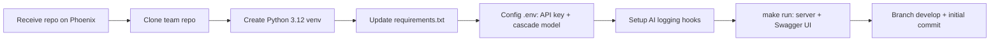

## Receiving Your Team Repo — Starting on the Right Foundation

One of the most common mistakes students make when starting a new project is building everything from scratch — manually organizing directory structures, configuring linters, writing CI/CD files, and authoring Dockerfiles. As a result, each team ends up with an inconsistent structure, misses critical files, and loses days on configuration instead of core logic. A project template solves this by providing a standardized foundation that bundles all necessary best practices.

In AI20K, you do not manually clone a template to create a separate repository. Once your team is finalized, the system automatically generates a team repo **from this template** within your cohort's GitHub organization, named after your team ID. Your job is simply to clone it and start coding.

### Two Things to Verify Before Cloning

1. **You have joined the cohort's GitHub organization.** The organizing team sends an invitation to your registered GitHub account; if the invitation has not been accepted, your clone command will fail with a 404 error (GitHub returns 404 rather than 403 for private repositories you do not have permission to access). Check this at [github.com/settings/organizations](https://github.com/settings/organizations).
2. **Your team repo has been created.** The repository link is displayed on your team page on Phoenix, and a notification is posted to the GitHub feed channel on Discord as soon as the repo is generated.

If you cannot see your team repo yet, **do not create a new one yourself** — contact the organizing team. Repositories created outside the official organization will not fire webhooks to the evaluation grading engine and will not count as valid submissions.

### Cloning Your Team Repo

Open your terminal and run the following commands:

```bash
# Replace <COHORT-ORG>/<TEAM-ID> with your real URL from your Phoenix team page
$ git clone https://github.com/<COHORT-ORG>/<TEAM-ID>.git

# Navigate into the project folder
$ cd <TEAM-ID>

# Confirm remote points to your team repo, not the template
$ git remote -v
```

You **do not** need to run `rm -rf .git`, `git init`, or `git remote add`. The team repository is generated via GitHub's *template generate* feature rather than a manual fork or clone: it starts with a clean initial commit without carrying over the template's commit history. The historical need for `rm -rf .git` no longer applies.

Conversely, deleting `.git` at this stage harms your project: you lose the configured GitHub remote, drop the protected `main` branch, and leave subsequent pushes without an upstream target.

### Directory Structure and Purpose

After cloning, open the project in your code editor (VS Code recommended). You will see the following structure:

```
<TEAM-ID>/
├── src/
│   ├── agent/           # LangGraph Agent logic
│   │   ├── __init__.py
│   │   ├── graph.py     # State graph definition
│   │   ├── state.py     # State schema
│   │   ├── nodes.py     # Node functions
│   │   └── tools.py     # Agent tools
│   ├── api/             # FastAPI endpoints
│   │   ├── __init__.py
│   │   ├── main.py      # FastAPI app entry point
│   │   ├── routes/      # API route modules
│   │   └── deps.py      # Dependencies injection
│   ├── core/            # Shared config & utilities
│   │   ├── __init__.py
│   │   ├── config.py    # Pydantic settings
│   │   └── logging.py   # Logging setup
│   └── models/          # Data models (Pydantic)
│       ├── __init__.py
│       └── schemas.py   # Request/Response schemas
├── tests/
│   ├── unit/            # Unit tests
│   ├── integration/     # Integration tests
│   └── eval/            # Agent evaluation tests
├── docs/
│   ├── architecture/    # Architecture diagrams
│   ├── api/             # API documentation
│   └── adr/             # Architecture Decision Records
├── eval/                # Evaluation datasets & scripts
│   ├── datasets/        # Test questions & expected outputs
│   └── scripts/         # Evaluation runner scripts
├── presentation/        # Demo Day slides & materials
├── .env.example         # Environment variable template
├── .gitignore           # Git ignore rules
├── Dockerfile           # Container definition
├── docker-compose.yml   # Multi-container orchestration
├── requirements.txt     # Dependency specifications
├── ruff.toml            # Linter/formatter configuration
├── Makefile             # Common command shortcuts
└── README.md            # Project documentation
```

Each directory serves a defined purpose. Understand them before writing code:

**`src/agent/`** — Houses all AI Agent logic. `graph.py` defines the state graph for the Agent, `state.py` specifies data schemas passed across nodes, `nodes.py` handles execution logic at each step, and `tools.py` defines tools the Agent can invoke (web search, database queries, external APIs, etc.). This is the application's core brain.

**`src/api/`** — FastAPI backend. `main.py` bootstraps the FastAPI application and configures middleware. The `routes/` directory contains endpoint definitions grouped by domain. `deps.py` provides dependency injection — such as creating Agent instances and injecting them into route handlers.

**`src/core/`** — Shared configuration and utilities. `config.py` uses `pydantic-settings` to load and validate environment variables. `logging.py` sets up structured logging.

**`src/models/`** — Pydantic models for requests and responses. This acts as the contract between client and server — defining input and output data shapes.

**`tests/`** — Test suites. `unit/` for unit tests (isolated functions), `integration/` for multi-component integrations, and `eval/` for Agent evaluation runs.

**`docs/`** — Project documentation. `architecture/` contains architecture diagrams (Mermaid or images), `api/` holds supplementary API docs, and `adr/` captures Architecture Decision Records — documenting why solution A was chosen over solution B.

**`eval/`** — Data and scripts for Agent evaluation. `datasets/` holds test scenarios with expected outcomes. `scripts/` contains automated evaluation runners that score Agent responses. Most teams overlook this — ensure your team does not.

**`presentation/`** — Slide decks and materials for Demo Day. Do not wait until the final hours — iterate on your slides continuously during development.

> 🔑 **KEY POINT:** This folder structure is deliberate — it reflects the principle of separation of concerns. Agent logic is isolated from API handling, configuration, and tests. As your project expands, this structure lets you navigate and refactor code quickly rather than maintaining a monolithic single file.

## Choosing Your Starting Tier: Rapid Prototype or Serious Build?

> 💡 **Cohort Lesson:** Teams with unvalidated ideas that built a full Docker/CI setup in Week 1 spent their first 3 weeks "setting up infrastructure" without gathering user feedback. Conversely, teams confident in their idea who stuck to manual prototyping saw their demos break under load. Pick the right tier.

| | **Tier 1 — Day 1 Prototype** (Idea Validation) | **Tier 2 — Team Repository** (This Chapter) |
|---|---|---|
| When | Weeks 1-2, user need is unverified; need something tangible to interview 5 real users | USP confirmed + ≥5 validated user feedbacks (see Chapter 5); ready to build seriously on the provisioned repo |
| Tools | AI Studio / Gemini Canvas + free Firebase/Supabase — NO servers, NO Docker | This repo: FastAPI + LangGraph + Docker + CI |
| Objective | Answer "will users use this?" within 48 hours | Answer "can this product withstand Demo Day?" over 6 weeks |
| Omissions | DevOps, tests, guardrails (acceptable — code will be discarded) | Zero omissions allowed |

**Rule:** Focus on "done over perfect." Tier 1 code can be 100% discarded — that is a win, not a loss. When transitioning to Tier 2, carry over exactly two assets: real user inquiries (→ golden dataset in Chapter 10) and the validated USP (Chapter 5).


> [📊 Open diagram in Mermaid Live / AI Editor](https://mermaid.live/edit#pako:eNotkM1uwjAQhF9l5WsLUtsbh0oQfopUVai0J4fDKl5si9ibOnYAId69TohP1sw3s17fRMWKxAzEseZzZTBE-PwuPeQzl18GPQRqGGIgDzvD5O3lAJPJOyxkUbOnh63YHh6hxWAW8gcZOvId7K7RsIe36cvriBQDspQFNuANxlzxl2wgRz6203iJI7ccuJUs2B-thmlum8F8t4UTXeEJKmwrVAQuL1CPkdUQWcs9xdTAfAs1a229BsN8akdoPUAb6fCUn5_8DFoKHYXcuT-j1vn2ux3ZzcB-yEVAXxlQ1FHNTT-dnbMRFKaDeAbhKDi0qv_IW58sRTR5oTILpVB0xFTHUpT-3sOYIu-vvspmDImykhqFkZYWdUA3yvd_h8SBlA==)

## Environment Setup — Avoiding "It Works on My Machine"

A classic complaint in software engineering is "It works on my machine." This friction stems from mismatched environments: different Python versions, divergent libraries, and inconsistent environment variables. This section guides you through setting up an environment that runs identically on every machine.

### System Requirements

Confirm your machine meets these prerequisites:

- **Python 3.12 or newer.** FastAPI, Pydantic 2, and LangChain/LangGraph 1.x fully support Python 3.12/3.13. Recommended: Python 3.12.x (stable and core-library verified as of 2026-09).
- **Latest pip version.** Run `pip install --upgrade pip` to update.
- **Git 2.30+.** Run `git --version` to verify.
- **(Optional) Docker Desktop.** Needed if you run containerized applications, though not strictly required during early local development.

Verify your Python installation:

```bash
$ python3 --version
# Expected: Python 3.12.x or higher

# If multiple Python versions are installed, check explicitly:
$ python3.12 --version
```

### Creating a Virtual Environment

A virtual environment (venv) isolates project dependencies from the global operating system Python installation. Each project should maintain its own venv to prevent dependency conflicts.

```bash
# From the project root
$ python3.12 -m venv .venv

# Activate venv on macOS/Linux
$ source .venv/bin/activate

# Activate venv on Windows
$ .venv\Scripts\activate

# Confirm active Python is inside venv
$ which python
# Expected output: /path/to/your/project/.venv/bin/python
```

Once activated, your command prompt displays `(.venv) $`, confirming your active virtual environment. Any subsequent `pip install` commands will install packages exclusively inside this venv.

> ⚠️ **NOTE:** Never install dependencies into the system Python. If you install packages globally by accident, remove them with `pip uninstall` and repeat inside an active venv. The `.venv` directory is ignored by `.gitignore` and must never be committed.

### Installing Dependencies

The template specifies all runtime, testing, and linting dependencies in `requirements.txt`:

```bash
$ pip install -r requirements.txt
```

There is no `pip install -e .` step: the template does not package `src/` as an installed library; it runs directly from the repository folder (`uvicorn src.main:app`). Any edits inside `src/` take effect immediately on the next execution without reinstallation.

Key runtime dependencies:

- **`fastapi`** — Async backend framework with automatic documentation.
- **`uvicorn`** — High-performance ASGI web server.
- **`langgraph`** — State machine framework for building AI Agents.
- **`langchain`** — Core orchestration abstractions.
- **`langchain-openai`** — OpenAI model integrations (GPT-4, GPT-3.5).
- **`pydantic`** and **`pydantic-settings`** — Data validation and environment settings.
- **`python-dotenv`** — Loads environment variables from `.env`.

Development dependencies:

- **`pytest`** and **`pytest-asyncio`** — Testing framework with async fixture support.
- **`ruff`** — Fast linter and formatter replacing flake8 and black.
- **`mypy`** — Static type checker. Optional in `requirements.txt`; install via `pip install mypy` when running `make typecheck`.
- **`httpx`** — Async HTTP client for endpoint testing.

Optional dependencies (commented out at the end of the file) include SQLAlchemy, Alembic, psycopg2 for relational databases, and ChromaDB for vector stores. Uncomment the relevant packages if your project needs them.

### Verifying the Installation

Verify that all dependencies were installed properly:

```bash
# Check FastAPI
$ python -c "import fastapi; print(f'FastAPI {fastapi.__version__}')"

# Check LangGraph
$ python -c "import langgraph; print('LangGraph OK')"

# Run tests to confirm template baseline
$ make test
# Or:
$ pytest tests/ -v
```

If all commands complete without errors, your development environment is fully prepared.

> 💡 **TIP:** If you see "Module not found" errors after installing, you likely forgot to activate `.venv` or installed into system Python. Check `which python` and activate the environment again if needed.

## Environment Variables — Never Hardcode Secrets

Hardcoding sensitive values such as API keys or database credentials into source code is dangerous. Automated scanners crawl GitHub continuously. Once pushed, leaked keys can be exploited within minutes, incurring unexpected usage costs.

Environment variables solve this. You store sensitive credentials in a local `.env` file (ignored by Git), and your code reads these values from the runtime environment.

### The .env.example File

> 💰 **Free AI Accounts:** Registration guide for OpenAI/Anthropic/Gemini/Groq/Cohere for AI20K students is available in [free-accounts.md](free-accounts.md).

The template supplies a `.env.example` file listing all required environment keys without exposing real credentials. Copy it to `.env` and fill in your values:

```bash
$ cp .env.example .env
```

Example `.env.example`:

```env
# Application
APP_NAME=ai-agent
APP_ENV=development
DEBUG=true
LOG_LEVEL=DEBUG

# API
API_HOST=0.0.0.0
API_PORT=8000
API_PREFIX=/api/v1

# LLM Provider
LLM_PROVIDER=openai
OPENAI_API_KEY=sk-your-key-here
# Cascade router (src/services/llm.py): cheap model classifies, capable model generates,
# judge MUST differ from generate (app raises ValueError if identical to prevent self-preference bias)
MODEL_CLASSIFY=gpt-4o-mini
MODEL_GENERATE=gpt-4o
MODEL_JUDGE=gpt-4o-mini
OPENAI_TEMPERATURE=0.7
OPENAI_MAX_TOKENS=2048
# Agent loop: max ReAct iterations before escape hatch finalize-with-partial triggers
AGENT_MAX_ITERATIONS=8

# Database (optional)
DATABASE_URL=sqlite:///./data/app.db

# Vector Store (for RAG, optional)
VECTOR_STORE_TYPE=chroma
CHROMA_PERSIST_DIR=./data/chroma
```

After copying, populate `.env` with your real keys, replacing `sk-your-key-here` with your actual OpenAI API key.

> ⚠️ **NOTE:** Never commit `.env` to Git. It is already included in `.gitignore`. If you accidentally commit `.env`: (1) revoke and regenerate the API key immediately, and (2) scrub the file from git history using `git filter-branch` or BFG Repo-Cleaner.

### Config Module with pydantic-settings

The template manages configuration through `pydantic-settings`, providing type safety when loading variables. Review `src/core/config.py`:

```python
from typing import Literal
from pydantic import Field, field_validator
from pydantic_settings import BaseSettings


class Settings(BaseSettings):
    """Application settings loaded from environment variables."""

    # Application
    app_name: str = "ai-agent"
    app_env: Literal["development", "staging", "production"] = "development"
    debug: bool = False
    log_level: Literal["DEBUG", "INFO", "WARNING", "ERROR"] = "INFO"

    # API
    api_host: str = "0.0.0.0"
    api_port: int = Field(default=8000, ge=1024, le=65535)
    api_prefix: str = "/api/v1"

    # LLM
    llm_provider: Literal["openai", "anthropic", "google"] = "openai"
    openai_api_key: str = Field(default="", alias="OPENAI_API_KEY")
    openai_model: str = "gpt-4o-mini"
    openai_temperature: float = Field(default=0.7, ge=0.0, le=2.0)
    openai_max_tokens: int = Field(default=2048, ge=1, le=128000)

    model_config = {
        "env_file": ".env",
        "env_file_encoding": "utf-8",
        "case_sensitive": False,
        "extra": "ignore",
    }


# Singleton instance
settings = Settings()
```

Key mechanics:

**`Literal` types** — `Literal["development", "staging", "production"]` restricts `app_env` to explicit choices. Setting `APP_ENV=testing` causes Pydantic to raise an error at startup rather than failing silently at runtime, following the fail-fast principle.

**`Field` validation** — `Field(default=8000, ge=1024, le=65535)` enforces valid port ranges. Similarly, `temperature` is constrained between 0.0 and 2.0, and `max_tokens` between 1 and 128000.

**`model_config`** — Directs environment loading: `env_file=".env"` specifies the target file, `case_sensitive=False` maps uppercase variables (`OPENAI_API_KEY`) to lowercase fields (`openai_api_key`), and `extra="ignore"` ignores unmapped keys.

**Singleton pattern** — `settings = Settings()` instantiates a module-level singleton. Anywhere in the codebase, you can import and reuse it: `from src.core.config import settings`.

```python
# Usage anywhere across the project
from src.core.config import settings

print(settings.openai_model)     # "gpt-4o-mini"
print(settings.api_port)         # 8000
print(settings.app_env)          # "development"
```

> 💡 **TIP:** When introducing new environment variables: (1) add them to `.env.example` with dummy values, (2) declare fields on `Settings` with type annotations and defaults, and (3) apply validation rules as needed. Never read environment keys directly in business logic without going through `Settings`.

## Git Workflow — Structured Team Collaboration

Teams without a unified Git workflow frequently encounter force-push overwrites, unresolved merge conflicts, cryptic commit messages ("fix", "update"), and broken builds on `main`. Establishing clear conventions prevents these issues.

### Branching Strategy

The template adopts a straightforward branching model:

- **`main`** — Production-ready branch. Always deployable. Never push directly to `main`; all changes enter via Pull Requests.
- **`develop`** — Integration branch where feature branches land prior to releases. Once verified, merge `develop` into `main`.
- **`feature/FEATURE-NAME`** — Dedicated branch for each feature or bug fix with descriptive naming.

Workflow example:

```bash
# Start a new feature
$ git checkout develop
$ git pull origin develop
$ git checkout -b feature/agent-search-tool

# Work and commit regularly
$ git add src/agent/tools/search.py
$ git commit -m "feat(agent): add web search tool"

# Push branch and open a PR
$ git push origin feature/agent-search-tool
# Open PR on GitHub: feature/agent-search-tool → develop
```

### Commit Message Conventions

Commit messages must remain informative and structured:

```
type(scope): concise description

[optional detailed body]
```

Standard types:

- **`feat`** — New functionality. E.g.: `feat(api): add /chat/stream endpoint`
- **`fix`** — Bug fix. E.g.: `fix(agent): handle empty user query gracefully`
- **`docs`** — Documentation updates. E.g.: `docs: update setup guide in README`
- **`test`** — Test updates. E.g.: `test(agent): add test coverage for search tool`
- **`refactor`** — Code restructuring without feature alterations. E.g.: `refactor(config): migrate settings to pydantic-settings`
- **`chore`** — Maintenance tasks. E.g.: `chore: bump ruff to v0.4.0`

Scope annotations are optional but recommended: `agent`, `api`, `config`, `models`, `tests`, etc.

### Pull Request Process

Pull Requests (PRs) serve as quality checkpoints. Every PR should:

1. **Feature a clear title** adhering to commit message conventions.
2. **Contain a description** explaining what changed, why, and how to verify.
3. **Stay compact and focused** — address one logical unit of work per PR.
4. **Be reviewed by at least one teammate** before merging.
5. **Pass all automated CI checks** (tests, linters) before merge approval.

```markdown
## PR Template

### Changes
- Added web search tool for the Agent
- Integrated Tavily Search API

### Why
The Agent requires real-time search capabilities to answer queries regarding recent events.

### How to Test
1. Configure `TAVILY_API_KEY` in `.env`
2. Run `pytest tests/unit/test_search_tool.py -v`
3. Verify manually via Swagger UI: POST /api/v1/chat

### Checklist
- [x] Conforms to project code style
- [x] Unit tests added
- [x] All automated tests pass
- [x] No secrets committed
```

> 🔑 **KEY POINT:** A structured Git workflow serves as your team safety net. If regressions occur, you can revert cleanly. When bugs emerge, `git bisect` identifies the root cause. Investing 5 minutes into clear PRs and commits saves hours of debugging later.

## Starting the Server — The Hello World Milestone

After setting up your environment and secrets, start the server to confirm system health. The template includes a preconfigured FastAPI application with a health check endpoint.

### Starting the Server

```bash
# Ensure venv is active
$ source .venv/bin/activate

# Launch FastAPI server
$ uvicorn src.api.main:app --reload --host 0.0.0.0 --port 8000
```

Parameter breakdown:

- **`src.api.main:app`** — Points to the FastAPI application instance (`app = FastAPI(...)` inside `src/api/main.py`).
- **`--reload`** — Hot-reloads code changes during development. Never use in production.
- **`--host 0.0.0.0`** — Binds to all interfaces for network accessibility.
- **`--port 8000`** — Listens on port 8000, aligning with `API_PORT`.

Expected output:

```
INFO:     Will watch for changes in these directories: ['/path/to/project']
INFO:     Uvicorn running on http://0.0.0.0:8000 (Press CTRL+C to quit)
INFO:     Started reloader process [12345] using WatchFiles
INFO:     Started server process [12346]
INFO:     Waiting for application startup.
INFO:     Application startup complete.
```

### Swagger UI — Automatic API Documentation

FastAPI auto-generates interactive API documentation. Navigate to:

```
http://localhost:8000/docs
```

Swagger UI allows you to inspect all endpoints, review request/response schemas, and execute live API requests directly in your browser without external tools like Postman.

### Health Check Endpoint

Verify server readiness using the built-in health check:

```bash
# Using curl
$ curl http://localhost:8000/api/v1/health

# Or open in your browser
# http://localhost:8000/api/v1/health
```

Expected response:

```json
{
  "status": "healthy",
  "version": "0.1.0",
  "environment": "development"
}
```

If the response returns successfully, your configuration and server are working. If issues arise, check: (1) is the venv active?, (2) does `.env` exist?, (3) is port 8000 already occupied (`lsof -i :8000`)?

### Using Makefile Shortcuts

The template includes a `Makefile` with handy targets:

```bash
$ make run          # Run the server
$ make test         # Run test suites
$ make lint         # Run ruff linter
$ make format       # Format code with ruff
$ make typecheck    # Run static type checker (mypy)
$ make check        # Execute all checks (lint + format + typecheck + test)
```

> 💡 **TIP:** Bookmark `http://localhost:8000/docs`. You will use it continuously throughout development. Every new route registered in FastAPI appears here immediately.

## Customizing the Template for Your Project

With a running template, customize the scaffolding for your domain while keeping core architecture intact.

### Immediate Customizations

**1. Review `requirements.txt`:** Uncomment packages your team actually needs, and add any third-party libraries here rather than installing them ad-hoc. CI builds environments directly from this file; unlisted dependencies will fail CI builds even if they work locally.

```
# Database — uncomment if used
sqlalchemy>=2.0.0
alembic>=1.14.0

# Vector Store — uncomment for RAG
chromadb>=0.5.0
```

Always include version bounds (`>=`) to prevent unexpected upstream breaking changes from breaking builds.

**2. Update `README.md`:** Replace placeholder text with your team's details:

```markdown
# Team Alpha — AI Agent

## Overview
Agent for automated social media sentiment analysis and summarization reports.

## Members
- Member A — Agent logic
- Member B — API & Backend
- Member C — Frontend & Testing

## Quick Start
```bash
python3.12 -m venv .venv
source .venv/bin/activate
pip install -r requirements.txt
cp .env.example .env  # Populate API keys
make run
```

## API Docs
With server running, visit: http://localhost:8000/docs
```

**3. Configure `.env` with valid keys:** Add your real OpenAI API key to `.env`:

```env
OPENAI_API_KEY=sk-proj-xxxxxxxxxxxxx
```

### What to Keep Intact

- **Directory structure** — Do not rearrange folders without compelling reasons; it follows established patterns.
- **Git workflow** — Branching conventions and commit formats.
- **CI/CD configuration** — Retain predefined GitHub Actions workflows.
- **Testing setup** — The `tests/` layout and pytest execution paths.
- **Linting rules** — The `ruff` setup in `ruff.toml`.

### First-Week Milestone Checklist

Before moving forward, ensure your team has:

1. Cloned the team repo; confirmed remote points to the cohort organization via `git remote -v`.
2. Created `.venv` and installed all project dependencies.
3. Created `.env` and set active API credentials.
4. Started the server locally and opened Swagger UI.
5. Updated `README.md` with team project metadata.
6. Created the `develop` branch with at least one commit.
7. Installed AI Logging Hooks (see below).

Once these 7 items are checked off, you are ready for Chapter 3, where we design system architecture.

> ⚠️ **NOTE:** Do not rush into writing Agent logic immediately. The placeholder code in `src/agent/` should remain as-is until you finish the architecture design in Chapter 3. Coding without architectural clarity leads to rewrites.

## Setting Up AI Usage Logging Hooks

The template bundles automated logging hooks to track prompts and tool interactions when utilizing AI coding assistants. This satisfies academic tracking requirements for grading AI usage rubrics.

### Why AI Logging Is Required

- **Transparency** — Clear documentation of AI usage during project development.
- **Grading** — Course instructors use this telemetry to grade the "AI Usage" rubric criteria.
- **Self-reflection** — Allows teams to inspect their own tool usage patterns and prompt efficiency.

### One-Time Setup Execution

```bash
# Linux / macOS / Git Bash
bash scripts/setup_hooks.sh

# Windows PowerShell
# powershell -ExecutionPolicy Bypass -File scripts\setup_hooks.ps1
```

This installs the git pre-push hook and initializes the `.ai-log/` folder. All supported AI tools will log telemetry automatically.

### Supported AI Tools

| Tool | Mechanism | When Telemetry Logs |
|---|---|---|
| **Claude Code** | `.claude/settings.json` hooks | On every prompt + tool invocation |
| **Cursor** | `.cursor/hooks.json` | On every prompt + session stop |
| **OpenAI Codex CLI** | `.codex/hooks.json` | On every prompt + session stop |
| **Gemini CLI** | `.gemini/settings.json` | BeforeAgent + AfterModel + SessionEnd |
| **GitHub Copilot** | `.github/hooks/hooks.json` | On every prompt + session end |
| **Antigravity IDE** | Pre-push scan transcript | Automatic transcript scan on `git push` |

### Telemetry Flow

```
Developer uses AI tool (Claude Code, Cursor, etc.)
        ↓
Hook captures prompt + metadata automatically
        ↓
Appends entry to .ai-log/session.jsonl
        ↓
git push → pre-push hook submits records to grading server
```

Captured metadata includes: timestamp, tool name, model identifier, repo name, branch, commit SHA, student email, prompt contents, and tool responses.

### Manual Logging for Web Interfaces

When using ChatGPT, Claude.ai, Gemini Web, or tools lacking local hooks:

```bash
# Interactive mode (prompts for tool and text)
bash scripts/_pyrun.sh scripts/log_manual.py

# CLI one-liner
bash scripts/_pyrun.sh scripts/log_manual.py --tool chatgpt --prompt "Brainstorm UI layout"
bash scripts/_pyrun.sh scripts/log_manual.py --tool gemini-web --prompt "Research scoring algorithms"
```

### Configuration in `.env`

Supplied in `.env.example`:

```env
AI_LOG_SERVER=https://ai-logs.note.transformerlabs.ai/api/ingest
AI_LOG_API_KEY=<provided by instructor>
AI_LOG_DIR=.ai-log
```

Copy to `.env` and fill in the instructor-provided `AI_LOG_API_KEY`.

### Troubleshooting

| Issue | Root Cause | Resolution |
|---|---|---|
| Hooks not logging | Setup script not run | Re-run `bash scripts/setup_hooks.sh` |
| `python3: not found` | Missing Python in system PATH | `brew install python3` (macOS) or install via python.org (Windows) |
| Submission fails | Invalid `AI_LOG_API_KEY` or network issue | Check `.env`; logs remain cached locally |
| Antigravity missing logs | No transcript present | Confirm Antigravity IDE is opened in the repository directory |

> ⚠️ **IMPORTANT:** Never modify or delete files under `.ai-log/`. Do not bypass hooks with `git push --no-verify`. Contact instructors if issues persist.

## Summary

This chapter walked through initializing your project from the provided template — setting the project foundation. We covered repository cloning, directory layout (`src/`, `tests/`, `docs/`, `eval/`, `presentation/`), setting up virtual environments with Python 3.12+, installing dependencies, and running the server for the first time.

You also learned type-safe configuration using `pydantic-settings`, structured Git branching and commit standards, and differentiating template boilerplate from customized project components.

The template serves as guide rails: ensuring steady direction and preventing costly structural pitfalls while allowing full creative freedom in domain logic.

## Review Questions

**Question 1:** Why should you avoid deleting `.git` and running `git init` after cloning a repo generated from a GitHub Template? What repository information is lost if `.git` is wiped? Which command verifies your active remote configuration?

**Question 2:** Explain the difference between `.env.example` and `.env`. Why is `.env.example` committed to version control while `.env` is ignored? What remediation steps should you take if a secret is committed accidentally?

**Question 3:** In `pydantic-settings`, why use `Literal["development", "staging", "production"]` instead of raw `str` for `app_env`? What concrete real-world benefits does this provide for early error detection?
