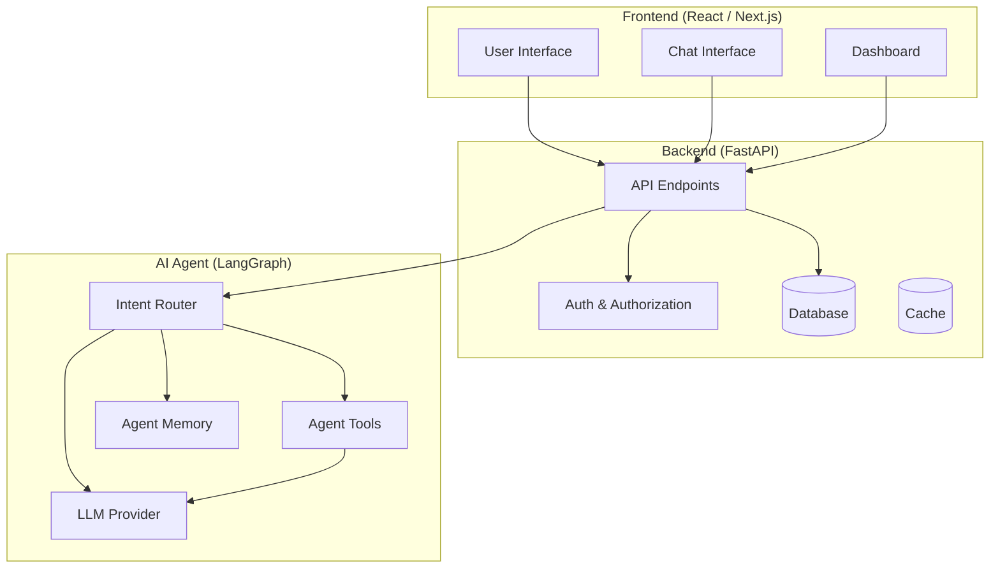
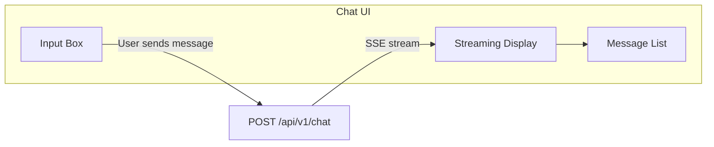
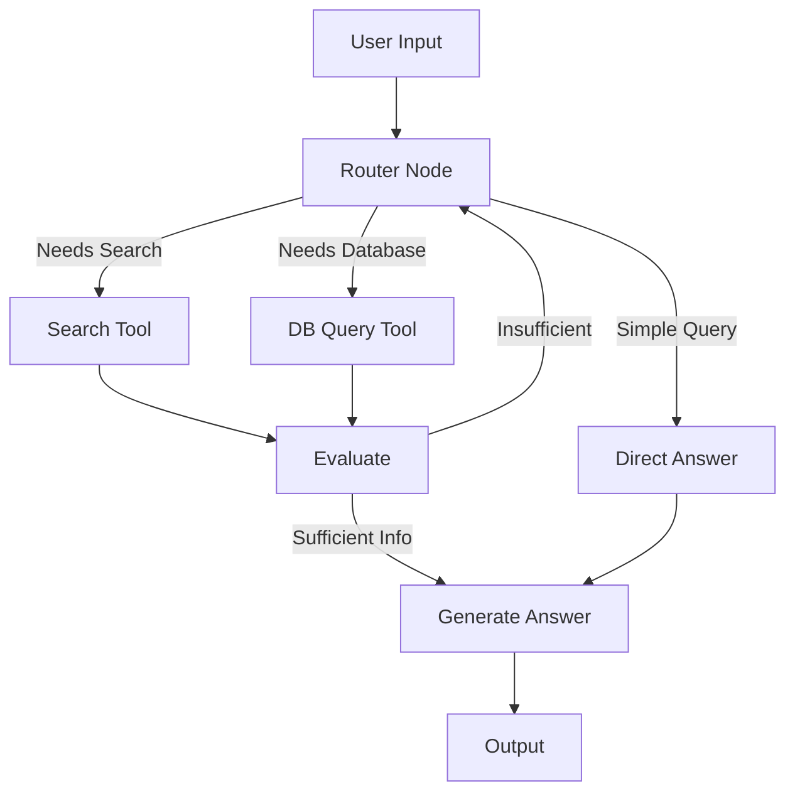
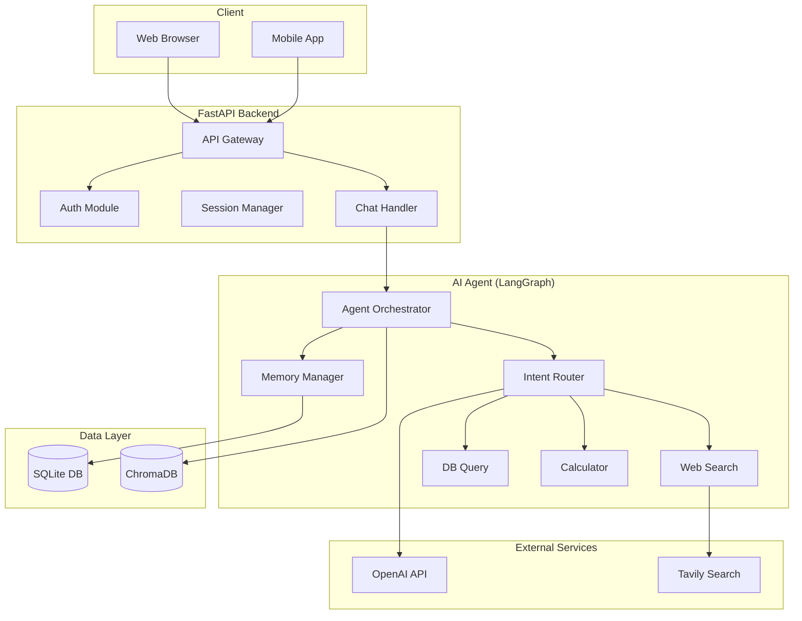
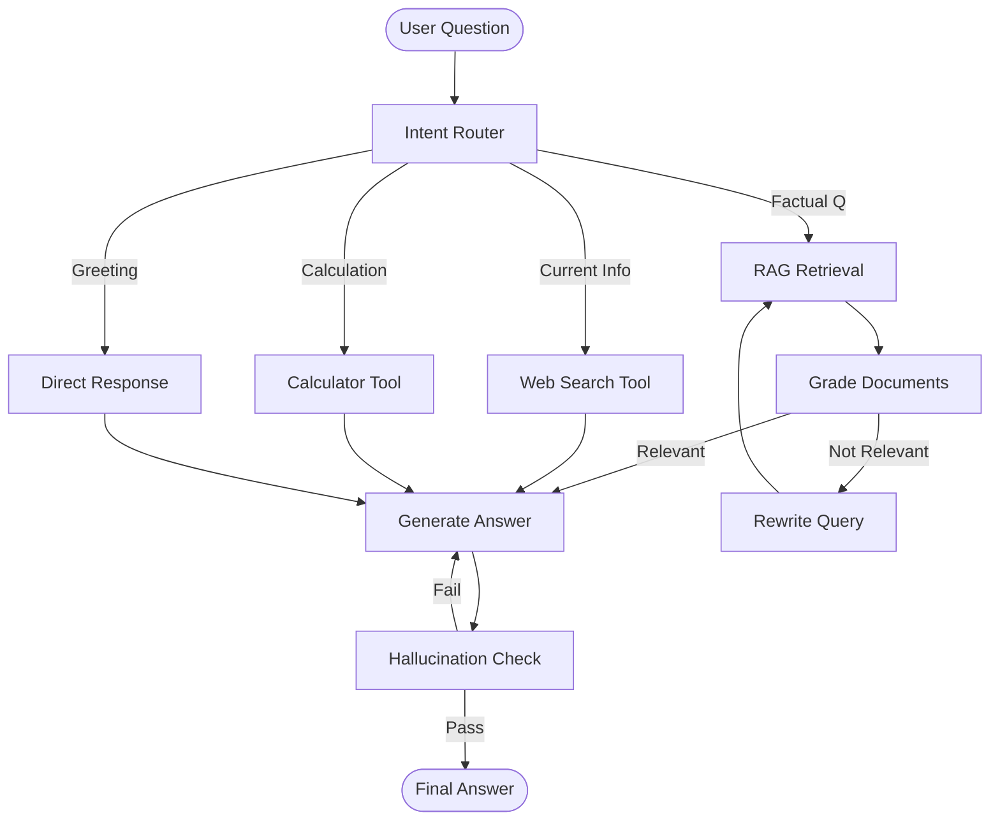
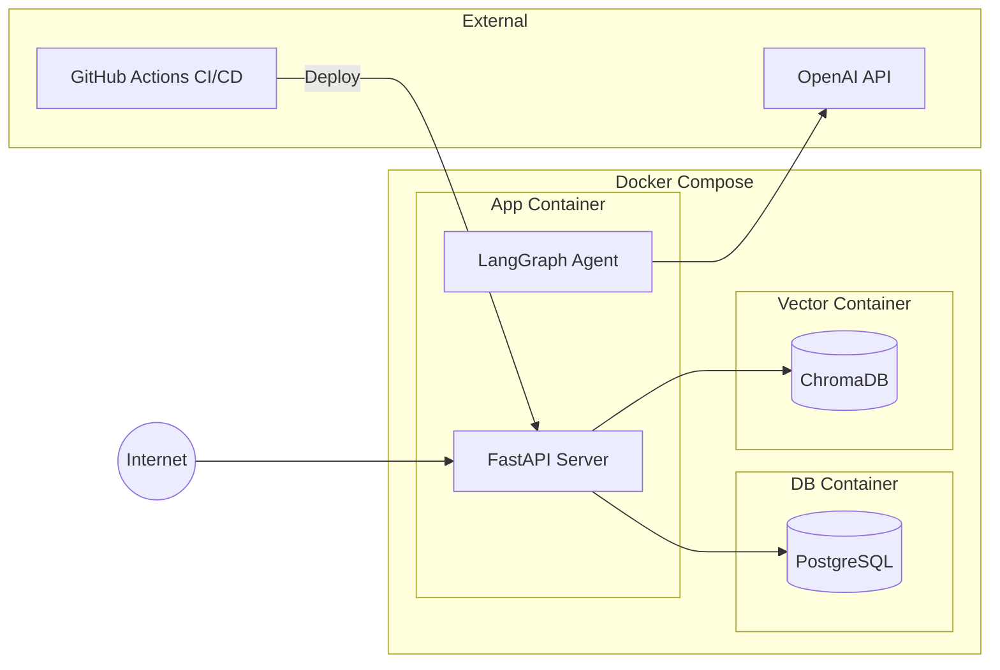

## 3-Tier Architecture Overview — The Big Picture

Before writing a single line of Agent logic, you need to answer the most fundamental question: **what will the system architecture look like?** System architecture acts like an architectural blueprint — it outlines where each component lives, how they interact, and how data traverses the system. Sound architectural design accelerates development, simplifies maintenance, and enables scaling. Weak architecture produces brittle code, frequent regressions, and painful rewrites.

Most modern AI Agent applications adopt a **3-tier architecture**, consisting of Frontend, Backend, and AI Agent layers. Each tier handles discrete responsibilities, interfacing across clearly defined APIs. This separation unlocks distinct benefits: you can refactor the Frontend without touching Agent logic, enhance the Agent without redeploying the Frontend, and scale each layer independently.

The diagram below illustrates the overall architecture:


> [📊 Open diagram in Mermaid Live / AI Editor](https://mermaid.live/edit#pako:eNptU9FKwzAU_ZVLHmSC080X0QdhsyqFKUMdCIkPd03WVm0y20Qcw3_3Jtlm6yyknHtOcnvODV2zzEjFLoDlNS4LeBoLDfQ0bh6Jm9poq7Tkgm0h9B4UZhZO4F592ePX5lCwl3jMP7OU35ZoQJbCDVV2pkHnwg2G84GvpSxBUjlYnOu8deqqQMv9C1L6SL3ATLXUBJtibrCWfIc2KvkR-o_nMWZv0fIGQe8GGzuapl2nRHBacK3l0pTaNm3N2YIaPHurapiBLbz7BaEDmBaBPdXw4VYh5FB3Gidj3hMsQYtzbJRgh-2gmBXKywH8av8FGeVKW3IxSiOE3gR1fuu1bpIH42ho3I-OdsWqJT8Z897w2CLglnanKlOvNmIsWupkcsdpwbQ2n6XcNW2ZnaXQ71_6WcY63GGH2V1Zl_aTDwRNussk424d80Qu4kCHJHtsjLBHU4jIhVNbih0Bq1RdYSn9P7D2WwSzharoZi4ISrVA924FE_rbb0ZnzeNKZyTa2ili3FKiVUmJdGXVhv7-AafmARs=)

**Frontend** represents the layer users interact with directly. It dispatches HTTP requests to the Backend and renders results. In an AI Agent context, the Frontend typically centers on a conversational chat interface alongside dashboards showing analytics, query history, and operational controls.

**Backend** serves as the central orchestration hub — receiving client requests, handling business logic (authentication, permission validation, schema checks), triggering the AI Agent when needed, persisting records to databases, and returning responses to the Frontend. This is where rate limits, session governance, and operational logging reside.

**AI Agent** forms the system's reasoning engine. It receives prompts forwarded from the Backend, executes state transitions (LangGraph), invokes tools as required (web retrieval, database querying, third-party APIs), and generates structured or streaming answers. The Agent does not communicate with end users directly — all interactions route through the Backend.

Why separate the system into 3 tiers instead of building a monolith? Three key factors:

**1. Separation of Concerns.** Each tier concentrates on a single responsibility. Frontend handles display. Backend governs business logic and persistence. Agent executes AI reasoning. Debugging a UI component requires zero knowledge of Agent internals; optimizing Agent prompts does not touch Frontend code.

**2. Scalability.** In practice, the AI Agent layer is often the latency bottleneck due to LLM inference duration. With a 3-tier design, you can scale the Agent layer independently across parallel workers without unnecessarily expanding Frontend or Backend infrastructure. Conversely, spikes in web traffic can be absorbed by scaling the API gateway alone.

**3. Architectural Flexibility.** You can migrate a Frontend from React to Vue without impacting the Backend or Agent. You can switch LLM providers from OpenAI to Anthropic without altering Frontend contracts. Each layer selects the stack best suited for its role.

> 🔑 **KEY POINT:** A 3-tier architecture is not over-engineering — it is the engineering baseline. Even in smaller projects, clear tier boundaries accelerate development velocity and minimize defect leakage.

## Frontend (React/Next.js) — The Interface for AI Agents

The Frontend represents the application surface that users see and experience. For AI Agent applications, the frontend typically combines a **chat interface** (conversational interactions) with a **dashboard** (telemetry, session logs, and operational controls).

### Why React and Next.js?

React provides a mature, expansive JavaScript ecosystem for building reactive interfaces. Next.js extends React with server-side rendering (SSR), static site generation (SSG), and integrated route handlers.

While teams in AI20K can explore options like Streamlit or Gradio for early prototyping, React and Next.js offer distinct production advantages:

- **Streaming responses:** AI Agents stream tokens progressively. React handles Server-Sent Events (SSE) and incremental DOM updates with greater flexibility than template-driven tools.
- **Customization:** Full control over UI styling, interaction paradigms, and design systems.
- **Production readiness:** Industry teams standardizing web applications overwhelmingly build on React and Next.js frameworks.

### Server-Side Rendering vs Client-Side Rendering

When employing Next.js, consider two primary rendering models:

**Server-Side Rendering (SSR):** HTML renders on the server and arrives pre-populated in the browser. Well-suited for public-facing, static content where SEO matters (landing pages, documentation). In an Agent context, SSR fits informational dashboards and marketing entry points.

**Client-Side Rendering (CSR):** The browser receives a minimal HTML shell and executes JavaScript to render dynamic UI. Essential for interactive components, particularly chat interfaces where messages stream in real time without full page reloads.

In practice, AI applications combine both paradigms: SSR for public shell pages and CSR for real-time chat widgets, easily organized using Next.js App Router conventions.

### Designing the Chat Interface

The chat interface serves as the primary touchpoint for users interacting with an Agent:


> [📊 Open diagram in Mermaid Live / AI Editor](https://mermaid.live/edit#pako:eNpNUEFqwzAQ_Mqic4PptYdC2_RgSGiompPVw9ba2oJIFlqpNMT5e2XLxN2DGGZGO8NeRDtoEg8guoC-h927cpCH01chXnqMcKwLO03tfIrN_MLz8Pu5Kntixo64WQDsDMd_uoyB0BrXNTcEW8P-hOfFRU4rV2AJ2GwexyNTAM4Sgy2LR3g61I0Shzf5ARV6U_3cV20uqsSyKOvzXylfgeewcY0vlrVDNt66izsQloJFo6ejXCavErEnSyoTSmj6xnTKScpdJzOmOMiza7MYQ6LMJK8x0tZgPqBd6OsfnItz0g==)

**Input Box** — Captures user prompts. Should support multi-line entry, submit via Enter, and newline on Shift+Enter. Attach file-upload triggers if your Agent accepts document inputs.

**Message List** — Displays conversational turns with distinct roles (`user` vs `assistant`), timestamps, and full Markdown rendering (code fences, formatted tables, bold text).

**Streaming Display** — Displays tokens incrementally as the Agent produces them. This significantly reduces perceived latency — users observe ongoing generation rather than waiting in front of an unresponsive screen for 10–15 seconds.

> 💡 **TIP:** If time is constrained, build an initial prototype in Streamlit, then transition to React/Next.js for the final submission. Streamlit allows rapid experimentation in pure Python, while Next.js delivers the polish expected for Demo Day.

### Definition of "Good Enough" for the Frontend

Within AI20K, grading centers primarily on Agent reasoning, architecture, and backend robustness. A Frontend is "good enough" when:

- Users can send prompts and reliably view responses.
- Streaming tokens render without jitter or duplicated text.
- Errors display polite user messages without leaking stack traces.
- Layouts remain responsive across standard display sizes.
- Loading indicators appear while the Agent reasons or executes tools.

Avoid getting bogged down in complex visual polish at the expense of backend verification and eval coverage.

## Backend (FastAPI) — The System Backbone

The Backend serves as the operational glue between the Frontend and the AI Agent. It encapsulates non-AI business logic: authenticating sessions, maintaining chat history, enforcing rate limits, capturing telemetry, and standardizing error handling. FastAPI is selected as the primary backend framework.

### Why FastAPI?

**Native Async Throughput.** FastAPI runs on Starlette and supports `async`/`await` natively. Because AI Agent workflows frequently involve asynchronous network calls (calling LLMs, fetching web resources, querying vector stores), async concurrency allows the server to process incoming requests while waiting on I/O operations without blocking worker threads.

**Automated OpenAPI Documentation.** FastAPI generates interactive Swagger (`/docs`) and ReDoc (`/redoc`) specifications directly from route types. Every updated endpoint updates documentation automatically, eliminating out-of-sync documentation drift.

**Type Safety with Pydantic.** Request and response payloads are validated against Pydantic models. Malformed client requests return automated 422 HTTP responses with precise validation diagnostics, minimizing runtime data mismatches.

**Native Server-Sent Events (SSE).** SSE provides a unidirectional streaming channel over HTTP, ideal for delivering LLM token streams to the Frontend.

### API Architecture for AI Agents

A representative FastAPI layout for an Agent backend:

```python
from fastapi import FastAPI, HTTPException
from pydantic import BaseModel, Field
from typing import AsyncGenerator
from fastapi.responses import StreamingResponse
from uuid import uuid4
import logging

logger = logging.getLogger(__name__)
app = FastAPI(title="AI Agent API", version="0.1.0")


class ChatRequest(BaseModel):
    """Payload schema sent to the Agent."""
    message: str = Field(..., min_length=1, max_length=10000,
                         description="User input query")
    session_id: str | None = Field(None, description="Conversation session ID")
    stream: bool = Field(True, description="Enable or disable streaming responses")


class ChatResponse(BaseModel):
    """Response payload returned by the Agent."""
    answer: str
    session_id: str
    sources: list[str] = Field(default_factory=list)
    metadata: dict = Field(default_factory=dict)


@app.post("/api/v1/chat", response_model=ChatResponse)
async def chat(request: ChatRequest) -> ChatResponse:
    """Submit a query to the Agent and receive a complete response."""
    ...


@app.post("/api/v1/chat/stream")
async def chat_stream(request: ChatRequest) -> StreamingResponse:
    """Stream token responses from the Agent using SSE."""
    async def generate() -> AsyncGenerator[str, None]:
        async for chunk in agent.astream(request.message):
            yield f"data: {chunk}\n\n"

    return StreamingResponse(
        generate(),
        media_type="text/event-stream"
    )


@app.get("/api/v1/health")
async def health_check():
    """Health check endpoint."""
    return {"status": "healthy", "version": "0.1.0"}
```

Key aspects:

**Pydantic models (`BaseModel`)** enforce explicit contracts between consumer and provider. `ChatRequest` specifies boundaries: mandatory non-empty `message` up to 10,000 characters, optional `session_id`, and default streaming behavior.

**Async route handlers (`async def`)** allow the server to scale under concurrent traffic without freezing worker pools while waiting on external model providers.

**Streaming endpoints** use Server-Sent Events to push incremental token batches to web clients.

### Robust Error Handling in FastAPI

```python
from fastapi import HTTPException
from src.core.config import settings


@app.post("/api/v1/chat")
async def chat(request: ChatRequest):
    try:
        response = await agent.run(request.message)
        return ChatResponse(
            answer=response.content,
            session_id=request.session_id or str(uuid4()),
        )
    except LLMRateLimitError:
        raise HTTPException(
            status_code=429,
            detail="The Agent is currently experiencing high load. Please retry shortly."
        )
    except LLMAuthError:
        if settings.app_env == "development":
            raise HTTPException(
                status_code=500,
                detail="Invalid API key. Verify your local .env configuration."
            )
        raise HTTPException(
            status_code=500,
            detail="System configuration error. Please contact the administrator."
        )
    except Exception as e:
        logger.error(f"Unexpected error: {e}")
        raise HTTPException(
            status_code=500,
            detail="An unexpected internal error occurred. Please try again."
        )
```

Error handling should adapt to the target environment: development surfaces detailed debugging hints, whereas production masks internals to prevent leaking configuration secrets or internal paths.

> ⚠️ **NOTE:** Never expose raw Python tracebacks or database errors to end users. Log raw details securely server-side and deliver generic, polite error messages to the client.

## AI Agent (LangGraph) — The Reasoning Brain

The AI Agent represents the central reasoning module. It processes user prompts through a multi-step state machine, coordinates tool invocations, and produces evaluated outputs. LangGraph is selected for this role because it treats orchestration as a **state machine** rather than an immutable, linear chain.

### Why State Machines Over Linear Chains?

**Linear Chains (e.g. basic LCEL):** Input → Step A → Step B → Step C → Output. Execution flows sequentially in one direction with no conditional branching or dynamic loops. Suitable for atomic tasks like simple translation or text summarization.

**State Machines (LangGraph):** Input → State A → (Branch condition?) → State B or State C → (Needs additional data?) → Loop back to State A → Output. Supports cycles, state updates, conditional routing, and human-in-the-loop checkpoints. Essential for iterative tasks: checking whether a search query returned sufficient evidence, executing follow-up queries, and re-evaluating draft responses.

Real-world AI agents require this **agentic loop** (Reason → Act → Observe) to handle complex, open-ended problem domains.

### State Machine Architecture in LangGraph

LangGraph models an agent as a **directed graph**, where nodes represent computation functions, edges dictate state transitions, and a shared **state dictionary** carries execution context across iterations.


> [📊 Open diagram in Mermaid Live / AI Editor](https://mermaid.live/edit#pako:eNptUcFOwzAM_RUrZya1gDSJA9LaboULCAanZAevddeKNq2yBDSt-3ecFNBA5BDJz--9-DlHUfQliRsQO4NDDS-Z0sBnIV_3ZOBeD85uYDa7hUQ-984y9sCCzcRKfGdMlYsiunRQKxdTUTXAQBzH_sZYw67xOF7pEVKZNYYKCwu9_yDz14ZZcw02-BUdvAXhtupGyOSa0BQ8YN-3_8tKtLjFPY2wlFkCT47M4ZyehRgruXzH1qH9zrCc4KlYBcswfuR9aQ629uNU13oHtuEIucxJk2GD3yEmaerZ8TbCnx14kxGSiZSGx_KpyENxJx-d9VsWFyA6Mh02pf-PoycpYWvqSDGgREkVutYqofTJk9HZfn3QBTetccSIG3gJlDXIn9l9wadPnd-Tvg==)

The diagram above models a dynamic reasoning agent:
- Simple greetings bypass tool execution and answer directly.
- Factual or recent events route to a search tool.
- Internal metrics route to database queries.
- An evaluation step checks retrieved context: if insufficient, it routes back to refine queries; if complete, it proceeds to answer synthesis.

Sample graph definition:

```python
from langgraph.graph import StateGraph, END
from typing import TypedDict, Annotated
import operator


class AgentState(TypedDict):
    """State schema across graph nodes."""
    messages: Annotated[list, operator.add]
    question: str
    context: list[str]
    tool_calls: int
    needs_search: bool
    answer: str


def router_node(state: AgentState) -> dict:
    """Classify the user intent and set routing flags."""
    question = state["question"]
    classification = llm.invoke(
        f"Classify this query: '{question}'\n"
        f"Return one of: simple, search, database"
    )
    needs_search = "search" in classification.lower()
    return {"needs_search": needs_search}


def search_node(state: AgentState) -> dict:
    """Execute search and append retrieved context."""
    results = search_tool.invoke(state["question"])
    return {"context": [results], "tool_calls": state["tool_calls"] + 1}


def generate_node(state: AgentState) -> dict:
    """Synthesize response using accumulated context."""
    context_str = "\n".join(state["context"]) if state["context"] else ""
    answer = llm.invoke(
        f"Context:\n{context_str}\n\n"
        f"Answer the query: {state['question']}"
    )
    return {"answer": answer}


# Build the state graph
graph = StateGraph(AgentState)

# Register nodes
graph.add_node("router", router_node)
graph.add_node("search", search_node)
graph.add_node("generate", generate_node)

# Connect edges
graph.set_entry_point("router")
graph.add_conditional_edges(
    "router",
    lambda state: "search" if state["needs_search"] else "generate",
    {"search": "search", "generate": "generate"}
)
graph.add_edge("search", "generate")
graph.add_edge("generate", END)

# Compile into an executable runnable
agent = graph.compile()
```

Each node behaves as a pure function: consuming state, performing bounded computation, and returning targeted state updates.

> 🔑 **KEY POINT:** LangGraph's core strength lies in **conditional transitions and cyclic feedback loops**. Agents can self-correct, gather supplemental evidence, and break execution once satisfactory outputs are achieved.

## Persistence and Databases — When and What to Choose

Not every AI application requires a full relational database. Identify your persistence requirements before provisioning database components.

### Common Persistence Needs in AI Agents

**Session History:** Enabling multi-turn conversations across browser reloads requires storing turn records.

**Session Governance:** LangGraph handles ephemeral in-memory checkpoints within a session. Cross-session retrieval and user profiles require persistent storage.

**Retrieval-Augmented Generation (RAG):** When an Agent must ground responses in external documents, document embeddings must be stored in a vector index.

**Operational Telemetry:** Tracking request counts, latency distributions, failure rates, and token consumption requires structured logging tables.

### SQLite for Local Development

SQLite operates as a self-contained, serverless file on disk. It requires zero external process configuration:

```python
from sqlalchemy import create_engine
from sqlalchemy.orm import sessionmaker

# Local SQLite storage file
engine = create_engine("sqlite:///./data/app.db")
SessionLocal = sessionmaker(bind=engine)
```

Advantages: zero setup overhead, instant portability, easy backup via file copy. Drawbacks: limited concurrent write handling, unsuitable for distributed production deployments.

### PostgreSQL for Production

For production environments, PostgreSQL provides robust concurrency, transactions, native JSONB support (convenient for storing LangGraph states), and rich extensions.

```python
import os
from sqlalchemy import create_engine

DATABASE_URL = os.getenv(
    "DATABASE_URL",
    "sqlite:///./data/app.db"  # Local fallback
)
engine = create_engine(DATABASE_URL)
```

Switching between SQLite in local development and PostgreSQL in production is controlled cleanly via `DATABASE_URL` in `.env`.

### Vector Stores for RAG Workflows

When indexing documents for semantic similarity lookup:

- **ChromaDB** — Embedded vector store running locally or in-process; great for prototypes and moderate collections.
- **Pinecone** — Fully managed cloud vector database with automated scaling.
- **Weaviate** — Open-source vector engine supporting hybrid lexical and vector search.
- **pgvector** — PostgreSQL extension enabling vector indexing alongside standard relational tables.

```python
# Sample ChromaDB usage
from langchain_community.vectorstores import Chroma
from langchain_openai import OpenAIEmbeddings

vectorstore = Chroma(
    collection_name="documents",
    embedding_function=OpenAIEmbeddings(),
    persist_directory="./data/chroma"
)

# Semantic retrieval
results = vectorstore.similarity_search("refund policy", k=3)
```

> 💡 **TIP:** Adhere to the YAGNI principle ("You Aren't Gonna Need It"). If your initial prototype does not depend on persistent state, skip setting up a heavy database until multi-turn memory or document retrieval is introduced.

## Architecture Diagrams — Communicating System Structure

Architecture diagrams are vital communication artifacts. They align teammates, help mentors evaluate technical decisions, and clarify system boundaries during development.

### Why Mermaid?

Mermaid produces diagrams from plain text markup. It version-controls cleanly inside Git, renders natively on GitHub, and stays synchronized alongside codebase files.

Key benefits:
- **Version-control native:** Text diffs and pull request reviews work out of the box.
- **Zero tooling friction:** Renders in Markdown viewers without exporting binary PNGs.
- **Co-located:** Diagrams sit directly within documentation directories.

### Three Essential Diagram Types

**1. System Overview Diagram** — Outlines all major subsystems, entry points, and storage layers.


> [📊 Open diagram in Mermaid Live / AI Editor](https://mermaid.live/edit#pako:eNp9VMFu2zAM_RVBpxZYf2CHAnaytQESdF0C9GDvwNisbUyWDFlqaxT994mmO8tJER8s6r1HkSIJvcvClCi_C1lZ6GpxSHMtwtf7IwMr1aB2DNKXWvPao82e8Php_5nZnTk2CjNeRNJ1E4e6zPXJybn8Cb1Lfm1ECsVfUsj5oABnRN2Bw1cYohCJd3VGvxCs9Aojao993xi9q2w2mWIHGqpFiqsa3D3oUoVLkC2mzcVMk41IqlAHcbUFXd0Rer1Il8gHW9TYOwvO2IzlMRTl8Nt4F8JvtCMR7xb3gOB3MEaNZeZtxK_TkVun4tGjjYuzAlV4RdFGxbyNe4StsQMVia2TGn1dgB9vIUUNKiRjX5oC-_j2Dx3qZJPxQq2Loh3gpVFDxsvyKl9HWoMDsYUBbRxi_7htHGZXuWQr1CCX14u2WtMCCdiK-SjQNLLi5uaWEmVwGtcFRsM3AmHSlkg0QExEALucDsPkfwqPYm4-K9ge4XkEziju_hm8bD3T8ymjhJtw5sl9m0rxORycxVjrS-n_118ScUfkNyFbtC00Jb037-SRS1dji3kAclniM3jlqO0fJAbvzH7QRSCd9RgQ35XhPVg3EIalneCPf6Kgf6c=)

**2. Agent Flow Diagram** — Shows execution paths, decision boundaries, and corrective loops within the Agent.


> [📊 Open diagram in Mermaid Live / AI Editor](https://mermaid.live/edit#pako:eNptUkFuwyAQ_MqKUyI1H-ihUhQraS5t47jqAedA8SZGxWBhaBTF-XvBhkZt4oPZnd2BmYUz4bpC8gjkYFhbQ5GVCvy3LeZ5MaHvHRrYOOys0Go3hdnsCXLtLBq6VhaVjdluZI1J6OpXBtEKdeghEwa5peMCOXatVh3eMpaMW8ckbHrfZI3AbyZpPl9ds1vOwhkTVKzVXvewRWZ4TT_wM4ZQaH2PxSR3kgVPPYSEJkSbRImkdPTgfGVYhXT4Q6a5a_zRXdx-RMPuOUrPULaHFSo0zHpKDGCuuuPvtK6UFx0Gk2g5Ho3wrLiG-ZtTchGx4SKSuKQ2mh6kxhPHQrB3B45X8rcQtSXFobiokX_RZyal40INcxuxKGqIByNvrOt6eHW2dXZCl75ZJs_T_71LJuR1RuQBSIOmYaIKr_Ecuktia2yw9EBJKtwzJ21JSnUJzcxZvT0p7ovWOPSIayu_USaYf8pNhC8_IhT3NQ==)

**3. Deployment Diagram** — Maps containers, network boundaries, and external cloud dependencies.


> [📊 Open diagram in Mermaid Live / AI Editor](https://mermaid.live/edit#pako:eNqNUl1rgzAU_SshTxVW9t6HgdXNCYW5CXsxfUj1TmXNB_E6Vtr-9yWmglsrLC_35ORwTnJvjrRUFdAVobXhuiGbNyaJXV2_8wSjsSo_wZBICa06YNQL_ohCra1CIm8lmKnGrSfeYZilxaWSHMwXmO1vUViDxGLDZZ0MnsN-ogFZ3UyO1_PBWVIsGM1Uh7WB_HXDaPAPx3coUZl516gxSnDn7FG8nvEdwFU_H78RjOT7qW3S4nO_Kxj1gIQltkp2JErvo5jRifmLBhmmhS_EdnN7lZVKFwC4WIwoCMhy-TDOwavGYbiDLLnm_Ns8P8xiYH2uZy93tfQpBr1Xh9NoQO8IFWAEbyv3tY5Ozyg2IOz_WVlYwQfv9-hacHZi3qPKD7K0h2h6sEyvK44Qt9y2TVzo8w-cb8tv)

### Diagram Design Best Practices

1. **Descriptive Labels:** Name nodes by their functional responsibility rather than generic placeholders like "Module A".
2. **Subgraphs for Scope:** Group related entities (Frontend, Backend, External Services) to make boundaries obvious.
3. **Explicit Data Flow:** Use directional arrows with annotations indicating what data is transmitted.
4. **Focused Scope:** Keep diagrams focused on a single viewpoint rather than packing all details into a tangled visual.

## Architecture Decision Records (ADRs) — Capturing Why Choices Were Made

An Architecture Decision Record (ADR) captures significant architectural decisions, documenting context, evaluated alternatives, the final decision, and anticipated consequences. ADRs turn technical opinions into justified engineering rationale.

### Why Maintain ADRs?

During a project's lifecycle, teams make dozens of technical calls: choice of frameworks, storage backends, streaming protocols, and model tiers. Without documentation, the context behind these decisions fades, leading to repeated debates and regressions.

For project evaluations, ADRs clearly demonstrate systematic engineering thinking to mentors and reviewers.

### Standard ADR Template

```markdown
# ADR-001: [Decision Title]

**Date:** YYYY-MM-DD
**Status:** Accepted / Deprecated / Superseded by ADR-XXX

## Context

Describe the problem or requirement necessitating a decision.
Example: "The Agent requires web search capabilities to answer queries regarding recent events.
Evaluating Tavily Search API versus Serper.dev."

## Alternatives

### Option 1: Tavily Search API
- Pros: Optimized for LLM workflows, returns cleaned markdown content, configurable search depth.
- Cons: Newer API, smaller developer ecosystem, free tier capped at 1,000 monthly requests.

### Option 2: Serper.dev
- Pros: Google Search API wrapper, comprehensive result data, 2,500 free requests.
- Cons: Requires manual page parsing and data cleaning, occasional upstream rate limits.

### Option 3: Google Custom Search API
- Pros: Official Google infrastructure, high availability.
- Cons: Complex provisioning, limited to 100 free daily requests.

## Decision

Adopt **Option 1: Tavily Search API**.

## Rationale

1. Pre-cleaned output formats reduce parsing boilerplate in the Agent layer.
2. Direct LangChain and LangGraph integrations minimize custom integration code.
3. The 1,000 monthly free tier comfortably covers development and Demo Day testing.
4. Scalable pricing tier ($30/month for 10k queries) supports subsequent production expansion.

## Consequences

- The Agent depends on Tavily API availability.
- A fallback handler is required when search endpoints are unreachable.
- API keys must be managed through environment variables.
```

### Writing Effective ADRs

- **Document impactful decisions:** Write ADRs for frameworks, databases, LLM cascades, and protocol designs — not minor coding style preferences.
- **Acknowledge trade-offs:** Every technical choice involves trade-offs. Detail both advantages and limitations.
- **Keep them concise:** ADRs should take 3–5 minutes to read and remain direct and factual.
- **Update status flags:** Mark superseded records as new ADRs replace older choices.

## Summary

This chapter explored system architecture design for AI Agent applications. We examined the 3-tier model (Frontend, Backend, Agent), delineating clear boundaries between user presentation, business logic, and AI reasoning.

Frontend architectures handle streaming interfaces and operational dashboards. FastAPI provides async endpoints, Pydantic type validation, and SSE token streaming. LangGraph powers cyclical, state-driven agent reasoning with dynamic tool routing and self-correction loops.

We also covered database selection strategies, visual architecture modeling via Mermaid, and formalizing decisions using Architecture Decision Records.

## Review Questions

**Question 1:** In a 3-tier architecture, why must the AI Agent interface through the Backend rather than connecting directly to the Frontend? Provide at least three technical reasons and their associated benefits.

**Question 2:** Contrast linear execution chains (e.g. basic LCEL) with LangGraph state machines. Describe a concrete scenario where a linear chain proves inadequate and a cyclical state machine is necessary.

**Question 3:** Draft a brief ADR addressing whether to adopt streaming responses (SSE) or non-streaming payloads for an Agent chat endpoint, comparing trade-offs across latency, user experience, and implementation complexity.
