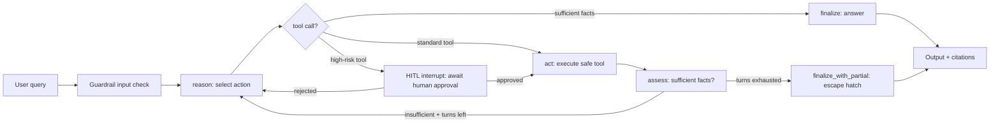
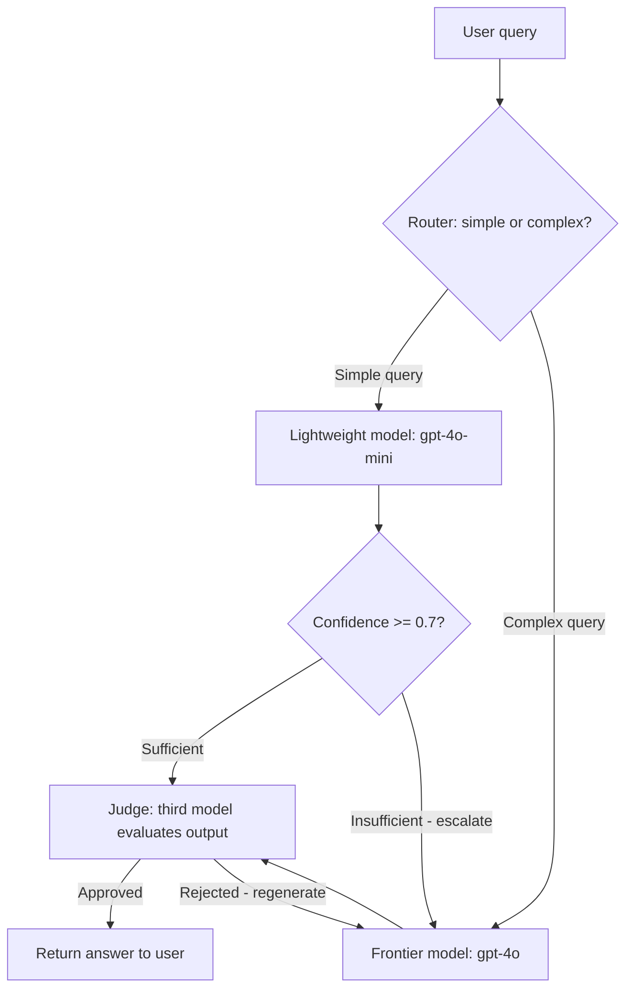

# Chapter 4: Building AI Agents with LangGraph

This chapter is the heart of the entire material. You will learn how to build AI Agents from scratch — from fundamental concepts to full-fledged implementation — using LangGraph, the most powerful library today for building stateful AI applications. By the end of this chapter, you will have sufficient knowledge to build an agent capable of reasoning, acting, and responding like a true intelligent assistant.

---

## 4.1 What Is an Agent?

### Definition

An Agent (intelligent agent) is an AI system capable of **autonomously deciding** how to accomplish a task instead of merely following a fixed script. Unlike standard chatbots that only answer questions based on a predetermined processing chain, an agent can observe its environment, reason about the next step, use tools to gather information, and adjust its behavior based on the results.

Imagine the difference as follows: a chatbot is like a call center operator reading from a script — when the user asks A, the bot answers B. An agent is like a skilled assistant — upon receiving a request, the assistant independently evaluates "what do I need to do to answer this question?", potentially searches documents, queries a database, computes calculations, and synthesizes the answer.

### Differences Between Chatbots and Agents

To understand more clearly, let us compare the two systems:

**Chatbot (Fixed Sequence — Chain):**
- Fixed processing flow: Input → LLM → Output
- No decision-making capabilities
- Does not use external tools
- Suitable for simple conversations, FAQs

**Agent (Flexible Flow):**
- Dynamic flow, decided at runtime
- Capable of calling tools (search, calculation, APIs)
- Reasoning loop: Think → Act → Observe
- Suitable for complex, multi-step tasks

### Why Choose LangGraph?

LangGraph is a library built on top of LangChain, but approaches application architecture from the perspective of a **state machine** rather than a linear **chain**. This is a crucial distinction:

- **Chain (LangChain):** A → B → C → D. Fixed flow, difficult to branch, difficult to loop.
- **State Machine (LangGraph):** Steps (nodes) are connected by edges, supporting conditional branching, loops, and complex paths.

LangGraph solves problems that chains cannot: an agent needs to **return** to a previous step, **jump** to a different step depending on conditions, and **maintain state** across multiple processing steps.

> 💡 **TIP:** Not every AI application needs an agent. If your task is simple (e.g., text translation, article summarization), using a chain or even calling the LLM directly is sufficient. An agent is necessary when: (1) the task involves multiple steps, (2) runtime decision-making is required, (3) external tool usage is needed.

### When Should You Use an Agent?

You should consider building an agent when your task exhibits the following characteristics:

1. **Multi-step:** The task requires multiple sequential or parallel processing steps.
2. **Decision-making:** The system must choose among multiple different actions.
3. **Tool usage:** Interaction with external systems (APIs, databases, web search) is required.
4. **Feedback loop:** The outcome of an earlier step influences subsequent steps.
5. **Non-deterministic:** The exact execution flow cannot be predetermined.

Real-world example: A scientific research agent needs to (1) analyze the research question, (2) search for relevant papers, (3) read and summarize each paper, (4) compare results, and (5) synthesize findings into a report. This is a perfect task for an agent.

---

## 4.2 State — The Agent's Memory

State is the most important concept in LangGraph. State serves as the agent's **memory** — it stores all information necessary for the agent to operate: messages, search results, processing status, etc. Every node reads from the state and writes updates back to the state after execution.

### The TypedDict Pattern

In LangGraph, state is defined using Python's `TypedDict`. This is a type-safe way to declare the data structure that the agent will utilize:

```python
from typing import TypedDict, Annotated, Sequence
from langchain_core.messages import BaseMessage

class AgentState(TypedDict):
    """State for a research agent."""
    messages: Annotated[Sequence[BaseMessage], "add_messages"]
    query: str  # Original user query
    search_results: list[str]  # Search results
    draft: str  # Draft answer
    iteration: int  # Iteration count
```

`TypedDict` acts as a schema — it specifies what fields the state contains and their respective types. LangGraph uses this schema to manage state throughout the agent's lifecycle.

### total=False and Annotated

When defining state, you will often see `total=False` used:

```python
from typing import TypedDict

class AgentState(TypedDict, total=False):
    """total=False allows fields to be optional/omitted initially."""
    messages: list  # Might not exist initially
    query: str
    search_results: list[str]
    draft: str
```

`total=False` means that not all fields are mandatory upon initialization. This is essential because as the agent executes, certain fields have not yet been produced in initial steps. For instance, `search_results` remains empty until the search node finishes running.

### State Design Principles

When designing state for an agent, adhere to the following principles:

1. **Store only what is necessary:** State is passed across every node; do not bloat it with redundant data.
2. **Descriptive field names:** Use clear names such as `query`, `search_results`, and `draft` instead of generic names like `data1` or `data2`.
3. **Accurate type hints:** Always annotate types to facilitate debugging and maintainability.
4. **Separation of concerns:** State for a research agent differs from state for a conversational agent.

### Reducer — How State Is Updated

A reducer determines how a field in the state is updated when a node returns a new value. There are two primary patterns:

**Overwrite — Default:**

```python
class SimpleState(TypedDict):
    query: str  # The new value completely overwrites the previous value
    result: str

# A node returning {"query": "new query"} will completely replace the old query
```

**Accumulate — Used for Lists:**

```python
from typing import Annotated
from langgraph.graph.message import add_messages

class ChatState(TypedDict):
    messages: Annotated[list, add_messages]  # Appends to the list instead of overwriting
    context: str

# The add_messages reducer appends new messages to the existing list of messages
# instead of replacing the entire list
```

The `add_messages` reducer is particularly critical because it handles complex logic: if a new message has the same ID as an existing message, it updates the existing message rather than appending a duplicate. This is helpful when an LLM modifies an earlier message.

### MessagesState

LangGraph provides built-in `MessagesState` for the most common scenario — conversational agents:

```python
from langgraph.graph import MessagesState

# MessagesState is equivalent to:
class MessagesState(TypedDict):
    messages: Annotated[list, add_messages]

# Direct usage:
class MyAgentState(MessagesState):
    """Extend MessagesState with custom fields."""
    user_id: str
    conversation_id: str
```

`MessagesState` already includes the `add_messages` reducer on the `messages` field, eliminating the need to define it manually. You simply subclass and append custom fields.

> ⚠️ **NOTE:** The most common mistake when working with state is forgetting to specify a reducer for list fields. If you want to accumulate values (append to a list), you must use `Annotated[list, add_messages]` or a custom reducer. Without a reducer, new values will completely overwrite previous ones.

> 💡 **TIP:** Start with the simplest state possible, then add fields as needed. Avoid over-engineering state for hypothetical future needs — remember YAGNI (You Aren't Gonna Need It). You can easily expand your TypedDict later.

---

## 4.3 Nodes — Processing Steps

Nodes are the fundamental processing units in LangGraph. Each node is a function that receives the current state, performs execution, and returns the changes to apply back to the state. Think of each node as a distinct "step" in the agent's workflow.

### Principle: Pure Functions

Nodes in LangGraph should be designed as close to pure functions as possible:

1. **Accept state, return updates:** The node receives the full state, but returns only the fields that need updating.
2. **No state side-effects:** Never mutate the input state object directly.
3. **Single Responsibility:** Each node should perform one and only one task.

```python
from typing import TypedDict

class AgentState(TypedDict, total=False):
    query: str
    search_results: list[str]
    answer: str
    error: str

# Correct node: returns only fields to update
def analyze_query(state: AgentState) -> dict:
    """Analyze the user's query."""
    query = state.get("query", "")
    # Processing...
    return {"query": query.lower().strip()}

# Incorrect node: directly mutates state
def bad_node(state: AgentState) -> dict:
    state["query"] = state["query"].lower()  # DO NOT DO THIS
    return state  # Returning the full mutated state
```

### Async Pattern

When a node needs to call APIs or perform I/O operations, use async functions:

```python
import asyncio
from langchain_openai import ChatOpenAI

async def generate_answer(state: AgentState) -> dict:
    """Generate an answer using an LLM (async)."""
    llm = ChatOpenAI(model="gpt-4o-mini")

    query = state.get("query", "")
    search_results = state.get("search_results", [])

    prompt = f"""Based on the following search results, answer the question.
    
    Question: {query}
    Search Results: {search_results}
    
    Answer in English:"""

    response = await llm.ainvoke(prompt)

    return {"answer": response.content}
```

Use async whenever a node calls LLMs, HTTP APIs, databases, or any other I/O operations. LangGraph supports both synchronous and asynchronous execution, but async is typically far more efficient for agents invoking multiple external services.

### Error Handling Inside Nodes

Nodes should handle errors gracefully to prevent crashing the entire graph:

```python
async def search_web(state: AgentState) -> dict:
    """Search the web with error handling."""
    query = state.get("query", "")
    
    try:
        # Assuming a search API invocation
        results = await search_api(query)
        return {"search_results": results}
    except ConnectionError:
        # Return error within state instead of crashing
        return {
            "search_results": [],
            "error": "Cannot connect to search API. Please try again."
        }
    except Exception as e:
        return {
            "search_results": [],
            "error": f"Unknown error: {str(e)}"
        }
```

> 🔑 **KEY TAKEAWAY:** Each node should only return the specific fields that need updating. If a node handles web search, return only `{"search_results": [...]}`. Downstream nodes will read `search_results` from the updated state and continue execution. This keeps your codebase modular, easy to test, and maintainable.

> 💡 **TIP:** Name nodes after their clear actions: `analyze_query`, `search_web`, `generate_answer`, `validate_result`. Avoid vague names like `process`, `handle`, or `step1`.

---

## 4.4 Edges — Directing the Flow

If nodes are the processing "stations," edges are the "pathways" that connect them. Edges define the graph's execution flow — which node runs after which, and under what conditions.

### Direct Edges

A direct edge connects two specific nodes deterministically. Once node A completes execution, node B will unconditionally execute next:

```python
from langgraph.graph import StateGraph, START, END

graph = StateGraph(AgentState)

# Add nodes
graph.add_node("analyze", analyze_query)
graph.add_node("search", search_web)
graph.add_node("answer", generate_answer)

# Direct edges — fixed workflow
graph.add_edge(START, "analyze")      # Start -> analyze
graph.add_edge("analyze", "search")   # analyze -> search
graph.add_edge("search", "answer")    # search -> answer
graph.add_edge("answer", END)         # answer -> End
```

`START` and `END` are special sentinel markers in LangGraph: `START` designates the entry point into the graph, while `END` marks termination. A graph always starts at `START` and concludes at `END`.

### Conditional Edges

A conditional edge enables an agent to **make decisions** — selecting the next node based on runtime state evaluation:

```python
def route_after_analysis(state: AgentState) -> str:
    """Determine the next node based on analysis."""
    query = state.get("query", "")
    
    if "calculate" in query.lower() or "how much" in query.lower():
        return "calculate"  # Needs calculation
    elif "find" in query.lower() or "search" in query.lower():
        return "search"     # Needs search
    else:
        return "answer"     # Direct answer

# Add conditional edge
graph.add_conditional_edges(
    "analyze",                  # Source node
    route_after_analysis,       # Routing function
    {                           # Mapping result -> destination node
        "calculate": "calculate",
        "search": "search",
        "answer": "answer",
    }
)
```

### Routing Functions

The routing function is the core of any conditional edge. It takes the current state and returns the key identifying the next target node:

```python
def should_continue(state: AgentState) -> str:
    """Check whether the agent needs to continue looping."""
    messages = state.get("messages", [])
    
    # Check whether the last message contains tool calls
    last_message = messages[-1] if messages else None
    
    if hasattr(last_message, "tool_calls") and last_message.tool_calls:
        return "tools"  # Route to tools processing node
    
    return END  # No tool calls remaining -> terminate

graph.add_conditional_edges(
    "agent",
    should_continue,
    {"tools": "tools", END: END}
)
```

This pattern is fundamental for ReAct agents (detailed in Section 4.6) — the agent dynamically decides whether to execute another tool or finalize its response.

> ⚠️ **NOTE:** A routing function must return a string matching one of the keys in the mapping dictionary. Returning a value not present in the map triggers a LangGraph exception. Always provide a fallback (default case) in routing functions.

> 🔑 **KEY TAKEAWAY:** Edges turn an isolated collection of nodes into an intelligent agent. Direct edges form predictable pipelines, while conditional edges introduce dynamic intelligence. Most real-world agents combine both types.

---

## 4.5 Tools — Extending Capabilities

Tools provide agents with the ability to interact with external environments — searching the web, performing calculations, invoking APIs, reading files, and more. If the LLM is the "brain," tools serve as the "hands" that enable action.

### The @tool Decorator

LangGraph (via LangChain) provides the `@tool` decorator to define tools cleanly:

```python
from langchain_core.tools import tool

@tool
def multiply(a: int, b: int) -> int:
    """Multiply two integers together."""
    return a * b

@tool
def search_web(query: str) -> str:
    """Search for information on the web."""
    # Assuming search API call
    return f"Search results for '{query}': ..."
```

### The Critical Role of Docstrings

A tool's docstring is not merely documentation — it serves as the **prompt** that the LLM inspects when deciding whether to call the tool and what parameters to provide. Always write clear, descriptive docstrings explaining exactly what the tool does:

```python
# Good docstring — clearly describes purpose and usage
@tool
def search_papers(query: str, max_results: int = 5) -> str:
    """Search scientific research papers by keywords.
    
    Args:
        query: Search keywords (e.g., "transformer attention mechanism")
        max_results: Maximum number of papers to return (default: 5, max: 20)
    
    Returns:
        List of papers containing titles, authors, and abstracts.
    """
    # Implementation...

# Poor docstring — the LLM has insufficient guidance on when or how to use it
@tool
def search(q: str) -> str:
    """Search."""
    return "results"
```

### Type Hints

Type hints inform the LLM about the exact data types required for each parameter. This is vital because the LLM must construct valid JSON arguments matching the schema:

```python
from typing import Literal, Optional

@tool
def get_weather(
    city: str,
    unit: Literal["celsius", "fahrenheit"] = "celsius",
    forecast_days: Optional[int] = None
) -> str:
    """Retrieve weather information for a specified city.
    
    Args:
        city: City name (e.g., "Hanoi", "Tokyo")
        unit: Temperature scale unit
        forecast_days: Number of forecast days (None = current weather only)
    """
    # The LLM knows city is a string, unit is strictly "celsius" or "fahrenheit",
    # and forecast_days can be null or an integer
    return f"Weather data for {city}..."
```

### Error Handling in Tools

Tools should handle exceptions gracefully and return informative error messages:

```python
import httpx

@tool
def fetch_api_data(url: str) -> str:
    """Send an HTTP GET request to a URL and return the response text.
    
    Args:
        url: The endpoint URL to fetch (must be a valid URL)
    """
    try:
        response = httpx.get(url, timeout=10.0)
        response.raise_for_status()
        return response.text[:5000]  # Limit to 5000 characters
    except httpx.TimeoutException:
        return "Error: Request timed out. The URL did not respond within 10 seconds."
    except httpx.HTTPStatusError as e:
        return f"HTTP error {e.response.status_code}: {e.response.reason_phrase}"
    except Exception as e:
        return f"Unknown error: {str(e)}"
```

### Example: Web Search Tool

```python
@tool
def web_search(query: str, num_results: int = 5) -> str:
    """Search the internet for current information using Tavily Search API.
    
    Use this tool when looking up recent events, factual details,
    or knowledge beyond the model's training data cutoff.
    
    Args:
        query: The search query string (should be specific and clear)
        num_results: Number of results to return (1-10)
    """
    from langchain_community.tools.tavily_search import TavilySearchResults
    
    search = TavilySearchResults(max_results=num_results)
    try:
        results = search.invoke(query)
        return str(results)
    except Exception as e:
        return f"Search error: {str(e)}. Please retry with a different query."
```

### Example: Safe Calculator Tool

```python
import math
import ast
import operator

# Safe mapping from AST operators to mathematical functions
_SAFE_OPERATORS = {
    ast.Add: operator.add,
    ast.Sub: operator.sub,
    ast.Mult: operator.mul,
    ast.Div: operator.truediv,
    ast.Pow: operator.pow,
    ast.USub: operator.neg,
    ast.Mod: operator.mod,
}

_SAFE_FUNCTIONS = {
    "sqrt": math.sqrt,
    "sin": math.sin,
    "cos": math.cos,
    "tan": math.tan,
    "log": math.log,
    "log10": math.log10,
    "pi": math.pi,
    "e": math.e,
    "abs": abs,
    "round": round,
}

def _safe_eval(node: ast.AST) -> float:
    """Recursively evaluate an AST node — avoiding eval()."""
    if isinstance(node, ast.Constant):  # Literal value (3.14, 42, "hello")
        return node.value
    elif isinstance(node, ast.Name):    # Variable (pi, e)
        if node.id in _SAFE_FUNCTIONS:
            return _SAFE_FUNCTIONS[node.id]
        raise ValueError(f"Invalid identifier: {node.id}")
    elif isinstance(node, ast.Call):    # Function call (sqrt(144), sin(0))
        func_name = node.func.id if isinstance(node.func, ast.Name) else ""
        if func_name not in _SAFE_FUNCTIONS:
            raise ValueError(f"Unsupported function: {func_name}")
        args = [_safe_eval(arg) for arg in node.args]
        return _SAFE_FUNCTIONS[func_name](*args)
    elif isinstance(node, ast.BinOp):   # Binary operation (2 + 3)
        left = _safe_eval(node.left)
        right = _safe_eval(node.right)
        op_type = type(node.op)
        if op_type in _SAFE_OPERATORS:
            return _SAFE_OPERATORS[op_type](left, right)
        raise ValueError(f"Unsupported operator: {op_type.__name__}")
    elif isinstance(node, ast.UnaryOp): # Unary operation (-5)
        operand = _safe_eval(node.operand)
        op_type = type(node.op)
        if op_type in _SAFE_OPERATORS:
            return _SAFE_OPERATORS[op_type](operand)
        raise ValueError(f"Unsupported operator: {op_type.__name__}")
    else:
        raise ValueError(f"Unsupported expression: {type(node).__name__}")

@tool
def calculate(expression: str) -> str:
    """Safely calculate a mathematical expression.

    Supports basic operations (+, -, *, /, **), 
    and math functions (sqrt, sin, cos, log, abs, round).
    Does not use eval() — safely evaluates via AST.

    Args:
        expression: Mathematical expression (e.g., "2 ** 10", "sqrt(144)")
    """
    try:
        tree = ast.parse(expression, mode="eval")
        result = _safe_eval(tree.body)
        return f"Result: {expression} = {result}"
    except (SyntaxError, ValueError) as e:
        return f"Invalid expression '{expression}': {str(e)}"
    except Exception as e:
        return f"Could not calculate '{expression}': {str(e)}"
```

> ⚠️ **NOTE:** Never use Python's built-in `eval()` in production code, especially when inputs originate from an LLM. Even `eval(expression, {"__builtins__": {}}, allowed_names)` can be bypassed via dunder attributes and subclass lookups. AST parsing (as implemented above) provides robust security by explicitly controlling allowed node evaluations.

> 💡 **TIP:** The LLM does not know which tools exist until you bind them. When you bind tools to a model, it autonomously chooses the appropriate tool based on user queries and docstring definitions. Write your docstrings as if guiding a new team member: clear, concise, and illustrated with examples.

> ⚠️ **NOTE:** Never blindly trust inputs generated by an LLM. LLMs can output invalid or out-of-range parameters. Always validate and sanitize parameters inside tools (e.g., clamp result limits, validate URL schemas).

---

## 4.6 The ReAct Pattern

ReAct (Reasoning + Acting) is the most widely adopted pattern for constructing AI agents. It mirrors human problem-solving workflows: **think → act → observe → repeat**.

### The Think → Act → Observe Loop

The ReAct cycle functions as follows:

1. **Thought:** The agent receives a query and reasons about what actions to take.
2. **Action:** The agent calls a tool to acquire needed information.
3. **Observation:** The agent inspects the output returned by the tool.
4. **Repeat:** If information remains insufficient, return to step 1.
5. **Answer:** Once sufficient context is gathered, the agent synthesizes the final response.

Illustrative walkthrough for the question "What is the current gold price?":

```
Thought: I need to find the current gold price. I will use the web search tool.
Action: search_web("current gold price")
Observation: Gold spot price today is $2,650 per ounce.
Thought: I now have the necessary information. I can answer the user.
Answer: The gold spot price today is $2,650 per ounce.
```

### When to Use ReAct

ReAct is ideal when:
- The agent requires **multiple steps** to respond (analyze → retrieve → synthesize).
- The agent must **decide** whether additional information is needed.
- The execution path is **dynamic** — depending on intermediate observations.

ReAct is NOT suitable when:
- The task is simple and single-step (use a chain instead).
- The workflow is strictly deterministic with no runtime decisions (use a fixed workflow).
- Maximum throughput / minimum latency is required (ReAct introduces latency through multi-turn LLM reasoning cycles).

### Example Using create_react_agent

LangGraph provides a helper function `create_react_agent` to assemble a ReAct agent rapidly:

```python
from langgraph.prebuilt import create_react_agent
from langchain_openai import ChatOpenAI

# Initialize LLM
llm = ChatOpenAI(model="gpt-4o-mini")

# Initialize tools
tools = [web_search, calculate, fetch_api_data]

# Create ReAct agent — in a single line!
agent = create_react_agent(llm, tools)

# Execute agent
result = agent.invoke({
    "messages": [{"role": "user", "content": "What is Vietnam's GDP in 2024? Calculate GDP per capita assuming a population of 100 million."}]
})

print(result["messages"][-1].content)
```

`create_react_agent` automatically constructs a graph containing: an agent node (LLM invocation), a tools node (executing tool calls), and a conditional edge (checking for pending tool calls). This is the fastest way to get a working agent up and running.

### Manual ReAct Graph Implementation

To understand the internal mechanics, let us construct a ReAct graph manually:

```python
from langgraph.graph import StateGraph, MessagesState, START, END
from langchain_openai import ChatOpenAI
from langchain_core.messages import HumanMessage, SystemMessage

# Initialization
llm = ChatOpenAI(model="gpt-4o-mini")
llm_with_tools = llm.bind_tools([web_search, calculate])

# Node 1: Agent reasoning and decision making
async def agent_node(state: MessagesState) -> dict:
    """Agent analyzes state and decides on the next action."""
    system = SystemMessage(content="""You are an intelligent AI assistant.
    When information is needed, call appropriate tools. When sufficient information is available, answer directly.
    Respond in English.""")
    
    messages = [system] + state["messages"]
    response = await llm_with_tools.ainvoke(messages)
    return {"messages": [response]}

# Node 2: Tool execution
async def tools_node(state: MessagesState) -> dict:
    """Execute tool calls from the latest message."""
    from langchain_core.messages import ToolMessage
    from langgraph.prebuilt import ToolNode
    
    tool_node = ToolNode([web_search, calculate])
    return await tool_node.ainvoke(state)

# Routing: Check for tool calls
def should_use_tools(state: MessagesState) -> str:
    """Route to tools if the last message contains tool calls; otherwise terminate."""
    last_message = state["messages"][-1]
    if hasattr(last_message, "tool_calls") and last_message.tool_calls:
        return "tools"
    return END

# Build graph
graph = StateGraph(MessagesState)
graph.add_node("agent", agent_node)
graph.add_node("tools", tools_node)

graph.add_edge(START, "agent")
graph.add_conditional_edges("agent", should_use_tools, {"tools": "tools", END: END})
graph.add_edge("tools", "agent")  # After tools run -> loop back to agent

app = graph.compile()
```

Notice the line `graph.add_edge("tools", "agent")` — this establishes the **loop**. Once tools execute, the agent reasons over the observations again. The loop continues until the agent decides to formulate a final response without calling further tools.

> 🔑 **KEY TAKEAWAY:** ReAct is the classic "think → act → observe" pattern. The loop between agent and tools persists until the agent determines it has gathered sufficient information. This architecture forms the backbone of modern autonomous agents.

---

## 4.7 Building a Complete Graph

Now we will combine all the concepts learned so far to build an end-to-end agent: a **Planning Agent** — an agent that takes a complex query, drafts a structured research plan, conducts search queries, and synthesizes a comprehensive final report.

### Architectural Overview

```
START → analyze → plan → [research → synthesize → review] → END
                        ↑                            |
                        └───── (needs refinement) ───┘
```

The agent executes through the following stages:
1. **Analyze:** Parses the question, determining inquiry type and requirements.
2. **Plan:** Drafts a multi-step research plan.
3. **Research:** Executes searches according to the plan.
4. **Synthesize:** Combines search findings into an answer draft.
5. **Review:** Evaluates draft quality — loops back to step 3 if revisions are required.

### Complete Code Implementation

```python
import asyncio
from typing import TypedDict, Annotated
from langgraph.graph import StateGraph, START, END
from langgraph.graph.message import add_messages
from langchain_openai import ChatOpenAI
from langchain_core.messages import HumanMessage, SystemMessage, BaseMessage
from langchain_core.tools import tool

# ==================== STATE ====================

class ResearchState(TypedDict, total=False):
    """State for the Planning Agent."""
    messages: Annotated[list[BaseMessage], add_messages]
    query: str                    # Original user query
    query_type: str               # Question type (factual, analytical, creative)
    research_plan: list[str]      # Multi-step research plan
    search_results: list[str]     # Collected search results
    draft: str                    # Draft answer
    quality_score: float          # Quality score (0-1)
    iteration: int                # Iteration counter
    error: str                    # Error messages (if any)

# ==================== TOOLS ====================

@tool
def web_search(query: str) -> str:
    """Search for information on the web.
    
    Args:
        query: Specific search keyword or query
    """
    # Placeholder — replace with real APIs (Tavily, SerpAPI, etc.)
    return f"[Search results for '{query}']: Sample information..."

# ==================== NODES ====================

async def analyze_node(state: ResearchState) -> dict:
    """Analyze the user's query."""
    llm = ChatOpenAI(model="gpt-4o-mini", temperature=0)
    
    query = state.get("query", "")
    if not query and state.get("messages"):
        last_msg = state["messages"][-1]
        query = last_msg.content if hasattr(last_msg, "content") else str(last_msg)
    
    prompt = f"""Analyze the following question and determine its type.
    
    Question: {query}
    
    Return JSON:
    {{
        "query_type": "factual|analytical|creative",
        "needs_research": true/false
    }}
    
    Return JSON only, with no markdown wrappers or additional text."""
    
    response = await llm.ainvoke([HumanMessage(content=prompt)])
    
    import json
    try:
        analysis = json.loads(response.content)
    except json.JSONDecodeError:
        analysis = {"query_type": "factual", "needs_research": True}
    
    return {
        "query": query,
        "query_type": analysis.get("query_type", "factual"),
        "iteration": 0,
    }

async def plan_node(state: ResearchState) -> dict:
    """Formulate a research plan."""
    llm = ChatOpenAI(model="gpt-4o-mini", temperature=0)
    
    query = state.get("query", "")
    query_type = state.get("query_type", "factual")
    
    prompt = f"""Create a structured research plan for the following question.
    
    Question: {query}
    Type: {query_type}
    
    List 3-5 search queries to execute, where each step is a concrete query string.
    Return a JSON array of strings. Return JSON only."""
    
    response = await llm.ainvoke([HumanMessage(content=prompt)])
    
    import json
    try:
        plan = json.loads(response.content)
        if not isinstance(plan, list):
            plan = [query]
    except json.JSONDecodeError:
        plan = [query]
    
    return {"research_plan": plan}

async def research_node(state: ResearchState) -> dict:
    """Execute search queries according to the plan."""
    plan = state.get("research_plan", [])
    results = []
    
    for search_query in plan:
        try:
            result = web_search.invoke({"query": search_query})
            results.append(f"Query: {search_query}\nResult: {result}")
        except Exception as e:
            results.append(f"Query: {search_query}\nError: {str(e)}")
    
    iteration = state.get("iteration", 0) + 1
    
    return {
        "search_results": results,
        "iteration": iteration,
    }

async def synthesize_node(state: ResearchState) -> dict:
    """Synthesize findings into an answer draft."""
    llm = ChatOpenAI(model="gpt-4o-mini")
    
    query = state.get("query", "")
    search_results = state.get("search_results", [])
    
    prompt = f"""Based on the research findings, write a comprehensive answer to the question.
    
    Question: {query}
    
    Research Findings:
    {chr(10).join(search_results)}
    
    Requirements:
    - Provide a complete, well-structured response
    - Cite sources where applicable
    - Note any missing information requiring further investigation
    - Write in English"""
    
    response = await llm.ainvoke([HumanMessage(content=prompt)])
    
    return {"draft": response.content}

async def review_node(state: ResearchState) -> dict:
    """Evaluate draft quality."""
    llm = ChatOpenAI(model="gpt-4o-mini", temperature=0)
    
    query = state.get("query", "")
    draft = state.get("draft", "")
    
    prompt = f"""Evaluate the quality of the following draft on a scale of 0.0 to 1.0.
    
    Question: {query}
    Draft: {draft}
    
    Evaluation Criteria:
    - Completeness: Does it address all aspects of the query?
    - Accuracy: Is the information credible and consistent?
    - Clarity: Is the explanation clear and well-organized?
    
    Return JSON: {{"score": 0.0-1.0, "needs_more": true/false, "feedback": "..."}}
    Return JSON only."""
    
    response = await llm.ainvoke([HumanMessage(content=prompt)])
    
    import json
    try:
        review = json.loads(response.content)
        score = float(review.get("score", 0.5))
    except (json.JSONDecodeError, ValueError):
        score = 0.5
        review = {"needs_more": True, "feedback": "Could not parse review output"}
    
    return {"quality_score": score}

# ==================== ROUTING ====================

def should_continue_research(state: ResearchState) -> str:
    """Decide whether further research iterations are required."""
    score = state.get("quality_score", 0.0)
    iteration = state.get("iteration", 0)
    
    # Terminate if quality meets threshold or maximum iterations reached
    if score >= 0.7 or iteration >= 3:
        return "finalize"
    
    # Otherwise continue research
    return "research"

# ==================== BUILD GRAPH ====================

async def finalize_node(state: ResearchState) -> dict:
    """Prepare the final answer payload."""
    from langchain_core.messages import AIMessage
    draft = state.get("draft", "Unable to generate an answer.")
    return {"messages": [AIMessage(content=draft)]}

graph = StateGraph(ResearchState)

# Add nodes
graph.add_node("analyze", analyze_node)
graph.add_node("plan", plan_node)
graph.add_node("research", research_node)
graph.add_node("synthesize", synthesize_node)
graph.add_node("review", review_node)
graph.add_node("finalize", finalize_node)

# Add edges
graph.add_edge(START, "analyze")
graph.add_edge("analyze", "plan")
graph.add_edge("plan", "research")
graph.add_edge("research", "synthesize")
graph.add_edge("synthesize", "review")

# Conditional edge from review
graph.add_conditional_edges(
    "review",
    should_continue_research,
    {
        "research": "research",    # Loop back to research
        "finalize": "finalize",    # Conclude
    }
)

graph.add_edge("finalize", END)

# Compile
app = graph.compile()

# ==================== EXECUTION ====================

async def main():
    result = await app.ainvoke({
        "messages": [HumanMessage(content="How are AI agents transforming the software engineering industry?")],
        "query": "How are AI agents transforming the software engineering industry?"
    })
    
    print("=" * 60)
    print("FINAL ANSWER:")
    print("=" * 60)
    print(result.get("draft", "No output generated"))
    print(f"\nIteration count: {result.get('iteration', 0)}")
    print(f"Quality score: {result.get('quality_score', 0):.2f}")

if __name__ == "__main__":
    asyncio.run(main())
```

> 💡 **TIP:** When architecting complex graphs, always start with the simplest linear pipeline first, then incrementally introduce conditional edges and feedback loops. Do not attempt to design a sprawling graph upfront — iterate just as you iterate on software.

---

## 4.8 RAG — Combining External Knowledge Retrieval

RAG (Retrieval-Augmented Generation) combines external knowledge retrieval with the generative capabilities of an LLM. Rather than relying solely on pre-trained parametric weights, the agent retrieves passages from custom knowledge bases to produce grounded, accurate answers.

### How RAG Works

1. **Index:** Chunk documents into manageable passages, compute vector embeddings for each chunk, and store them in a vector database.
2. **Retrieve:** Upon receiving a user question, generate an embedding for the query and retrieve chunks exhibiting the highest semantic similarity.
3. **Generate:** Provide both the user query and retrieved context chunks to the LLM, prompting it to answer strictly based on the supplied evidence.

### Embeddings and Vector Stores

```python
from langchain_openai import OpenAIEmbeddings
from langchain_community.vectorstores import Chroma

# Initialize embedding model
embeddings = OpenAIEmbeddings(model="text-embedding-3-small")

# Create vector store from documents
from langchain_text_splitters import RecursiveCharacterTextSplitter

documents = [
    "LangGraph is a library for building stateful AI agents based on state machines...",
    "State in LangGraph is defined using TypedDict...",
    "Nodes are processing functions that receive state and return updates...",
    # ... additional documents
]

text_splitter = RecursiveCharacterTextSplitter(
    chunk_size=500,
    chunk_overlap=50,
)
chunks = text_splitter.create_documents(documents)

vectorstore = Chroma.from_documents(
    documents=chunks,
    embedding=embeddings,
    collection_name="ai20k_docs"
)

# Similarity search
results = vectorstore.similarity_search("What is state in LangGraph?", k=3)
for doc in results:
    print(doc.page_content)
```

### Integrating RAG into the Graph

```python
from langchain_openai import ChatOpenAI, OpenAIEmbeddings
from langchain_community.vectorstores import Chroma

async def retrieve_node(state: ResearchState) -> dict:
    """Retrieve relevant documents from the vector store."""
    query = state.get("query", "")
    
    try:
        # Build retriever from vector store
        embeddings = OpenAIEmbeddings(model="text-embedding-3-small")
        vectorstore = Chroma(
            collection_name="ai20k_docs",
            embedding_function=embeddings,
        )
        
        retriever = vectorstore.as_retriever(search_kwargs={"k": 3})
        docs = await retriever.ainvoke(query)
        
        # Format results
        context = "\n\n".join([
            f"[Document {i+1}]: {doc.page_content}"
            for i, doc in enumerate(docs)
        ])
        
        return {"search_results": [context]}
    except Exception as e:
        return {"error": f"Retrieval error: {str(e)}"}

async def rag_generate_node(state: ResearchState) -> dict:
    """Generate an answer grounded in retrieved documents."""
    llm = ChatOpenAI(model="gpt-4o-mini")
    
    query = state.get("query", "")
    search_results = state.get("search_results", [])
    context = "\n".join(search_results)
    
    prompt = f"""Based on the following documents, answer the question. 
    If the answer cannot be found in the documents, state that clearly.
    
    Documents:
    {context}
    
    Question: {query}
    
    Answer in English:"""
    
    response = await llm.ainvoke([HumanMessage(content=prompt)])
    return {"draft": response.content}

# Add nodes to graph
graph.add_node("retrieve", retrieve_node)
graph.add_node("rag_generate", rag_generate_node)

# Route between web search and RAG depending on query characteristics
def route_search(state: ResearchState) -> str:
    query_type = state.get("query_type", "")
    if query_type == "factual":
        return "retrieve"  # Use RAG for proprietary knowledge queries
    return "research"      # Use web search for real-time/current queries
```

> ⚠️ **NOTE:** RAG efficacy relies heavily on chunking quality and embedding relevance. Chunks that are too large dilute salient details; chunks that are too small lose crucial context. Experiment with `chunk_size` between 300-1000 and `chunk_overlap` between 50-200.

> 🔑 **KEY TAKEAWAY:** RAG resolves the fundamental limitation of "LLMs lacking access to your proprietary data." Instead of cost-prohibitive and complex model fine-tuning, you inject relevant passages into context dynamically. This remains the industry standard for specialized domain knowledge.

---


> [📊 Open diagram on Mermaid Live / AI Editor](https://mermaid.live/edit#pako:eNplUttO4zAQ_ZWRXxd-oA-LKna3IHGRkvQpqdDImdYWrh2c8aJs03_fiRNAQF4sndvcclI6tKRWoPYuvGqDkeGuaDzId_tQb3uK8JIoDju4vPwJm6LeJIxtROvA-i4xaEP6eTc7NkVWFWUdCfvgV8IGDwa9gTb4wyIryllWnTgEBxqduzovVDVRY8bZJPGMsL6uatQ8heEAmUIvL_rdd1NMFmIY4WZ7v36oG3VzW91Jp0wxpi5nBPCHFCy0aSBu1OeMNgkOz5b8CH9kAXvr0dl_JEZMwBHBBbtYconZJX3CkDv9SnGaStpRhp4p0eTp12WNfU99v4KPoqJNeLXkr_OaxgmCH6BlkX_zPt6TZt4QL8Tv8vq94adXy-apk3tadCugXmNHcgnWZomX8XIjj9uqfkw83VKqWEa2wfeLSCLfROoC1JHiEW07_S-nSdAoNnSkRoBGtbTH5GSljT9PYkwcysFrITkmEiR1LTL9sniIeFzg839QtM0G)

## 4.8A Harness Engineering — The Scaffolding Around the Agent

### What Is a Harness?

If the LLM is the brain, then the **harness** is the rest of the body: scaffolding (agent reasoning loop), tools, guardrails, cost limits, and feedback loops. A widespread industry maxim in 2026 states:

> **A great agent is an agent with a great harness.**

This explains why major platforms — Claude Agent SDK, OpenAI Agents SDK, LangGraph — all converge on identical architectural patterns: they do not merely sell "smarter models," they provide **turnkey harnesses**: controlled tool-calling loops, step budgets, context window management, and permission gates. Stanford CS329Z (Engineering AI Agents, Fall 2026) even assigned "Build an Agentic Harness" as its very first homework assignment — prior to assignments focusing on models.

A minimal harness consists of 4 components:

1. **Scaffolding:** The agent — tools — observation execution loop (built in §4.6)
2. **Tools:** Explicitly defined tool schemas (§4.5, §4.8B)
3. **Guardrails:** Input/output validation, permission boundary checks, prompt injection defenses
4. **Feedback loop:** Mechanisms for evaluating output quality and self-correcting (the review node in §4.7 is an example)

### Mitigating Pattern Drift

Pattern drift occurs when an agent **reproduces flawed patterns present in your own codebase** — if repository sample prompts or legacy tools lack proper error handling, the agent (as well as teammates using AI coding assistants) will generate new code adopting those identical anti-patterns, propagating bugs across commits. Combat pattern drift by consolidating the harness in **a single centralized location**: system prompts, tool declarations, guardrails, and operational limits are defined in one shared module consumed by all agents across the project.

```python
from dataclasses import dataclass, field
from langchain_core.tools import BaseTool

@dataclass
class AgentHarness:
    """Harness = everything surrounding the LLM, centrally declared in one place."""
    system_prompt: str
    tools: list[BaseTool] = field(default_factory=list)
    guardrails: list = field(default_factory=list)   # check_input / check_output functions
    max_steps: int = 10          # prevent infinite loops (detailed in §4.8C)
    budget_usd: float = 0.10     # session spending ceiling

# All project agents share this centralized harness —
# modify once, update everywhere, preventing pattern drift.
HARNESS = AgentHarness(
    system_prompt="You are a research assistant. Use only authorized tools...",
    tools=[web_search, calculate],
    guardrails=[block_prompt_injection, mask_pii],
)
```

### Agent Logging (Chapter 2) vs. Production Harness (This Section)

Chapter 2 guided you in configuring **Claude Code hooks to LOG** team AI usage: capturing prompts, tool calls, and telemetry transmitted to grading servers on git push. That constitutes a harness **for workflow observability** — observing how humans interact with AI. This section addresses the harness **for the production application**: the runtime boundary encasing the agent during end-user interaction. Both complement each other: Chapter 2 hooks provide workflow telemetry for reporting; production harnesses ensure agents operate securely and predictably in production. Teams mastering both operate with deep multi-tier agent literacy.

> 💡 **TIP:** When inspecting agent SDK codebases (Claude Agent SDK, OpenAI Agents SDK), measure what percentage of code represents the "LLM inference loop" versus surrounding infrastructure — permissions, retries, step limits, context formatting. The latter almost always dominates the codebase: that infrastructure is the harness.

---

## 4.8B MCP — Model Context Protocol

### The Industry Standard for Tool Access

By 2026, **MCP (Model Context Protocol)** — open-sourced by Anthropic in late 2024 and transitioned to the Linux Foundation — established itself as the open industry standard for agent tool integration: a standardized protocol governing tool schemas, invocation semantics, and server-side capability exposure. Instead of building bespoke API wrapper layers across projects, you write **one MCP server**, allowing any MCP-compliant client (Claude Code, Cursor, LangChain, ChatGPT, etc.) to consume it out of the box.

Why this matters for your engineering team:

1. **Write once, run anywhere:** A search tool implemented as an MCP server runs inside Claude Code during local development and seamlessly inside LangGraph applications in production.
2. **Permission isolation:** MCP servers run in dedicated isolated processes — allowing independent sandboxing, privilege separation, and logging.
3. **Language agnostic:** Servers written in Python communicate with clients written in TypeScript over standardized JSON-RPC.

### Building a FastMCP Server

```python
# server_search.py — MCP server exposing a web search tool
from mcp.server.fastmcp import FastMCP

mcp = FastMCP("web-search")

@mcp.tool()
def web_search(query: str, max_results: int = 5) -> str:
    """Search the web for a given query string.

    Args:
        query: Clear, specific search query
        max_results: Maximum results to return (1-10, default 5)
    """
    # Reuse the web_search logic implemented in §4.5
    return f"[Results for '{query}']: ..."

if __name__ == "__main__":
    mcp.run(transport="stdio")  # run locally via stdin/stdout
```

Connecting to the MCP server within a LangGraph agent using `langchain-mcp-adapters`:

```python
from langchain_mcp_adapters.client import MultiServerMCPClient
from langgraph.prebuilt import create_react_agent

async def main():
    async with MultiServerMCPClient(
        {
            "web-search": {
                "command": "python",
                "args": ["server_search.py"],
                "transport": "stdio",
            }
        }
    ) as client:
        tools = client.get_tools()  # MCP tools adapt into LangChain tools
        agent = create_react_agent(llm, tools)
        result = await agent.ainvoke(
            {"messages": [("user", "What is Vietnam's GDP in 2024?")]}
        )
```

### When to Use MCP vs. Standard Tools

| Scenario | Recommended Approach |
|---|---|
| Internal tool, used solely by one team agent, straightforward logic | Standard tool (`@tool`) — fewer abstraction layers |
| Reusing the identical tool across multiple environments (CLI dev + deployed app) | MCP server |
| Tool requires sensitive access (internal DB, paid API) — requires isolated privilege separation and audit logging | MCP server |
| Utilizing external services with existing MCP servers (GitHub, filesystem, browser, Slack...) | Always MCP — avoid reinventing the wheel |

Case study from Cohort 2: The **Aclaris aiKnowledge Hub** team developed a knowledge authoring pipeline where 2 agents utilized **MCP tools** for reading and writing knowledge records, separating execution from inference. As a result, their MAP → REDUCE → REFINE → VERIFY → COMMIT pipeline (see §4.8E) operated reliably across prolonged tool-calling sessions.

**Exercise 4.8A-B.** Convert the `web_search` tool from §4.5 into an MCP server (`server_search.py`), then write a client script connecting to and invoking the tool over MCP. **Deliverables:** (1) server file, (2) screenshot or log output demonstrating a successful tool invocation via the MCP client, (3) a 5-line explanation identifying which project tool your team will expose via MCP and why.

---

## 4.8C Loop Engineering — Designing Termination Criteria

### Every Loop Demands an Exit

The ReAct architecture in §4.6 sets up an execution loop: `agent → tools → agent`. Loops provide agents with adaptive power — but a loop **without deterministic stopping criteria** is the fastest path to consuming API token budgets. Loop engineering is the discipline of defining explicit **stopping criteria**, rather than trusting that an LLM will "know when to stop."

Four layers of stopping criteria, from coarse to granular:

1. **Max iterations:** A hard ceiling on loop iterations — non-negotiable and mandatory.
2. **Token / cost budget:** Halts execution when total session cost breaches a predetermined threshold (e.g., $0.10 USD).
3. **Self-assessment node:** A dedicated node where the agent **evaluates** whether sufficient facts have been accumulated before each subsequent turn.
4. **Escape hatch:** Every graph branch must possess an explicit path to `END` — even during cascading failures.

### Self-Assessment Node

```python
async def assess_node(state: ResearchState) -> dict:
    """Agent evaluates: are there sufficient facts to formulate the final answer?"""
    prompt = f"""You are answering the question: {state['query']}
Collected so far: {len(state.get('search_results', []))} search results.
Are there enough facts to provide a complete answer?
Return JSON: {{"enough": true/false, "missing": "what is missing if not enough"}}"""
    response = await llm.ainvoke([HumanMessage(content=prompt)])
    import json
    try:
        return {"enough_info": json.loads(response.content).get("enough", False)}
    except json.JSONDecodeError:
        return {"enough_info": False}  # parse failure -> assume insufficient, evaluate next turn
```

### Escape Hatches — Lessons from Team CareerPulse (011)

Team **CareerPulse (Cohort 1)** demonstrated exemplary loop design in their interview agent: the interviewer node **tracks the count of questions asked**, transitioning to the `Closing` phase once `question_count >= max` — ensuring an inescapable path to `END` regardless of whether the LLM "wishes to ask more." They paired this with a `retry_policy` capped at 3 attempts and a `SqliteSaver` checkpointer for session persistence. The routing logic requires only a few lines:

```python
MAX_QUESTIONS = 5
BUDGET_USD = 0.10

def route_interview(state: dict) -> str:
    """Escape hatch: every execution path guarantees a route to END."""
    if state.get("question_count", 0) >= MAX_QUESTIONS:
        return "closing"                      # question limit reached
    if state.get("cost_usd", 0.0) >= BUDGET_USD:
        return "closing"                      # budget ceiling reached
    if state.get("enough_info"):
        return "closing"                      # agent self-assessment satisfied
    return "ask"                              # insufficient -> ask next question
```

Design rule: **Termination criteria must reside in deterministic code, never solely inside prompts**. A prompt may suggest "stop once sufficient information is gathered" — but only a line of code like `question_count >= MAX_QUESTIONS` guarantees termination. This mental model forms the core of loop-breaking assessments: production agents must finalize answers within explicit operational boundaries rather than running unboundedly.

> ⚠️ **NOTE:** The default ReAct loop created by `create_react_agent` includes a `recursion_limit` (defaulting to 25 steps) — exceeding this threshold raises a `GraphRecursionError`. This is an emergency safety net, not your primary stopping condition. Design application-level stopping criteria deliberately into your graph; never delegate control flow to runtime exceptions.

---

## 4.8D Graph Orchestration — When Do You Truly Need a Graph?

### A Graph Is Not the Default

This chapter introduces LangGraph because state machines represent the correct paradigm for stateful agent systems. However, a critical empirical finding from AI20K cohorts is that **many teams outgrow LangGraph** — beginning with a 10-node graph before discovering their runtime path only traverses 2-3 deterministic sequences. Team **NexusEdu (007)** — who earned the highest code quality score in Cohort 1 — explicitly documented in their README that they "refactored from complex graph models for maximum reliability": transitioning from complex graphs to deterministic chains resulted in markedly higher stability. **Decoupling from unnecessary graph complexity is an architectural victory, not a regression.**

Every orchestration layer introduces trade-offs: steeper debugging curves, slower onboarding, and harder state replication. Select the minimal abstraction layer that satisfies requirements:

| Scenario | Recommended Foundation | Example |
|---|---|---|
| Deterministic sequence A → B → C without branching | **Simple chain** (sequential LLM calls) | Translation, summarization, extraction |
| Input classification routing to specialized handlers | **Router + chains** (conditional edge at graph entry) | Query classification → RAG or web search (§4.8) |
| Runtime looping and state back-tracking based on conditions | **Graph** (LangGraph) | Planning agent §4.7, ReAct §4.6 |
| Multiple specialized roles requiring delegation and synthesis | **Multi-agent / supervisor-worker** | DevCoach 002: 6 worker agents with 1 supervisor |

### Three Indispensable Features When Using Graphs

**1. GENUINE Conditional Edges** — The routing function must legitimately alter execution paths, avoiding no-op anti-patterns where every condition maps to the exact same node (a common template anti-pattern where conditional edges mapped both branches to the identical target — rendering the graph conditional on paper, but linear in reality). Every branch in the mapping dictionary should lead to a distinct node:

```python
graph.add_conditional_edges(
    "review",
    should_continue_research,
    {
        "research": "research",   # loop back — previous step
        "finalize": "finalize",   # complete — two DISTINCT destinations
    },
)
```

**2. Subgraphs** — Encapsulate a nested graph into a single node within the parent graph to maintain clean separation of concerns (e.g., a "research" subgraph operates over `search_results`, while the parent graph only inspects the final `draft`):

```python
research_subgraph = research_builder.compile()   # §4.7 graph treated as a module
graph.add_node("research", research_subgraph)    # consumed like a standard node
```

**3. Checkpointers** — Persist state snapshots after each step to facilitate time-travel debugging and session recovery (Team 011 utilized `SqliteSaver` for interview session persistence):

```python
from langgraph.checkpoint.memory import InMemorySaver

app = graph.compile(checkpointer=InMemorySaver())
result = await app.ainvoke(
    {"query": "..."},
    config={"configurable": {"thread_id": "demo-day-001"}},
)
```

**Exercise 4.8C-D.** Author a one-page Architecture Decision Record (ADR, reference Chapter 3) for your team's project addressing: Does the application require a chain, a router, a graph, or multi-agent orchestration? Cite 2 functional requirements as justification. If selecting a graph: diagram the architecture (displaying actual non-trivial nodes and edges) and define termination criteria across the 4 layers described in §4.8C. **Deliverables:** `docs/ADR-orchestration.md` file + architecture diagram.

---

## 4.8E Multi-LLM — Cascade Routing and Judge-Generator Separation

### Not Every Task Warrants a Frontier Model

Routing every request to a single flagship model is cost-inefficient: a large share of queries (FAQs, direct lookups) requires minimal reasoning capacity. **Cascade routing (cheap-first)** invokes lightweight models initially, escalating to frontier models only when necessary:

```python
CHEAP = "gpt-4o-mini"
STRONG = "gpt-4o"
CONFIDENCE_THRESHOLD = 0.7

async def cascade_answer(query: str, state: dict) -> dict:
    """Lightweight model answers first; escalate to frontier model if confidence is low."""
    cheap = await llm_with_confidence(CHEAP).ainvoke(query)
    if cheap.confidence >= CONFIDENCE_THRESHOLD:
        return {"answer": cheap.text, "model_used": CHEAP}
    strong = await llm_with_confidence(STRONG).ainvoke(query)
    return {"answer": strong.text, "model_used": STRONG}
```

Cascade flow diagram:


> [📊 Open diagram on Mermaid Live / AI Editor](https://mermaid.live/edit#pako:eNp9kl1rwyAUhv_KwetlJGvHaGDdRXqVMcba3s1dGDVRiCZYZZS2_31q0mxltLkIx_Px-L4HD4h2jKMcUN1231QQY2G7whr89_GJUYFdmvIHBwK7jNNagm58KqvScGZMAgsd9cKn0RckyRLWB4zWnbPc5EDP42Emy8KfZBoaGabJTIMge-gjmy8o2JjO-heMToOGdUAe_-i4AsLoCIXgpPea37yjFkyoVFUOTW-TeZcoqaWXeAX7X0MgbqzpdDMh1VDS4gydePHq6L7w7otO15JxTTksnyG9f_r1U4wXRxvpwLPhqvKy_iriWue6mRzHVkiA7yhpieW_AofRIY4iSi-5dKzhOaio3I72oCJAY0we1UiOK6QzNZkpr2l8d9aDt2bYObTnJ3DrSVwib9jaSS0GJPGSJm_oDpDiRhHJwis9BB5GVnDlF5D7kPGauNbrw_oUmomz3WavqS9a47jPuJ75da0kaQxRY_r0A2Fw60E=)

Empirical data published on cascade routing (OpenAI, Microsoft AI agent design patterns) demonstrates that multi-tiered routing can **drastically reduce inference expenditure** — savings around ~60% are documented in workloads with high proportions of simple queries — because the vast majority of requests never touch premium models. Teams should benchmark their own escalation ratios rather than relying on external estimates.

### Separate Judge from Generator — The Evaluator Must Not Be the Author

When automating answer evaluation (LLM-as-a-judge), the golden rule is: **the evaluator model must differ from the generator model**. Models evaluating their own outputs exhibit self-preference bias — assigning higher scores to their own text than third-party models do. Employ a distinct third model as the judge, or at minimum an isolated independent evaluation pipeline.

Case study takeaways:

- **Aclaris aiKnowledge Hub (Cohort 2):** Deployed a **2-agent** architecture — the author agent executes the MAP → REDUCE → REFINE → VERIFY → COMMIT pipeline, while an **independent** verifier agent inspects the content for contradictions before committing to the wiki. This strict generator ≠ verifier decoupling produced a 0.91 Hit Rate and 0.96 Groundedness in evaluation benchmarks.
- **NurA Nurse Assistant (Cohort 2):** Expanded verification into sequential screening stages — keyword negation check → LLM intent classifier → grounding guard → output guard. Each stage intercepts errors missed by preceding filters.
- **VibeMaster (009, Cohort 1):** Defined a deterministic **citation-accuracy metric** — directly verifying citations against primary ground-truth sources — instead of simply asking an LLM "is this answer acceptable?" Specific, verifiable metrics consistently outperform subjective ratings.

Comprehensive LLM-as-a-judge methodologies (scoring rubrics, pairwise vs. pointwise evaluation, mitigating evaluator bias) are covered in Chapter 10 — Evaluation. Here, prioritize the architectural foundation: **isolate the author from the evaluator, at both the model level and node level.**

**Exercise 4.8E.** Log 50 representative user queries (from demos or user testing sessions) through the cascade router shown above, recording the assigned model and confidence score for each query. **Deliverables:** A 50-row results table + percentage of queries resolved by the lightweight model + estimated cost savings (% of requests bypassing frontier models multiplied by model price differential) + a short analysis evaluating whether your team's 0.7 confidence threshold is too high, too low, or well-calibrated.

---

## 4.9 Error Handling — Three Defensive Tiers

Because agents execute multi-step routines, invoke external APIs, and process unstructured inputs, failures are inevitable. Production-grade agents require three distinct layers of error handling: node-level, graph-level, and tool-level.

### Tier 1: Node Level — Graceful Degradation

Each node must handle local failures independently, preventing uncaught exceptions from propagating:

```python
async def search_node(state: ResearchState) -> dict:
    """Search node with comprehensive error handling."""
    query = state.get("query", "")
    
    if not query:
        return {"error": "Query string is empty; cannot execute search."}
    
    try:
        results = await search_api(query)
        return {"search_results": results}
    except ConnectionError:
        # Connection failure — transient, can be retried in a subsequent loop
        return {
            "search_results": [],
            "error": "Connection lost. Will retry on the next turn."
        }
    except RateLimitError:
        # Rate limit encountered — back off before retrying
        await asyncio.sleep(2)
        try:
            results = await search_api(query)
            return {"search_results": results}
        except Exception:
            return {
                "search_results": [],
                "error": "Rate limit exceeded. Please try again later."
            }
    except Exception as e:
        # Unhandled unexpected error — log and continue
        import logging
        logging.error(f"Unexpected error in search_node: {e}")
        return {
            "search_results": [],
            "error": f"Unknown error: {type(e).__name__}"
        }
```

### Tier 2: Graph Level — Retry Policies

LangGraph provides built-in automated retry policies configured at the node registration level:

```python
from langgraph.types import RetryPolicy

# Note: RetryPolicy module location may vary across LangGraph versions — consult official documentation

# Define retry policy
retry_policy = RetryPolicy(
    max_attempts=3,           # Attempt up to 3 times
    initial_interval=1.0,     # Initial wait time of 1 second
    backoff_factor=2.0,       # Exponential backoff: 1s, 2s, 4s
    max_interval=10.0,        # Maximum backoff interval of 10 seconds
    retry_on=[ConnectionError, TimeoutError],  # Retry only on specific transient errors
)

# Attach retry policy when registering a node
graph.add_node("search", search_node, retry=retry_policy)

# Alternatively configure at invocation time
result = await app.ainvoke(
    {"query": "test"},
    config={"retry": retry_policy}
)
```

### Tier 3: Tool Level — handle_tool_errors

When an individual tool throws an exception, you must safeguard against crashing the entire graph execution. LangGraph provides `handle_tool_errors`:

```python
from langgraph.prebuilt import ToolNode

# Approach 1: ToolNode with automatic error handling enabled
tool_node = ToolNode(
    tools=[web_search, calculate, fetch_api_data],
    handle_tool_errors=True,  # Automatically catches exceptions and returns error messages
)

# Approach 2: Custom error handler function
def custom_error_handler(error: Exception, tool_call: dict) -> str:
    """Format tool execution errors into instructional messages for the agent."""
    if isinstance(error, ConnectionError):
        return "Connection failed. Please attempt an alternative tool or answer from existing knowledge."
    elif isinstance(error, TimeoutError):
        return "Tool execution timed out. Please retry or explore an alternative approach."
    else:
        return f"Tool error: {str(error)}. Please adjust parameters or try an alternate strategy."

tool_node = ToolNode(
    tools=[web_search, calculate],
    handle_tool_errors=custom_error_handler,
)
```

### Combining All Three Tiers

```python
# Comprehensive example: Agent utilizing 3 error handling tiers

# 1. Tool level: handle errors inside tools
@tool
def robust_search(query: str) -> str:
    """Search tool with self-contained error handling."""
    try:
        return search_api(query)
    except Exception as e:
        return f"Search error: {str(e)}"  # Handled locally within tool

# 2. Node level: fallback handling in nodes
async def safe_search_node(state: ResearchState) -> dict:
    """Node with fallback logic."""
    try:
        results = await robust_search.ainvoke({"query": state.get("query", "")})
        return {"search_results": [results]}
    except Exception as e:
        # Fallback: preserve existing results or return empty list
        return {
            "search_results": state.get("search_results", []),
            "error": f"Search failed: {str(e)}"
        }

# 3. Graph level: retry policy
app = graph.compile(
    retry=RetryPolicy(max_attempts=2),
)

# Integrate error signals into routing decisions
def route_after_search(state: ResearchState) -> str:
    if state.get("error"):
        return "handle_error"  # Route to dedicated error handling node
    return "synthesize"
```

> 💡 **TIP:** Core production rule: **fail gracefully, never crash**. A production agent must never terminate unexpectedly due to an API timeout or tool failure. Intercept exceptions, log telemetry, and maintain fallback pathways (retry an alternative tool, answer from existing parametric context, or inform the user cleanly).

---

## 4.10 Testing Agents

Testing AI agents is uniquely challenging because LLM generation is non-deterministic — responses vary across invocations. Nonetheless, you can construct robust automated test suites by testing discrete architectural components in isolation.

### Unit Testing Nodes

Test individual nodes in isolation by feeding mock states:

```python
import pytest
from unittest.mock import AsyncMock, patch

@pytest.mark.asyncio
async def test_analyze_node():
    """Unit test for analyze_node using a mocked LLM."""
    # Arrange: prepare mock state
    mock_state = {
        "query": "What is Vietnam's GDP in 2024?",
        "messages": [],
    }
    
    # Act: invoke node
    with patch("langchain_openai.ChatOpenAI.ainvoke") as mock_llm:
        mock_llm.return_value = AsyncMock(
            content='{"query_type": "factual", "needs_research": true}'
        )
        result = await analyze_node(mock_state)
    
    # Assert
    assert "query_type" in result
    assert result["query_type"] in ["factual", "analytical", "creative"]
    assert result["iteration"] == 0

@pytest.mark.asyncio
async def test_research_node():
    """Unit test for research_node."""
    mock_state = {
        "research_plan": ["GDP Vietnam 2024", "Vietnam economy statistics"],
        "iteration": 0,
    }
    
    with patch("__main__.web_search") as mock_search:
        mock_search.invoke.return_value = "GDP Vietnam 2024: $430 billion"
        result = await research_node(mock_state)
    
    assert "search_results" in result
    assert len(result["search_results"]) == 2
    assert result["iteration"] == 1
```

### Integration Testing the Graph

Test end-to-end graph state transitions with mocked LLM outputs:

```python
@pytest.mark.asyncio
async def test_full_graph():
    """Test full graph execution end-to-end with mocked LLMs."""
    with patch("langchain_openai.ChatOpenAI.ainvoke") as mock_llm:
        # Mock sequential responses matching graph traversal
        mock_llm.side_effect = [
            AsyncMock(content='{"query_type": "factual", "needs_research": true}'),  # analyze
            AsyncMock(content='["search query 1", "search query 2"]'),                # plan
            AsyncMock(content="Sample synthesized response regarding GDP..."),         # synthesize
            AsyncMock(content='{"score": 0.9, "needs_more": false}'),                 # review
            AsyncMock(content="Final synthesized answer."),                            # finalize
        ]
        
        result = await app.ainvoke({
            "query": "What is Vietnam's GDP in 2024?",
            "messages": [],
        })
    
    # Assert
    assert "draft" in result
    assert len(result["draft"]) > 0
    assert result.get("quality_score", 0) >= 0.7

@pytest.mark.asyncio
async def test_graph_handles_empty_query():
    """Verify that graph gracefully handles empty query input."""
    result = await app.ainvoke({
        "query": "",
        "messages": [],
    })
    
    # Graph executes without unhandled exceptions
    assert result is not None
```

### Mocking LLM Responses

Key pattern: Mock LLM completions rather than invoking live external APIs during automated testing:

```python
from unittest.mock import AsyncMock, MagicMock

def create_mock_llm(responses: list[str]):
    """Create a mock LLM returning predefined responses sequentially."""
    mock = MagicMock()
    mock.ainvoke = AsyncMock()
    mock.ainvoke.side_effect = [
        AsyncMock(content=response) for response in responses
    ]
    return mock

# Usage
def test_with_mock():
    llm = create_mock_llm([
        "Response 1 from analyze",
        "Response 2 from plan",
        "Response 3 from generate",
    ])
    
    # Test code consuming mock LLM...
```

### Testing Conditional Routing

```python
def test_should_continue_research():
    """Test conditional routing logic."""
    # Case 1: Low quality score -> requires further research
    state_low_score = {"quality_score": 0.3, "iteration": 1}
    assert should_continue_research(state_low_score) == "research"
    
    # Case 2: High quality score -> finalize response
    state_high_score = {"quality_score": 0.9, "iteration": 1}
    assert should_continue_research(state_high_score) == "finalize"
    
    # Case 3: Low quality score but iteration budget reached -> finalize
    state_max_iteration = {"quality_score": 0.3, "iteration": 3}
    assert should_continue_research(state_max_iteration) == "finalize"
```

> ⚠️ **NOTE:** Do not rely on live LLM API calls in CI test suites. Live LLMs introduce stochastic outputs (temperature > 0), incur API expenses, and introduce network latency. Always mock LLM outputs in unit and integration test suites. Reserve live LLM calls for manual acceptance testing and staging verification.

> 💡 **TIP:** Structure tests according to the testing pyramid: extensive unit tests (nodes and routing functions), focused integration tests (graph transitions), and minimal end-to-end tests (with live LLMs). This keeps test suites fast, deterministic, and cost-effective.

---

## Summary

1. **Agents** are AI systems capable of autonomously deciding execution paths, unlike chatbots following static scripts. Agents are required for multi-step tasks requiring external tools and iterative feedback loops.

2. **State** (TypedDict) acts as the agent's memory. Design state deliberately: store only essential fields, select proper reducers (overwrite vs. accumulate), and keep initial implementations simple.

3. **Nodes** are modular processing functions — each adhering to single-responsibility principles, receiving state, and returning updates. Employ async functions for I/O operations and handle failures gracefully.

4. **Edges** orchestrate nodes into workflows: direct edges define deterministic steps, while conditional edges introduce dynamic branching. `START` and `END` act as system boundary sentinels.

5. **Tools** extend agent capabilities into external environments — author comprehensive docstrings (which act as model prompts), provide strict type hints, and sanitize inputs.

6. **ReAct** (Think → Act → Observe) is the foundational pattern for autonomous agents. The loop between agent and tools cycles iteratively until the model determines sufficient evidence has been gathered.

7. **RAG** bridges external custom documents with LLM generation, solving the constraint of LLMs lacking proprietary organization data.

8. **Error handling** spans three tiers: node-level (try-except blocks), graph-level (RetryPolicy), and tool-level (handle_tool_errors). Guiding principle: fail gracefully, never crash.

9. **Testing** should follow the test pyramid: comprehensive unit testing of nodes and routing logic, targeted integration testing of graph state changes, and mocked LLM calls over live APIs.

10. **Complete Graphs** synthesize state design, nodes, edges, tools, and defensive error handling. Start with linear pipelines and iterate toward complex topologies.

11. **Harnesses** encase the agent: scaffolding + tools + guardrails + feedback loops + operational limits, centralized in one module to eliminate pattern drift. A great agent is defined by a great harness — distinguishing workflow telemetry hooks (Chapter 2) from production runtime harnesses.

12. **MCP** is the open industry standard for tool integration: declare tools once as an MCP server for consumption across all MCP-enabled environments. Choose MCP for multi-environment reuse, permission isolation, or leveraging pre-built servers.

13. **Loop engineering**: Every execution loop demands explicit, deterministic stopping criteria — max iterations, cost caps, self-assessment checks, and universal escape hatches. Termination criteria belong in code, not prompts.

14. **Graph orchestration**: Graphs are not mandatory defaults — evaluate across chains, routers, graphs, and multi-agent topologies; simplifying away unnecessary graphs is sound architecture. When using graphs: rely on real conditional branching, modular subgraphs, and checkpointers.

15. **Multi-LLM**: Cheap-first cascade routing (lightweight models escalating on confidence thresholds) minimizes operational costs; evaluators (judges) must remain strictly independent of generators to eliminate self-preference bias.

---

## Review Questions

1. What is the fundamental architectural difference between a chatbot (chain) and an agent (state machine)? Provide a representative use case suited for each.

2. Why is `Annotated[list, add_messages]` essential for the `messages` field in state definitions? What happens if a plain `list` is used without a reducer?

3. Explain the ReAct execution cycle (Think → Act → Observe). Why does the edge `graph.add_edge("tools", "agent")` establish this cyclic behavior?

4. Write a routing function that selects the subsequent node based on user query content (e.g., weather queries → weather node, math queries → calculate node, other queries → answer node).

5. When building an agent to answer inquiries regarding internal corporate documentation, would you choose RAG or web search? Explain why and outline the query-to-answer processing flow.

6. Distinguish between a harness and an agent: if all harness components (guardrails, ceilings, feedback loops) are stripped away, what remains? Why does pattern drift pose heightened risks when team members employ AI coding assistants?

7. Your team needs a student grade inquiry tool accessible both within Claude Code (during development) and a deployed LangGraph application. Should you implement a standard Python tool or an MCP server? Discuss the benefits and identify one security risk requiring mitigation.

8. Design stopping criteria for an admissions advising agent: the agent may ask at most 5 clarifying questions, with total session cost capped at $0.05 USD. Write a concise routing function (under 10 lines) ensuring all branches guarantee a path to `END`.

9. Your project follows a strictly linear pipeline: accept resume → extract fields → calculate match score → return report, without conditional branching. Should you adopt LangGraph? Justify your decision referencing the evaluation matrix in §4.8D, and identify a hypothetical requirement that would alter your recommendation.

10. Why must evaluation models (judges) remain decoupled from generation models? If constrained to utilize the identical model for both generation and evaluation, what mitigation techniques reduce self-preference bias?
