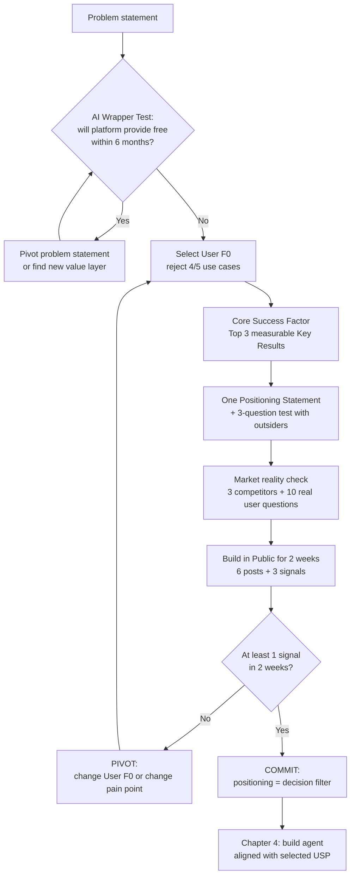

# Chapter 5: From Problem Statement to USP — Market Research & Positioning

> 📊 **Cohort Evidence —** In the RA phase, inconsistent messaging across surfaces directly degraded trust: Gamma displayed "~60 min" on the hero but the entry-test only ran "~35 minutes" (G-07), and exposed empty nav links before new visitors could see value (G-02); Beta posted "Practice SOON" / "Exam NEW" right on core features (A-03); Alpha built an admissions chatbot whose knowledge base lacked scholarships and application deadlines — precisely the 2 topics users asked about most. On the other hand, the team going deep on a single USP won: Alpha achieved the highest AI score of 8.5/10 by pouring all resources into anti-hallucination + citations; Aclaris aiknowledge Hub [C2-118] proved its USP of "not just an ordinary RAG bot" with measurable numbers — Hit Rate 0.91, Groundedness 0.96, $0.0011 per answer.

This chapter sits between "problem statement" and "build". [Chapter 2](chapter-02.md) helps you initialize the repo, [Chapter 4](chapter-04.md) helps you build agents — but if positioning is wrong, the faster you build, the more you waste. Most teams' problem is not poor coding; it is **building the right wrong thing**: a product nobody needs, or a wrapper that the platform will release for free in 6 months, or a USP that promises one thing while doing another.

**Positioning is picking the battle, not writing a tagline.** You do not "position" with an attractive slogan on a landing page. You position by **saying no** to 4 out of 5 possible directions, concentrating resources on 1 initial user, and using the positioning statement as a filter for all subsequent build decisions.

The entire chapter follows a loop — if market signals do not arrive, you return to the start of the loop rather than building more features:

> [📊 Open diagram on Mermaid Live / AI Editor](https://mermaid.live/edit#pako:eNplk09vGjEQxb_Kk680SihpDqhNFSAkNIpAhbSHugfjNbtWdu2V_7RCiO_esZcAUfew0o49v3kzb3bHpC0UG4JtavtXVsIFrCbcgJ67X5xNFNZCc_YbFxe3GO04WykfcDfDTyfaVrnh57W7vG1rETbWNahFg0Yrg7bS-SQ4a0rcIFTClF8523fsEfHA2dhy1pH7qZjVqGK6X-SyGVBZIRE0oW2LUgsEp9HYk6Z3wKeK0g_MMSHH9I0XrxymV52eCFlRnevLT4heQQqvPLE6yjgnTlKidQrLKKXyHlMhg3U5f0UqBnhSW3xXPtbBo7AoopVHxiQz7okxNwoL63XQ1mjqahlEUI0yIZN6CGmUA5IQ8YckmTLmt80D72D3GTYl2LNwryrAKVHrsKUmlHzNnAEp0DTfiB76V5mWGqTm3BEzzZgHwoyirgtog0Vc11riI0IUJoNu0FpPDfVIk9elEfVpMA8Z8Ej-TyL6h-MzgzvMyd_H_-1YUPXF7Md81a1MEn0wBtnjFGiFNm_Gjt-RjpsyS-bMn59nB057NuAvtDhSe_rCRtfhbACznPstb0TesOsh1nkUonwzJFQqWUmHL8sFCpEWJalhH8Aa5Rqhi_Sj7BKRM7rdKE4Bzgq1EbQKnHGzT5dFDHa5NZIOg4uKIrEtyPqJFqUTzSG8_wfPpRKU)

Each section below includes an exercise with outputs in the form of `usp/*.md` files in your team repo. This is positioning evidence for QA and judges — without these files, it counts as undone.

---

## 5.1 Identifying AI Wrappers — What is left of your product after 6 months?

An **AI Wrapper** is a product where its entire value lies in "wrapping" a platform API (OpenAI, Google, Anthropic...) with a thin interface. The workshop metaphor: **a motorbike riding into a container truck lane** — you are competing head-to-head with giants on their own home turf.

The test has only one question:

> **"If the platform (OpenAI/Google/Anthropic) releases this feature for free in the next 6 months, what is left of my product?"**

If the answer is "nothing" — you do not have a product, you have someone else's feature.

Two real pieces of evidence every team must know by heart:

- **GPT Store launched in November 2023** — an entire generation of "ChatGPT for X" (thin wrappers around a prompt) lost value almost overnight, because OpenAI allowed users to create and share GPTs for free.
- **ChatGPT Memory launched in May 2024** — products selling "chatbots remembering personal context" were reduced to only the value they built outside default memory (proprietary data, unique workflows, custom integrations).

The next question: **which value layers CANNOT be swallowed?** Typically falling into 4 categories:

| Value Layer | Real Cohort Example | Why It Is Hard to Swallow |
|---|---|---|
| **Proprietary data / domain** | Gamma used real cohort leaderboard data (level 0.0–2.2) instead of generic questions | The platform does not have your data |
| **Deep workflow** | Aclaris: MAP → REDUCE → REFINE → VERIFY → COMMIT pipeline + contradiction detection verifier, not a single prompt | A sequence of verifiable steps cannot be replaced with a single API call |
| **Domain-specific guardrail / governance** | NurA [C2-074]: 4-layer guardrail for Vietnamese medical domain; MindCare [C2-109]: risk classifier before AI response | The platform assumes no liability for your specific domain |
| **Integration where the user already is** | Chatbot embedded directly inside the admissions/enrollment flow, with official sources | You own the distribution context |

> 💡 **TIP:** The quickest way to pass this test is to write your USP in 1 sentence, then strike through every word the platform can also provide for free. How many words remain? That is your true build scope. If 0 words remain — pivot your topic today; do not wait until QA.

**Exercise 1 — Wrapper check (output: `usp/wrapper-check.md`)**

For your team's problem statement, write:
1. Current product description (maximum 2 sentences).
2. Answer the "free platform feature in 6 months" test — strike through each word, list what remains.
3. Classify the remaining value into 1 of the 4 categories in the table above. If it fits none — this is a red flag, consult a coach before writing another line of code.

---

## 5.2 User F0 / Beachhead — Saying "No" Matters More Than Choosing

**User F0** (beachhead) is the first user segment you choose to WIN decisively — not just "serve adequately". Workshop Rule #1: **"saying no is more important than choosing"**. A 4-person team does not have the resources to win 5 markets at once; listing 5 use cases and picking 1 means you have 4 clear rejection reasons — that is real proof you have made a deliberate choice.

### Exercise: Choosing User F0 (20 minutes, group work)

**Exercise 2 — Beachhead statement (output: `usp/beachhead.md`)**

1. List **5 use cases** of the problem statement (specific group + specific task they need to accomplish). For example, with an admissions chatbot: applicants asking about scholarships, parents comparing majors, 2nd-year students seeking transfer advice, counselors checking deadlines, international applicants asking about visas.
2. Evaluate each use case against 3 criteria: is the pain real, does your team have an edge, can you reach real users within 2 weeks?
3. **Choose 1** — write it as a Beachhead statement: *"We serve [target group], helping them [specific task], replacing [what they currently do today]."*
4. **Reject 4** — fill out the table below. The rejection table is just as critical as the statement, proving "you have actually thought it through".

Rejection table for 4 use cases (fill into `usp/beachhead.md`):

| Rejected Use Case | Willing to pay? / What pain? | Why not selected? / Can it expand later? |
|---|---|---|
| (E.g.: Parents comparing majors) | Won't pay — check for free on school website; low pain | Real pain but decision does not rest with them; can expand in Phase 2 after winning applicants |
| ... | ... | ... |

Three mandatory columns: **willing to pay / what pain / expansion path**. If you cannot articulate a reason in the middle column for a rejected use case — you haven't thought deeply enough; it does not count as a deliberate rejection.

A real cohort mistake at this step: Alpha chose applicants asking about admissions as their user, but their knowledge base **lacked the 2 most frequently asked topics** (scholarships and undergraduate deadlines). Selecting a user without knowing what real users ask means the choice only exists on paper — the exercise in Section 5.5 closes this gap with 10 real user questions.

---

## 5.3 Core Success Factor → Top 3 Measurable Key Results

You have chosen your battle (User F0). Next question: **what must you win to CAPTURE that market?** The Core Success Factor (CSF) is the decisive win/lose factor for the chosen User F0 — not a generic to-do list.

From the CSF, derive the **Top 3 Key Results** — each KR must be measurable by numbers with a clear deadline. If a KR is not measurable, it is a wish, not a key result.

5 seed KRs for teams to kick off (choose 3, or rewrite for your domain — but preserve measurability):

| # | Seed Key Result | How to Measure |
|---|---|---|
| 1 | Core feature runs correctly end-to-end from public UI to output (internal demos and stubs do not count) | Manual step-by-step checklist on the public URL; all steps produce real output |
| 2 | Average response latency < 3 seconds for common questions | Log timestamps per request (following the per-step timing pattern from the RAG chapter); measure across 20 sample queries |
| 3 | Accuracy >= 90% on golden dataset, or >= 4/5 stars from LLM-judge | Golden dataset + runner — see [Chapter 10](chapter-10.md); NurA's 4.62/5 LLM-judge score serves as a benchmark |
| 4 | Onboarding < 5 minutes from first open to first value (new user self-serves without team members sitting nearby) | Ask 3 outsiders to try, time them; record where they get stuck |
| 5 | >= 50% trial users return within the first week | User registration mechanism (even just Google Form + email reminders); count retention rate |

Choose only **3**. Choosing 5 means choosing nothing. Record reasons for excluded KRs in the exercise file — again, evidence of deliberate thinking.

**Exercise 3 — Key Results (output: `usp/key-results.md`)**

1. Write your team's CSF in 1 sentence: "To win [User F0], we must win at [factor]."
2. Select Top 3 KRs from the seed table (or author your own), documenting for each: target value, measurement method (specific tool), deadline.
3. For each excluded KR: 1 line explaining why it was dropped.

Direct cohort lesson: "11/11 teams lacked demo videos, 82% lacked eval evidence" (judge feedback) and 10/12 teams in the prior cohort submitted empty eval placeholders. KR #3 above distinguishes teams with hard evidence from teams with mere claims — choose it unless you have an exceptionally good reason not to.

---

## 5.4 One Positioning Statement — One Sentence as Referee

Everything above converges into **one** sentence. A single sentence, not 3 versions for 3 channels. If your landing page says one thing, your pitch deck says another, and your demo highlights a third — listeners will pick whichever version makes it easiest to dismiss your product.

Sentence framework:

> **[Product Name] helps [User F0] [specific task] by [distinctive mechanism] — unlike [current alternative / competitor] in that [measurable differentiator].**

Two real cohort examples:

- **Gamma** (sharp positioning, worth learning from): *"Prove your AI readiness — 5 axes, 5 levels, LLM-judged, AI-Ready Certificate."* Concise, mechanistic, verifiable output.
- **Aclaris** [C2-118] (USP backed by evidence): positioned as "not an ordinary RAG bot" — 5-step knowledge synthesis pipeline + contradiction verifier, proven by Hit Rate 0.91 / Groundedness 0.96 / $0.0011 per answer.

Common strength: both feature a **mechanism** (5-axis assessment, VERIFY pipeline) rather than just adjectives ("smart", "fast", "comprehensive" — these are positioning slop that anyone can paste).

### The 3-Question Test with Outsiders

Once written, show the statement to **3 people outside your team who know nothing about the topic** (classmates from another group, family, community group admins). Each person reads the sentence and answers:

1. Who is this product for?
2. What can that person do with it?
3. Without this product, what would they use instead?

If 3 people give divergent answers to question 1 — the statement is not narrow enough. If question 3 is answered with "just use ChatGPT" — you have failed the wrapper test from Section 5.1 in practice. Revise and re-test with 3 new people.

**Exercise 4 — Positioning statement (output: `usp/positioning-statement.md`)**

1. Statement following the framework above.
2. Test results: 3 questions x 3 people (record their verbatim responses — do not edit to sound better).
3. Revised statement (if applicable) post-test.

This file becomes the **single source of truth for messaging**: all copy across landing pages, pitch decks, demo scripts, and BIP posts must be checked against this file before publication. This directly prevents Gamma-style messaging misalignment (60 minutes on hero vs 35 minutes in entry-test) — both surfaces must quote the same number from the same file.

---

## 5.5 Market Reality Check Checklist — Competitors, Real Questions, Consistent Messaging

This checklist is recommended as **mandatory prior to building** by the cohort lessons report — as all four RA phase teams stumbled across its items.

### 4-Item Checklist

**1. Three direct competitors + feature comparison matrix.** "Direct" means: same user, same pain, actively used today (not "theoretical competitors"). For each competitor, spend 15 minutes hands-on (or read real user reviews on Facebook groups / Reddit / App Store). Fill into the matrix:

| Feature Needed by User F0 | Your Product | Competitor 1 | Competitor 2 | Competitor 3 |
|---|---|---|---|---|
| (E.g.: Answering scholarship questions with citations) | Yes / No | | | |
| ... | | | | |

This matrix serves two purposes: identifying viable positioning ground (features where all competitors are "No"), and preventing you from rebuilding what the market already offers for free.

**2. Ten most authentic user questions.** Gather from 3 sources: interviewing 5 people matching User F0 (Tally / Google Form + 15-minute call), reading 20 Q&A threads in communities where your target users hang out, and 1-2 star reviews of competitor products. Extract the 10 most frequent questions. These form the minimum content for your knowledge base and golden dataset in [Chapter 10](chapter-10.md). Alpha's failure (KB lacking scholarships + deadlines — the 2 most asked topics) resulted from skipping this step.

**3. Consistent messaging across all surfaces.** Cross-reference every number and claim across 4 surfaces: landing hero, in-product flow, pitch deck, demo script. All figures must originate from a single source: `usp/positioning-statement.md` and `usp/key-results.md`. Rule: write a number in one place only and reference it — no manual copying.

**4. Unfinished features must be hidden or clearly labeled.** Never slap "SOON" / "NEW" / "Locked" on core features (Beta's A-03 error: "Practice SOON", "Exam NEW", Day 02–15 Locked prevented evaluators from verifying AI value). Rule: if a feature lies on the User F0 path but does not function — hide it completely; if you wish to retain a roadmap — label it under a dedicated roadmap section, isolated from primary user flows. Navigation must not contain dead `#` links (Gamma's G-02 error: new visitors saw empty placeholders before experiencing value).

### Comprehensive Case Study — Real Mistakes vs Doing It Right

| Team | What Happened | Consequence | Lesson Learned |
|---|---|---|---|
| **Beta** | Core feature labeled "Practice SOON"/"Exam NEW"; Day 02–15 Locked | Evaluators could not verify AI Tutor value — AI score was only 6.5/10 despite overall score 78 | Core features must be reachable from public UI; hide what is incomplete |
| **Gamma** | Hero stated "~60 min" vs entry-test "~35 min" | Eroded trust (G-07) — caught in a single QA session | One number, one source, across all surfaces |
| **Alpha** | KB lacked scholarships and undergraduate application deadlines | Admissions chatbot answered poorly on the 2 most queried topics | 10 real user questions must exist BEFORE building KB |
| **Delta (correct)** | Honest landing: "MVP · Practice only · Not affiliated with employers" | Highest score in RA phase (80) — trust increased instead of dropping | Honest messaging does not diminish the product; it makes words credible |
| **Gamma (correct)** | 5-axis positioning + AI-Ready Certificate | Clearest positioning in RA phase despite lower total score | A single specific mechanism sentence beats ten adjectives |
| **Aclaris (correct)** | USP "not an ordinary RAG bot" + metrics | Hit Rate 0.91, Groundedness 0.96 — evidence-backed positioning | Claims must always be accompanied by measurable numbers |

**Exercise 5 — Market reality check (output: `usp/competitor-matrix.md`)**

This file consolidates all 4 checklist items: 3-competitor matrix (item 1), 10 real user questions with source attribution (item 2), 4-surface messaging reconciliation table with Consistent / Inconsistent status (item 3), and hidden features list with rationales (item 4). Without completing this file, you do not pass the "permission to build" gate — a decision held by coaches.

---

## 5.6 Build in Public — 2 Weeks, 6 Posts, 3 Signals

**Build in Public (BIP)** means sharing real product progress before completion where your User F0 hangs out (professional Facebook groups, LinkedIn, Discord servers, campus forums). The goal is not marketing — it is **gathering market signals as early as possible**, rather than guessing.

Minimum 2-week plan (from Positioning Workshop):

- **6 posts** (3 per week): each post covers 1 aspect of the USP being built — the User F0 pain point, your approach, measurable outcomes (real KR numbers). Posts with real data consistently outperform opinion pieces.
- **3 tasks per week** within the team: (1) build the prioritized KR, (2) produce 1-2 posts directly from those results, (3) answer/interview real users to populate the 10-question matrix. These 3 tasks mirror the BIP → Positioning → Focus loop: learnings from posts feed back into refining positioning.

**3 validation signals** — at least 1 must appear within 2 weeks:

| Signal | Threshold | What It Means |
|---|---|---|
| Substantive post comments | >= 10 comments | Strangers care enough to write |
| DMs asking for pricing / trials | >= 5 people | Genuine purchase intent — strongest signal |
| Actual trials (usage from outside the team) | >= 20 sessions | Product touched real users |

**No signals after 2 weeks — PIVOT.** Not "let's build more features and see". Pivoting means returning to Section 5.2: change User F0, or change the pain point targeted — then run the loop again.

**Exercise 6 — BIP tracker (output: `usp/bip-tracker.md` or Google Sheets)**

1. 6-post schedule: date, channel, topic, associated KR.
2. Tracker table: record comments / DMs / trials generated per post.
3. 3 signals with thresholds and expiration date (14 days from first post). Conclusion column: COMMIT / PIVOT — based on data, not gut feeling.

---

## 5.7 Reading Market Signals — Don't Trust Surveys, Trust Credit Cards

Signals in Section 5.6 are only valuable if interpreted correctly. Three questions separate true signal from noise:

**1. Who is ACTUALLY using it — does it match your chosen User F0?**

If active users turn out to be curious tech students (your peers) rather than the User F0 declared in `usp/beachhead.md` — that is a misaligned signal. Record who actually used it (bio, context) versus the statement. Skewed usage > target usage = wrong audience positioning, or the product is attracting early-adopter hobbyists rather than target users — distinguish between these two scenarios before deciding.

**2. What words do users use to describe your product?**

Read comments and DMs verbatim (do not paraphrase to suit your narrative). If users describe it consistent with your statement — positioning works. If they describe it through an alternative value proposition (that you accidentally delivered better) — the market is showing you a viable pivot direction. Cross-check user vocabulary with `usp/positioning-statement.md`.

**3. Who pays — or behaves like someone ready to pay?**

Principle: **"Don't trust surveys, trust credit cards."** In surveys, everyone says "great, I'd use it"; what counts is high-friction/financial commitment: filling out long registration forms, asking for exact pricing, returning a second time, proactively sharing with peers. 5 pricing DMs outweigh 100 likes. This is why KR #5 (>= 50% first-week retention) is a high-value seed choice — returning behavior cannot be faked.

At the end of the 2-week BIP sprint, write `usp/verdict.md` (half a page): which signals emerged with what numbers, who used it in reality, how users described it, and the decision to COMMIT or PIVOT (returning to Section 5.2 with specific takeaways).

---

## 5.8 Positioning as Decision Filter — Connecting to the Build Chapter

Once committed, the positioning statement does not sit in a frame. It becomes a **decision filter** for all subsequent building. Whenever debate arises in the team about what to build next (and every team debates), ask in order:

1. Does this feature lie on User F0's critical path? No — drop it.
2. Does this feature contribute to the Top 3 Key Results? No — defer it.
3. Could the platform offer this feature for free within 6 months? Yes — rethink its value proposition.
4. Once completed, does messaging across surfaces need to change? Yes — update `usp/positioning-statement.md` before writing code.

This rule directly explains why "going deep on 1 USP beats spreading thin across 10 features": Alpha scored 8.5/10 in AI with a single USP (anti-hallucination + citations) implemented end-to-end, whereas teams spreading thin were marked down for "users could not reach core AI value" — products are evaluated on user access to value, not feature counts. The rule "USP must run from public UI to output" (from cohort 3 template) serves as the final sanity check before every submission.

From here, every `usp/*.md` file you have authored becomes real build input: 10 real user questions form the golden dataset, Top 3 KRs form acceptance criteria, positioning statement sets messaging constraints. Move to [Chapter 4](chapter-04.md) to build agents adhering strictly to those constraints.

---

## "Reaching Excellence" Self-Assessment Rubric — Demo Day "Concept & Practical Application"

Use this rubric to self-evaluate before submission. Your self-grade must hold up against external QA (remember: no team in the cohort caught their own flaws — all CRITICAL/HIGH issues were found by external QA; get peer teams to cross-evaluate).

| Level | Problem Statement & Market Understanding | USP & Evidence | Real-world Application |
|---|---|---|---|
| **1 — Below Standard** | Unidentified direct competitors; unable to articulate real user questions | USP is generic adjectives ("smart", "fast"), unmeasurable | No external trial users; core features inaccessible from public UI |
| **2 — Meets Standard** | Lists 3 competitors; has 10 user questions (superficial sources) | Specific USP but evidence limited to internal demos | < 5 external trial users; lacks behavioral metrics |
| **3 — Good** | Complete 3-competitor feature matrix; 10 questions with attributed sources; consistent messaging across 4 surfaces | USP features distinct mechanism + metrics (accuracy, speed) on golden dataset; initial signals emerge (comments/DMs/trials) | >= 20 external trial users; tracked KRs backed by dashboards/logs |
| **4 — Excellent** | Competitors tested hands-on with documented weaknesses; market void identified and proven via matrix; 4 surfaces quote a single source | 1 USP executed deeply end-to-end + independently reproducible evidence (e.g. Aclaris 0.91/0.96, AI Finance Assistant 64% → 96%); reaches >= 1 signal threshold (>= 5 pricing DMs or >= 20 trials) | Real users returning to track KRs; COMMIT/PIVOT verdict backed by 2-week data; product lives up to positioning statement from public UI to output |

## Exit-Test — 4 Concluding Questions

Before moving past this chapter (and before any pitch), every team member must be able to answer 4 questions — each representing an intentional trade-off you have accepted, not a feel-good answer:

1. **If the platform releases your core feature for free in 6 months, what remains of your product?** — answering "we believe in execution speed" is not sufficient; point out the exact value category (proprietary data / deep workflow / domain guardrail / integration) you own.
2. **Why did you reject 4 out of 5 use cases, and what did rejecting them cost you?** — the `usp/beachhead.md` table must reflect the true cost of rejection, not just rationalizations.
3. **What signal triggers a pivot, and after 2 weeks, at what level did you observe or fail to observe it?** — answer with numbers from `usp/bip-tracker.md`, including expiration dates; "the team feels it's going well" is not a signal.
4. **Which features are currently hidden or roadmap-labeled, and does hiding them invalidate your positioning statement?** — if hiding too much causes the statement to overpromise, the problem is not in the UI; it is in the statement itself.

Answer all 4 questions with documented evidence in `usp/*.md` files — you are now ready to build. Proceed to [Chapter 4](chapter-04.md).
