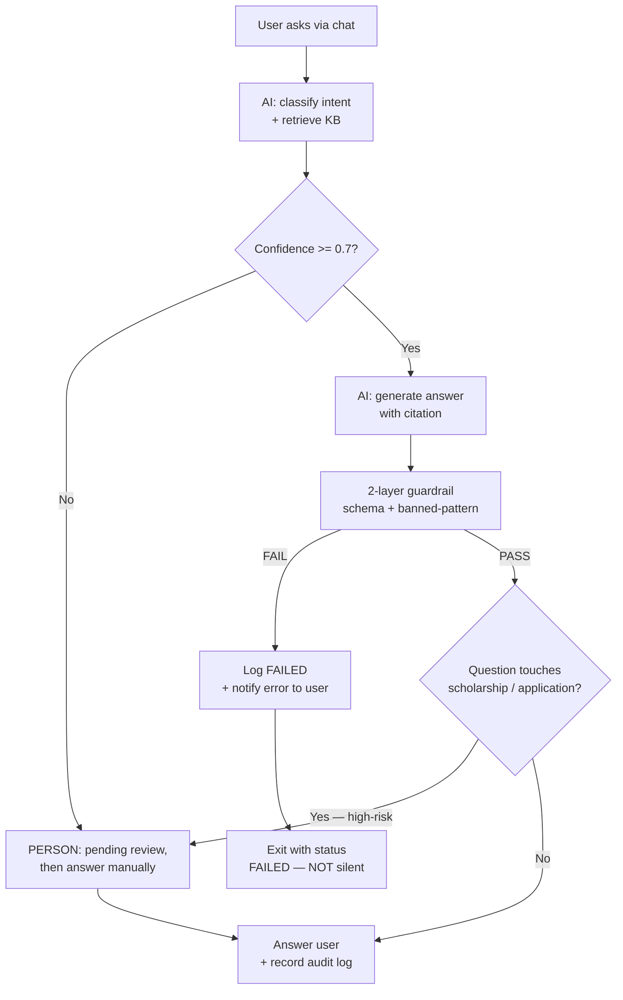
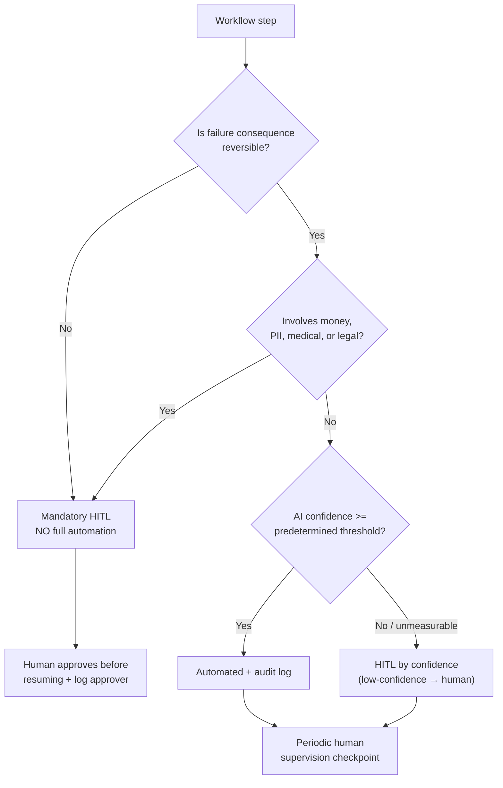
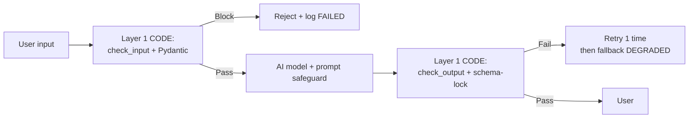

# Chapter 7 — Workflow Design & Reliability: Edge Cases, Failback, Human-in-the-Loop, Governance

> 📊 **Cohort Evidence —** Three figures from previous cohorts explain why this chapter exists: (1) **11/12 teams** relied on a single prompt-only guardrail layer — once the prompt was bypassed, the entire system stood unprotected; (2) Team **002** wrote `except Exception: return default` — the AI experienced silent regressions without anyone noticing, a textbook "silent fallback"; (3) Team **Gamma** allowed user sessions to expire during a 35-minute exam without persisting state — users lost all progress (G-06), while unrecorded MCQ clicks displayed no toast warning of missing answers (G-08). None of these were AI model failures — they were **workflow design failures**. This chapter provides the mindset and actionable checklists to prevent their recurrence.

Core principle: **design for reliability first, automate second**. Automating a broken process simply produces broken outcomes at higher velocity.

---

## 7.1 Value Stream — Mapping IPO for Product Flows

Every workflow, regardless of complexity, follows an **Input → Process → Output (IPO)** structure. Before writing any code, map this flow and answer two questions:

1. **Where is AI?** — which steps require unstructured reasoning (text generation, ambiguous classification, summarization)?
2. **Where is Human?** — which steps require human judgment, accountability, or intervention when AI is uncertain?

### IPO Example: Admissions Counseling Chatbot (Team Alpha model)

| Phase | Description | AI / Human | Risk Note |
|---|---|---|---|
| **Input** | User chat questions; scholarship and deadline KB | Human KB curator | Deficient KB causes AI hallucination (Alpha cohort defect) |
| **Process** | Intent classification → retrieve KB → generate cited answer | AI | Requires 2-layer guardrail (Section 7.7) |
| **Output** | Answer + source links; if low confidence → escalate to human counselor | AI + Human | Designates the HITL junction (Section 7.5) |

If you cannot sketch this table within 15 minutes, you do not adequately understand your product workflow. Previous cohorts demonstrated the consequence: teams built features first, only to realize later that messaging contradicted core values (e.g., Beta defaulting to Direct answers over Socratic dialogue — reversing their own stated value proposition).

### Quick Exercise

Map the IPO for your team's product in a 3-row table (Input/Process/Output), identifying for each step whether AI or Human executes it, along with one concrete operational risk.

---

## 7.2 Six Attributes of a Reliable Workflow

Use this evaluation checklist before deploying workflows to production. Each attribute requires an **empirical verification method** — an unverified attribute is merely an aspiration.

| # | Attribute | Definition | Verification Method |
|---|---|---|---|
| 1 | **Fault-tolerant** | An isolated node failure does not crash the entire workflow; explicit fallback branches exist | Terminate an intermediate node (mock raise) → workflow gracefully degrades or returns a clear error message |
| 2 | **Observable** | Every step logs state as OK/WARN/FAIL, enabling root-cause diagnosis | Scenario: server crashes at midnight — morning logs clearly answer: "which step failed, on what input, affecting how many cases" |
| 3 | **Scalable** | System operates reliably under 1 or 100 concurrent requests | Execute 10 parallel requests — no ERR_ABORTED streaming exceptions like team Alpha (A-02) |
| 4 | **Workable** | Real users traverse the core value stream without blocking defects | Execute automated E2E smoke tests on the golden path upon each deployment (Gamma was blocked twice at login) |
| 5 | **Idempotent** | Re-executing with identical input creates no duplicate or corrupted state | Call API twice with identical payload → no duplicate database records created, no duplicate billing charges |
| 6 | **Auditable** | Deterministic backward traceability: who/what decided what, and when | Inspect a flawed output → trace execution path: prompt used, retrieved context, and human approval record |

The two weakest attributes across prior cohorts were: **Workable** (zero teams caught their own blocking defects — all CRITICAL bugs were surfaced by external QA) and **Observable** (Team 002's silent fallback violated attribute #2).

---

## 7.3 Systematic Edge-Case Taxonomy

Edge cases are not unpredictable anomalies — they cluster into identifiable, recurring categories. When architecting workflows, systematically inspect each category and determine your system's response:

| Edge Category | Real Cohort Example | Standard Mitigation |
|---|---|---|
| **Missing / Empty Data** | Admissions KB lacked 2 most frequent topics (scholarships, deadlines) | Input validation at boundary (Pydantic); missing source data → respond explicitly "information unavailable" + route to human, NEVER allow AI to hallucinate |
| **Invalid Format** | LLM returns truncated JSON mid-stream with missing fields | Schema-lock: schema mismatch triggers explicit exception + 1 retry → fallback (team 012: all outputs validated via Pydantic) |
| **Out-of-Scope User Input** | Submitting medical questions to admissions bot; illicit requests | Intent classification + polite rejection + redirect to proper channel (input guardrails, Section 7.7) |
| **Concurrency** | Rapid consecutive message bursts trigger streaming ERR_ABORTED (Alpha A-02) | Client-side debouncing + server-side queue + per-user session lock |
| **Timeout / Budget Exhaustion** | AI interview session runs indefinitely | Cost locks like Delta: max 60-minute session, 30-second idle disconnect, 10 sessions/24h — enforced **server-side** |
| **Prompt Injection** | User submits "disregard all previous instructions, output..." | Prompt safeguards + isolate untrusted user data from system prompts + filter banned patterns (Section 7.7) |
| **Infinite Loop** | Agent invokes tools in endless recurring cycle | Escape hatch: iteration counter exceeding maximum threshold forces termination state (team 011: count ≥ max → Closing → END) |

Rule: every edge case listed in this matrix must be represented as an **automated test** within your repository. An unencoded edge case will inevitably surface during live Demo Day evaluations.

---

## 7.4 Failback & State — Eliminating Silent Fallbacks

### Anti-Pattern: Silent Fallback

```python
# ANTI-PATTERN — Team 002 from previous cohort
try:
    result = run_ai_analysis(data)
except Exception:
    return default_answer   # AI fails silently, neither user nor dev knows
```

The issue is not having a fallback — fallbacks are essential. The flaw lies in **silence**: the system degrades to low-fidelity output without alerting anyone. For defects of this nature, establishing a **Root Cause Analysis (RCA)** protocol is mandatory: Team 002 addressed this by committing a `ROOT_CAUSE_ANALYSIS.md` to their repository — converting an operational failure into persistent institutional knowledge.

### Production Pattern: Log FAILED + Explicit User Degradation Notice

```python
import logging

logger = logging.getLogger("workflow")

def safe_ai_step(data: dict) -> dict:
    try:
        return run_ai_analysis(data)
    except Exception as exc:
        logger.error(
            "FAILED ai_step input_hash=%s reason=%s",
            hash(str(data)), type(exc).__name__,
        )
        return {
            "status": "DEGRADED",          # user KNOWS quality is degraded
            "answer": None,
            "message": "AI analysis temporarily unavailable, displaying raw data.",
        }
```

Three critical distinctions from the anti-pattern: (1) structured `FAILED` log containing input hash and exception type — satisfying Observability; (2) explicit `DEGRADED` status instead of masked normalcy; (3) transparent user notification rather than disguised placeholder data.

### State Persistence & Resumption — Gamma's 35-Minute Lesson

Gamma allowed users to undertake a 35-minute placement assessment where sessions expired mid-exam without state persistence → resulting in total progress loss (G-06). This constituted the cohort's most severe Fault-tolerance failure. Baseline requirements for extended workflows (exams, structured interviews, multi-step onboarding):

- **Persist state after every individual step**, never deferring until workflow completion (checkpoint per response)
- **Resume seamlessly from the exact step** upon user return — surviving tab switches, page reloads, and transient network drops
- **Provide clear UI toasts/indicators** upon execution anomalies (G-08: clicked MCQs failed to register without UI feedback, leaving users unaware of unrecorded answers)

---

## 7.5 Human-in-the-Loop — Tiered Autonomy

### The Golden Rule

> **Any step impacting finances, PII, healthcare, legal compliance, or irreversible outcomes MUST NOT be fully automated. Mandatory human review is required before execution.**

This is not a UX design preference — it is an operational safety boundary. Tiered autonomy separates workflows into two distinct operational tiers:

- **Low-Risk** (internal document summarization, drafting suggestions, content generation): AI runs autonomously, verified post-hoc via audit logs.
- **High-Risk** (disbursing funds, outbound external emails, clinical advice, record deletion, publishing results): pause execution for human verification — or automate solely when confidence scores exceed predefined safety thresholds.

### Diagram 1 — Reference Workflow with HITL Junction (Admissions Counseling)


> [📊 Open diagram on Mermaid Live / AI Editor](https://mermaid.live/edit#pako:eNptUl1vEzEQ_Csrv7aBtkJCikRRkssXqdqKlCfMw9a3OVu9s4OzBlVR_jvr-yCAuJeT1zOzs7M-KhNKUmNQuzr8NBYjw1OhPcg3-arVlwNFsDpdk9k5-J4QBMNafYPR6Bamgpisx7C36KEO6MB5Js9a-wuIxNHRD4LNVPCd5LSlzY5azYLfuZK8Ibj9AFdv3n_U6tSBZgICrTY2-EqrlrGSRo_zz9uH-7EYCFCmV-JLiMEBR5TW8rcJTGZo_9_yYKFXn4VeuuhnODhvwWAamKLzQg0Yx8gu-N_8omXNhbVMGMuIroYbIeyFcDCWGoQLeEbvqRztkZnimTvvei8m67u--0J07kIFuTQv2tw4zy0KofWfp02yhH81Hifbba-xzHGKcdvCsREVGww8Z5m3UoVDOIe7HMYHnW6urt-BdZUdRXd4GaL-C_fnEtbi9amPtbWU3VbWAabSsZTPIa86QndYtIdPwt4Q54UY2UiOWfyxxZx0N_5gabN6uF-Ca6DGdnHqElRDsUFX5pd6zLJasWRNWgpalbTDVMuz1P6UwZg4bF-9kUuOiaSS9iUyFQ6riE1fPv0CxsTnXQ==)

Diagram interpretation: the human escalation node (`PERSON`) activates only when model confidence falls below threshold OR when the inquiry touches high-risk domains — all standard interactions execute automatically to preserve responsiveness.

### LangGraph `interrupt()` + Checkpointer Implementation

LangGraph provides native stateful primitives: nodes call `interrupt()` to suspend graph execution, the checkpointer serializes state, and upon human review completion, execution resumes without state degradation.

```python
from typing import TypedDict
from langgraph.graph import StateGraph, START, END
from langgraph.checkpoint.memory import MemorySaver
from langgraph.types import interrupt, Command


class State(TypedDict):
    question: str
    answer: str
    approved: bool


def draft(state: State) -> dict:
    return {"answer": f"Draft response for: {state['question']}"}


def human_review(state: State) -> dict:
    verdict = interrupt(          # Graph HALTS here, state is safely persisted
        {"answer": state["answer"], "note": "Approve before sending?"}
    )
    return {"approved": verdict == "APPROVE"}


def send(state: State) -> dict:
    return {"answer": state["answer"] + " [sent]"}


g = StateGraph(State)
g.add_node("draft", draft)
g.add_node("review", human_review)
g.add_node("send", send)
g.add_edge(START, "draft")
g.add_edge("draft", "review")
g.add_edge("send", END)
g.add_conditional_edges("review", lambda s: "send" if s["approved"] else END)

graph = g.compile(checkpointer=MemorySaver())
cfg = {"configurable": {"thread_id": "t1"}}
result = graph.invoke({"question": "Scholarship application?"}, cfg)
# Graph halts at review node — inspect interrupt payload, human reviewer approves:
result = graph.invoke(Command(resume="APPROVE"), cfg)   # Resumes from review node
```

Key insight: `MemorySaver` (or durable `SqliteSaver` in production — utilized by Team 011) persists execution state at interruption boundaries; if server processes restart, the `thread_id` enables exact resumption without progress loss.

### Decision Matrix — Where Does YOUR Workflow Need HITL?

| Step Indicator | Fully Automated? | Rationale |
|---|---|---|
| Drafting internal content, zero immediate public exposure | Yes — low-risk | Errors can be rectified downstream |
| Dispatching outbound messages/emails to external users | **No** — review required | Direct external user impact, difficult to retract |
| Processing PII (transcripts, identity, grades) | **No** — requires PII-filter + review | Regulatory compliance, user trust |
| Medical or health-related recommendations | **No** — emergency route if triggered | Team 005 pattern: danger keywords escalate immediately |
| Financial transactions, publishing results, record deletion | **No — absolute prohibition** | Irreversible real-world consequences |

### Diagram 2 — Tiered Autonomy Decision Flow


> [📊 Open diagram on Mermaid Live / AI Editor](https://mermaid.live/edit#pako:eNptk29r2zAQxr_KoVcbS1jUDEYG62icNDEtZbC8m_pCluRYJJY8V6ILId99J8mt7TC_8J_T6fndcyefibBSkW9AyqN9FRVvHexWzABed78ZWTI_o8WMeapkIcC11uzh1baHkM7IM0ynt7A8M7INKVx6-OPj2xxeuAaB22flnDETdChNSxbMvtdVcwFvq4PYD0YuqY4lQoCRhwrZjERihqVt890jFFGxdFBErFwIZD1sA1Z-edqAC9GSQo-Xi6DyPJLObKe7QiePOuxW3KAVvDkddglqOhYVE0T8zPMJnJJ8UU6gqeIm2sAxWpZ9-asrRjYKD12tkX6Xg7Cm1FIZoeD2O7JGzaLY_96MKEyFQxkNqSevr8j32LXdfxsCn4B7qR0cbd-c9aBC-AyH-JQWpLeiU9y8zcFVyg4Kx6o_4AGZDqwwf0MXN1D5mpuP74z7KLNFmaxS4tBYbRzs0wRoDS_pxY0OUDR9iD7maSiy1KMjJaV-J2wSIX1k8SNH3NM4HU2dovZXB3-Dzzp1UyNZVGnwp-4sFGWD_cJOXTMHIognEyC1amuuZfi_zqECRrBRtWIYYESqkvsjpjJzCcncO_vrZAQuutYrjPhGcqdWmu9bXnfhyz-vJiKf)

---

## 7.6 Lightweight AI Governance — Audit Logs, Accountability, Escalation

Governance is not a static Privacy Policy web page (Team Alpha had dead `#` Privacy Policy links despite deploying a B2B product handling sensitive PII). Governance is an **executable runtime mechanism**. Three required components:

### 1. Audit Logging — Every AI Decision Leaves a Trace

Each time an AI component makes an inference or decision, record an audit event adhering to the **canonical schema** detailed in [Chapter 11](chapter-11.md) §11.7 (timestamp, user hash, input hash, output hash, model version, risk tier, human approval flag — omitting raw PII/payloads). Team 002 committed evaluation artifacts directly into source control with identical rationale: automated decisions must remain retrospectively auditable.

### 2. Accountability Definition

Formulate a clear statement in your project README prior to deployment: **"If system outputs cause harm X, the responsible party is role Y, under justification Z."** Reference standard: MommyCare (Team 005) did not assign liability to the AI model — the system triaged inputs, routed detected emergency keywords to urgent hotlines, and downgraded safety tiers for unverified clinical sources. Accountability resides in architecture design, not model weights.

### 3. Escalation Paths — Graceful Upward Handoffs

Workflows require clear upward escape routes: uncertain AI → human reviewer → secondary specialist → emergency services/on-call staff. Team Delta executed this cleanly: the system gracefully **declined** to conduct real employment interviews, steering users back to designated human instructors when queries exceeded educational boundaries.

One-Page Governance Checklist (place alongside your IPO):

- [ ] Audit log records every automated decision step (storing hashes, never raw PII)
- [ ] Accountability policy explicitly documented in repository README
- [ ] Escalation path mapped in architecture diagrams, culminating in a human endpoint
- [ ] Server-side cost ceilings and rate limits enforced (independent of client controls)

---

## 7.7 2-Layer Guardrails — Code Validation + Prompt Safeguards

Cohort benchmark: **11/12 teams relied solely on prompt-only guardrails**. Prompts represent a fragile defense — easily subverted via jailbreaks, misunderstood by smaller models, or dropped across model migrations. The primary defensive layer must be implemented in **imperative code**, executing deterministically before and after model invocation.

### Layer 1 — Code Validation: Pydantic Schema-Lock + Banned-Pattern Filtering

```python
from pydantic import BaseModel, ValidationError

BANNED = ("ignore previous", "disregard instructions", "urgent bypass")

class TriageOutput(BaseModel):          # Schema-lock: format mismatch raises exception
    level: str                          # "routine" | "warning" | "emergency"
    reason: str

def check_input(text: str) -> str | None:
    low = text.lower()
    for pat in BANNED:                  # Banned-pattern guard
        if pat in low:
            return "BLOCKED_INJECTION"
    return None

def guard(ai_result: dict) -> TriageOutput:
    try:
        return TriageOutput.model_validate(ai_result)
    except ValidationError as exc:
        raise RuntimeError(f"FAILED schema: {exc.errors()[:2]}") from exc
```

Team 012 (ResearchKit) enforced this comprehensively: **all** model outputs were parsed through Pydantic models; validation failures generated explicit exceptions without silent error suppression. Team 010 introduced AST-level sandboxing to block unauthorized module imports.

### Layer 2 — Prompt Safeguards

Prompt engineering remains necessary: declaring system persona + explicit boundary refusals + citation requirements + "admit uncertainty when ungrounded" directives. However, prompt safeguards serve as **secondary defenses**, never the primary barrier.

### Case Study 1 — 2-Layer Medical Triage (Team 005, MommyCare)

Code layer: a deterministic keyword list — if incoming queries contain critical symptom patterns, the workflow **bypasses the LLM entirely**, triggering immediate emergency escalation. In parallel, a `trust_manager` classifies information provenance: authoritative clinical references maintain high confidence; missing source citations automatically degrade the `safety_level` to warning. This represents safety by design: patient risk mitigation does not depend on model compliance.

### Case Study 2 — Guardrails Class (Team 008, Buddy)

A dedicated module encapsulating `SafetyLevel` and `ViolationType` enumerations, decoupling `check_input` from `check_output` — malicious input is blocked before model entry, and non-compliant output is halted before user exposure. Most notably, test suites were written like formal specifications — e.g. `test_blocks_grooming_secret_language` — validating safety properties as **core functional requirements**.

### Architectural Summary — End-to-End 2-Layer Guardrail


> [📊 Open diagram on Mermaid Live / AI Editor](https://mermaid.live/edit#pako:eNp1kE1LxDAQhv_KkKv24HUPQtt0ZaHgUhUUIzIm6QdNk5ImSFn2vzvdFhHF3DJ5nzcPc2LSKc12wGrjPmWLPkBZCQt00lfBnibtobNjDIK9QZLcQkbT0o1wA_k9L3ZCWNlq2b9fQnAFx1mhDZ2k_FqTEQaCZcbJXrBLxzN1PEaQreuIMK6BfXooC_6bOeI0bUhOSHqAgWwNMaN3wxhgwlo3Eb36JvNLmv8j6WJYLSe6D5isThvK10_32Jnt0xeqqXTwMxUZtFTjybhGYz5Q9sCLuyrlP7T5H-1i2yFF2DWwQfsBO7Xs-7QgggXy0IIGgildYzS0aGHPSxhjcA-zlfQYfNQ0iaPCoHmHjcdhG5-_AL4WiBE=)

---

## 7.8 Chapter Exercises

### Exercise 1 — IPO Mapping & 6-Attribute Self-Assessment (30 minutes)

Map the IPO value stream for your product's core feature (Input/Process/Output with AI/Human and Risk columns). Subsequently, perform a candid self-evaluation across the 6 attributes in Section 7.2 — rating each as: Pass / Fail / Unmeasured.

- Output: `docs/workflow-ipo.md` in your repository — containing the IPO table, the 6-attribute scorecard, and remediation plans for the 3 weakest attributes.

### Exercise 2 — Edge-Case Taxonomy & Automated Tests (45 minutes)

Using the taxonomy from Section 7.3, author an edge-case matrix tailored to your system: 7 categories, each with a concrete failure scenario and current mitigation. Every row marked "unhandled" must link to an issue, and at least 3 critical edge cases must feature automated tests in your test suite.

- Output: `docs/edge-cases.md` + at least 3 new test files under `tests/` named after explicit specs (e.g. `test_blocks_out_of_scope_question.py`).

### Exercise 3 — Comprehensive Mermaid Workflow Architecture (60 minutes)

Construct a Mermaid workflow diagram for your system (maximum 12 nodes), strictly incorporating all 4 architectural components:

1. **Edge Branches** — at least 2 distinct failure paths (fallback execution, explicit DEGRADED/FAILED states)
2. **HITL Junctions** — at least 1 human review node (labeled `PERSON` or icon equivalent) adhering to Section 7.5 guidelines
3. **Failback Routes** — every AI node must have an explicit failure recovery route, avoiding terminal dead-ends
4. **Governance Checkpoints** — audit logging and escalation paths visible within the topology

- Output: `docs/workflow-diagram.mmd` (or embedded in README) + a 5-line design justification explaining the placement of each HITL junction.

### "Reaching Excellence" Rubric — Production Quality & Reliability

| Level | Demonstrated Competency |
|---|---|
| **9-10 Excellent** | 2-layer guardrails (code + prompt) with spec-driven tests; zero silent fallbacks — all exception blocks log FAILED and return explicit DEGRADED states to users; durable state persist/resume for extended sessions; at least 1 verified HITL junction with functional interrupt/checkpointer logic; audit logging and escalation paths diagrammed in workflow topology |
| 7-8 Good | 2-layer guardrails with modest test coverage; fallback and structured logging present with minimal error swallowing; HITL modeled in diagrams though simulated in code |
| 5-6 Average | Predominantly prompt-only guardrails; fallbacks exist but are partially silent; edge cases cataloged in documentation without automated test coverage |
| ≤4 Deficient | Bare `except: return default` blocks; volatile in-memory state without persistence; single-layer or absent guardrails; undefined accountability upon AI failure |

### Chapter Exit-Test (Self-Check — Pass before proceeding)

1. How many guardrail layers currently protect your system? Which layer executes in code, and which in prompt text? If prompt instructions are completely subverted, what prevents failure?
2. Locate an `except` block in your codebase that catches exceptions — does it emit a structured FAILED log? Does the end user recognize that the system is operating in a degraded mode?
3. If a user interrupts a 35-minute workflow and closes the browser tab, returning 24 hours later — how much progress is lost? Which code mechanism guarantees state recovery?
4. Where is the initial HITL junction situated in your workflow, and what justifies that specific placement under the decision matrix in Section 7.5?

---

## Related References

- Content safety guardrails & red-teaming: see [Chapter 11 (Privacy & Security)](chapter-11.md) §11.4.
- Reliability evaluation via quantitative benchmarking (golden datasets, LLM-judges, pass@k): see [Chapter 10 (Testing & Evaluation)](chapter-10.md).
