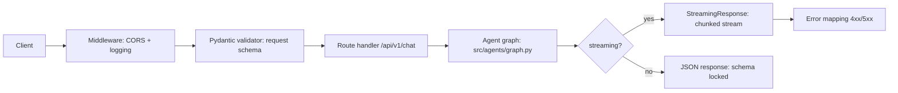

# Chapter 8: API Development with FastAPI

After building the AI Agent in Chapter 4, you need to "package" the agent into a web service that users can access. FastAPI is a modern Python framework ideal for building APIs for AI agents. This chapter guides you from fundamentals to advanced concepts—from creating your first route to implementing streaming responses and connecting with a LangGraph agent.

---

## 8.1 FastAPI — Modern Framework for AI

### Why Choose FastAPI?

FastAPI is a Python framework designed specifically for building modern APIs. It stands out due to four main advantages:

**High Performance:** Built on Starlette (ASGI) and Pydantic, FastAPI achieves performance on par with NodeJS and Go—significantly faster than Flask and Django. When processing thousands of requests to an AI agent, this performance makes a substantial difference.

**Async-First:** AI agents typically call LLM APIs, search APIs, and databases—all of which are I/O-bound operations. FastAPI provides native async/await support, enabling concurrent request processing without blocking threads. This is critical because a single request to an AI agent can take 5–30 seconds to complete.

**Auto-Documentation:** FastAPI automatically generates OpenAPI (Swagger) documentation directly from code. Every route, parameter, request body, and response model is documented automatically. You never need to write API docs manually—documentation always remains in sync with the code.

**Type-Safe:** Deep integration with Pydantic validation catches errors early—wrong data types, missing fields, out-of-range values—all detected before the execution logic runs. This minimizes bugs and boosts reliability.

### Comparison with Flask and Django

| Criteria | FastAPI | Flask | Django |
|-----------|---------|-------|--------|
| Async | Native async | WSGI (sync), requires extensions | ASGI since Django 3.0 |
| API Docs | Automatic (Swagger) | Requires Flask-RESTX | Requires DRF + drf-spectacular |
| Validation | Integrated Pydantic | Additional install required | Django forms / DRF serializers |
| Performance | Very high | Medium | Medium |
| Learning curve | Easy | Very easy | Fairly steep |
| Best suited for | APIs, microservices | Small apps, prototypes | Full-stack web apps |

FastAPI is the right choice when building an **API backend for an AI application**. Flask suits quick prototypes but lacks native async and auto-docs. Django is overly heavy for an API-only service.

### When Is FastAPI the Right Choice?

FastAPI is an excellent choice when:
- You are building an API backend (no HTML rendering)
- Async is required (calling multiple external APIs, heavy I/O)
- You need auto-documentation for team collaboration
- Building microservices or serverless functions
- Strong type validation is needed

FastAPI may not be optimal when:
- HTML template rendering is needed (use Django or Flask instead)
- Small projects or quick prototypes that do not require production readiness
- The team is already proficient in Django and prefers not to learn a new framework

> 💡 **TIP:** Install FastAPI alongside uvicorn (ASGI server) to run: `pip install fastapi uvicorn`. Uvicorn is a high-performance ASGI server, comparable to Gunicorn for WSGI. In production, run uvicorn with multiple workers: `uvicorn src.main:app --workers 4`.

---


> [📊 Open diagram on Mermaid Live / AI Editor](https://mermaid.live/edit#pako:eNpVkTFvwjAQhf_KyWtLo0rtkqEVogipKqWKER0SBss-EovEdh0bgoD_3kuASvXg4d37fO_ORyatQpYC29R2LyvhA3xkhQE6k3xSazRhDaPRC8y_87lWqsa98JjCZJFxuIPalqU25fpCzL8H6yr_OihhgpawE7VWIlifgsefiG2AVlbYiCuxGoAsL1hmY0CohKEWHhLhdLJ7TChRKNjVnA3m8Yzc45KCQemFq1JovUxEL7TJoDy4wx8zng0Q58c2eBQNhX09X0qc96XTAdsT8GXOb_UMW2dNS0PKKpothGhKcJRs_Y8z9gTvfPGZ9xdNd4Mu89Fm5BbVDVkOKaaUfOq99dAI56gVPHVd8tx1FJfdA2vQN0Kr_juOPViwQG9hQULBFG5ErGkbhTn3ZhGD5QcjqRh8RFKio1Xjmxa0heYqn38B10Gb0g==)

## 8.2 Routes and Schemas

### Defining Routes

A route is an API entry point. Each route couples an HTTP method (GET, POST, PUT, DELETE) with a URL path:

```python
from fastapi import FastAPI

app = FastAPI(
    title="AI20K Agent API",
    description="API for AI Agent built with LangGraph",
    version="1.0.0",
)

@app.get("/")
async def root():
    """Health check endpoint."""
    return {"status": "ok", "message": "AI20K Agent API is running"}

@app.get("/health")
async def health_check():
    """Check system health."""
    return {
        "status": "healthy",
        "version": "1.0.0",
    }

@app.post("/api/v1/chat")
async def chat(request: ChatRequest):
    """Process incoming messages from users."""
    # Business logic execution...
    return {"response": "..."}
```

### Pydantic Request/Response Models

Pydantic models define the data structures for requests and responses. They form the "contract" between client and server:

```python
from pydantic import BaseModel, Field
from typing import Optional
from datetime import datetime

class ChatRequest(BaseModel):
    """Schema for chat requests."""
    message: str = Field(
        ...,  # ... indicates required
        min_length=1,
        max_length=5000,
        description="Message from user",
        examples=["What is the GDP of Vietnam in 2024?"]
    )
    conversation_id: Optional[str] = Field(
        None,
        description="Conversation ID (default: create new)",
    )
    stream: bool = Field(
        False,
        description="Whether to stream the response",
    )

class ChatResponse(BaseModel):
    """Schema for chat responses."""
    response: str = Field(description="Response from agent")
    conversation_id: str = Field(description="Conversation ID")
    sources: list[str] = Field(
        default_factory=list,
        description="Reference sources",
    )
    timestamp: datetime = Field(
        default_factory=datetime.now,
        description="Response timestamp",
    )

# Route usage
@app.post("/api/v1/chat", response_model=ChatResponse)
async def chat(request: ChatRequest):
    """Process chat messages with the agent."""
    # Handling logic...
    return ChatResponse(
        response="Sample response",
        conversation_id=request.conversation_id or "new-id",
        sources=["source1", "source2"],
    )
```

### Field Validators

Pydantic allows complex validation rules using validators:

```python
from pydantic import BaseModel, Field, field_validator

class QueryRequest(BaseModel):
    """Request for research agent."""
    query: str = Field(
        ...,
        min_length=3,
        max_length=1000,
    )
    max_iterations: int = Field(
        default=3,
        ge=1,   # greater than or equal
        le=10,  # less than or equal
    )
    
    @field_validator("query")
    @classmethod
    def validate_query(cls, v: str) -> str:
        """Normalize query string."""
        v = v.strip()
        if not v:
            raise ValueError("Query cannot be empty")
        return v
```

### API Versioning

Always version your API to preserve backward compatibility:

```python
from fastapi import APIRouter

# Router for v1
v1_router = APIRouter(prefix="/api/v1")

@v1_router.post("/chat", response_model=ChatResponse)
async def chat_v1(request: ChatRequest):
    """Chat endpoint version 1."""
    return ChatResponse(
        response="Response v1",
        conversation_id="id",
    )

# Router for v2 (when modifying APIs without breaking v1)
v2_router = APIRouter(prefix="/api/v2")

@v2_router.post("/chat", response_model=ChatResponseV2)
async def chat_v2(request: ChatRequestV2):
    """Chat endpoint version 2 — streaming supported."""
    # New logic...
    pass

# Register routers
app.include_router(v1_router)
app.include_router(v2_router)
```

> 🔑 **KEY TAKEAWAY:** Pydantic models are the heart of FastAPI. They ensure: (1) requests follow the correct format, (2) responses adhere to the schema, and (3) auto-documentation remains completely accurate. Always specify explicit request and response models for every endpoint.

---

## 8.3 Validation with Pydantic

Pydantic is a powerful validation library deeply integrated into FastAPI. When a request arrives, Pydantic automatically parses and validates data before the route handler receives it. If validation fails, FastAPI automatically returns 422 Unprocessable Entity with detailed error diagnostics.

### BaseModel

`BaseModel` serves as the foundation class for all Pydantic models:

```python
from pydantic import BaseModel, Field
from typing import Optional
from enum import Enum

class MessageRole(str, Enum):
    """Message sender role."""
    USER = "user"
    ASSISTANT = "assistant"
    SYSTEM = "system"

class Message(BaseModel):
    """A single message within a conversation."""
    role: MessageRole
    content: str = Field(..., min_length=1)
    timestamp: Optional[str] = None

class ConversationContext(BaseModel):
    """Conversation context and state."""
    conversation_id: str
    user_id: Optional[str] = None
    history: list[Message] = Field(default_factory=list)
```

### Field Constraints

Pydantic provides extensive constraints through `Field`:

```python
from pydantic import BaseModel, Field
from typing import Literal

class AgentConfig(BaseModel):
    """Agent runtime configuration."""
    # Model catalog updated 2026-09 — review each cohort (see cost-management.md).
    # gpt-3.5-turbo has been retired — DO NOT use anymore.
    model: Literal["gpt-4o", "gpt-4o-mini", "gpt-4.1",
                   "claude-sonnet-4-5", "claude-haiku-4-5",
                   "gemini-2.5-pro", "gemini-2.5-flash"] = Field(
        default="gpt-4o-mini",
        description="LLM model to use",
    )
    temperature: float = Field(
        default=0.7,
        ge=0.0,    # >= 0.0
        le=2.0,    # <= 2.0
        description="Text generation temperature",
    )
    max_tokens: int = Field(
        default=2048,
        gt=0,      # > 0
        le=8192,   # <= 8192
    )
    tools: list[str] = Field(
        default_factory=lambda: ["web_search"],
        description="List of tools the agent can use",
    )
```

### Custom Validators

```python
from pydantic import BaseModel, Field, field_validator, model_validator
from typing import Literal

class ResearchRequest(BaseModel):
    """Research agent request payload."""
    query: str = Field(..., min_length=3, max_length=2000)
    depth: Literal["shallow", "medium", "deep"] = "medium"
    language: str = "en"
    
    @field_validator("query")
    @classmethod
    def clean_query(cls, v: str) -> str:
        """Strip redundant whitespace."""
        return " ".join(v.split())
    
    @field_validator("language")
    @classmethod
    def validate_language(cls, v: str) -> str:
        """Support English and Vietnamese only."""
        v = v.lower()
        if v not in ["vi", "en"]:
            raise ValueError("Supported languages: vi (Vietnamese), en (English) only")
        return v
    
    @model_validator(mode="after")
    def validate_depth_for_query(self):
        """Deep research requires longer, descriptive queries."""
        if self.depth == "deep" and len(self.query) < 20:
            raise ValueError(
                "Deep research requires a query of at least 20 characters. "
                "Please describe what you need researched in more detail."
            )
        return self
```

### Nested Models

```python
from pydantic import BaseModel, Field

class ToolCall(BaseModel):
    """A single tool invocation."""
    tool_name: str
    arguments: dict
    result: str | None = None

class AgentStep(BaseModel):
    """A discrete execution step taken by the agent."""
    thought: str
    action: str | None = None
    observation: str | None = None

class ChatResponse(BaseModel):
    """Complete response payload from the agent."""
    answer: str
    conversation_id: str
    steps: list[AgentStep] = Field(default_factory=list)
    tool_calls: list[ToolCall] = Field(default_factory=list)
    total_tokens: int = 0
    latency_ms: float = 0.0
```

> 💡 **TIP:** When a client sends a malformed request, FastAPI automatically returns 422 with actionable error details. Leverage this capability—never write manual validation inside route handlers. Declaring constraints in your Pydantic model is sufficient.

---

## 8.4 Error Handling

Proper error handling is fundamental for production-grade APIs. An API must return structured error responses, prevent leaking sensitive internal data, and provide clear diagnostics for client-side recovery.

### HTTPException

FastAPI uses `HTTPException` for standard error responses:

```python
from fastapi import HTTPException

@app.get("/api/v1/conversations/{conversation_id}")
async def get_conversation(conversation_id: str):
    """Retrieve conversation details."""
    conversation = await db.get_conversation(conversation_id)
    
    if not conversation:
        raise HTTPException(
            status_code=404,
            detail=f"Conversation not found: {conversation_id}",
        )
    
    return conversation
```

### Global Exception Handler

Catch all unhandled exceptions at the global layer:

```python
from fastapi import Request
from fastapi.responses import JSONResponse
import logging

logger = logging.getLogger(__name__)

class AgentError(Exception):
    """Custom agent execution error."""
    def __init__(self, message: str, code: str = "AGENT_ERROR"):
        self.message = message
        self.code = code
        super().__init__(message)

class RateLimitError(Exception):
    """Rate limit violation error."""
    pass

@app.exception_handler(AgentError)
async def agent_error_handler(request: Request, exc: AgentError):
    """Handle custom agent errors."""
    logger.warning(f"Agent error: {exc.message}")
    return JSONResponse(
        status_code=503,
        content={
            "error": "agent_error",
            "message": "The agent was unable to process the request. Please try again.",
            "code": exc.code,
        }
    )

@app.exception_handler(RateLimitError)
async def rate_limit_handler(request: Request, exc: RateLimitError):
    """Handle rate limit errors."""
    return JSONResponse(
        status_code=429,
        content={
            "error": "rate_limit",
            "message": "Too many requests. Please try again after 60 seconds.",
            "retry_after": 60,
        }
    )

@app.exception_handler(Exception)
async def global_error_handler(request: Request, exc: Exception):
    """Catch-all handler — never leak internal details."""
    logger.error(f"Unhandled exception: {exc}", exc_info=True)
    return JSONResponse(
        status_code=500,
        content={
            "error": "internal_error",
            "message": "System error. Please try again later.",
            # NEVER include str(exc) — doing so leaks sensitive system internals
        }
    )
```

### Domain Errors to HTTP Codes

Map domain-specific errors to HTTP status codes:

```python
from fastapi import HTTPException

class ErrorCode:
    """Centralized definition of error codes."""
    AGENT_TIMEOUT = ("agent_timeout", 504, "Agent processing took too long")
    INVALID_QUERY = ("invalid_query", 400, "Invalid query input")
    CONVERSATION_NOT_FOUND = ("not_found", 404, "Conversation not found")
    RATE_LIMIT = ("rate_limit", 429, "Too many requests")
    MODEL_ERROR = ("model_error", 502, "Error from LLM provider")

def raise_agent_error(code: tuple, detail: str = ""):
    """Standardized error raising helper."""
    error_code, status, message = code
    raise HTTPException(
        status_code=status,
        detail={
            "error": error_code,
            "message": detail or message,
        }
    )

# Usage
@app.post("/api/v1/chat")
async def chat(request: ChatRequest):
    try:
        result = await agent.run(request.message)
    except TimeoutError:
        raise_agent_error(ErrorCode.AGENT_TIMEOUT)
    except ValueError as e:
        raise_agent_error(ErrorCode.INVALID_QUERY, str(e))
    
    return result
```

> ⚠️ **NOTE:** Vital security principle: **NEVER** expose stack traces, internal error messages, or environment paths in 500 responses. Attackers can leverage such information to identify system vulnerabilities. Global exception handlers must sanitize every error response.

---

## 8.5 CORS and Middleware

### What Is CORS?

CORS (Cross-Origin Resource Sharing) is a browser security mechanism. When frontend code hosted at `http://localhost:3000` (Next.js) invokes an API at `http://localhost:8000` (FastAPI), the browser blocks the request due to cross-origin restrictions. CORS middleware permits you to declare explicitly which origins may access the API.

### Configuring CORS for Frontend

```python
from fastapi.middleware.cors import CORSMiddleware
import os

app.add_middleware(
    CORSMiddleware,
    allow_origins=[
        "http://localhost:3000",      # Next.js development server
        "http://localhost:3001",      # Alternative port
        "https://ai20k.yourdomain.com",  # Production frontend
    ],
    allow_credentials=True,           # Allow cookie transmission
    allow_methods=["*"],              # Allow all HTTP methods
    allow_headers=["*"],              # Allow all headers
)

# For development — permit all origins (DO NOT use in production)
if os.getenv("ENVIRONMENT") == "development":
    app.add_middleware(
        CORSMiddleware,
        allow_origins=["*"],
        allow_credentials=True,
        allow_methods=["*"],
        allow_headers=["*"],
    )
```

### Logging Middleware with Timing

Middleware executes before and after every request—making it ideal for logging and request profiling:

```python
import time
import logging
from fastapi import Request

logger = logging.getLogger("api")

@app.middleware("http")
async def logging_middleware(request: Request, call_next):
    """Log all requests along with execution duration."""
    start_time = time.time()
    
    # Log incoming request
    logger.info(f"-> {request.method} {request.url.path}")
    
    try:
        response = await call_next(request)
    except Exception as e:
        # Log failure
        duration = (time.time() - start_time) * 1000
        logger.error(
            f"x {request.method} {request.url.path} "
            f"ERROR {duration:.0f}ms - {str(e)}"
        )
        raise
    
    # Log completed response
    duration = (time.time() - start_time) * 1000
    logger.info(
        f"<- {request.method} {request.url.path} "
        f"{response.status_code} {duration:.0f}ms"
    )
    
    # Append processing time header
    response.headers["X-Process-Time"] = f"{duration:.0f}ms"
    return response
```

### Rate Limiting

```python
from fastapi import Request, HTTPException
from collections import defaultdict
import time

# Simple in-memory rate limiter (use Redis in production)
rate_limits: dict[str, list[float]] = defaultdict(list)

RATE_LIMIT = 30  # 30 requests
RATE_WINDOW = 60  # per 60 seconds

@app.middleware("http")
async def rate_limit_middleware(request: Request, call_next):
    """Enforce request limits per IP address."""
    client_ip = request.client.host
    
    # Evict expired entries
    now = time.time()
    rate_limits[client_ip] = [
        t for t in rate_limits[client_ip]
        if now - t < RATE_WINDOW
    ]
    
    # Verify threshold
    if len(rate_limits[client_ip]) >= RATE_LIMIT:
        raise HTTPException(
            status_code=429,
            detail=f"Too many requests. Please try again after {RATE_WINDOW} seconds."
        )
    
    rate_limits[client_ip].append(now)
    return await call_next(request)
```

> 💡 **TIP:** During development, using `allow_origins=["*"]` is convenient. However, in production, always declare exact trusted origins. An in-memory rate limiter works fine for single-process development; adopt Redis for production deployments running multiple workers.

---

## 8.6 Streaming Response

AI agents often take several seconds to compose answers. Streaming responses allow users to see tokens incrementally as the LLM generates them, rather than waiting for the entire response to complete.

### SSE (Server-Sent Events) Pattern

SSE is a web standard enabling servers to push events to clients. FastAPI provides native SSE support via `StreamingResponse`:

```python
from fastapi.responses import StreamingResponse
import asyncio
import json

@app.post("/api/v1/chat/stream")
async def chat_stream(request: ChatRequest):
    """Stream responses from the agent."""
    
    async def event_generator():
        """Generator yielding SSE events."""
        try:
            # Emit start marker
            yield f"data: {json.dumps({'type': 'start'})}\n\n"
            
            # Stream tokens from agent
            async for chunk in agent.astream(request.message):
                event = {
                    "type": "token",
                    "content": chunk,
                }
                yield f"data: {json.dumps(event)}\n\n"
            
            # Emit completion marker
            yield f"data: {json.dumps({'type': 'done'})}\n\n"
            
        except Exception as e:
            error_event = {
                "type": "error",
                "message": "Processing error. Please try again.",
            }
            yield f"data: {json.dumps(error_event)}\n\n"
    
    return StreamingResponse(
        event_generator(),
        media_type="text/event-stream",
        headers={
            "Cache-Control": "no-cache",
            "Connection": "keep-alive",
            "X-Accel-Buffering": "no",  # Nginx: disable buffering
        },
    )
```

### Async Generators with LangGraph

LangGraph supports streaming via `astream` and `astream_events`:

```python
from fastapi.responses import StreamingResponse
from langchain_core.messages import HumanMessage
import json

@app.post("/api/v1/agent/stream")
async def agent_stream(request: ChatRequest):
    """Stream agent execution events from LangGraph."""
    
    async def stream_generator():
        """Stream tokens and tool events from LangGraph agent."""
        config = {
            "configurable": {
                "thread_id": request.conversation_id or "default",
            }
        }
        
        inputs = {
            "messages": [HumanMessage(content=request.message)]
        }
        
        async for event in agent.astream_events(inputs, config, version="v2"):
            kind = event.get("event")
            
            if kind == "on_chat_model_stream":
                # New token from LLM
                token = event["data"]["chunk"].content
                if token:
                    yield f"data: {json.dumps({'type': 'token', 'content': token})}\n\n"
            
            elif kind == "on_tool_start":
                # Agent initiated tool call
                tool_name = event.get("name", "unknown")
                yield f"data: {json.dumps({'type': 'tool_start', 'tool': tool_name})}\n\n"
            
            elif kind == "on_tool_end":
                # Tool invocation complete
                tool_name = event.get("name", "unknown")
                output = str(event["data"].get("output", ""))[:200]
                yield f"data: {json.dumps({'type': 'tool_end', 'tool': tool_name, 'preview': output})}\n\n"
        
        yield f"data: {json.dumps({'type': 'done'})}\n\n"
    
    return StreamingResponse(
        stream_generator(),
        media_type="text/event-stream",
    )
```

> 🔑 **KEY TAKEAWAY:** Streaming is essential for AI chat applications. Users dislike waiting in front of blank screens for 10–30 seconds. SSE is the simplest standard—clients simply consume the stream with `EventSource` or `fetch` using a `ReadableStream`.

---

## 8.7 Connecting Agent to API

The most critical step: bridging the LangGraph agent (Chapter 4) with the FastAPI web layer. There are two primary architectural patterns: singleton agent and per-request agent.

### Dependency Injection Pattern

```python
from fastapi import FastAPI, Depends
from langgraph.graph import StateGraph

app = FastAPI(title="AI20K Agent API")

# Agent singleton — shared across incoming requests
class AgentManager:
    """Manages agent instance lifecycle."""
    def __init__(self):
        self._agent = None
    
    async def get_agent(self):
        """Lazy initialization of the agent graph."""
        if self._agent is None:
            # Build graph (from Chapter 4)
            graph = StateGraph(ResearchState)
            graph.add_node("analyze", analyze_node)
            graph.add_node("plan", plan_node)
            graph.add_node("research", research_node)
            graph.add_node("synthesize", synthesize_node)
            graph.add_node("review", review_node)
            graph.add_node("finalize", finalize_node)
            
            graph.add_edge(START, "analyze")
            graph.add_edge("analyze", "plan")
            graph.add_edge("plan", "research")
            graph.add_edge("research", "synthesize")
            graph.add_edge("synthesize", "review")
            graph.add_conditional_edges(
                "review",
                should_continue_research,
                {"research": "research", "finalize": "finalize"}
            )
            graph.add_edge("finalize", END)
            
            self._agent = graph.compile()
        
        return self._agent

agent_manager = AgentManager()

async def get_agent():
    """Dependency injection provider for agent instance."""
    return await agent_manager.get_agent()
```

### Lifespan Pattern

The lifespan pattern allows explicit resource initialization on startup and teardown on shutdown:

```python
from contextlib import asynccontextmanager
from fastapi import FastAPI
import logging

logger = logging.getLogger(__name__)

@asynccontextmanager
async def lifespan(app: FastAPI):
    """Initialize resources on startup, release on shutdown."""
    # Startup
    logger.info("Starting AI20K Agent API...")
    app.state.agent = await initialize_agent()
    app.state.vectorstore = await initialize_vectorstore()
    logger.info("Agent and VectorStore ready")
    
    yield  # Application serves traffic here
    
    # Shutdown
    logger.info("Shutting down...")
    await cleanup_resources()

app = FastAPI(
    title="AI20K Agent API",
    lifespan=lifespan,
)

# Access resources via request.app.state
@app.post("/api/v1/chat", response_model=ChatResponse)
async def chat(request: ChatRequest):
    """Chat endpoint using agent instance from application state."""
    from langchain_core.messages import HumanMessage
    
    agent = request.app.state.agent
    
    result = await agent.ainvoke({
        "messages": [HumanMessage(content=request.message)],
        "query": request.message,
    })
    
    return ChatResponse(
        response=result.get("draft", "Unable to generate response"),
        conversation_id=request.conversation_id or "new",
        sources=result.get("search_results", []),
    )
```

### Complete Implementation Example

```python
# main.py — Primary API entrypoint

import os
import logging
from contextlib import asynccontextmanager
from fastapi import FastAPI, HTTPException
from fastapi.middleware.cors import CORSMiddleware
from fastapi.responses import StreamingResponse
from pydantic import BaseModel, Field
from typing import Optional
from datetime import datetime

# Logging configuration
logging.basicConfig(level=logging.INFO)
logger = logging.getLogger("ai20k_api")

# ==================== SCHEMAS ====================

class ChatRequest(BaseModel):
    message: str = Field(..., min_length=1, max_length=5000)
    conversation_id: Optional[str] = None
    stream: bool = False

class ChatResponse(BaseModel):
    response: str
    conversation_id: str
    sources: list[str] = []
    timestamp: datetime = Field(default_factory=datetime.now)

class HealthResponse(BaseModel):
    status: str
    version: str
    agent_ready: bool

# ==================== LIFESPAN ====================

@asynccontextmanager
async def lifespan(app: FastAPI):
    # Startup
    logger.info("Initializing AI20K Agent API...")
    from src.agents.graph import build_graph
    app.state.agent = build_graph()
    logger.info("Agent ready!")
    
    yield
    
    # Shutdown
    logger.info("Closing API...")

# ==================== APP ====================

app = FastAPI(
    title="AI20K Agent API",
    version="1.0.0",
    lifespan=lifespan,
)

# CORS
app.add_middleware(
    CORSMiddleware,
    allow_origins=os.getenv("ALLOWED_ORIGINS", "http://localhost:3000").split(","),
    allow_credentials=True,
    allow_methods=["*"],
    allow_headers=["*"],
)

# ==================== ROUTES ====================

@app.get("/health", response_model=HealthResponse)
async def health():
    return HealthResponse(
        status="healthy",
        version="1.0.0",
        agent_ready=hasattr(app.state, "agent"),
    )

@app.post("/api/v1/chat", response_model=ChatResponse)
async def chat(request: ChatRequest):
    """Chat with the agent — returns complete response."""
    from langchain_core.messages import HumanMessage
    
    agent = app.state.agent
    
    try:
        result = await agent.ainvoke({
            "messages": [HumanMessage(content=request.message)],
            "query": request.message,
        })
    except TimeoutError:
        raise HTTPException(status_code=504, detail="Agent timeout")
    except Exception as e:
        logger.error(f"Agent error: {e}", exc_info=True)
        raise HTTPException(status_code=503, detail="Agent unavailable")
    
    return ChatResponse(
        response=result.get("draft", "Unable to generate response"),
        conversation_id=request.conversation_id or "conv-001",
        sources=result.get("search_results", []),
    )

@app.post("/api/v1/chat/stream")
async def chat_stream(request: ChatRequest):
    """Chat with the agent — streams response tokens."""
    import json
    from langchain_core.messages import HumanMessage
    
    agent = app.state.agent
    
    async def generate():
        try:
            async for event in agent.astream_events(
                {"messages": [HumanMessage(content=request.message)]},
                config={"configurable": {"thread_id": request.conversation_id or "default"}},
                version="v2",
            ):
                if event["event"] == "on_chat_model_stream":
                    token = event["data"]["chunk"].content
                    if token:
                        yield f"data: {json.dumps({'type': 'token', 'content': token})}\n\n"
            
            yield f"data: {json.dumps({'type': 'done'})}\n\n"
        except Exception as e:
            yield f"data: {json.dumps({'type': 'error', 'message': str(e)})}\n\n"
    
    return StreamingResponse(generate(), media_type="text/event-stream")

# ==================== RUN ====================

if __name__ == "__main__":
    import uvicorn
    uvicorn.run(
        "main:app",
        host="0.0.0.0",
        port=8000,
        reload=True,  # Auto-reload on code change (development only)
    )
```

> 🔑 **KEY TAKEAWAY:** The lifespan pattern is the recommended method to initialize a LangGraph agent inside FastAPI. The agent graph compiles once during startup and is reused across all requests. This eliminates compilation overhead per request and lets the agent retain execution state (when configured with checkpointers).

---

## Summary

1. **FastAPI** is the ideal framework for AI APIs: async-first, auto-docs, and type-safe. Select FastAPI when building backend APIs for AI applications.

2. **Routes and Schemas** form the foundation: specify clear routes, leverage Pydantic models for request/response payloads, and adopt API versioning early.

3. **Pydantic Validation** catches errors early: apply Field constraints, custom validators, and nested models to safeguard data integrity.

4. **Error Handling** demands a global handler: map domain errors cleanly to HTTP status codes, avoid leaking internal implementation details, and log comprehensively.

5. **CORS and Middleware** serve as the guard layer: configure CORS correctly for frontend origins, incorporate timing/logging middleware, and enforce rate limits in production.

6. **Streaming** is a must-have for AI chat: employ the SSE pattern with `StreamingResponse`, streaming events directly from LangGraph using `astream_events`.

7. **Agent Integration** adopts the lifespan pattern: instantiate the agent graph once at startup, reuse it through `app.state`, and apply dependency injection to ensure testability.

---

## Review Questions

1. Why is FastAPI better suited than Flask for AI agent APIs? State at least 3 concrete reasons.

2. Write a Pydantic model for `TranslationRequest` featuring: `text` (required, 1–10,000 characters), `source_lang` (default "auto"), and `target_lang` (required, either "vi" or "en"). Add a validator ensuring `source_lang` differs from `target_lang`.

3. Explain why CORS middleware is required. What happens if a frontend at `localhost:3000` attempts to call an API at `localhost:8000` without CORS configured?

4. Compare streaming responses with regular buffered responses. When should each approach be applied?

5. Implement a route `POST /api/v1/agent/stream` that streams responses from a LangGraph agent. Include error handling for agent execution exceptions.
