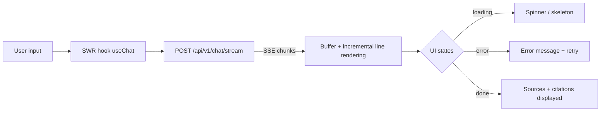

# Chapter 9: User Interface

After building the AI Agent (Chapter 4) and API backend (Chapter 8), you need a user interface (UI) so users can interact with the agent. This chapter guides you through building a frontend chat application using Next.js—from project setup to rendering streaming responses from the AI agent.

> 💡 **TIP:** If time is limited and you need a fast demo prototype, start with **Streamlit** (see section 9.0 below). Once the prototype stabilizes, you can migrate to Next.js for a more polished interface.

---

## 9.0 Streamlit — Prototype in 30 Minutes

If you are not yet familiar with React/Next.js or need a working demo interface as quickly as possible, **Streamlit** is an excellent choice. Python only—no JavaScript, no npm, and no frontend development experience required. You can build a complete chat UI in under 30 minutes.

### Installation and Setup

```bash
pip install streamlit requests
```

Create an `app.py` file in the root directory:

```python
# app.py — Streamlit Chat UI for AI Agent
import streamlit as st
import requests
import json

# Page config
st.set_page_config(
    page_title="AI20K Agent",
    page_icon="🤖",
    layout="wide",
)

# Initialize chat history
if "messages" not in st.session_state:
    st.session_state.messages = []

# Title
st.title("🤖 AI20K Agent")
st.caption("Intelligent AI Assistant — Powered by LangGraph")

# Display chat history
for message in st.session_state.messages:
    with st.chat_message(message["role"]):
        st.markdown(message["content"])

# Chat input
if prompt := st.chat_input("Enter your question..."):
    # Add user message
    st.session_state.messages.append({"role": "user", "content": prompt})
    with st.chat_message("user"):
        st.markdown(prompt)

    # Call API
    with st.chat_message("assistant"):
        API_URL = "http://localhost:8000/api/v1/chat"
        
        with st.spinner("Thinking..."):
            try:
                response = requests.post(
                    API_URL,
                    json={"message": prompt},
                    timeout=60,
                )
                response.raise_for_status()
                data = response.json()
                answer = data.get("response", "No answer returned.")
            except requests.exceptions.ConnectionError:
                answer = "❌ Unable to connect to API. Ensure the server is running: `make run`"
            except requests.exceptions.Timeout:
                answer = "⏱️ Agent took too long to respond. Try again with a shorter question."
            except Exception as e:
                answer = f"❌ Error: {str(e)}"

        st.markdown(answer)

    st.session_state.messages.append({"role": "assistant", "content": answer})

# Sidebar — Info
with st.sidebar:
    st.header("Information")
    st.write(f"Message count: {len(st.session_state.messages)}")
    if st.button("Clear history"):
        st.session_state.messages = []
        st.rerun()
    
    st.divider()
    st.caption("AI20K Build Phase — Template Agent")
```

### Running the Application

```bash
# Terminal 1: Run FastAPI backend
make run

# Terminal 2: Run Streamlit frontend
streamlit run app.py --server.port 8501
```

Open http://localhost:8501 — you now have a complete chat interface!

### Streaming with Streamlit

> ⚠️ **NOTE:** The endpoint `/api/v1/chat/stream` is not included out-of-the-box in the template—you need to implement this endpoint on the backend yourself (see Chapter 8 section on Streaming Response). The sample code below assumes you have deployed the streaming endpoint.

```python
# Replace the "Call API" section with the streaming version:
with st.chat_message("assistant"):
    API_URL = "http://localhost:8000/api/v1/chat/stream"
    
    with st.spinner("Thinking..."):
        try:
            response = requests.post(
                API_URL,
                json={"message": prompt, "stream": True},
                stream=True,  # Enable streaming for requests
                timeout=60,
            )
            
            answer = st.write_stream(
                line.removeprefix("data: ").strip()
                for line in response.iter_lines(decode_unicode=True)
                if line and line.startswith("data: ")
                and not line.endswith('"type": "done"')
            )
        except Exception as e:
            answer = f"❌ Error: {str(e)}"
            st.error(answer)
```

### When to Use Streamlit vs. Next.js?

| Criteria | Streamlit | Next.js |
|-----------|-----------|---------|
| Setup time | 30 minutes | 2–3 hours |
| Knowledge required | Python only | Python + JavaScript/React |
| UI customization | Great defaults, limited custom styling | Fully customizable |
| Streaming | Supported | Supported |
| Production readiness | Not recommended | Recommended |
| Demo Day | ✅ Acceptable | ✅ Preferred |

> 🔑 **KEY TAKEAWAY:** Streamlit is the **fastest prototyping tool** for AI Agent UIs. Use it when you need to focus on agent logic (Chapter 4) rather than frontend engineering. If your team has members proficient in React, choose Next.js (section 9.1 onward) for a more polished product.

---


> [📊 Open diagram on Mermaid Live / AI Editor](https://mermaid.live/edit#pako:eNplkEFqwzAQRa8yaNsG020XhaRxIbTQEMVkYWUh7LEtbEtGGrWEOHfv2DGlUK3E15uvJ11F4UoUzyCqzn0XjfYEHwdlgVeWZwE9GDtEOsNq9QLylMvTARrnWogBXxtN5zsrTzOw3u9yJfaf8giJHkzy9ZRwJyWBPOpeiYVmbMJHKVMommjbMMIme8s3sar4xgfwaEveULQ1lM7Wyxwzd4_j-pjKa7aDQJow3BaJOZ6bO6dLY-sR5J6F5GCs5b4EQosdkrO_Kn9m0HvnR0gPeTrtoMcQdI2zDvnL_wE2wxG277l00RcYmCwMCxlnAzQGLVBjzuIRRI--16ac_vk61ShBDfaoOFCixErHjpRQ9jbBOpKTF1vwIfmInMSh5Gduja697pf49gMqYo38)

## 9.1 Next.js Setup

### Why Choose Next.js?

Next.js is currently the most popular React framework, offering numerous production-ready features out of the box: file-based routing (App Router), server-side rendering (SSR), static site generation (SSG), API routes, and automated optimizations. For AI chat applications, Next.js is an outstanding choice because it natively supports streaming via the App Router and React Server Components.

### Initializing the Next.js Project

Create a new Next.js project with TypeScript and Tailwind CSS:

```bash
npx create-next-app@latest ai20k-chat --typescript --tailwind --eslint --app --src-dir --import-alias "@/*"
```

When prompted with configuration options, select:
- TypeScript: Yes
- ESLint: Yes
- Tailwind CSS: Yes
- `src/` directory: Yes
- App Router: Yes
- Import alias: `@/*`

### Directory Structure (App Router)

The Next.js App Router relies on file-based routing—each folder inside `app/` corresponds to a route segment:

```
ai20k-chat/
├── src/
│   ├── app/
│   │   ├── layout.tsx          # Root layout (wraps all pages)
│   │   ├── page.tsx            # Home page (/)
│   │   ├── globals.css         # Global styles
│   │   ├── chat/
│   │   │   └── page.tsx        # Chat page (/chat)
│   │   └── api/                # API routes (optional backend)
│   ├── components/
│   │   ├── ChatMessage.tsx     # Message display component
│   │   ├── ChatInput.tsx       # Chat input bar component
│   │   ├── Sidebar.tsx         # Sidebar navigation component
│   │   └── ThemeToggle.tsx     # Dark/light mode toggle
│   ├── hooks/
│   │   └── useChat.ts          # Custom hook for chat logic
│   ├── lib/
│   │   └── api.ts              # API client functions
│   └── types/
│       └── chat.ts             # TypeScript type definitions
├── tailwind.config.ts
├── next.config.js
├── package.json
└── tsconfig.json
```

### Pages and Layouts

**Root Layout** (`src/app/layout.tsx`) acts as the top-level wrapper for the entire application:

```tsx
// src/app/layout.tsx
import type { Metadata } from "next";
import { Inter } from "next/font/google";
import "./globals.css";
import { ThemeProvider } from "@/components/ThemeProvider";

const inter = Inter({ subsets: ["latin"] });

export const metadata: Metadata = {
  title: "AI20K Chat",
  description: "AI Agent Chat Application",
};

export default function RootLayout({
  children,
}: {
  children: React.ReactNode;
}) {
  return (
    <html lang="en" suppressHydrationWarning>
      <body className={inter.className}>
        <ThemeProvider>
          {children}
        </ThemeProvider>
      </body>
    </html>
  );
}
```

**Home Page** (`src/app/page.tsx`):

```tsx
// src/app/page.tsx
import Link from "next/link";

export default function Home() {
  return (
    <main className="flex min-h-screen flex-col items-center justify-center p-8">
      <div className="max-w-2xl text-center">
        <h1 className="text-4xl font-bold mb-4">
          AI20K Agent
        </h1>
        <p className="text-lg text-gray-600 dark:text-gray-400 mb-8">
          Intelligent AI assistant ready to help you research,
          analyze, and answer complex questions.
        </p>
        <Link
          href="/chat"
          className="inline-block bg-blue-600 text-white px-6 py-3 rounded-lg
                     hover:bg-blue-700 transition-colors font-medium"
        >
          Start Chatting
        </Link>
      </div>
    </main>
  );
}
```

**Chat Page** (`src/app/chat/page.tsx`):

```tsx
// src/app/chat/page.tsx
"use client";

import { useState } from "react";
import ChatMessage from "@/components/ChatMessage";
import ChatInput from "@/components/ChatInput";
import { Message } from "@/types/chat";

export default function ChatPage() {
  const [messages, setMessages] = useState<Message[]>([]);
  const [isLoading, setIsLoading] = useState(false);

  const handleSend = async (content: string) => {
    // Add user message
    const userMessage: Message = {
      id: Date.now().toString(),
      role: "user",
      content,
      timestamp: new Date(),
    };
    setMessages((prev) => [...prev, userMessage]);
    setIsLoading(true);

    try {
      // Call API
      const response = await fetch("http://localhost:8000/api/v1/chat", {
        method: "POST",
        headers: { "Content-Type": "application/json" },
        body: JSON.stringify({ message: content }),
      });

      const data = await response.json();

      const assistantMessage: Message = {
        id: (Date.now() + 1).toString(),
        role: "assistant",
        content: data.response,
        sources: data.sources,
        timestamp: new Date(),
      };
      setMessages((prev) => [...prev, assistantMessage]);
    } catch (error) {
      console.error("Chat error:", error);
    } finally {
      setIsLoading(false);
    }
  };

  return (
    <div className="flex flex-col h-screen max-w-4xl mx-auto">
      {/* Header */}
      <header className="border-b p-4">
        <h1 className="text-xl font-semibold">AI20K Agent</h1>
      </header>

      {/* Messages */}
      <div className="flex-1 overflow-y-auto p-4 space-y-4">
        {messages.length === 0 ? (
          <div className="text-center text-gray-500 mt-20">
            Send a message to start the conversation
          </div>
        ) : (
          messages.map((msg) => (
            <ChatMessage key={msg.id} message={msg} />
          ))
        )}
        {isLoading && (
          <div className="text-gray-500 animate-pulse">
            Thinking...
          </div>
        )}
      </div>

      {/* Input */}
      <ChatInput onSend={handleSend} disabled={isLoading} />
    </div>
  );
}
```

> 💡 **TIP:** The `"use client"` directive at the top signals to Next.js that this is a Client Component—a component evaluated in the browser with support for useState, useEffect, and event listeners. By default, components in App Router are Server Components (rendered on the server). Use `"use client"` only when interactivity is required.

---

## 9.2 Responsive Design

### Tailwind CSS Basics

Tailwind CSS is a utility-first CSS framework—instead of authoring custom CSS classes, you compose utility classes to construct interfaces. Each class carries a single, explicit responsibility:

```html
<!-- Padding, margin, background, text -->
<div class="p-4 bg-white rounded-lg shadow-md">
  <h2 class="text-xl font-bold text-gray-900 mb-2">Title</h2>
  <p class="text-gray-600 leading-relaxed">Content...</p>
</div>
```

Common utility classes:
- **Spacing:** `p-4` (padding), `m-4` (margin), `gap-2` (gap in flex/grid)
- **Sizing:** `w-full`, `h-screen`, `max-w-4xl`, `min-h-screen`
- **Typography:** `text-sm`, `font-bold`, `text-gray-600`, `leading-relaxed`
- **Layout:** `flex`, `grid`, `items-center`, `justify-between`
- **Visuals:** `bg-white`, `rounded-lg`, `shadow-md`, `border`
- **Interactivity:** `hover:bg-blue-700`, `focus:ring-2`, `transition-colors`

### Responsive Breakpoints

Tailwind adheres to a mobile-first philosophy—styles are applied for mobile viewports first, then extended for larger viewports:

```html
<!-- Mobile: 1 column, Tablet: 2 columns, Desktop: 3 columns -->
<div class="grid grid-cols-1 md:grid-cols-2 lg:grid-cols-3 gap-4">
  <div>Card 1</div>
  <div>Card 2</div>
  <div>Card 3</div>
</div>
```

Breakpoints:
- Default (no prefix): 0px+ (mobile)
- `sm:`: 640px+ (large phone)
- `md:`: 768px+ (tablet)
- `lg:`: 1024px+ (laptop)
- `xl:`: 1280px+ (desktop)
- `2xl:`: 1536px+ (large desktop)

### Mobile-first Design

Structure layouts for mobile screens first, then expand for desktop viewports:

```tsx
// ChatLayout with responsive sidebar
export default function ChatLayout({
  children,
}: {
  children: React.ReactNode;
}) {
  return (
    <div className="flex h-screen">
      {/* Sidebar: hidden on mobile, visible on desktop */}
      <aside className="hidden md:flex md:w-64 lg:w-80 flex-col border-r bg-gray-50 dark:bg-gray-900">
        <div className="p-4 border-b">
          <h2 className="font-semibold">Chat History</h2>
        </div>
        <nav className="flex-1 overflow-y-auto p-2">
          {/* Conversation list */}
        </nav>
      </aside>

      {/* Main content */}
      <main className="flex-1 flex flex-col min-w-0">
        {children}
      </main>
    </div>
  );
}
```

### Grid Layout for Chat

```tsx
// Dashboard layout using CSS Grid
export default function Dashboard() {
  return (
    <div className="grid grid-cols-1 lg:grid-cols-4 gap-4 p-4 h-screen">
      {/* Sidebar */}
      <div className="lg:col-span-1 border rounded-lg p-4">
        <h3 className="font-semibold mb-4">Conversations</h3>
        {/* List */}
      </div>

      {/* Chat area */}
      <div className="lg:col-span-2 border rounded-lg flex flex-col">
        <div className="flex-1 overflow-y-auto p-4">
          {/* Messages */}
        </div>
        <div className="border-t p-4">
          {/* Input */}
        </div>
      </div>

      {/* Info panel */}
      <div className="lg:col-span-1 border rounded-lg p-4">
        <h3 className="font-semibold mb-4">Information</h3>
        {/* Sources, metadata */}
      </div>
    </div>
  );
}
```

> 🔑 **KEY TAKEAWAY:** Mobile-first principle: declare mobile styles first (without prefix), then layer responsive overrides using `md:` and `lg:`. This ensures the UI renders cleanly across all devices without needing manual media queries.

> 💡 **TIP:** Apply `min-w-0` to flex/grid children to prevent long text from overflowing the container. This is a common bug where long unbroken strings break the layout. `min-w-0` allows text truncation and ellipsis to work correctly.

---

## 9.3 Dark Mode

### Why Support Dark Mode?

Dark mode is more than aesthetic preference—it reduces eye strain in low-light environments, saves battery on OLED displays, and satisfies widespread user expectations. A modern AI chat application must support both light and dark themes smoothly.

### Setup with next-themes

`next-themes` is the standard library for theme management in Next.js:

```bash
npm install next-themes
```

### Theme Provider

Create a ThemeProvider component wrapping the application:

```tsx
// src/components/ThemeProvider.tsx
"use client";

import { ThemeProvider as NextThemesProvider } from "next-themes";
import { ReactNode } from "react";

export function ThemeProvider({ children }: { children: ReactNode }) {
  return (
    <NextThemesProvider
      attribute="class"          // Appends "dark" class to <html>
      defaultTheme="system"      // Follow OS preference
      enableSystem={true}        // Auto-detect system theme
      disableTransitionOnChange // Prevent flashing when switching themes
    >
      {children}
    </NextThemesProvider>
  );
}
```

### Toggle Component

```tsx
// src/components/ThemeToggle.tsx
"use client";

import { useTheme } from "next-themes";
import { useEffect, useState } from "react";

export default function ThemeToggle() {
  const { theme, setTheme } = useTheme();
  const [mounted, setMounted] = useState(false);

  // Render toggle only after mount (prevents hydration mismatch)
  useEffect(() => {
    setMounted(true);
  }, []);

  if (!mounted) {
    return <div className="w-10 h-10" />; // Placeholder preventing layout shift
  }

  return (
    <button
      onClick={() => setTheme(theme === "dark" ? "light" : "dark")}
      className="p-2 rounded-lg hover:bg-gray-100 dark:hover:bg-gray-800 transition-colors"
      aria-label="Toggle theme"
    >
      {theme === "dark" ? (
        // Sun icon for dark mode
        <svg className="w-5 h-5" fill="none" viewBox="0 0 24 24" stroke="currentColor">
          <path strokeLinecap="round" strokeLinejoin="round" strokeWidth={2}
            d="M12 3v1m0 16v1m9-9h-1M4 12H3m15.364 6.364l-.707-.707M6.343 6.343l-.707-.707m12.728 0l-.707.707M6.343 17.657l-.707.707M16 12a4 4 0 11-8 0 4 4 0 018 0z"
          />
        </svg>
      ) : (
        // Moon icon for light mode
        <svg className="w-5 h-5" fill="none" viewBox="0 0 24 24" stroke="currentColor">
          <path strokeLinecap="round" strokeLinejoin="round" strokeWidth={2}
            d="M20.354 15.354A9 9 0 018.646 3.646 9.003 9.003 0 0012 21a9.003 9.003 0 008.354-5.646z"
          />
        </svg>
      )}
    </button>
  );
}
```

### Tailwind Dark Mode Configuration

Configure Tailwind to enable class-based dark mode:

```javascript
// tailwind.config.ts
import type { Config } from "tailwindcss";

const config: Config = {
  darkMode: "class",  // Uses class strategy (compatible with next-themes)
  content: [
    "./src/pages/**/*.{js,ts,jsx,tsx,mdx}",
    "./src/components/**/*.{js,ts,jsx,tsx,mdx}",
    "./src/app/**/*.{js,ts,jsx,tsx,mdx}",
  ],
  theme: {
    extend: {},
  },
  plugins: [],
};

export default config;
```

### Using Dark Mode in Components

Tailwind provides the `dark:` variant across all utility classes:

```tsx
// Message component supporting dark mode
export default function ChatMessage({ message }: { message: Message }) {
  const isUser = message.role === "user";

  return (
    <div className={`flex ${isUser ? "justify-end" : "justify-start"}`}>
      <div
        className={`max-w-[80%] rounded-2xl px-4 py-3 ${
          isUser
            ? "bg-blue-600 text-white"          // User message: blue
            : "bg-gray-100 dark:bg-gray-800 text-gray-900 dark:text-gray-100"  // AI message: gray
        }`}
      >
        <p className="whitespace-pre-wrap">{message.content}</p>
        {message.sources && message.sources.length > 0 && (
          <div className="mt-2 pt-2 border-t border-gray-200 dark:border-gray-700">
            <p className="text-xs text-gray-500 dark:text-gray-400">Sources:</p>
            {message.sources.map((src, i) => (
              <p key={i} className="text-xs text-gray-400 dark:text-gray-500 truncate">
                {src}
              </p>
            ))}
          </div>
        )}
      </div>
    </div>
  );
}
```

> ⚠️ **NOTE:** Always handle hydration mismatches when using `next-themes`. The active theme is resolved on the client, meaning the server-rendered HTML may temporarily mismatch the client state. The `mounted` state pattern (as shown in ThemeToggle) reliably solves this issue by rendering theme-dependent UI only after mounting.

---

## 9.4 Connecting with the API

### Fetch API

The standard method for invoking backend endpoints from the frontend:

```typescript
// src/lib/api.ts
const API_BASE = process.env.NEXT_PUBLIC_API_URL || "http://localhost:8000";

export interface ChatRequest {
  message: string;
  conversation_id?: string;
  stream?: boolean;
}

export interface ChatResponse {
  response: string;
  conversation_id: string;
  sources: string[];
  timestamp: string;
}

export async function sendMessage(
  request: ChatRequest
): Promise<ChatResponse> {
  const response = await fetch(`${API_BASE}/api/v1/chat`, {
    method: "POST",
    headers: { "Content-Type": "application/json" },
    body: JSON.stringify(request),
  });

  if (!response.ok) {
    throw new Error(`API error: ${response.status}`);
  }

  return response.json();
}
```

### SWR (Stale-While-Revalidate)

SWR is a data-fetching library created by Vercel. It provides caching, revalidation, optimistic updates, and built-in error handling:

```bash
npm install swr
```

```tsx
// src/hooks/useChat.ts
"use client";

import { useState, useCallback } from "react";
import { Message } from "@/types/chat";
import { sendMessage } from "@/lib/api";

export function useChat() {
  const [messages, setMessages] = useState<Message[]>([]);
  const [isLoading, setIsLoading] = useState(false);
  const [error, setError] = useState<string | null>(null);

  const send = useCallback(async (content: string) => {
    setIsLoading(true);
    setError(null);

    // Optimistic update: append user message immediately
    const userMsg: Message = {
      id: Date.now().toString(),
      role: "user",
      content,
      timestamp: new Date().toISOString(),
    };
    setMessages((prev) => [...prev, userMsg]);

    try {
      const data = await sendMessage({ message: content });

      const assistantMsg: Message = {
        id: (Date.now() + 1).toString(),
        role: "assistant",
        content: data.response,
        sources: data.sources,
        timestamp: data.timestamp,
      };
      setMessages((prev) => [...prev, assistantMsg]);
    } catch (err) {
      setError(
        err instanceof Error ? err.message : "Unknown error occurred"
      );
    } finally {
      setIsLoading(false);
    }
  }, []);

  const clear = useCallback(() => {
    setMessages([]);
    setError(null);
  }, []);

  return { messages, isLoading, error, send, clear };
}
```

### Error Handling

```tsx
// src/components/ChatError.tsx
export default function ChatError({
  error,
  onRetry,
}: {
  error: string;
  onRetry: () => void;
}) {
  return (
    <div className="flex items-center gap-3 p-4 bg-red-50 dark:bg-red-900/20 rounded-lg">
      <svg className="w-5 h-5 text-red-500 shrink-0" fill="none" viewBox="0 0 24 24" stroke="currentColor">
        <path strokeLinecap="round" strokeLinejoin="round" strokeWidth={2}
          d="M12 8v4m0 4h.01M21 12a9 9 0 11-18 0 9 9 0 0118 0z"
        />
      </svg>
      <p className="text-sm text-red-700 dark:text-red-300 flex-1">{error}</p>
      <button
        onClick={onRetry}
        className="text-sm text-red-600 dark:text-red-400 underline hover:no-underline"
      >
        Retry
      </button>
    </div>
  );
}
```

### Loading States

```tsx
// src/components/ChatInput.tsx
"use client";

import { useState, KeyboardEvent } from "react";

interface ChatInputProps {
  onSend: (message: string) => void;
  disabled?: boolean;
}

export default function ChatInput({ onSend, disabled }: ChatInputProps) {
  const [input, setInput] = useState("");

  const handleSend = () => {
    const trimmed = input.trim();
    if (!trimmed || disabled) return;
    onSend(trimmed);
    setInput("");
  };

  const handleKeyDown = (e: KeyboardEvent<HTMLTextAreaElement>) => {
    if (e.key === "Enter" && !e.shiftKey) {
      e.preventDefault();
      handleSend();
    }
  };

  return (
    <div className="border-t p-4 dark:border-gray-800">
      <div className="flex gap-2 max-w-4xl mx-auto">
        <textarea
          value={input}
          onChange={(e) => setInput(e.target.value)}
          onKeyDown={handleKeyDown}
          placeholder="Enter your question..."
          rows={1}
          disabled={disabled}
          className="flex-1 resize-none rounded-lg border border-gray-300 dark:border-gray-700
                     bg-white dark:bg-gray-800 px-4 py-2.5 text-sm
                     focus:outline-none focus:ring-2 focus:ring-blue-500
                     disabled:opacity-50 disabled:cursor-not-allowed"
        />
        <button
          onClick={handleSend}
          disabled={disabled || !input.trim()}
          className="bg-blue-600 text-white px-4 py-2.5 rounded-lg font-medium
                     hover:bg-blue-700 disabled:opacity-50 disabled:cursor-not-allowed
                     transition-colors"
        >
          {disabled ? "Sending..." : "Send"}
        </button>
      </div>
    </div>
  );
}
```

> 💡 **TIP:** Always account for three states in every asynchronous workflow: loading (show spinner/skeleton), success (render data), and error (render message with retry option). This standard pattern ensures a resilient user experience.

---

## 9.5 Rendering AI Responses

### Chat UI Pattern

Conversational user interfaces follow an established pattern: messages displayed chronologically, user bubbles aligned right, AI bubbles aligned left, and an input dock anchored at the bottom:

```tsx
// src/components/ChatMessage.tsx
"use client";

import { Message } from "@/types/chat";

interface ChatMessageProps {
  message: Message;
}

export default function ChatMessage({ message }: ChatMessageProps) {
  const isUser = message.role === "user";

  return (
    <div className={`flex ${isUser ? "justify-end" : "justify-start"} mb-4`}>
      {/* Avatar */}
      {!isUser && (
        <div className="w-8 h-8 rounded-full bg-blue-100 dark:bg-blue-900
                        flex items-center justify-center mr-2 shrink-0">
          <span className="text-sm">AI</span>
        </div>
      )}

      {/* Message bubble */}
      <div
        className={`max-w-[80%] rounded-2xl px-4 py-3 ${
          isUser
            ? "bg-blue-600 text-white rounded-br-md"
            : "bg-gray-100 dark:bg-gray-800 text-gray-900 dark:text-gray-100 rounded-bl-md"
        }`}
      >
        {/* Content: markdown rendering */}
        <div className="prose prose-sm dark:prose-invert max-w-none">
          {message.content}
        </div>

        {/* Sources */}
        {message.sources && message.sources.length > 0 && (
          <div className="mt-3 pt-3 border-t border-gray-200 dark:border-gray-700">
            <p className="text-xs font-medium opacity-60 mb-1">Sources:</p>
            {message.sources.map((src, i) => (
              <p key={i} className="text-xs opacity-50 truncate">{src}</p>
            ))}
          </div>
        )}

        {/* Timestamp */}
        <p className="text-xs opacity-40 mt-2">
          {new Date(message.timestamp).toLocaleTimeString("en-US")}
        </p>
      </div>
    </div>
  );
}
```

### Streaming Display

Display tokens incrementally as they arrive from the SSE stream:

```typescript
// src/lib/stream.ts
export async function streamChat(
  message: string,
  onToken: (token: string) => void,
  onDone: () => void,
  onError: (error: string) => void,
): Promise<void> {
  const API_BASE = process.env.NEXT_PUBLIC_API_URL || "http://localhost:8000";

  try {
    const response = await fetch(`${API_BASE}/api/v1/chat/stream`, {
      method: "POST",
      headers: { "Content-Type": "application/json" },
      body: JSON.stringify({ message, stream: true }),
    });

    if (!response.ok) {
      throw new Error(`API error: ${response.status}`);
    }

    const reader = response.body?.getReader();
    const decoder = new TextDecoder();

    if (!reader) throw new Error("No reader available");

    let buffer = "";

    while (true) {
      const { done, value } = await reader.read();
      if (done) break;

      buffer += decoder.decode(value, { stream: true });

      // Parse SSE events
      const lines = buffer.split("\n");
      buffer = lines.pop() || ""; // Retain incomplete trailing line

      for (const line of lines) {
        if (line.startsWith("data: ")) {
          const data = JSON.parse(line.slice(6));

          switch (data.type) {
            case "token":
              onToken(data.content);
              break;
            case "done":
              onDone();
              break;
            case "error":
              onError(data.message);
              break;
          }
        }
      }
    }
  } catch (err) {
    onError(err instanceof Error ? err.message : "Streaming error occurred");
  }
}
```

```tsx
// Using streaming within a custom hook
"use client";

import { useState, useCallback, useRef } from "react";
import { streamChat } from "@/lib/stream";
import { Message } from "@/types/chat";

export function useStreamingChat() {
  const [messages, setMessages] = useState<Message[]>([]);
  const [isStreaming, setIsStreaming] = useState(false);
  const streamRef = useRef<string>("");

  const sendStream = useCallback(async (content: string) => {
    // Append user message
    setMessages((prev) => [
      ...prev,
      {
        id: Date.now().toString(),
        role: "user",
        content,
        timestamp: new Date().toISOString(),
      },
    ]);

    // Create placeholder for assistant response
    const assistantId = (Date.now() + 1).toString();
    setMessages((prev) => [
      ...prev,
      {
        id: assistantId,
        role: "assistant",
        content: "",
        timestamp: new Date().toISOString(),
      },
    ]);

    setIsStreaming(true);
    streamRef.current = "";

    await streamChat(
      content,
      // onToken: append token to content
      (token) => {
        streamRef.current += token;
        setMessages((prev) =>
          prev.map((msg) =>
            msg.id === assistantId
              ? { ...msg, content: streamRef.current }
              : msg
          )
        );
      },
      // onDone
      () => setIsStreaming(false),
      // onError
      (error) => {
        setMessages((prev) =>
          prev.map((msg) =>
            msg.id === assistantId
              ? { ...msg, content: `Error: ${error}` }
              : msg
          )
        );
        setIsStreaming(false);
      }
    );
  }, []);

  return { messages, isStreaming, sendStream };
}
```

### Markdown Rendering

AI agents frequently return markdown format (headers, lists, tables, code blocks). Render markdown in React with syntax highlighting:

```bash
npm install react-markdown remark-gfm rehype-highlight
```

```tsx
// src/components/MarkdownRenderer.tsx
"use client";

import ReactMarkdown from "react-markdown";
import remarkGfm from "remark-gfm";
import rehypeHighlight from "rehype-highlight";

interface MarkdownRendererProps {
  content: string;
}

export default function MarkdownRenderer({ content }: MarkdownRendererProps) {
  return (
    <ReactMarkdown
      remarkPlugins={[remarkGfm]}
      rehypePlugins={[rehypeHighlight]}
      components={{
        // Custom rendering for code blocks
        code({ inline, className, children, ...props }: any) {
          if (inline) {
            return (
              <code
                className="bg-gray-100 dark:bg-gray-800 px-1.5 py-0.5 rounded text-sm"
                {...props}
              >
                {children}
              </code>
            );
          }

          return (
            <div className="relative my-3">
              <pre className="bg-gray-900 text-gray-100 rounded-lg p-4 overflow-x-auto">
                <code className={className} {...props}>
                  {children}
                </code>
              </pre>
            </div>
          );
        },
        // Custom rendering for hyperlinks
        a({ href, children }: any) {
          return (
            <a
              href={href}
              target="_blank"
              rel="noopener noreferrer"
              className="text-blue-500 hover:underline"
            >
              {children}
            </a>
          );
        },
        // Custom rendering for tables
        table({ children }: any) {
          return (
            <div className="overflow-x-auto my-3">
              <table className="min-w-full border-collapse border border-gray-300 dark:border-gray-700">
                {children}
              </table>
            </div>
          );
        },
      }}
    >
      {content}
    </ReactMarkdown>
  );
}
```

Update `ChatMessage` to use `MarkdownRenderer`:

```tsx
// Update ChatMessage component
import MarkdownRenderer from "./MarkdownRenderer";

// Inside ChatMessage, replace:
// <div>{message.content}</div>
// with:
<MarkdownRenderer content={message.content} />
```

> 🔑 **KEY TAKEAWAY:** Streaming display is pivotal for chat UX. Users observe answers forming in real time, mirroring natural conversational pacing. Combined with markdown formatting, the interface matches modern ChatGPT-like production standards.

> 💡 **TIP:** Add a blinking typing cursor animation during streaming to indicate active token generation:

```css
/* Add to globals.css */
.typing-cursor::after {
  content: "▋";
  animation: blink 1s infinite;
}

@keyframes blink {
  0%, 50% { opacity: 1; }
  51%, 100% { opacity: 0; }
}
```

---

## Summary

1. **Next.js App Router** provides file-based routing, layouts, and server components. Maintain a clear directory layout: `app/` for routes, `components/` for reusable UI, `hooks/` for stateful abstractions, and `lib/` for helpers.

2. **Tailwind CSS** with a mobile-first mindset enables rapid responsive development. Utilize `sm:`, `md:`, and `lg:` breakpoints and test across multiple viewports.

3. **Dark Mode** via `next-themes` is straightforward: wrap the app in `ThemeProvider`, use the `dark:` utility prefix, and handle hydration mismatch with a `mounted` guard.

4. **API Integration** must cover all three operational states: loading, success, and error. Use custom hooks (`useChat`, `useStreamingChat`) to decouple communication logic from components.

5. **AI Response Rendering** requires three pillars: a structured chat layout (user right, agent left), SSE streaming consumption, and rich markdown parsing for code and tables.

---

## Review Questions

1. Explain the distinction between Server Components and Client Components in Next.js App Router. When must you specify `"use client"`?

2. Design a responsive layout for a chat application: sidebar (conversation list) + main chat container + context panel. Ensure the sidebar hides on mobile screens and appears on desktop. Provide the Tailwind CSS classes.

3. Why is it necessary to track `mounted` state inside the `ThemeToggle` component? What bug occurs if this is omitted?

4. Write a client-side `streamChat` function that connects to an SSE endpoint and updates state incrementally. Handle unexpected connection drops gracefully.

5. Compare rendering an AI response upon full completion versus streaming tokens in real time. What are the key advantages and trade-offs of each approach?
