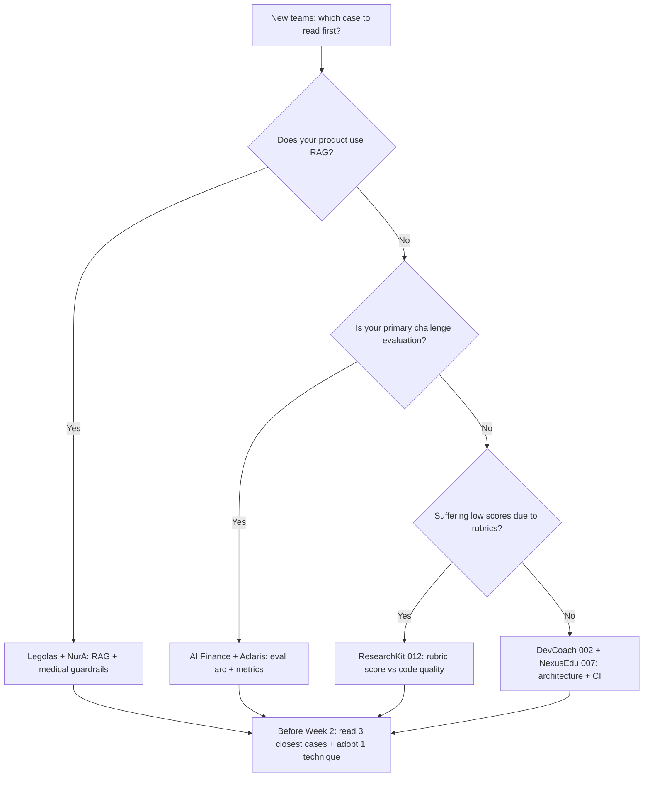

# Case Studies — Learning from 3 Generations of AI20K Teams

> "Users proceeded a step deeper, yet still failed to reach core AI value."
> — QA evaluation finding regarding the team with the most blocking defects during the RA phase (Gamma VCoder, v2). Products are evaluated on whether users can actually experience core AI value, not on absolute feature count.

This chapter serves as a practical learning laboratory based on real teams: 12 case studies selected across 3 generations of AI20K teams, each featuring VERBATIM evaluation metrics sourced from original evidence files with source paths provided for independent verification. No single team was flawless — one team achieved the highest code quality score in the cohort yet omitted their development journal; another had razor-sharp market positioning but suffered two disqualifying blockers. Study both sides of the coin.

## Overview Matrix of the 12 Cases

| # | Case | Cohort | One-Sentence USP | Standout Metric | Related Chapter |
|---|---|---|---|---|---|
| 1 | Aclaris AI Knowledge Hub | C2 [118] | Automated knowledge synthesis wiki pipeline with conflict-detecting verifier | Hit Rate 0.91, Groundedness 0.96, $0.0011/query | [Chapter 4](chapter-04.md), [Chapter 10](chapter-10.md) |
| 2 | NurA Nurse Assistant | C2 [074] | 4-layer cascading guardrails for Vietnamese medical assistance | Action accuracy 100%, LLM-judge 4.62/5 | [Chapter 11](chapter-11.md), [Chapter 10](chapter-10.md) |
| 3 | MindCare AI | C2 [109] | Pre-response risk classification with clinician escalation protocols | Risk accuracy 97%, crisis recall 96% | [Chapter 11](chapter-11.md), [Chapter 10](chapter-10.md) |
| 4 | AI Finance Assistant | C2 [057] | Presenting evaluation as an improvement arc (measuring baseline first) | Behavior Accuracy 64% -> 96% | [Chapter 10](chapter-10.md) |
| 5 | Legolas AI | C2 [108] | Verifiable citations for legal-tech workflows | Citation hit 83.3%, keyword recall 96.5% | [Chapter 10](chapter-10.md) |
| 6 | DevCoach AI | C1-2 code [002] | Closed-loop cycle: code -> test -> eval -> CI -> deploy | Auto score 37.0, highest code quality in cohort | [Chapter 4](chapter-04.md), [Chapter 12](chapter-12.md), [Chapter 10](chapter-10.md) |
| 7 | NexusEdu | C1-2 code [007] | Authentic DDD architecture + most rigorous PII guardrails in cohort | 38.3 — highest overall score in cohort | [Chapter 4](chapter-04.md), [Chapter 11](chapter-11.md) |
| 8 | ResearchKit | C1-2 code [012] | Schema-first architecture without frameworks, Pydantic on all outputs | 28.9 points but 67 unit tests, cleanest pure code | [Chapter 4](chapter-04.md), [Chapter 10](chapter-10.md) |
| 9 | Buddy | C1-2 code [008] | Typed guardrail classes + golden safety-UX benchmarks | Real running golden scenarios + cost benchmarks | [Chapter 10](chapter-10.md), [Chapter 11](chapter-11.md) |
| 10 | VCareer (Delta) | Phase RA | Exemplary governance: server-side cost locks + APAC privacy compliance | 80/100 — highest in RA phase | [Chapter 7](chapter-07.md), [Chapter 11](chapter-11.md) |
| 11 | VCoder (Gamma) | Phase RA | The lesson of user blockage: users never touched core AI value | 52/100, blocked twice | [Chapter 5](chapter-05.md), [Chapter 7](chapter-07.md) |
| 12 | Red Team Agent (Luna Wolves) | C3 [138] | Automated AI Red Teaming benchmarked against OWASP Top 10 for LLM (2025) | Comprehensive dataset of 18,293 adversarial attack prompts | [Chapter 4](chapter-04.md), [Chapter 11](chapter-11.md) |

---

## Group 1 — Cohort 2: 5 Teams with Comprehensive Empirical Evaluation

These 5 teams shared the same cohort, faced the exact same deadline, and presented their evaluations using concrete quantitative metrics. Common trait: each team selected ONE central evaluation axis as the backbone of their product (groundedness, guardrail efficacy, risk classification, improvement progression, citation accuracy) and measured it rigorously.

### Case 1 — Aclaris AI Knowledge Hub [C2-118]

**(a) Product and Team:** An automated knowledge synthesis engine that curates, verifies, and commits unstructured notes into a structured, interconnected wiki knowledge base. Engineered using a 2-agent architecture integrated with Model Context Protocol (MCP).

**(b) Unique Selling Proposition (USP):** Committing knowledge to the wiki is never a matter of "the AI generated text and finished" — a dedicated VERIFY step executes where an independent verifier detects contradictions before triggering a COMMIT. The wiki maintains an active wikilink graph, structuring knowledge as an interconnected graph rather than disconnected text snippets.

**(c) Notable Engineering Practices:** A 5-phase pipeline with clear separation of concerns: MAP -> REDUCE -> REFINE -> VERIFY -> COMMIT. The VERIFY stage operates as an isolated node with a contradiction-detection verifier — implementing the core design principle: "separate verification from generation" ([Chapter 4](chapter-04.md)). Prompt-injection guardrails reside server-side, using JWT tokens bound to student IDs for authorized overrides — never trusting client-supplied inputs ([Chapter 11](chapter-11.md)).

**(d) Evaluation Metrics (Verbatim from Evidence):**

| Metric | Value |
|---|---|
| Hit Rate | 0.91 |
| Groundedness | 0.96 |
| Cost | $0.0011/query |

**(e) Actionable Takeaway:** A 0.96 groundedness score did not originate from clever prompting, but from isolating VERIFY into a dedicated pipeline stage empowered with commit rejection authority. Apply this immediately: in [Chapter 4](chapter-04.md) (agent core: add an independent verification node) and [Chapter 10](chapter-10.md) (treat groundedness as your primary metric if your system synthesizes knowledge).

**(f) Evidence Source:** `cai_tien_tai_lieu_ky_thuat/reference/e1-secondbrain-mine.md` (TOP 5 Cohort 2 Case Studies); raw records: `ai20k-cohort2-data/` (demoday_details, project_intros).

### Case 2 — NurA Nurse Assistant [C2-074]

**(a) Product and Team:** A clinical nursing assistant deployed in the Vietnamese medical domain — a high-stakes environment where a single incorrect statement produces immediate clinical harm.

**(b) Unique Selling Proposition (USP):** A 4-layer cascading guardrail defense, with each successive layer targeting distinct failure modes, rather than relying on a generic "please be careful" system prompt.

**(c) Notable Engineering Practices:** A strictly ordered 4-layer defense pipeline: (1) Deterministic regex negation filters intercepting forbidden diagnoses -> (2) LLM intent classifier parsing clinical context -> (3) Grounding guard forcing responses to adhere strictly to verified reference sources -> (4) Output safety guard vetting final responses before delivery to users. Retrieval leverages hybrid dense embeddings (Cohere multilingual) + BM25 combined via Reciprocal Rank Fusion (RRF) — the gold standard for Vietnamese clinical terminology mixing English and Vietnamese medical jargon ([Chapter 11](chapter-11.md): defense-in-depth).

**(d) Evaluation Metrics (Verbatim from Evidence):**

| Metric | Value |
|---|---|
| Action accuracy | 100% |
| Hit rate | 86.8% |
| LLM-judge | 4.62/5 |
| Violation rate | ~0 |

**(e) Actionable Takeaway:** Enforcing "Guardrails >= 2 layers (code + prompt)" is not a superficial slogan — NurA proved that cascading 4-layer filters drive violations to near zero. If your application handles sensitive domains, architect layered guardrails before writing your initial feature ([Chapter 11](chapter-11.md)), and benchmark each layer independently ([Chapter 10](chapter-10.md)).

**(f) Evidence Source:** `cai_tien_tai_lieu_ky_thuat/reference/e1-secondbrain-mine.md` (TOP 5); raw records: `ai20k-cohort2-data/`.

### Case 3 — MindCare AI [C2-109]

**(a) Product and Team:** A mental health support assistant — an operating domain where errors risk psychological crisis.

**(b) Unique Selling Proposition (USP):** A pre-response risk classification engine: every incoming interaction undergoes risk severity scoring BEFORE any AI response is generated; critical risk cases escalate directly to clinical personnel rather than permitting automated generation.

**(c) Notable Engineering Practices:** A "classify-first, generate-second" pipeline incorporating validated clinical diagnostic instruments (PHQ-9/GAD-7); PHI/PII data is fully encrypted at rest and in transit ([Chapter 11](chapter-11.md): domain privacy, authentic Human-in-the-Loop workflows — escalation is the primary design path, not a secondary fallback). The evaluation report presented side-by-side comparisons of standalone models versus layered filtering, alongside an explicit false-positive breakdown — a rare show of engineering honesty.

**(d) Evaluation Metrics (Verbatim from Evidence):**

| Metric | Value |
|---|---|
| Risk accuracy | 97% |
| Crisis recall | 96% |
| Comparative Analysis | Standalone model vs Layered pipeline + False-positive distribution table |

**(e) Actionable Takeaway:** When building systems touching human health, execution sequencing supersedes feature breadth: risk classifiers must execute PRIOR to generators. Furthermore, when documenting evaluation results, always include false-positive tables — one-sided reporting signals an immediate red flag to technical judges ([Chapter 10](chapter-10.md), [Chapter 11](chapter-11.md)).

**(f) Evidence Source:** `cai_tien_tai_lieu_ky_thuat/reference/e1-secondbrain-mine.md`; raw records: `ai20k-cohort2-data/`.

### Case 4 — AI Finance Assistant [C2-057]

**(a) Product and Team:** A personal financial intelligence assistant — Cohort 2.

**(b) Unique Selling Proposition (USP):** Not an exotic model architecture, but their approach to presenting evaluation: the sole team in the cohort that framed evaluation as a quantified improvement arc — measuring an unflattering initial baseline before demonstrating iterative optimization.

**(c) Notable Engineering Practices:** Measuring unvarnished baselines BEFORE optimizing: by documenting that initial Behavior Accuracy sat at 64% and Grounding at 13.3%, subsequent gains evolved into a credible engineering narrative rather than isolated, suspect numbers ([Chapter 10](chapter-10.md): establish baseline -> apply architectural change -> re-measure).

**(d) Evaluation Metrics (Verbatim from Evidence):**

| Metric | Before | After |
|---|---|---|
| Behavior Accuracy | 64% | 96% |
| Grounding | 13.3% | 93.3% |
| Guardrail | — | 100% |

**(e) Actionable Takeaway:** In Week 2, measure your initial baseline even if performance is modest — an imperfect baseline today constitutes undeniable proof of engineering progress on Demo Day. A documented progression from 13.3% to 93.3% carries far greater credibility than a static 93.3% reported without context ([Chapter 10](chapter-10.md)).

**(f) Evidence Source:** `cai_tien_tai_lieu_ky_thuat/reference/e1-secondbrain-mine.md`; raw records: `ai20k-cohort2-data/`.

### Case 5 — Legolas AI [C2-108, Spotlight #6]

**(a) Product and Team:** Legal-tech intelligence: a legal research assistant delivering answers supported by verifiable statutory citations — ranked top 17 spotlight in Cohort 2.

**(b) Unique Selling Proposition (USP):** Verifiable legal citations — tackling hallucination risks through strict source citation fidelity.

**(c) Notable Engineering Practices:** Evaluation tailored to specific categories of legal precision: citation hit rate, keyword recall, and an isolated legal statute number recall metric — because misquoting a statutory article number invalidates an entire legal opinion ([Chapter 10](chapter-10.md): select metrics aligned with domain risks rather than generic broad accuracy).

**(d) Evaluation Metrics (Verbatim from Evidence):**

| Metric | Value | Context |
|---|---|---|
| Citation hit | 83.3% | 30 test prompts |
| Keyword recall | 96.5% | 30 test prompts |
| Legal number recall | 90% | 30 test prompts / 526 document chunks |

**(e) Actionable Takeaway:** Identify the single failure mode your target users fear most in your domain (statutory misquotation, incorrect medication dosages, arithmetic financial errors) and construct an isolated benchmark for it. If all metrics are bundled into generic "accuracy", you lack meaningful evaluation ([Chapter 10](chapter-10.md)).

**(f) Evidence Source:** `cai_tien_tai_lieu_ky_thuat/reference/e1-secondbrain-mine.md`; raw records: `ai20k-cohort2-data/`.

---

## Group 2 — Code-Mining Across Cohorts 1 & 2: 4 Teams Evaluated from Repositories

This cluster was analyzed by performing direct static code analyses across 12 repositories from Cohorts 1 and 2. Telemetry is drawn from analysis_results.json and deep_analysis.json. Note: All 12 repositories squashed their commit histories into a single commit upon submission, preventing commit velocity analysis — a subtle lesson: maintaining genuine commit history serves as evaluation evidence.

Baseline telemetry: Automated CI present in 5/12 teams, Docker adopted in 10/12, verifiable offline evaluation suites (test script + dataset + generated artifacts) present in only 5/12, code-level guardrails present in 5/12, and prompt-only filtering relied upon by 11/12 teams.

### Case 6 — DevCoach AI [002]: The Sole Closed-Loop Implementation

**(a) Product and Team:** An AI technical interview coach — LangGraph supervisor-worker architecture orchestrating 6 agents, 13,000 pgvector embeddings, a 35-page React frontend, 29 pytest suites, and automated CI/CD targeting AWS EC2.

**(b) Unique Selling Proposition (USP):** The only team across the cohort executing a complete engineering lifecycle: code -> test -> eval -> CI -> deploy. No other team among the 12 reviewed achieved this full loop.

**(c) Notable Engineering Practices:** (1) Supervisor-worker topology utilizing TypedDict state schemas with Literal stage enums — enforcing a "single source of truth for state mergers" to eliminate race conditions across 6 collaborating agents ([Chapter 4](chapter-04.md)). (2) Structured prompts organized across 6 distinct sections: role, context, instructions, examples, output_format, and verification — prompts maintained in dedicated configuration files, never hardcoded in application logic. (3) Threshold-based regression evaluations paired with a synthetic answer repository, answering the question: "Does the pipeline remain within quality bounds after every code, prompt, or retrieval change?", committing all benchmark outputs to version control ([Chapter 10](chapter-10.md)). (4) CI executing test suites inside isolated `python:3.12-slim` containers with deployment concurrency controls guarding production rollouts ([Chapter 12](chapter-12.md)). Included a detailed `ROOT_CAUSE_ANALYSIS.md` for post-incident debugging.

**(d) Evaluation Metrics (Verbatim from Evidence):**

| Metric | Value |
|---|---|
| Automated static score | 37.0 |
| Code quality ranking | Highest code quality in cohort (overall static score: 37.0 — slightly trailing 007) |
| Evaluation suite | End-to-end trace replay + LLM-judge + committed artifact reports |

**(e) Actionable Takeaway:** The loop of code -> test -> eval -> CI is ONE unified system, not four disconnected tasks — Team 009 committed 89 test files, yet zero automated CI workflows executed them, rendering those tests inactive. Starting in Week 3: every agent modification must trigger automated regression evaluations backed by quantitative quality thresholds ([Chapter 4](chapter-04.md), [Chapter 12](chapter-12.md), [Chapter 10](chapter-10.md)).

**(f) Evidence Source:** `cai_tien_tai_lieu_ky_thuat/reference/e1-cohort12-code-mining.md` (Table Section A, Practices Section B); repository: `A20-App-002`, analysis_results.json, deep_analysis.json.

### Case 7 — NexusEdu [007]: Authentic DDD and Knowing When to Step Away from Frameworks

**(a) Product and Team:** An educational intelligence platform, achieving an automated static evaluation score of 38.3 — the highest overall rating among all 12 evaluated codebases (Team 007 captured the top composite score; Team 002 captured top code architecture honors).

**(b) Unique Selling Proposition (USP):** Domain-Driven Design (DDD) implemented across 4 functional layers, backed by the most disciplined PII sanitization pipeline in the cohort.

**(c) Notable Engineering Practices:** (1) Deterministic pipelines paired with BAML structured output schemas: choosing deterministic execution chains over unconstrained cyclic graphs, and enforcing typed generation schemas over unstructured text parsing ([Chapter 4](chapter-04.md)). (2) A 4-stage PII pipeline: sanitization masking (Presidio PII mask) -> BAML generation -> semantic validation -> invariant consistency checks ([Chapter 11](chapter-11.md)). (3) Most notably: their README stated, "refactored from complex graph models for maximum reliability" — the team deliberately removed LangGraph when the problem did not require cyclic state branching. Frameworks are tools, not evaluation criteria. Accompanied by 37 pytest files, `uv sync --frozen` with deterministic lockfiles, and an ergonomic developer Makefile (`make start/stop/logs/reset_db/reseed`).

**(d) Evaluation Metrics (Verbatim from Evidence):**

| Metric | Value |
|---|---|
| Automated static score | 38.3 (highest in cohort) |
| Automated tests | 37 pytest test files |
| Active eval pipelines | Absent (deducted points) |

**(e) Actionable Takeaway:** Adopt graph architectures only when workflows require authentic conditional branching; default to deterministic pipelines and structured outputs when workflows are sequential — the highest scoring team chose architectural simplicity over framework complexity. Core privacy rule: sanitize and mask PII before data ever reaches LLM endpoints ([Chapter 11](chapter-11.md)).

**(f) Evidence Source:** `cai_tien_tai_lieu_ky_thuat/reference/e1-cohort12-code-mining.md`; repository: `A20-App-007`.

### Case 8 — ResearchKit [012]: Rubric Scores vs Engineering Excellence

**(a) Product and Team:** An automated factual claim verification system: distributed workers executing over a Redis event bus WITHOUT utilizing any commercial agent frameworks.

**(b) Unique Selling Proposition (USP):** Schema-first anti-hallucination architecture: EVERY model output is enforced via Pydantic — schema validation failures raise immediate, explicit exceptions rather than masking errors through silent fallbacks.

**(c) Notable Engineering Practices:** (1) Pydantic as a strict behavioral contract for all outputs — schema mismatches fail loudly and visibly, eliminating silent degradation. (2) Verification prompts requiring verbatim source quotations, page numbers, and confidence ratings: models must quote source documents verbatim with citations to confirm facts ([Chapter 10](chapter-10.md)). (3) Redis-backed CancelTokens propagating cancellation signals into long-running background workers. (4) 67 unit tests — the largest test suite in the group. Professional README: clear feature matrices + ASCII directory trees + active deployment links.

**(d) Evaluation Metrics (Verbatim from Evidence):**

| Metric | Value |
|---|---|
| Rubric score | 28.9 (lowest among top tier — omitted journal and worklog) |
| Unit tests | 67 test suites |
| Code review summary | "Cleanest, most idiomatic codebase in the evaluated set" |

**(e) Actionable Takeaway:** A dual lesson: (1) Do not sacrifice engineering quality for quick rubric points, but never neglect mandatory deliverables like journals; Team 012 lost standing solely because they omitted their journal and worklog, not due to flawed code. (2) "A modest rubric score does not equal poor engineering" — past feedback submitted to organizers underscored that evaluation rubrics must appropriately reward deep software craftsmanship ([Chapter 4](chapter-04.md), [Chapter 10](chapter-10.md)).

**(f) Evidence Source:** `cai_tien_tai_lieu_ky_thuat/reference/e1-cohort12-code-mining.md` (Section D — Top 3); repository: `A20-App-012`.

### Case 9 — Buddy [008]: Typed Guardrail Classes + Golden Safety Benchmarks

**(a) Product and Team:** An English conversational tutor — designed around Safety-UX principles: conversational practice for novice learners that remains completely safe across all age brackets.

**(b) Unique Selling Proposition (USP):** The strongest Safety-UX implementation in the cohort: guardrails were implemented as fully typed classes accompanied by isolated unit tests, rather than informal prompt instructions.

**(c) Notable Engineering Practices:** (1) Guardrails class hierarchy: `SafetyLevel` enums, `ViolationType` enums, and clear separation between `check_input` and `check_output` — baking safety rules into type systems for automated linting and testing ([Chapter 11](chapter-11.md)). (2) Golden scenario benchmark: every test scenario defined explicit `must` and `must_not` behavioral assertions accompanied by a `needs_human_review` escalation flag — transforming behavioral expectations into executable unit tests ([Chapter 10](chapter-10.md)). (3) Dedicated inference cost benchmarking. (4) Self-documenting test identifiers: `test_blocks_grooming_secret_language` clearly communicates the exact safety violation being intercepted. Areas for improvement: accidental inclusion of a 311KB `buddy.db` SQLite file in Git and committing an unmodified `src/agent.py` template file.

**(d) Evaluation Metrics (Verbatim from Evidence):**

| Metric | Value |
|---|---|
| Real evaluation suite | Yes — golden_scenarios + cost benchmarks |
| Cohort standing | Best Safety-UX in cohort |
| Defect noted | Binary file accidentally committed (`buddy.db` 311KB) |

**(e) Actionable Takeaway:** Encode guardrails as strongly typed code with descriptive test names, supported by golden must/must-not behavioral benchmarks ([Chapter 10](chapter-10.md), [Chapter 11](chapter-11.md)). Verify your `.gitignore` configuration before Week 2 to keep local database files out of version control.

**(f) Evidence Source:** `cai_tien_tai_lieu_ky_thuat/reference/e1-cohort12-code-mining.md`; repository: `A20-App-008`.

---

## Group 3 — Phase RA + Cohort 3: Governance, User Blockers, and Emerging Trends

### Case 10 — VCareer (Delta): Exemplary Governance Architecture

**(a) Product and Team:** An AI mock interview simulator evaluated among 4 teams during Phase RA. Score: 80/100 — highest ranking in Phase RA.

**(b) Unique Selling Proposition (USP):** Governance implemented as enforceable runtime MECHANISMS rather than marketing statements on landing pages: every constraint is strictly enforced in code and verifiable in live demo accounts.

**(c) Notable Engineering Practices:** Server-side cost controls: sessions hard-capped at 60 minutes, 30-second idle timeouts, maximum 10 sessions per rolling 24-hour window, calculated strictly on backend servers — client modifications cannot bypass restrictions ([Chapter 7](chapter-07.md), [Chapter 11](chapter-11.md)). AI refuses to participate in real job interviews (preventing fraudulent user substitution in authentic recruitment processes). Anti-cheating audio watermarking. Privacy compliance: PII transcript filtering, raw audio persisted to Cloudflare R2 Singapore (compliant with PDPA / APAC data privacy mandates), automated deletion after 24 hours, zero data transmission outside APAC boundaries. Transparent landing page disclosure: "MVP · Practice Simulation Only · Not Affiliated with Recruiters" ([Chapter 5](chapter-05.md)).

**(d) Evaluation Metrics (Verbatim from Evidence):**

| Metric | Value |
|---|---|
| Phase RA score | 80/100 (highest among 4 teams) |
| Cost controls | 60 min session cap, 30s idle disconnect, 10 sessions/24h, enforced server-side |
| Privacy infrastructure | Cloudflare R2 Singapore, 24h retention purge, APAC-locked |
| QA Observation (D-01) | High initial onboarding friction, lack of open public demo access |

**(e) Actionable Takeaway:** Winning Phase RA did not stem from accumulating dozens of secondary features, but from authentic messaging and verified governance: server-side budget limits, PII sanitization, and geographic data sovereignty. Teams advertising privacy compliance must demonstrate concrete technical enforcement ([Chapter 5](chapter-05.md), [Chapter 7](chapter-07.md), [Chapter 11](chapter-11.md)).

**(f) Evidence Source:** `cai_tien_tai_lieu_ky_thuat/reference/e1-cohort-lessons.md` (Sections 3, 7, and Top Performing Teams analysis); QA Audit Reports Delta v1 and v2.

### Case 11 — VCoder (Gamma): Two Disqualifying Blockers and the Core North Star

**(a) Product and Team:** A technical assessment platform evaluating developer AI readiness. Score: 52/100 — blocked twice during formal QA audits (first by a 401 login failure, followed by an unhandled MCQ interaction defect).

**(b) Unique Selling Proposition (USP):** Sharp market positioning: "Prove your AI readiness — 5 axes, 5 levels, LLM-judged, AI-Ready Certificate". The central lesson of this case lies in the CHASM between crisp positioning and a user's ability to access product value.

**(c) Notable Engineering Practices:** Strengths: Loop-breaking safeguards in Q4 received an "Outstanding" evaluation from QA ([Chapter 7](chapter-07.md): escape hatches against infinite conversational loops — similar to Team 011 where interviewers actively track message counts against maximum thresholds to transition cleanly to Closing states); Q7 `CLAUDE.md` persistent context architecture was similarly rated "Outstanding"; leaderboard utilized real cohort benchmarks (levels 0.0–2.2). Blocker issues: navigation menus with `null` href attributes meant "unregistered users could not preview product value" (G-02); authentication sessions expired midway through 35-minute assessments without state persistence, causing complete progress loss (G-06); multiple-choice inputs failed to register clicks without warning toasts (G-08); unhandled React Router developer exceptions surfaced in production (G-05); conflicting duration messaging between hero banners ("~60 mins") and entry tests ("~35 mins") eroded evaluator trust (G-07). Version 2 requested re-testing and resolved the initial critical defect (G-01) but suffered regression: a new blocking bug (G-08) surfaced right on the submission button due to the absence of end-to-end regression tests.

**(d) Evaluation Metrics (Verbatim from Evidence):**

| Metric | Value |
|---|---|
| Phase RA score | 52/100 (blocked) |
| Blocking occurrences | 2 (authentication 401 -> MCQ submission failure) |
| QA Outstanding ratings | Q4 loop-breaking safeguards, Q7 CLAUDE.md context |
| Leaderboard | Real cohort distribution data, levels 0.0–2.2 |
| QA Critique | Lack of discriminative validation, poor reproducibility |

**(e) Actionable Takeaway:** The enduring lesson of this case: products are judged by whether NEW USERS CAN UNLOCK CORE AI VALUE without jumping through convoluted registration barriers — not by the volume of background features. Once a defect is resolved, execute comprehensive E2E regression tests in CI to guarantee that bug fixes do not spawn fresh blockers ([Chapter 5](chapter-05.md), [Chapter 7](chapter-07.md)).

**(f) Evidence Source:** `cai_tien_tai_lieu_ky_thuat/reference/e1-cohort-lessons.md` (Sections 1, 9, North Star Summary); QA Audit Reports Gamma v1 and v2.

### Case 12 — Red Team Agent / AIP-10 (Luna Wolves) [C3-138]

**(a) Product and Team:** An automated AI Red Teaming platform: automated vulnerability detection, adversarial stress testing, and risk auditing tailored for LLM and AI Agent architectures, benchmarked against the OWASP Top 10 for LLM Applications (2025). Built by team Luna Wolves (4 members: hieunm12122002, monobear2014, NgoKhoi1, xrl111). Spotlight rank 6 out of 246 submissions in Cohort 3.

**(b) Unique Selling Proposition (USP):** Combines a LangGraph Control Plane with the Microsoft PyRIT Attack Engine and a dedicated dataset of 18,293 adversarial attack scenarios. Rather than inventing arbitrary evaluation rubrics, the team audited AI systems against recognized global standards (OWASP).

**(c) Notable Engineering Practices:** Architecture isolates orchestration from execution: LangGraph operates as the control plane while PyRIT serves as the specialized attack engine — exemplifying the orchestrator + specialized worker paradigm ([Chapter 4](chapter-04.md)). Grounding product metrics on an established industry benchmark (OWASP Top 10 for LLM Applications 2025) provides instant authority. The curated repository of 18,293 attack prompts provides massive empirical evaluation evidence. Detailed security benchmark telemetry: (unreleased).

**(d) Evaluation Metrics (Verbatim from Project Description):**

| Metric | Value |
|---|---|
| Cohort 3 Spotlight Rank | Rank 6 |
| Adversarial attack prompts | 18,293 scenarios |
| Standardized framework | OWASP Top 10 for LLM Applications (2025) |
| Architecture design | LangGraph Control Plane + PyRIT Attack Engine |
| Detailed security benchmark | (unreleased) |

Live Demo: https://c3-app-138.tech-vibe.io.vn/ — Video Walkthrough: https://drive.google.com/file/d/1dlpjHG2W4Dk6v6-NEn0zmCAIb5vKScXA/view?usp=sharing

**(e) Actionable Takeaway:** Do not attempt to invent custom safety definitions: adopting established industry frameworks (OWASP), massive empirical scenario banks, and dedicated tooling (PyRIT) immediately elevates project credibility ([Chapter 4](chapter-04.md), [Chapter 11](chapter-11.md)). This represents an exciting product category: AI safety systems evaluating sibling AI agents.

**(f) Evidence Source:** `cai_tien_tai_lieu_ky_thuat/reference/e1-cohort3-demoday-projects.json` (Record for team "Luna Wolves", team ID 138, spotlight_rank 6 — verbatim descriptions, links, and slides).

---

> [📊 Open diagram on Mermaid Live / AI Editor](https://mermaid.live/edit#pako:eNpdUk2PmzAQ_Ssjru1KCTlU4tAVXWi1SlQpH0oPkMPUnsXWgh0ZO21E8t87LjRRygke78PzxkMirKQkg-Sttb-EQudhV9QG-Nnu8s2uKqyGzuoMpBUgsCcwaMG7YMXzAZ6ePsN6PmzRwFFhB8LCJv_2fB0d1vNIuAh7iWi1osa22MMH-B5cnkWM35uATjrULZzhXVk8PGgZMc0F1umw5wxJIJQ2CloEOmF7C0pvQeW-yl_hqzZoBLF9Llp0us_-8gGdYKwj77ToDw_if0mL4YsGqakDr_AIJw0u_GT6LWtxH2pZbagnNlVL7WE2T7NROSp4HOTOuODDg3RKKlZVQacXi0LBbJbGWuh36EsZ-PNTFs-qtCfhg4uDvLxOLrG22PuPslym1S5uAnzgdtJxSYtxTQ0jRqFnKUp79DCH9zPPFNBPRuX-7jNZL_9HitUdST5C0pHrUMt4Y4bIqBOvqKOagTqR9Iah9XVSm2skY_B2ezaCf_KFIUbCUaKnQmPjsJvg6x-dQsZS)

## How to Apply These Case Studies

1. **Before Week 2, review the 3 case studies that mirror your proposed architecture.** If your product synthesizes knowledge or uses RAG -> Cases 1, 5, 8. If handling sensitive domains (health, finance, law, education) -> Cases 2, 3, 4, 9. If seeking to standardize team engineering practices -> Cases 6, 7. If refining product positioning and public demos -> Cases 10, 11, 12.
2. **Review each case in this exact sequence: (b) -> (d) -> (e).** The USP guides positioning, the quantitative metrics set performance targets, and the actionable takeaway dictates your immediate sprints. Section (f) identifies the original source path — review the raw evidence directly.
3. **For every reported metric, ask: What benchmark dataset was used, how was it measured, and who graded the results?** If you cannot answer these questions for your own system, you lack an empirical evaluation framework ([Chapter 10](chapter-10.md)).
4. **Scrutinize Case 11 (Gamma) prior to Demo Day** — both blocking failures occurred directly at the user onboarding boundary, never within the underlying AI model.

## Chapter Exit-Test (Self-Assessment Checklist)

Verify you can answer all three questions before resuming development:

1. **Which case study most closely resembles your project, and how does your USP distinguish your solution?** (If your answer is "it is identical" — you lack a defined USP; revisit [Chapter 5](chapter-05.md).)
2. **Which single technical practice from these 12 cases will you integrate into your codebase this week?** (Examples: 2-layer guardrails from NurA, baseline measurement from AI Finance Assistant, Pydantic schema validation from ResearchKit, golden must/must-not tests from Buddy, server-side budget locks from Delta.)
3. **If external evaluators encounter a disqualifying blocker on your product's very first user screen, what internal testing mechanism would catch it first?** (Remember: in prior cohorts, zero teams caught their own blocking defects internally — all critical issues were uncovered by external QA audits.)

---

Primary archival evidence sources: `cai_tien_tai_lieu_ky_thuat/reference/` (`e1-secondbrain-mine.md`, `e1-cohort12-code-mining.md`, `e1-cohort-lessons.md`, `e1-cohort3-demoday-projects.json`). All reported figures are reproduced verbatim; missing metrics are explicitly identified as "(unreleased)".
