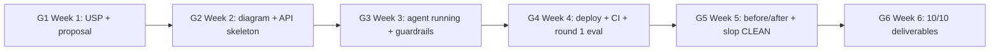

## 15.1 Six-Week Learning Curriculum

This curriculum is tailored for VinUni students participating in the AI20K Build Phase, designed to guide engineers from "zero LangGraph background" to "capable of building and deploying production-grade AI Agents" within 6 weeks. Each week targets a specific objective balancing theoretical foundations with hands-on implementation.

### Week 1: Python and API Fundamentals

Objective: Master FastAPI architecture, author resilient API endpoints, and invoke LLM APIs via client SDKs.

- Study FastAPI fundamentals: routing mechanics, request/response models, Pydantic schemas
- Build fluency with Python `async`/`await` concurrency patterns
- Execute core OpenAI API interactions: chat completions, streaming responses
- Establish repository skeleton: `app/`, `tests/`, `requirements.txt`
- Practical Exercise: Implement a FastAPI application exposing 3 endpoints (`GET /health`, `POST /chat`, `GET /history`)

Recommended Materials: FastAPI Official Tutorial (2–3 hours), Python Async Documentation (1 hour), OpenAI API Quickstart Guide (1 hour).

### Week 2: LangGraph Fundamentals

Objective: Comprehend LangGraph graphs, state persistence, nodes, and directional edges. Assemble your first functional agent.

- Master LangGraph core abstractions: StateGraph, nodes, edges, conditional routing
- Assemble an inaugural graph: 2–3 nodes with dynamic conditional routing
- Experiment across state schemas (`TypedDict` vs Pydantic)
- Instrument execution debugging using LangSmith tracing
- Practical Exercise: Construct an agent routing queries by intent (FAQ → retrieval branch, chitchat → direct synthesis branch)

Recommended Materials: LangGraph Academy Modules 1–2 (4–5 hours), Lance Martin YouTube LangGraph Playlist (2 hours).

### Week 3: RAG and Vector Stores

Objective: Master end-to-end RAG pipelines: document ingestion, chunking, embedding, vector storage, and semantic retrieval.

- Ingestion pipelines across formats: PDF, web URLs, markdown, unstructured text
- Text splitting strategies: chunk size trade-offs, chunk overlap tuning
- Embedding models: OpenAI embeddings and open-source local embedding alternatives
- Vector database backends: ChromaDB (local development), PGVector (production hosting)
- The complete RAG pipeline: retrieve → rerank → generate
- Practical Exercise: Build an agent answering technical questions grounded in 10 ingested PDF documents

Recommended Materials: DeepLearning.AI "Building RAG Agents with LLMs" (4 hours), LangChain RAG Tutorial (2 hours).

### Week 4: Advanced Agents and Tool Integration

Objective: Equip agents with external tools, conversational memory, and multi-step reasoning capabilities.

- LangGraph tool integration: `@tool` decorator, native model tool-calling
- Agent memory architectures: conversational buffer history, long-term persistent memory
- Multi-step reasoning loops: ReAct pattern, plan-and-execute workflows
- Resilient error handling in agent graphs: retries, fallback routing
- Practical Exercise: Construct an agent wielding 3+ tools (web search, math calculator, database querying)

Recommended Materials: LangGraph Academy Modules 3–4 (4 hours), DeepLearning.AI "AI Agents in LangGraph" (3 hours).

### Week 5: DevOps, Automated Testing, and Cloud Deployment

Objective: Containerize workloads with Docker, achieve solid test coverage, deploy to cloud infrastructure, and set up CI/CD.

- Docker containerization: multi-stage `Dockerfile`, multi-service `docker-compose.yml`
- Automated test suites: pytest, mocking LLM API responses, test coverage profiling
- Continuous Integration: GitHub Actions automated workflow triggers
- Cloud deployments: Render (backend services), Vercel (frontend interfaces)
- Observability: structured JSON logging, LangSmith tracing, standardized health check probes
- Practical Exercise: Containerize application, reach 60%+ automated test coverage, deploy live to Render

Recommended Materials: Chapters 12 and 8 of this guidebook, Docker Official Getting Started Tutorial (2 hours), pytest Documentation (1 hour).

### Week 6: Quantitative Evaluation and Demo Day Preparation

Objective: Benchmark agent performance empirically, assemble mandatory deliverables, and refine presentation delivery.

- RAGAS evaluation framework: faithfulness, answer relevance, context precision
- Comprehensive evaluation reporting: metrics tables, test suite logs, authentic user feedback
- Finalizing all 10 mandatory deliverables
- Pitch Deck delivery: 10 slides, time-budgeted presentation practice
- Static code analysis and cleanup: eliminate bare `except:` blocks, enforce strict type hints, clean Git history
- Practical Exercise: Submit all 10 deliverables, tracking toward an anticipated score of 35+/50 points

Recommended Materials: Chapter 13 of this guidebook, RAGAS Documentation (2 hours).

> 💡 **TIP:** This roadmap demands disciplined focus — approximately 15–20 hours per week. If your schedule is constrained, prioritize in this order: Week 2 (LangGraph) > Week 3 (RAG) > Week 5 (DevOps) > Week 6 (Evaluation). This sequence maximizes direct scoring impact.

### Time Commitment Summary

| Week | Core Focus | Study Hours | Coding Hours |
|------|------------|-------------|--------------|
| 1 | FastAPI + LLM APIs | 6 | 8 |
| 2 | LangGraph Fundamentals | 6 | 10 |
| 3 | RAG + Vector Stores | 6 | 10 |
| 4 | Advanced Agents + Tool Calling | 7 | 10 |
| 5 | DevOps + Testing + Deployment | 5 | 12 |
| 6 | Quantitative Evaluation + Demo Day Prep | 4 | 10 |
| **Total** | | **34** | **60** |

## 15.2 DeepLearning.AI Curated Courses

DeepLearning.AI (deeplearning.ai) is a premier AI learning platform created by Andrew Ng, offering over 121 focused short courses. These courses are free, typically 1–2 hours in duration, and authored by leading practitioners across OpenAI, LangChain, Google, and Anthropic. They represent the highest-yield supplementary material for AI20K participants.

### Priority Course Matrix for AI20K

| Course | Key Focus | Duration | Priority |
|--------|-----------|----------|----------|
| AI Agents in LangGraph | LangGraph architecture, ReAct loops, tool execution | 2 hours | HIGH |
| Building RAG Agents with LLMs | End-to-end RAG pipelines, retrieval strategies, evaluation | 2 hours | HIGH |
| Prompt Engineering with LLMs | Systematic prompt architecture, chain-of-thought patterns | 1 hour | HIGH |
| Functions, Tools and Agents with LangChain | Tool schemas, autonomous agent loops, chains | 1.5 hours | HIGH |
| Multi-AI Agent Systems with CrewAI | Multi-agent collaboration and delegation | 1.5 hours | MEDIUM |
| Evaluating and Debugging Generative AI | Quantitative evaluation methodologies, metric tracking | 1 hour | MEDIUM |
| LangChain for LLM Application Development | LangChain core components, memory systems, chains | 1.5 hours | MEDIUM |
| ChatGPT Prompt Engineering for Developers | Prompting fundamentals and constraints | 1 hour | LOW |
| Building Systems with the ChatGPT API | API interaction patterns, basic system design | 1 hour | LOW |
| Red Teaming LLM Applications | Adversarial prompt testing, vulnerability auditing | 1 hour | BONUS |

### High-Efficiency Learning Strategies

**Study Recommendations:**

1. **Stream at 1.5x Speed:** DeepLearning.AI lectures feature deliberate pacing; accelerating to 1.5x cuts total runtime by 33% without compromising retention.
2. **Code Along in Provided Notebooks:** Every course features interactive Jupyter notebooks. Write code concurrently with the lecture; modify parameters to observe shifts in model outputs.
3. **Immediate Project Integration:** Integrate concepts into your AI20K codebase immediately. Completing "AI Agents in LangGraph" should directly trigger the addition of a new state node in your application.
4. **Log Insights in Your Development Journal:** Record 3 architectural takeaways from each course in your Development Journal — simultaneously reinforcing memory and producing content for mandatory deliverables.

**AI Agent Course Catalog (35+ Courses):** DeepLearning.AI maintains an extensive collection of agent courses. Do not attempt to complete them all — master the 4 HIGH-priority courses first, expanding only if development bandwidth permits.

> 🔑 **KEY TAKEAWAY:** Four essential foundation courses for AI20K: (1) AI Agents in LangGraph, (2) Building RAG Agents with LLMs, (3) Prompt Engineering with LLMs, (4) Functions, Tools and Agents with LangChain. Complete all four within your first two weeks.

### Recommended Weekly Course Progression

- **Week 1:** Prompt Engineering with LLMs + Building Systems with the ChatGPT API (2 courses)
- **Week 2:** AI Agents in LangGraph + Functions, Tools and Agents with LangChain (2 courses)
- **Week 3:** Building RAG Agents with LLMs (1 comprehensive course)
- **Week 4:** Evaluating and Debugging Generative AI (1 course)
- **Weeks 5–6:** Supplemental bonus courses as needed

## 15.3 LangGraph Official Resources

LangGraph is the core orchestration framework recommended for AI20K, and its official documentation represents your primary technical authority.

### Official Documentation

**LangGraph Documentation** (langchain-ai.github.io/langgraph/):
- Core abstractions: StateGraph, nodes, edges, state schemas, tool integrations
- Tutorials: Step-by-step implementations of common agent topologies
- API Reference: Comprehensive class and function signatures
- How-to Guides: Specific patterns such as persistent memory, human-in-the-loop validation, and subgraphs

**LangGraph Academy** (academy.langchain.com):
- Module 1: Fundamentals — StateGraph construction, nodes, edges
- Module 2: State Management — TypedDict state models, custom reducer functions
- Module 3: Tool Execution and Human-in-the-Loop workflows
- Module 4: Multi-Agent Architectures
- Module 5: Graph Persistence and Production Deployment
- Each module spans 2–3 hours with hands-on coding exercises

### Curated YouTube Technical Channels

**Lance Martin** (youtube.com/@LanceMartinAI):
- Practical LangGraph architectures from basics to advanced patterns
- Deep-dive technical analyses into RAG pipelines
- Agent engineering design patterns and production best practices
- Concise (10–20 minutes), code-first walkthroughs reflecting the latest releases

**James Briggs** (youtube.com/@JamesBriggs):
- Vector databases, indexing mechanics, and dense embeddings
- Advanced RAG retrieval and reranking optimizations
- Deep architectural explorations across the LangChain ecosystem

**LangChain Official** (youtube.com/@LangChain):
- Official product walkthroughs, architecture teardowns, and framework announcements
- LangGraph release overviews and developer office hours

### Community GitHub Repositories

**langchain-ai/langgraph** (github.com/langchain-ai/langgraph):
- The `examples/` directory houses dozens of fully realized reference architectures
- Curated patterns: ReAct agents, RAG graphs, supervisor-worker multi-agent topologies, human-in-the-loop approvals
- Every example includes an isolated `README.md` and dependencies for instant execution

```bash
# Clone the LangGraph repository to explore reference patterns
git clone https://github.com/langchain-ai/langgraph.git
cd langgraph/examples

# Inspect and execute a reference pattern
cd rag/
pip install -r requirements.txt
python agent.py
```

**langchain-ai/langchain** (github.com/langchain-ai/langchain):
- The `templates/` directory contains complete project blueprints
- The `cookbook/` folder provides targeted recipes resolving specific integration challenges

> 💡 **TIP:** When encountering unexpected LangGraph exceptions, search GitHub Issues first: `repo:langchain-ai/langgraph "error message"`. 90% of common edge cases have established solutions and workarounds.

## 15.4 The BMAD Method

BMAD (Breakthrough Method for Agile AI-Driven Development) is an AI-first software engineering methodology, currently in version BMAD-v6. BMAD defines 6 specialized AI persona roles, each assuming a discrete functional responsibility across the project lifecycle, modeling an agile software development organization. Comprehending BMAD clarifies multi-agent system design and agile project management.

### The 6 AI Roles in BMAD-v6

| Role | Responsibility | Real-World Analog | Activation Phase |
|------|----------------|-------------------|------------------|
| **Mary** (Analyst) | Requirement scoping, PRD authoring, user stories | Business Analyst | Project initiation, upon receiving the brief |
| **John** (Architect) | Architectural design, tech stack selection, schema modeling | Solution Architect | Immediately following PRD approval |
| **Winston** (Developer) | Code implementation, feature development | Software Engineer | Following architectural design freeze |
| **Amelia** (Designer) | UI/UX workflows, responsive design, wireframing | UX Designer | Concurrently with feature development |
| **Sally** (QA) | Test suite creation, code review, quality gates | QA Engineer | Concurrently with development sprints |
| **Paige** (PM) | Velocity tracking, sprint milestones, deliverable audits | Project Manager | Throughout the entire 6-week lifecycle |

### The 4-Phase Delivery Lifecycle

**Phase 1: Discovery — Roles Mary + Paige**
Mary analyzes criteria from the competition brief, drafting a concise Product Requirements Document (PRD), profiling user personas, and specifying core use cases. Paige establishes sprint milestones, timelines, and deliverable tracking. Output: 1-page PRD + sprint milestone tracker.

**Phase 2: Architecture & Design — Roles John + Amelia**
John architects system boundaries: technology stack, state flows, API contracts, and deployment pipelines. Amelia defines UI/UX wireframes, interaction flows, and layout systems. Output: System architecture document + interactive UI mockups.

**Phase 3: Implementation & Validation — Roles Winston + Sally**
Winston writes application logic against the architectural specification. Sally creates automated test suites concurrently, conducts pull request reviews, and audits quality gates. Output: Working codebase + comprehensive pytest test suite.

**Phase 4: Verification & Delivery — Roles Paige + Sally**
Paige oversees the 10 mandatory deliverables checklist, ensuring 10/10 deliverable completion. Sally executes final end-to-end evaluation suites and verifies all quality thresholds pass. Output: Complete, verified submission package.

### When to Apply BMAD

BMAD is ideally suited when:
- Project scope is clearly defined and requires disciplined operational structure
- A newly formed team needs distinct separation of roles
- Comprehensive documentation and traceability are necessary for Demo Day scoring
- Teams seek to internalize multi-agent orchestration mental models

BMAD is unnecessary when:
- Hacking a fast, throwaway proof-of-concept
- Working as a solo developer where role separation introduces unnecessary overhead
- Building trivial applications (1–2 isolated endpoints)

> ⚠️ **NOTE:** BMAD is an engineering mindset, not mandatory tooling. You do not need to install complex frameworks. Internalize its discipline: analyze requirements before coding (Mary), architect before implementing (John), test concurrently with development (Sally), and actively manage deliverables throughout (Paige).

### Applying BMAD to the AI20K Build Phase

In AI20K, you can execute BMAD through structured sessions:

1. **Sprint 1 (Mary):** Review the brief; author a 1-page PRD defining problem, solution, user personas, core features, and explicit non-goals.
2. **Sprint 2 (John):** Diagram the system architecture, select the technology stack, and establish typed API contracts.
3. **Sprints 3–10 (Winston + Sally):** Concurrent implementation and automated testing. Every newly merged feature must include corresponding test coverage.
4. **Sprints 11–12 (Paige + Sally):** Finalize all 10 deliverables, run automated evaluation benchmarks, and rehearse the Pitch Deck.

## 15.5 Reference Architectural Patterns

Studying production-grade AI Agent architectures is one of the most effective paths toward engineering mastery. Below are the key design patterns and disciplines shared by top-performing AI Agent projects:

### Pattern 1: Holistic Completeness

Excellence in hackathon environments is not defined by over-optimizing a single dimension, but by maintaining high standards across all evaluation criteria. Consistent marks across all 5 evaluation pillars (Architecture, Code Quality, Documentation, Demo Execution, Innovation) routinely outperform unbalanced submissions.

Hallmarks of a complete submission:
- Modular, well-organized directory layouts
- Full submission of mandatory deliverables (10/10)
- Professional README with architecture diagrams and setup walkthroughs
- Complete DevOps foundations: multi-stage Dockerfiles, CI workflows, automated health probes

Lesson: **Completeness** — avoid perfectionism in one area at the expense of blank sections elsewhere.

### Pattern 2: Code Discipline

High-caliber code does not require arcane wizardry — it requires consistent adherence to clean software craftsmanship:
- Comprehensive type annotations across all function signatures
- Descriptive docstrings detailing arguments and exceptions
- Explicit exception handling (zero bare `except:` blocks)
- Uniform, automated linting via Ruff
- Meaningful unit and integration tests verifying critical paths

Lesson: **Discipline** — software reliability arises from consistent engineering habits.

### Pattern 3: Architectural Depth in LangGraph

Rather than building dozens of shallow features, prioritize depth and correctness in core workflows:
- Thoughtful graph design: 5+ state nodes, conditional branch routing, integrated tool execution
- Typed state persistence using `TypedDict` and custom state reducers
- Human-in-the-loop approval checkpoints for sensitive actions
- Tuned RAG retrieval: optimized chunking, hybrid search, semantic reranking

Lesson: **Depth** — mastering a few robust architectural patterns outscores implementing numerous fragile prototypes.

### Pattern 4: Infrastructure First

Deploy early and deploy often. A stable infrastructure layer accelerates development velocity:
- Optimized multi-stage Docker builds
- Multi-container orchestration via Docker Compose
- Resilient public Live URLs backed by health probes
- Environment-driven configuration management via `.env` files

Lesson: **Infrastructure First** — when your deployment pipeline is solid, team bandwidth remains focused on agent capabilities rather than environmental debugging.

### Pattern 5: Multi-Agent Ambition

Embrace advanced multi-agent patterns when problem domains justify orchestration:
- Specialized collaborating agents (e.g., dedicated retrieval agent + dedicated reasoning agent)
- Well-defined inter-agent messaging protocols
- Dynamic task delegation driven by user intent routing

Lesson: **Ambition** — evaluators reward calculated architectural ambition. Exploring sophisticated paradigms provides massive learning returns.

### Quick Reference Guide

| Desired Learning Goal | Target Architectural Pattern | Key Reference Resources |
|-----------------------|------------------------------|--------------------------|
| Holistic deliverable execution | Completeness | Guidebook README templates, 10 deliverables checklist |
| Clean, robust codebases | Code Discipline | Python type hint guides, Ruff linter configurations |
| Advanced LangGraph mechanics | Depth | Official LangGraph examples on GitHub |
| Containerization & deployment | Infrastructure First | Docker official documentation, GitHub Actions CI templates |
| Multi-agent collaboration | Ambition | CrewAI docs, LangGraph multi-agent supervisor guides |
| Architectural documentation | Completeness | System architecture diagrams, Architecture Decision Records (ADRs) |

> 💡 **TIP:** Never blindly copy and paste code from external repositories. Adopt underlying **patterns** and **architectural approaches**, tailoring them to your project's unique constraints. Evaluators easily detect plagiarized templates. Understanding architectural rationale matters far more than reproducing boilerplate.


> [📊 Open diagram on Mermaid Live / AI Editor](https://mermaid.live/edit#pako:eNpF0E1rwzAMBuC_InzdSpvPQw6D0o1QKKOs22neQU2UNMyxg-NklNL_PhkX4oMP0vtIoJuoTE2iANEo81dd0Do4fEgN_MroW4oygs8JNUQFfJ2O8ASDNYMZUUnxA6vVC5SxT8UhFRdQd9ha7Dm5Pe5h_CVFzmhOP4bGQSVeJUElBWBL2gHvvzJsJ7S1xU4tKgkq9SoNKuVdNCjjxW7PH82oYDa6hWiBaYCZh1mAWQFnaoylNTaOLMtRmQF2h7ft-wKzAHMP8wDzAqLNOtrwXtXNZPGsaGQhnkH0ZHvsan_Jm58ghbtQT5ILUtTU4KScFFLffRgnZ05XXXHT2Ym4Mg01OnoNt3uU7_9KY3l_)

## 10.x Progression Gates G1–G6 — Weekly Evaluation Milestones

> Source: AI20K Mentor Duty Handbook. Mentors utilize these 6 milestone gates to audit team velocity weekly — conduct self-assessments prior to mentor reviews to avoid unpleasant surprises.

| Gate | Week | Minimum Required Supporting Evidence | Guidebook Chapter |
|---|---|---|---|
| G1 — Idea & Scope | 1 | Crisp USP statement + 1-page PRD + low-fidelity prototype reviewed by 5 target users | USP Chapter + Ch 02 |
| G2 — Architecture & Scaffolding | 2 | Architecture diagram + functional API skeleton + repo matching standardized template | Ch 03 + Ch 02 |
| G3 — Functional Agent | 3 | Agent resolves 5 core domain queries + executes real external tools + 1-tier guardrails | Ch 04 + Ch 12 |
| G4 — Production Pipeline | 4 | Live cloud deployment + passing CI pipeline + golden dataset ≥45 cases + round 1 metrics | Ch 08 + Ch 07 |
| G5 — Production Readiness | 5 | Before/after metrics + feedback from ≥5 real users + verified slop-check + mock panel review | Ch 08 + Ch 09 |
| G6 — Demo Day Excellence | 6 | All 10/10 mandatory deliverables + verified demo video + AIDA-structured pitch delivery | Ch 09 |

**At-Risk Escalation Triggers (Flagged by Mentors):** Missing daily standups for 2 consecutive days · Zero Git commits across 3 consecutive days · Progression gates slipping >3 days behind schedule. Actively audit these triggers in your team's Development Journal.

## 10.y Recommended Technology Stack — Reviewed Each Cohort

> Technology evolves rapidly. The matrix below reflects verified baseline versions as of September 2026 — mentors audit this stack at the onset of each cohort before distributing guidance to students.

| Technology Component | Recommended Baseline (2026-09) | Review Cadence |
|---|---|---|
| Python Runtime | 3.12.x | Every cohort |
| LangGraph / LangChain | 1.2.x / 1.4.x | Every cohort (frequent framework breaking changes) |
| FastAPI / Pydantic | 0.141.x / 2.13.x | Every 6 months |
| OpenAI Models | gpt-4o / gpt-4o-mini / gpt-4.1 | Every cohort — verify model deprecation notices |
| Anthropic Models | claude-sonnet-4-5 / claude-haiku-4-5 | Every cohort |
| Google Models | gemini-2.5-pro / gemini-2.5-flash | Every cohort |
| RAGAS Framework | 0.4.x | Every cohort |
| ~~gpt-3.5-turbo~~ | RETIRED — DO NOT USE | — |

## 10.z 17 Spotlight Projects from Cohort 2 (Inspirational Case Studies)

Turtalk · Arionear · MedEvidence · SilentGuard · EduGap · Legolas · PaperPulse · Quizify · Smart-XR · PickPilot · SecuSense · VISA · Sim2Real · EdupulseAI · VinAIR · AI Academic Advisor · PromptPilot

## Summary

This concluding chapter consolidated the essential learning tools and roadmaps for your AI20K journey:

- **6-Week Structured Curriculum** bridging initial FastAPI endpoints to polished Demo Day deliverables across ~94 total hours.
- **DeepLearning.AI Masterclasses** — 4 high-priority courses covering LangGraph architectures, RAG pipelines, prompt design, and tool integrations.
- **LangGraph Ecosystem Resources** — Official guides, LangGraph Academy modules, Lance Martin/James Briggs video tutorials, and reference GitHub repositories.
- **The BMAD Method** — 6 specialized AI roles and 4 delivery phases serving as an agile operational mental model.
- **5 High-Yield Architectural Patterns** — Completeness, code discipline, architectural depth, infrastructure-first deployments, and calculated ambition.

The AI20K Build Phase is a focused, rigorous sprint. Six weeks is a compact timeframe, yet fully sufficient to assemble a production-grade AI Agent when your team stewards time and resources intentionally. The curriculum, reference architectures, and field-tested strategies are in your hands — the next step is writing great software.

## Concluding Words

We wish every VinUni AI20K team great success. Keep these engineering principles close:

- **Start simple, iterate fast.** Launch with a single endpoint, a single graph node, and a single automated test. Expand incrementally.
- **Ship early, ship often.** Deploy your initial cloud skeleton during Week 1. Ship demonstrable improvements weekly.
- **Document relentlessly.** Architecture diagrams, structured engineering journals, and polished READMEs represent half the victory.
- **Eliminate common pitfalls.** Most teams overlook CI/CD, omit automated tests, and skip quantitative evaluation. Avoiding these errors immediately positions your team among top contenders.

Best of luck, and we look forward to seeing your solutions on Demo Day!
