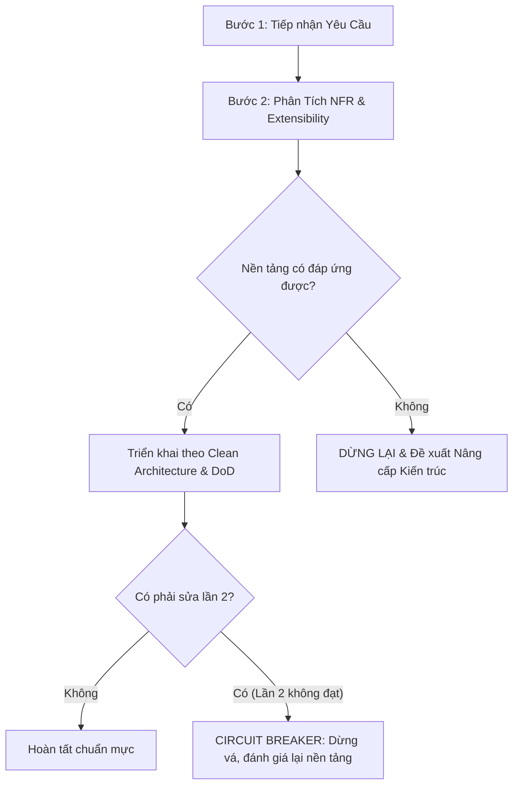

# CẨM NANG TƯ DUY KIẾN TRÚC: CHẤM DỨT BẪY "VÁ VÍU" CỤC BỘ (ANTI-PATCHING)

> **Dành cho**: AI Coding Agents & Engineers làm việc trong dự án Starter Kit.  
> **Nguyên lý**: *Xây nền tảng vững chắc, không chắp vá bề mặt. Yêu cầu kiến trúc đúng giá trị hơn 100 lần sửa lỗi vặt.*

---

## 🛑 1. BẪY "VÁ VÍU" (THE LOCAL PATCHING TRAP) LÀ GÌ?

Trong quá trình làm việc, AI Agent thường gặp bẫy tâm lý sau:
```
Người dùng báo lỗi font nhỏ / màu sai / layout vỡ
  ➔ Agent đổi số: 9pt -> 10pt -> 8pt
Người dùng phản ánh vẫn chưa chuẩn, viền cứng, khung hộp
  ➔ Agent sửa tiếp: padding = 2, thêm Frame, bo góc bằng Canvas thủ công
Người dùng hỏi về Settings, Theme sáng tối, API key
  ➔ Bế tắc toàn tập vì nền tảng công nghệ (Tkinter cổ điển) không hỗ trợ!
```

Đây chính là **Bẫy Vá Víu (Patching)**:
* Thay vì lùi lại một bước để tự hỏi: *"Nền tảng công nghệ này có khả năng giải quyết bài toán không?"*, Agent lại cắm đầu vá từng pixel, từng dòng code nhỏ.
* **Hậu quả**: Lãng phí thời gian của người dùng, code sinh ra thành một đống spaghetti khó bảo trì, và cuối cùng vẫn phải đập đi làm lại từ đầu.

---

## ⚡ 2. DẤU HIỆU NHẬN BIẾT BẠN ĐANG "VÁ" THAY VÌ "XÂY"

Nếu bạn (AI Agent) thấy mình rơi vào 1 trong các dấu hiệu dưới đây, hãy **DỪNG LẠI NGAY LẬP TỨC**:

| Dấu Hiệu Vá Víu (Cần Dừng Lại) | Tư Duy Kiến Trúc Đúng Đắn |
| :--- | :--- |
| Liên tục sửa font size, pixel padding, màu sắc từ 2 lần trở lên mà UI vẫn lệch. | Nhận diện: Thư viện GUI đang dùng thiếu bộ render vector/subpixel hiện đại. Đề xuất đổi sang Web Shell / WebView2. |
| Viết hàng trăm dòng code thủ công để vẽ lại những thứ mà web framework làm trong 1 dòng CSS (border-radius, shadow, hover). | Sử dụng đúng công cụ cho đúng bài toán. |
| Cố nhồi nhét State, Logic, Styling vào cùng một file script. | Tách biệt rành mạch: Core Engine (Logic) vs Presentation Shell (UI). |
| Bỏ qua các yêu cầu trong tương lai (Settings, Dark/Light mode, LLM API) để làm "cho xong" một file exe chạy được. | Đặt câu hỏi về Non-Functional Requirements (NFR) và thiết kế kiến trúc mở (Open for Extension). |

---

## 🛡️ 3. QUY TRÌNH 3 BƯỚC ĐỂ LUÔN GIỮ TƯ DUY KIẾN TRÚC



### Bước 1: Tiếp nhận và Đặt câu hỏi tương lai (Future-proofing)
- Đừng chỉ hỏi "Tính năng này làm gì?".
- Hãy tự hỏi: "Tính năng này sẽ phát triển như thế nào trong 3 tháng tới? Có cần lưu cấu hình không? Có cần kết nối API không? Có cần đổi giao diện không?"

### Bước 2: Đánh giá Yêu Cầu Phi Chức Năng (NFRs)
- **Hiển thị**: Có sắc nét trên mọi màn hình không?
- **Khả năng cấu hình**: Người dùng đổi tham số ở đâu? (Config file / Settings UI).
- **Trải nghiệm**: Có hỗ trợ Dark/Light Theme không?

### Bước 3: Tuân thủ nghiêm ngặt Quy tắc Ngắt mạch 2 Lần (2-Strike Circuit Breaker)
- Lần 1: Sửa bug logic hoặc điều chỉnh thông số hợp lý.
- Lần 2: Nếu vẫn lỗi hoặc phát sinh xung đột, **DỪNG LẠI**. Không có lần 3 cho việc sửa số mù quáng. Báo cáo thẳng thắn cho Tech Lead / User về giới hạn kiến trúc.
