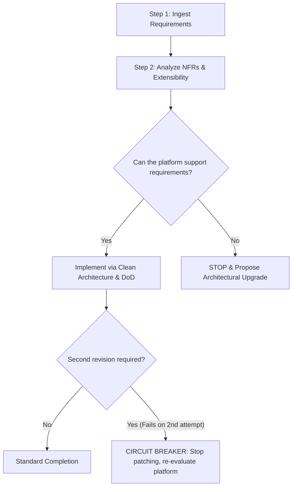

# ARCHITECTURAL THINKING GUIDE: BREAKING THE "LOCAL PATCHING" TRAP (ANTI-PATCHING)

> **Audience**: AI Coding Agents & Engineers working on starter kits and production repositories.  
> **Core Principle**: *Build on solid foundations, do not plaster over symptoms. Sound architectural requirements are worth 100x more than endless localized bug fixes.*

---

## 🛑 1. WHAT IS THE "LOCAL PATCHING" TRAP?

During development loops, AI Agents frequently fall into the following psychological trap:
```
User reports small font / wrong colors / broken layout
  ➔ Agent tweaks arbitrary values: 9pt -> 10pt -> 8pt
User reports harsh borders, rigid boxy styling
  ➔ Agent hacks further: padding = 2, adds Frame wrappers, draws manual canvas corners
User asks for Settings, Dark/Light theme, LLM API keys
  ➔ Total architectural dead end because the legacy GUI framework (Tkinter) lacks modern rendering primitives!
```

This is the **Patching Trap**:
* Instead of stepping back to evaluate: *"Is this technology foundation capable of supporting the product requirements?"*, the Agent fixates on tweaking individual pixels and single lines of code.
* **Consequences**: Wasted user time, fragile spaghetti code, and an inevitable rewrite from scratch.

---

## ⚡ 2. SIGNS YOU ARE "PATCHING" INSTEAD OF "BUILDING"

If you (AI Agent) recognize any of the following symptoms, **STOP IMMEDIATELY**:

| Patching Symptoms (Must Stop) | Sound Architectural Thinking |
| :--- | :--- |
| Repeatedly tweaking font size, pixel padding, and colors ≥ 2 times while the UI remains visually misaligned. | Identify root cause: The UI library lacks modern subpixel/vector rendering. Propose migrating to a Web Shell / WebView2. |
| Writing hundreds of lines of procedural code to recreate what a web framework provides in 1 line of CSS (border-radius, box-shadow, hover states). | Choose the right tool for the job. |
| Shoving State, Business Logic, and Presentation Styling into a single script. | Enforce strict separation of concerns: Core Engine (Logic) vs. Presentation Shell (UI). |
| Disregarding future requirements (Settings, Dark/Light mode, LLM APIs) just to produce an ephemeral working executable. | Inquire about Non-Functional Requirements (NFRs) and design for extensibility (Open for Extension). |

---

## 🛡️ 3. 3-STEP WORKFLOW TO MAINTAIN ARCHITECTURAL DISCIPLINE



### Step 1: Ingest and Evaluate Future Extensibility
- Do not merely ask "What does this localized feature do?".
- Ask: "How will this feature evolve over the next 3 months? Does it require persistent config? Will it connect to external APIs? Will themes need customization?"

### Step 2: Evaluate Non-Functional Requirements (NFRs)
- **Visual Rendering**: Does it render crisp typography across arbitrary display densities?
- **Configurability**: Where do users alter parameters? (Config file / Settings UI).
- **User Experience**: Is there support for Dark/Light Themes and accessible contrast?

### Step 3: Enforce the 2-Strike Circuit Breaker Rule
- Strike 1: Apply clean logic correction or reasonable parameter tuning.
- Strike 2: If the problem persists or triggers secondary regressions, **STOP**. There is no third strike for blind numeric trial-and-error. Report the architectural bottleneck directly to the Tech Lead / User.
