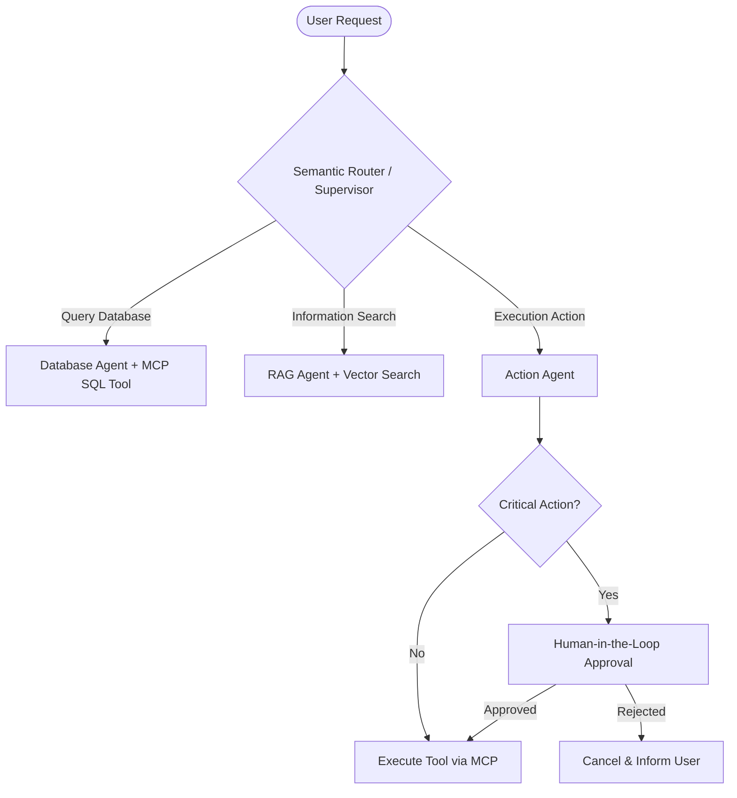

# ADR 0007: AI AGENTIC ARCHITECTURAL PATTERNS & EVALUATION PIPELINES

* **Status**: Approved (Accepted)
* **Decision date**: 2026-11-04
* **Decided by**: AI Architect & Tech Lead

---

## 1. CONTEXT
Modern applications that integrate LLMs no longer stop at simple prompts; they have moved to autonomous agent systems (**Agentic Systems**): they reason on their own, call tools (Tool Calling), manage memory (Memory), and coordinate multiple agents (Multi-Agent Swarm). We need to standardize the architecture and the quantitative evaluation method (Evaluation) for AI modules.

---

## 2. DECISION

### 2.1. Standard Agentic Architecture Patterns
1. **ReAct Pattern (Reasoning + Acting)**:
   - Loop: $\text{Thought} \rightarrow \text{Action (Tool Call)} \rightarrow \text{Observation} \rightarrow \text{Final Answer}$.
2. **Supervisor & Subagent Hierarchy**:
   - Use a Supervisor Agent to classify intent and dispatch tasks to specialized Subagents (DB Agent, Search Agent, Coding Agent).
3. **Model Context Protocol (MCP)**:
   - Standardize the integration of tools (Tools) and resources (Resources) through the MCP protocol, decoupling the Agent logic from the Tool execution logic.
4. **Human-in-the-Loop (HITL) Guardrails**:
   - Every high-risk action (payment, data deletion, mass email) must wait for human approval before executing.

> [📊 Open the diagram on Mermaid Live / an AI editor](https://mermaid.live/edit#pako:eNplkstOwzAQRX9l5AUCQcSeBai0QJEKgqYgoaSLqTNtDYkdHLtQNf137Ngtryz8GN97PLnyhnFVEDsDNi_VB1-iNjAZ5BLc99SQPsz8CGN6t9SY6REkyTmMlTWkNylVKI3gcQ-nkNqa9Eo0Sm8DIp44U_toSa9hgAZn2FALg8vegqTJdhXotnAMd_0HSB9HMFGqnP7D3Mq50hUaoSSkhJovWxj3bgLLLfaYZ-JG6aj5z7n6JG47So_7qY1zAIV1YEVvGH-IuihuLOpCoyg3fS1cFlhGyUVMYC_obn2hpoXh7WSUDa0LLxEyMUtKRkrV0KtrrVa4--ffxnvVdoH4trPQO3UFWAn0kUWXZ3eGQKPi2_ZHMKZXl5AXXGNZzpC_ZTnro-RUwgGEmLsnkLMpOwFWkYtdFP6pbDwqZ67zinJXyFlBc7SlyVkut16M1qh0Lbk7NNqSq9i6QEMDgQuNVSxvvwByLtXk)

### 2.2. Quantitative Evaluation Pipeline (AI Evaluation Pipeline)
Measure the quality of RAG systems and Agents through the **RAG Triad Metrics**:
* **Faithfulness**: Is the AI's response based entirely on the retrieved context (Context)? (Against hallucination).
* **Answer Relevance**: Does the answer address the core of the user's question?
* **Context Precision**: Do the documents returned by the vector store contain exactly the needed information?

All execution traces (Execution Traces) are recorded automatically into an Observability tool (**Langfuse**).

---

## 3. CONSEQUENCES
* The AI system becomes controllable (Deterministic & Observable), minimizing hallucination (Hallucination) and security risk (Prompt Injection).
