# 🚀 DEVELOPER ONBOARDING GUIDE (ZERO TO FIRST COMMIT IN 30 MINUTES)

> **Goal**: Guide a new software engineer (or AI Coding Agent) to set up a complete local environment and create the first Pull Request (PR) in **under 30 minutes**.

---

## ⏱️ 30-MINUTE TIMELINE

```mermaid
gantt
    title 30-Minute Onboarding Roadmap
    dateFormat  mm
    axisFormat  %M'

    section Setup
    Install base tools & Clone the Repo    :00, 05m
    Initialize the environment variables   :05, 05m
    Start the Docker infrastructure & Services :10, 05m
    section Experience
    Start the Frontend & Backend           :15, 05m
    Create a branch & write the First Feature (TDD) :20, 07m
    section Acceptance
    Anti-Crash check & open the PR         :27, 03m
```


> [📊 Open the diagram on Mermaid Live / an AI editor](https://mermaid.live/edit#pako:eNp9Uk1rGzEQ_SvDQpIGEpDimqW-pTa-5KMhMT3pIktjr6glGe0oJIT8945WG9eE0DlI4mnmvTcjvTUmWmxm0Gx1IFIBOMjRDuFWZYn2B1BSWQg0oYNfYR11si5sYSLgoSsXGz1WWU24jMlrAvC-YvrF9R_Yyd2ZChXu0ZCLAVadKyLrDVU1bfc1YT5ICge8SymHpJbADILfWd4UCKcQym5kABrqJ3x1CvNdDAiPuI8wE-ICxHS0c9MNPW3cmC5jJdLTDN2hy_VoKoCveq7OQK7FUG5ZpMRMTL_kNl0lf4XxMKq1XLeI5g8m9viE6dkZ7AcieWzyMJxUW3Jwv61zMu1_tJYpBsJgmfunZhE-_YuZPLa6-mg-1KYlN30Kvw9vsXSp5xU15YTwbbVYnBeOq-Ky_eTyyBs_Zx79VWjieXAargO5y3nSfVG5q87h4RGO_V21zD3xzQU0Hvm_OFv-5FuhUw116FExoBqLG513pBoV3kuyzhSfXoPhS0oZGcn78hEXTm-T9iP8_heEOuNM)

---

## 🛠️ 1. PREREQUISITES

Before starting, make sure your computer has the following tools installed:
- **Git** (v2.30 or later): `git --version`
- **Node.js** (v18 or later, or v20+ LTS): `node -v`
- **Docker & Docker Compose**: `docker compose version`
- **A source code editor**: VS Code, Cursor or Antigravity IDE.

---

## ⚡ 2. STEP-BY-STEP SETUP

### Step 1: Clone the Repository & check the branch (2 minutes)
```bash
git clone https://github.com/Dokhacgiakhoa/Project-Builder-4-Agents.git
cd Project-Builder-4-Agents
git checkout main
git pull origin main
```

### Step 2: Set up the Environment Variables (3 minutes)
Create the environment configuration file from the safe template:
```bash
# On Linux/macOS or Git Bash:
make setup

# Or manually in Windows PowerShell:
cp .env.example .env
```
> [!IMPORTANT]
> Open the `.env` file and check the default settings. Never commit real API Keys to the Git repo.

### Step 3: Start the local database infrastructure (5 minutes)
Start PostgreSQL (with pgvector) and Redis with Docker Compose:
```bash
make up
```
*Check the container status:*
```bash
docker compose ps
```
Both services `db` (port 5432) and `redis` (port 6379) must be in the `running (healthy)` state.

### Step 4: Start the Frontend (5 minutes)
Open a new terminal window:
```bash
cd frontend
npm install
npm run dev
```
Open your browser at: **`http://localhost:3000`**.  
You will see the Dashboard screen with a switcher between: **Dashboard | AI Assistant Chat | UI/UX Presets Studio**.

---

## 💻 3. CREATE THE FIRST FEATURE & PULL REQUEST (FIRST COMMIT WORKFLOW)

### Branch Naming Convention:
* `feat/US-xxx-feature-name` (new feature)
* `fix/BUG-xxx-bug-description` (bug fix)
* `docs/document-name` (documentation update)

Example of creating a new branch:
```bash
git checkout -b feat/T-001-user-avatar-badge
```

### Writing Code in Compliance with the "Anti-Crash Standard":
Before writing code, you MUST follow the 4 defensive engineering principles:
1. **Defensive Access**: Always use Optional Chaining (`user?.profile?.avatarUrl`) and Nullish Coalescing (`?? 'default.png'`).
2. **Safe Array Handling**: Always wrap with `Array.isArray(items) ? items.map(...) : []`.
3. **Safe Async/JSON**: Every `JSON.parse` or API call must sit inside a `try...catch` block.
4. **Strict Typing**: Never use the `any` type in TypeScript.

### Self-check before committing (Pre-flight Verification):
```bash
# Check the formatting and type checking of the Frontend:
cd frontend
npm run build

# Run the linter across the whole system:
make lint
```

### Create a Conventional Commit:
```bash
git add .
git commit -m "feat(user): add status badge to user avatar in main layout"
git push origin feat/T-001-user-avatar-badge
```

### Open the Pull Request:
1. Go to the GitHub repo and click **Compare & pull request**.
2. Keep the PR title close to the Task code: `feat: [T-001] User avatar status badge`.
3. Tick every item in the checklist of `.github/PULL_REQUEST_TEMPLATE.md`:
   - [x] The code follows the Feature Spec and the API Contract.
   - [x] Anti-Crash was checked (no null/undefined crash).
   - [x] Build and tests ran successfully locally.
4. Assign at least 1 Reviewer (the Tech Lead or a Peer Reviewer) for approval.

---

## ❓ 4. COMMON ERRORS & QUICK FIXES (FAQ & GOTCHAS)

| Error symptom | Root cause | Quick fix command |
| :--- | :--- | :--- |
| `Error: connect ECONNREFUSED 127.0.0.1:5432` | The Database container has not finished starting | Run `make restart` and wait 10 seconds for PostgreSQL to finish its healthcheck. |
| `Cannot find module '@/...'` | A path alias configuration error in TypeScript | Check the `tsconfig.json` file and make sure `npm install` ran completely. |
| Port 3000 or 5432 is in use | Another application is using the same port | Change the local port in `.env` or stop the process holding the port (`lsof -i :3000` or Task Manager on Windows). |
