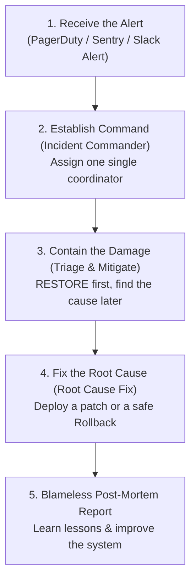

# 🚨 PRODUCTION INCIDENT RESPONSE RUNBOOK

> **Purpose**: Emergency guidance for the On-Call Engineer and the Tech Lead when the system has a serious incident in the Production environment (especially at sensitive hours such as 2 a.m.).

---

## 🚦 1. SEVERITY MATRIX & RESPONSE SLA

| Level | Incident definition | Response SLA | Temporary-fix SLA | Coordination channel |
| :---: | :--- | :---: | :---: | :--- |
| **P1 - Critical** | The whole system is down, data is lost, users cannot pay/log in. | **< 15 minutes** | **< 1 hour** | Create an emergency War Room (Slack / Google Meet) + report to the CTO/CEO immediately. |
| **P2 - Major** | A core feature fails (for example: the AI Agent does not respond), but the main system still works. | **< 30 minutes** | **< 4 hours** | The Slack channel `#incident-response` + update the Status Page. |
| **P3 - Minor** | A UI display bug, slight performance degradation, a temporary workaround exists. | **< 2 hours** | **< 24 hours** | Create a high-priority Issue on GitHub / Jira. |
| **P4 - Low** | A typo or minor UI bug that does not affect the main experience. | **< 24 hours** | Next sprint | Handle through the normal development process. |

---

## 🧭 2. THE 5-STEP RESPONSE PROCESS FOR A P1/P2 ALERT


> [📊 Open the diagram on Mermaid Live / an AI editor](https://mermaid.live/edit#pako:eNpNkl9P2zAUxb_KkR-mIkFp-kcV04REk20gBqpKHyYtfXBsp7FI7Mq1t1WI786N3QJ5ydW1z_Xv3HtfmLBSsa9gdWv_iYY7j3VRGtB386dk2RBrXYZMVfUOj00fcWmwKMNopDIL-mfZqE_LK7P9VrnL68GSb5Urgj_gEk_KeBeDlotn3LTK-bOSbXBxcY0FPTAe4ncqJvArld8hjw-JK9yGAwZ3RmhJdZDbruNGKncWH_qZdAYZzLYHqRKI1JCkM4l25hNkFm2ILGAXDyQl2CY5XUScnHAmQzzGWqOJOWJUc4N1k9Rzj9tYNdMYrJ0mp_iCB-31lnuVsHo1rwO8jnzcJIkc32EZIzXN4d0n4Eqcw8fLoiMr4XAS9hYoGhvseXinzSNtQbTTIe6Ty1pgGSM1EyCwE-3HfMQEg5W11EUe9go_9P-EW6hdaw-oYhky_Td1FY1N5gVWtm2rfnpE5G08Hpl3miLSfCea2fBjL_JTcB8t1FOz_bwrszRrOac2LlreqVbt91javb94sM6rLrGtopZ7PGvTUGdOU-io6XkC1rHP_X4apK2Zwx8HTFvBNuwcrFOu41r2a_7SU5fMN6pTJSVKJlXNQ-tLVprX_jIP3j4djKBD74KiTNhJmm5B03a8O6Zf3wDFrwMS)

---

## 🛠️ 3. EMERGENCY MITIGATION CHECKLIST

### Option 1: Roll back the latest release (Recommendation #1)
If the incident happens right after a Deploy, **DO NOT TRY TO FIX ON PRODUCTION**; roll back immediately:
```bash
# View the history of the last 3 commits on main:
git log -n 3 --oneline

# Revert the faulty commit and push urgently:
git revert <FAULTY_COMMIT_HASH> -m 1
git push origin main
```

### Option 2: Restart a hung service (Graceful Restart)
```bash
# Restart containers safely:
docker compose restart <service-name>

# Watch real-time logs to check for errors:
docker compose logs -f --tail=100 <service-name>
```

### Option 3: Turn on Maintenance Mode
If there is a data leak or an unidentified database error, turn on the maintenance page right away to protect user data:
- Redirect traffic at Cloudflare / Nginx to the `maintenance.html` page.
- Tell customers the system status through Twitter/Email: *"The system is undergoing emergency technical maintenance, expected to finish in 30 minutes."*

---

## 🔍 4. DIAGNOSTICS CHEATSHEET FOR COMMON PROBLEMS

### Case 1: Database Connection Pool exhausted (Postgres Error: "Too many connections")
* **Signs**: The app returns HTTP 500 errors across the board, the database server CPU spikes to 100%.
* **Quick fix**:
  1. Check the number of open connections:
     ```sql
     SELECT count(*) FROM pg_stat_activity;
     ```
  2. Terminate hung queries running longer than 60 seconds:
     ```sql
     SELECT pg_terminate_backend(pid) 
     FROM pg_stat_activity 
     WHERE state = 'active' AND now() - query_start > interval '60 seconds';
     ```
  3. Restart the connection pooler (PgBouncer).

### Case 2: Redis out of RAM (OOM - Out of Memory)
* **Signs**: The cache cannot store, the Task Queue stops processing.
* **Quick fix**:
  1. Check RAM usage:
     ```bash
     redis-cli info memory
     ```
  2. Delete temporary keys or switch the eviction policy to `allkeys-lru`:
     ```bash
     redis-cli config set maxmemory-policy allkeys-lru
     ```

### Case 3: AI Provider API overloaded or Rate Limited (HTTP 429 Too Many Requests)
* **Signs**: All AI Agent features hang or report a timeout.
* **Quick fix**:
  1. Turn on the Fallback Provider Flag in the configuration to switch from OpenAI to Anthropic Claude or Gemini.
  2. Enable Exponential Backoff with jitter to reduce the pressure of constant retries.

---

## 📝 5. BLAMELESS POST-MORTEM TEMPLATE

> **Philosophy**: We do not look for someone to punish; we look for the gaps in the process and architecture so the system never repeats a similar failure.

```markdown
# [POST-MORTEM]: Incident [Incident Code - Short Name]
* **Date**: YYYY-MM-DD
* **Severity**: P1 / P2
* **Downtime**: XX minutes
* **Incident Commander**: [Full Name]
* **User impact**: About XX% of users hit errors between [HH:MM] and [HH:MM].

## 1. Detailed timeline (Timeline - UTC+7)
- 02:15: The Sentry monitoring system fires an alert for a spike in HTTP 500 errors.
- 02:20: The on-call engineer receives the alert and confirms a P1 incident.
- 02:35: The cause is identified: commit #abc overflowed Redis memory.
- 02:45: Roll back to the previous safe release.
- 02:50: The system recovers fully; the error rate returns to 0%.

## 2. Root Cause Analysis (The 5 Whys)
1. Why did the system go down? ➔ Redis ran out of memory (OOM).
2. Why did Redis run out of memory? ➔ A background worker stored whole large image payloads in the cache.
3. Why did the worker store large images in the cache? ➔ The new feature has no limit on the uploaded file size.
4. Why is there no file size limit? ➔ The business spec lacked a validation constraint definition.
5. Why was it merged into main without the constraint? ➔ The PR review process lacked an Anti-Crash checklist step.

## 3. Improvement actions to prevent recurrence (Action Items)
| No. | Concrete action | Owner | Deadline (DoD) |
| :---: | :--- | :--- | :--- |
| 1 | Add middleware limiting uploads to a maximum of 5MB | [Engineer A] | Before 10/11 |
| 2 | Configure a Prometheus alert when Redis RAM exceeds 80% | [Engineer B] | Before 12/11 |
| 3 | Add an automated test for the oversized-file case | [Engineer C] | Before 15/11 |
```
