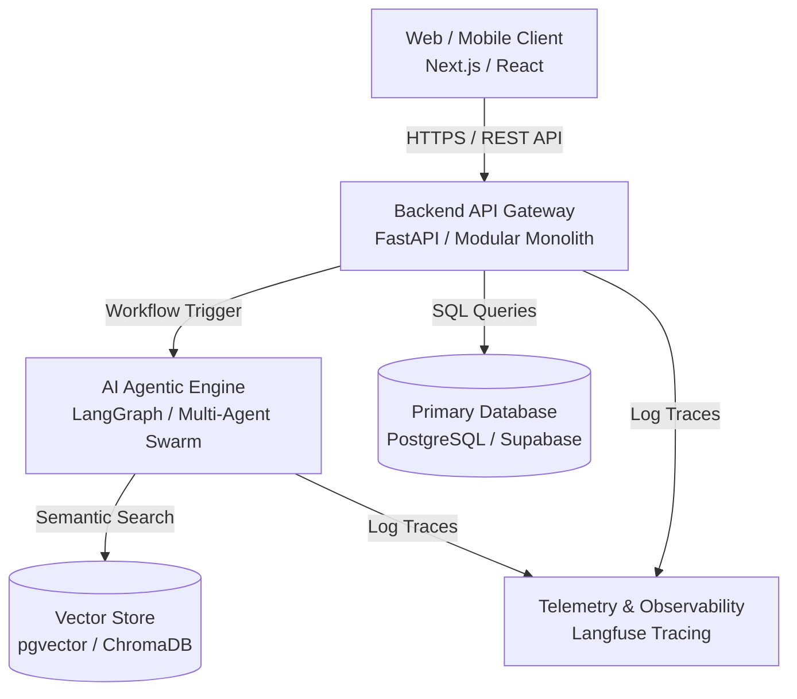

# SYSTEM ARCHITECTURE

---

## 🏛️ 1. SYSTEM ARCHITECTURE OVERVIEW (C4 CONTAINER DIAGRAM)

> [📊 Open the diagram on Mermaid Live / an AI editor](https://mermaid.live/edit#pako:eNptUl1P4zAQ_CuWHxAn0ev7CSG1hI9K5SiXiD5ghDbJ1vGR2NXGoVcR_jtrpwpXiTw4zu7M7O5k32XhSpS_hNQE20pkibKCn8vaoPVPSq4xF1Nx53JT4yF6ntP04jf-8z__tpz7g1B4JZ8H4my1YNYcile0ZfgSN-BxB_vIuobWh1hQLLsaiN_W1cZXXwKLl5keas8WIl5NIa6sNhajxhKsvonNskpXezOJIJHugJpRJpk_nSq5ItMA7UUCHnJoB4GVa70mTB-WrJB225hR8seB-YiFdzTwh7tI-Ri4W_02hKbisiLXQDL_YvIshnPceYY1Nui58om4z1ukN2ADjd-PE2y6FkVGUBirY9P_-y4mk4v-NstWafD3Ks2CkX04RpMjZO3odVO7HQsZrZH60b1jXBj1oUMy2PbszLHRAwIbiEanCFRU_ejCN9il07HzIHYY-bjcNwB5JmSD1IApw7K9B4KSvmKXFAeULHED_DOVVPYjgKHzLt3bgpOeOuRIty15kxIDvKnNIfzxCat85Fg=)

---

## 🔄 2. KEY DATA FLOW
1. The user sends a request from the Client interface.
2. The Backend API authenticates permissions (`ROLE_USER`) and checks the Input Schema.
3. It triggers the AI Agent to reason or run a semantic search on the Vector DB.
4. It returns a defensive result (Defensive Payload) for the Client to display.
