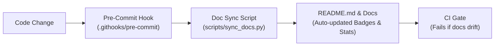

# Living Documentation & Auto-Sync Pipeline

> **Intent**: Reduce documentation rot in vibe-coded projects. Keep `README.md`, architecture summaries, and verification commands synchronized with the live codebase with less manual nagging (hooks and CI can be bypassed, so this lowers drift but does not remove it).

---

## The Problem: Documentation Drift in AI Coding

In fast-paced vibe coding sessions, agents create features, change endpoints, refactor folders, and add dependencies. However:
1. Humans forget to prompt: *"Please update README.md and docs."*
2. Agents only update docs when explicitly commanded.
3. Over sprints, `README.md` and architecture notes rot, leading subsequent agents astray with obsolete setup commands and false architectural assumptions.

---

## The 4-Layer Solution Architecture



### Layer 1: Single-Source-of-Truth Sync Script (`scripts/sync_docs.py`)
Embed dynamic markers into `README.md`:
```markdown
<!-- AUTO-GEN:STATS -->
[](project-review.md)
[](tests/)
<!-- /AUTO-GEN:STATS -->
```

The sync script parses test suites, project review results, and file trees, replacing the block automatically.

### Layer 2: Automatic Git Hook (`.githooks/pre-commit`)
Configure git to use repository-controlled hooks:
```bash
git config core.hooksPath .githooks
```

Hook contents (`.githooks/pre-commit`):
```sh
#!/bin/sh
python scripts/sync_docs.py
git add README.md project-review.md 2>/dev/null || true
```

### Layer 3: CI Quality Gate (`.github/workflows/ci.yml`)
Enforce sync verification on pull requests:
```yaml
- name: Verify Documentation Sync
  run: python scripts/sync_docs.py --check
```

### Layer 4: Agent Definition of Done (DoD)
Enshrine the rule into `AGENTS.md` and `docs/standards/definition-of-done.md`:
- Every completed task must execute `python scripts/sync_docs.py` before declaring completion.
