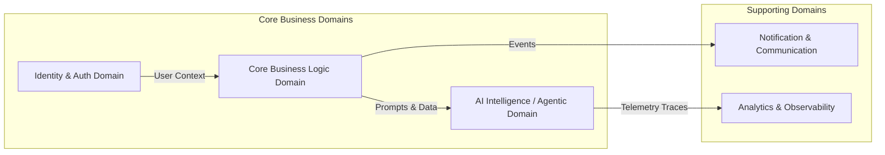

# DOMAIN BOUNDARIES & CONTEXT MAP (BOUNDED CONTEXTS)

> **Mục tiêu**: Phân chia hệ thống thành các Domain rành mạch để AI và các thành viên có thể làm việc song song mà không xung đột mã nguồn.

---

## 🗺️ 1. BẢN ĐỒ CÁC DOMAIN (DOMAIN MAP)

---

## 📦 2. QUY ƯỚC RANH GIỚI & GIAO TIẾP LIÊN DOMAIN

1. **Giao tiếp qua Hợp đồng (Contract-Only Communication)**:
   - Domain A KHÔNG được phép truy cập trực tiếp vào DB Table hoặc nội hàm private của Domain B.
   - Mọi tương tác phải qua API Contract (REST API, RPC) hoặc Event Bus công khai.
2. **Context Cô Lập Cho AI Coding Agent**:
   - Khi giao task thuộc Domain A, Agent chỉ cần nạp context của Domain A và các Contracts liên quan, tránh over-context dẫn đến ảo giác (hallucination).
