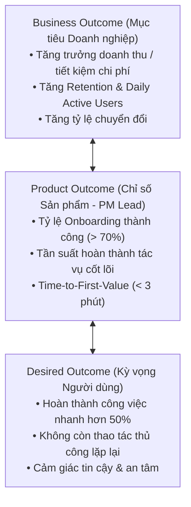

# PRODUCT VISION & STRATEGY

> **Tài liệu tham chiếu**: Tinh thần cốt lõi từ *Tư duy Product cho người làm công nghệ* (Hoàng Đức Minh).

---

## 🎯 1. KHUNG PHÂN TÍCH WHO - WHAT - HOW

* **1. WHO (Tập trung vào ai?)**:
  * Nhóm đối tượng người dùng mục tiêu chính: [Mô tả chi tiết nhóm người dùng]
  * Đặc điểm & bối cảnh sử dụng: [Môi trường, công cụ, tần suất họ sử dụng sản phẩm]

* **2. WHAT (Giải quyết nỗi đau gì?)**:
  * Nỗi đau lớn nhất (Core Pain Point): [Vấn đề nhức nhối hiện tại mà người dùng đang chịu đựng]
  * Sự sẵn sàng chi trả (Willingness to pay): [Họ sẵn sàng trả bằng tiền, thời gian hay công sức ra sao để giải quyết?]

* **3. HOW (Bằng cách nào?)**:
  * Giải pháp đột phá: [Sản phẩm / AI Agent giải quyết triệt để nỗi đau đó bằng cách nào?]
  * Giá trị khác biệt (Unique Selling Point - USP): [Tại sao họ chọn giải pháp này thay vì các giải pháp thay thế?]

---

## 📈 2. CÂY KẾT NỐI 3 TẦNG OUTCOME (OUTCOME OVER OUTPUT)

---

## 🚫 3. RANH GIỚI PHẠM VI (IN-SCOPE VS. OUT-OF-SCOPE)

* **Trong phạm vi (In-Scope - Phải hoàn thành)**:
  1. [Tính năng / Luồng tác vụ 1]
  2. [Tính năng / Luồng tác vụ 2]
  3. [Tính năng / Luồng tác vụ 3]

* **Ngoài phạm vi (Out-of-Scope - Kiên quyết không làm trong giai đoạn này)**:
  1. [Tính năng mở rộng chưa cấp thiết]
  2. [Tối ưu hóa phức tạp quá mức cần thiết]
  3. [Hỗ trợ các nền tảng phụ chưa có nhu cầu thực tế]
