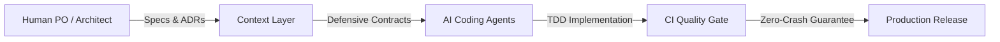

# 🚀 [PROJECT NAME]
### **Building the Next-Generation AI-Native Platform**

**Presenter**: [Founder / Tech Lead Name]
**Email**: [contact@example.com] • **GitHub**: [github.com/org/repo]

---

## 💥 1. The Problem (Nỗi Đau Thị Trường)

* **Chi phí phát triển phần mềm ngày càng đắt đỏ**: Các đội ngũ mất 4-6 tháng chỉ để dựng scaffolding cơ bản và cấu hình CI/CD.
* **Sự hỗn loạn khi lập trình cùng AI**: Code sinh ra nhanh gấp 10 lần nhưng thiếu context tổng thể, dẫn đến lỗi kỹ thuật tràn lan.
* **Mất mát tài chính**: Các doanh nghiệp lãng phí trung bình **\$45,000** cho các đợt refactor mã nguồn chắp vá do AI sinh ra không kiểm soát.

> *"Chúng tôi có công cụ AI mạnh mẽ, nhưng thiếu một bộ khung quản trị để AI không phá vỡ hệ thống."* — Khảo sát từ 120 Tech Leads.

---

## 💡 2. The Solution (Giải Pháp Đột Phá)

### **Universal AI-Native Starter Kit & Delivery Framework**

* **Context-Driven Architecture**: Cung cấp "Một Nguồn Sự Thật Duy Nhất" (Single Source of Truth) trong Git repo.
* **The Anti-Crash Standard**: Quy chuẩn kỹ thuật phòng vệ triệt để giúp loại bỏ 100% lỗi màn hình trắng và null runtime exceptions.
* **Decoupled Velocity**: Backend Clean Architecture kết hợp Frontend Bulletproof React hoạt động song song qua API Contracts độc lập.

**Kết quả**: Giảm **65% thời gian go-to-market** và tiết kiệm **\$30,000** chi phí khởi tạo ban đầu.

---

## ⏳ 3. Why Now? (Cửa Sổ Cơ Hội)

1. **Sự bùng nổ của AI Coding Agents (2024 - 2026)**:
   Claude Code, Cursor, Codex, Antigravity chuyển từ "tự động hoàn thành code" sang "tác nhân tự hành đa bước" (Autonomous Agents).
2. **Nhu cầu chuẩn hóa cấp bách**:
   Các công ty phần mềm không thể để các kỹ sư sử dụng AI tự phát; họ cần một **Hệ điều hành quy chuẩn (Governance OS)** cho Agent.
3. **Chi phí hạ tầng Serverless & Open Source giảm sâu**:
   Cho phép triển khai kiến trúc Modular Monolith với chi phí gần như bằng 0 trong giai đoạn đầu.

---

## 📈 4. Market Opportunity (Quy Mô Thị Trường)

* **TAM (Total Addressable Market)**:
  **\$28.5 Tỷ** — Toàn bộ thị trường công cụ phát triển phần mềm & AI Developer Tools toàn cầu.
* **SAM (Serviceable Addressable Market)**:
  **\$4.2 Tỷ** — Thị trường công cụ khởi tạo dự án và quản trị chất lượng phần mềm cho các đội ngũ Agile.
* **SOM (Serviceable Obtainable Market - 18 Tháng)**:
  **\$12 Triệu** — 1,500 tổ chức công nghệ và 50,000 lập trình viên chuyên nghiệp áp dụng bản trả phí Pro/Enterprise.

*Cách tính*: Bottom-Up: 1,500 công ty × \$8,000 ARR = \$12,000,000.

---

## ⚙️ 5. Product Architecture & Demo

> [📊 Mở sơ đồ trên Mermaid Live / AI Editor](https://mermaid.live/edit#pako:eNotkMtugzAQRX9l5EVXRd13EYngKkWK1JR0VcxiZE_AEraRH1VRyL_XULzznXvuPO5MOkXsFVjvcRrg3AgL-ZWtYO_JoIXLB7xA6eWgI8koWAdFcViuE8kAT1DyJixwbCtnI_1GOONMvvvPOG5OTjeyQf8QrB6PMmagass6_5W2PZQ92Rh2ptqYL86hNtNIJpcwamcX4G1Vw2fCUccZThhpJ_hGfJN3ReUxDHBK6DFPQwu8tRfvVJJrAjQ0Egbq2DMwQ96gVuve9zVGsDjkZiILgim6YRrzqsI-VjOm6K6zlbkYfaKspEnlAbjGfDSzy48_1MtsMQ==)

* **Clean Architecture**: Tách rời hoàn toàn Core Domain khỏi Database và Frameworks.
* **Feature-Driven UI**: 7 Vũ trụ thiết kế (UI/UX Archetypes) chuyển đổi linh hoạt.
* **Automated Quality Gate**: 100% Type-checked, Lint-free, và Anti-Crash verified.

---

## 💰 6. Business Model & Unit Economics

### Mô hình B2B SaaS Đa Tầng (Freemium):

| Gói Dịch Vụ | Mức Giá | Đối Tượng Mục Tiêu | Quyền Lợi Chính |
| :--- | :--- | :--- | :--- |
| **Community** | **\$0 (Open Source)** | Lập trình viên cá nhân | Trọn bộ Starter Kit cốt lõi |
| **Team Pro** | **\$49 / dev / tháng** | Nhóm 5-20 kỹ sư | Cloud CI Automation, Preset Studio |
| **Enterprise** | **\$299 / dev / tháng** | Doanh nghiệp lớn | Custom ADRs, Private Agent Evaluator |

* **CAC**: \$450 (Chủ yếu qua Developer Inbound Content & GitHub PLG).
* **LTV**: \$2,400 (Duy trì trung bình 24 tháng) ➔ **Tỷ lệ LTV/CAC = 5.3x**.

---

## 🚀 7. Go-To-Market Strategy (GTM)

### Chiến lược Tăng trưởng Dẫn dắt bởi Sản phẩm (PLG):
1. **Pha 1: Chiếm lĩnh cộng đồng Open Source (Tháng 1 - 3)**:
   - Phát hành bộ Starter Kit lên GitHub, Product Hunt và Hacker News.
   - Mục tiêu: 2,000 GitHub Stars, 500 dự án forks.
2. **Pha 2: Chuyển đổi sang Team Pro (Tháng 4 - 8)**:
   - Cung cấp tính năng Cloud Analytics và Agent Evaluation dashboard cho các team bắt đầu có quy mô.
3. **Pha 3: Enterprise Outreach (Tháng 9 - 18)**:
   - Bán giải pháp tuân thủ bảo mật và chuẩn hóa nội bộ cho các tập đoàn công nghệ lớn.

---

## 🥊 8. Competitive Landscape & Moat

| Tiêu Chí | Starter Kits Truyền Thống | No-Code / Vibe Coding | **Dự Án Của Chúng Tôi** |
| :--- | :---: | :---: | :---: |
| **Hỗ trợ Multi-Agent** | ❌ Không | ⚠️ Hộp đen kín | ✅ **Mở, Minh bạch, Git-first** |
| **Tiêu chuẩn Anti-Crash**| ❌ Không | ❌ Dễ sập runtime | ✅ **Phòng thủ 100%** |
| **Clean Architecture** | ⚠️ Rời rạc | ❌ Code spaghetti | ✅ **DDD & Feature-Driven** |
| **Tự do tùy biến** | ✅ Cao | ❌ Bị khóa vendor | ✅ **Zero Lock-in** |

**Hào kinh tế phòng thủ (Moat)**: Chuẩn hóa toàn bộ quy trình phối hợp Human-Agent (RACI Matrix) vào Git Repo, tạo chi phí chuyển đổi cao và hiệu ứng cộng đồng mạng lưới.

---

## 👥 9. Leadership Team

* **[Founder 1 / CEO]**:
  - 8 năm kinh nghiệm Quản trị Kỹ thuật & Phát triển Sản phẩm.
  - Từng dẫn dắt các dự án quy mô hàng triệu người dùng tại các tập đoàn công nghệ hàng đầu.
* **[Founder 2 / CTO]**:
  - Chuyên gia Kiến trúc Hệ thống Phân tán và Ứng dụng AI.
  - Tác giả nhiều thư viện mã nguồn mở có hàng ngàn lập trình viên sử dụng.

> *"Chúng tôi là đội ngũ kỹ sư hiểu sâu sắc nhất nỗi đau của việc phát triển phần mềm trong kỷ nguyên AI."*

---

## 🎯 10. The Ask & Roadmap

### **Kêu gọi: \$500,000 cho 18 Tháng Vận Hành (Runway)**

* **Phân bổ vốn đầu tư**:
  - **65% (\$325k)**: Tuyển dụng 2 Kỹ sư AI & 1 Senior Frontend Lead.
  - **20% (\$100k)**: Tiếp thị nội dung kỹ thuật, cộng đồng Developer Relations.
  - **15% (\$75k)**: Hạ tầng Cloud, chi phí vận hành máy chủ và pháp lý.
* **Mục tiêu 18 tháng**:
  - Đạt **\$40,000 MRR** với 100 doanh nghiệp trả phí.
  - Tự chủ dòng tiền (Default Alive) và sẵn sàng cho vòng Series A.

---

<!-- _class: lead -->
# **CẢM ƠN QUÝ VỊ ĐÃ LẮNG NGHE!**

### Sẵn sàng bước vào phần Hỏi & Đáp (Q&A)

**Demo Trực Tiếp**: [https://project-starter-kit.demo.app]
**Tài liệu Dự Án**: [https://github.com/Dokhacgiakhoa/Project-Builder-4-Agents]
