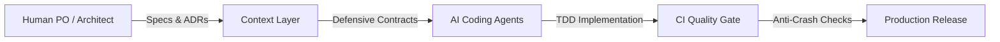

> ⚠️ **ILLUSTRATIVE TEMPLATE**: Every figure, statistic, competitor comparison and commitment in this file is hypothetical data to illustrate the structure. No number has been measured or has a source. Replace them with real, sourced data before use; do not use it verbatim for Project-Builder-4-Agents.

# 🚀 [PROJECT NAME]
### **Building the Next-Generation AI-Native Platform**

**Presenter**: [Founder / Tech Lead Name]
**Email**: [contact@example.com] • **GitHub**: [github.com/org/repo]

---

## 💥 1. The Problem

* **Software development costs keep rising**: Teams spend 4-6 months just to set up basic scaffolding and CI/CD configuration.
* **Chaos when coding with AI**: Code is generated 10 times faster but lacks the overall context, leading to widespread technical defects.
* **Financial loss**: Businesses waste on average **\$[X]** (a sourced figure is needed) on patchwork refactors of uncontrolled AI-generated code.

> *"We have powerful AI tools, but we lack a governance framework so the AI does not break the system."* — [The survey source must be stated].

---

## 💡 2. The Solution

### **Universal AI-Native Starter Kit & Delivery Framework**

* **Context-Driven Architecture**: Provides "a Single Source of Truth" in the Git repo.
* **The Anti-Crash Standard**: A thorough defensive engineering standard aiming to reduce white-screen errors and null runtime exceptions (not yet measured).
* **Decoupled Velocity**: A Clean Architecture Backend and a Bulletproof React Frontend work in parallel through independent API Contracts.

**Result**: Goal: reduce **[X%] of the go-to-market time** and save **\$[Y]** (must be measured in practice).

---

## ⏳ 3. Why Now?

1. **The boom of AI Coding Agents (2024 - 2026)**:
   Claude Code, Cursor, Codex, Antigravity moved from "code autocomplete" to "multi-step autonomous agents" (Autonomous Agents).
2. **An urgent need for standardization**:
   Software companies cannot let engineers use AI ad hoc; they need a **Governance OS** for Agents.
3. **Serverless & Open Source infrastructure costs dropped sharply**:
   This allows deploying a Modular Monolith architecture at almost zero cost in the early stage.

---

## 📈 4. Market Opportunity

* **TAM (Total Addressable Market)**:
  **\$28.5 Billion** — The whole global market for software development tools & AI Developer Tools.
* **SAM (Serviceable Addressable Market)**:
  **\$4.2 Billion** — The market for project-initialization and software quality management tools for Agile teams.
* **SOM (Serviceable Obtainable Market - 18 Months)**:
  **\$12 Million** — 1,500 technology organizations and 50,000 professional developers adopting the paid Pro/Enterprise plans.

*Calculation*: Bottom-Up: 1,500 companies × \$8,000 ARR = \$12,000,000.

---

## ⚙️ 5. Product Architecture & Demo

> [📊 Open the diagram on Mermaid Live / an AI editor](https://mermaid.live/edit#pako:eNotkMtugzAQRX9l5EVXRd13EYngKkWK1JR0VcxiZE_AEraRH1VRyL_XULzznXvuPO5MOkXsFVjvcRrg3AgL-ZWtYO_JoIXLB7xA6eWgI8koWAdFcViuE8kAT1DyJixwbCtnI_1GOONMvvvPOG5OTjeyQf8QrB6PMmagass6_5W2PZQ92Rh2ptqYL86hNtNIJpcwamcX4G1Vw2fCUccZThhpJ_hGfJN3ReUxDHBK6DFPQwu8tRfvVJJrAjQ0Egbq2DMwQ96gVuve9zVGsDjkZiILgim6YRrzqsI-VjOm6K6zlbkYfaKspEnlAbjGfDSzy48_1MtsMQ==)

* **Clean Architecture**: Fully separates the Core Domain from the Database and Frameworks.
* **Feature-Driven UI**: 7 design universes (UI/UX Archetypes) that switch flexibly.
* **Automated Quality Gate**: Type-check, lint and Anti-Crash checks run in CI (results depend on the project).

---

## 💰 6. Business Model & Unit Economics

### A multi-tier B2B SaaS model (Freemium):

| Plan | Price | Target audience | Main benefits |
| :--- | :--- | :--- | :--- |
| **Community** | **\$0 (Open Source)** | Individual developers | The complete core Starter Kit |
| **Team Pro** | **\$49 / dev / month** | Teams of 5-20 engineers | Cloud CI Automation, Preset Studio |
| **Enterprise** | **\$299 / dev / month** | Large enterprises | Custom ADRs, Private Agent Evaluator |

* **CAC**: \$450 (mostly through Developer Inbound Content & GitHub PLG).
* **LTV**: \$2,400 (24 months average retention) ➔ **LTV/CAC ratio = 5.3x**.

---

## 🚀 7. Go-To-Market Strategy (GTM)

### Product-Led Growth (PLG) strategy:
1. **Phase 1: Win the Open Source community (Months 1 - 3)**:
   - Release the Starter Kit on GitHub, Product Hunt and Hacker News.
   - Goal: 2,000 GitHub Stars, 500 forked projects.
2. **Phase 2: Convert to Team Pro (Months 4 - 8)**:
   - Offer Cloud Analytics and an Agent Evaluation dashboard to teams that are starting to scale.
3. **Phase 3: Enterprise Outreach (Months 9 - 18)**:
   - Sell security compliance and internal standardization solutions to large technology groups.

---

## 🥊 8. Competitive Landscape & Moat

| Criterion | Traditional Starter Kits | No-Code / Vibe Coding | **Our Project** |
| :--- | :---: | :---: | :---: |
| **Multi-Agent support** | ❌ No | ⚠️ Closed black box | ✅ **Open, Transparent, Git-first** |
| **Anti-Crash standard**| ❌ No | ❌ Prone to runtime crashes | ✅ **A defensive standard (not measured yet)** |
| **Clean Architecture** | ⚠️ Fragmented | ❌ Spaghetti code | ✅ **DDD & Feature-Driven** |
| **Freedom to customize** | ✅ High | ❌ Vendor lock-in | ✅ **Little vendor dependency** |

**Defensive Moat**: Standardizing the whole Human-Agent collaboration process (RACI Matrix) into the Git Repo creates a high switching cost and a network community effect.

---

## 👥 9. Leadership Team

* **[Founder 1 / CEO]**:
  - 8 years of experience in Engineering Management & Product Development.
  - Previously led projects with millions of users at leading technology groups.
* **[Founder 2 / CTO]**:
  - An expert in Distributed System Architecture and AI applications.
  - Author of several open-source libraries used by thousands of developers.

> *"We are the engineering team that understands best the pain of software development in the AI era."*

---

## 🎯 10. The Ask & Roadmap

### **Raising: \$500,000 for 18 Months of Runway**

* **Allocation of the investment**:
  - **65% (\$325k)**: Hire 2 AI Engineers & 1 Senior Frontend Lead.
  - **20% (\$100k)**: Technical content marketing, Developer Relations community.
  - **15% (\$75k)**: Cloud infrastructure, server operating costs and legal.
* **18-month goals**:
  - Reach **\$40,000 MRR** with 100 paying businesses.
  - Cash-flow self-sufficiency (Default Alive) and readiness for a Series A round.

---

<!-- _class: lead -->
# **THANK YOU FOR LISTENING!**

### Ready for the Q&A

**Live Demo**: [https://project-starter-kit.demo.app]
**Project Documents**: [https://github.com/Dokhacgiakhoa/Project-Builder-4-Agents]
